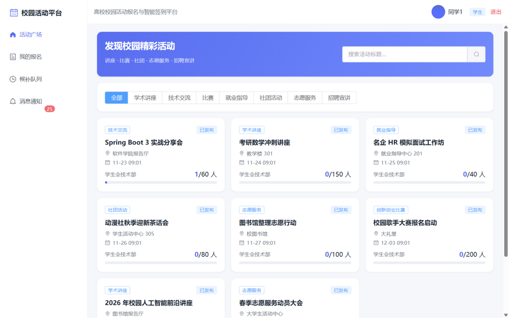
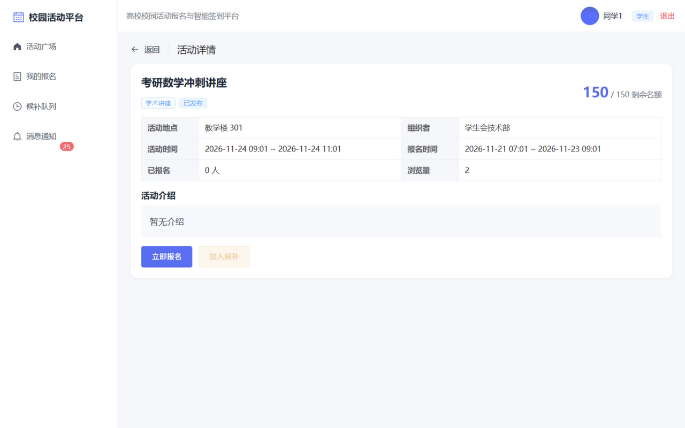
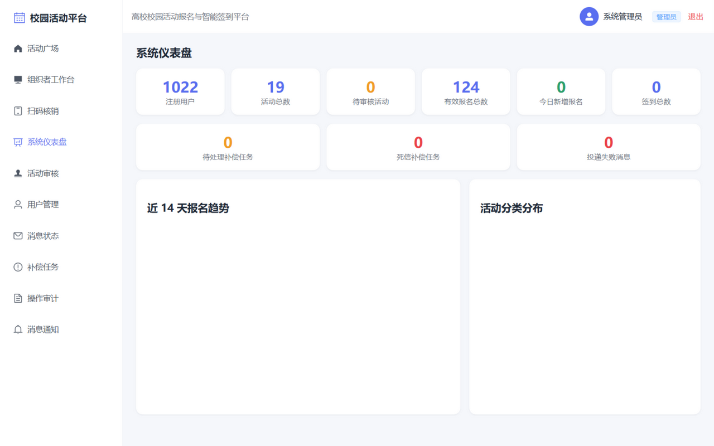
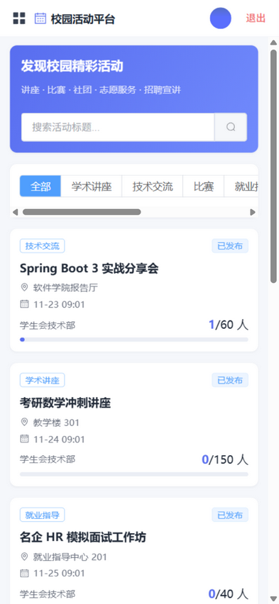
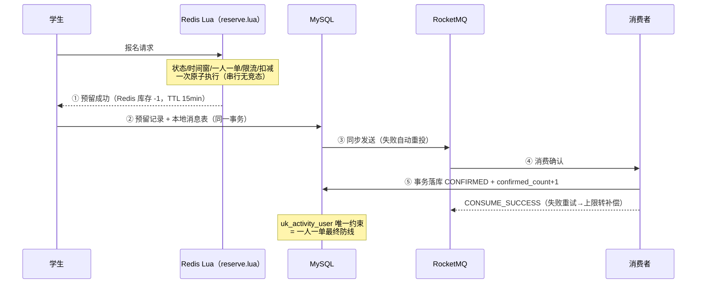

<div align="center">

# 🎓 校园活动平台

**一套能扛住真实并发的高校校园活动报名、候补与智能签到平台**

*Not just a CRUD demo — 一个把「高并发报名」「可靠消息」「分布式一致性」做进真实业务闭环的 Java 全栈实战项目*

[](https://openjdk.org/projects/jdk/17/)
[](https://spring.io/projects/spring-boot)
[](https://vuejs.org/)
[](https://www.mysql.com/)
[](https://redis.io/)
[](https://rocketmq.apache.org/)
[](https://github.com/Yangxbao/CampusFlow/actions)
[](#-测试体系)
[](LICENSE)

*Redis Lua 原子扣减 · RocketMQ 异步削峰 · 候补队列 · 二维码签到 · 多级缓存 · 分库分表 · 89 个自动化测试*

[快速开始](#-快速开始) · [核心设计](#-核心设计为什么这么写) · [压测报告](#-真实压测数据) · [学习路线](#-学习资料) · [项目结构](#-项目结构)

</div>

---

## 📸 项目预览

| 活动广场（学生端） | 活动详情与报名 |
|:---:|:---:|
|  |  |
| **管理员仪表盘（ECharts）** | **移动端适配（393px）** |
|  |  |

## ❓ 为什么又写了一个「校园活动管理系统」？

市面上绝大多数同类课程设计止步于「一张活动表 + 一张报名表」。本项目回答一个更难的问题：

> **1000 名学生同一秒抢 100 个活动名额，如何做到一单不超卖、一单不重复、消息一条不丢、系统挂了能自愈？**

```
传统方案：所有请求打到 MySQL，UPDATE ... WHERE remaining > 0
    → 行锁排队，磁盘 IO 瓶颈，超时雪崩，最终可能超卖或大量误报

本方案：Redis Lua 原子预留（P99 ≈ 5ms） → RocketMQ 异步落库（削峰）
        → MySQL 唯一约束（最终防线） → 6 个补偿任务（自愈兜底）
```

每一层都有**真实压测与集成测试证据**，而不是 PPT 架构。

## ✨ 核心设计（为什么这么写）

### 🔥 高并发报名主链路



**三层防超卖 + 三层消息幂等 + 六大补偿任务**，每个环节的取舍与避坑都有讲义和测试佐证：

| 设计点 | 方案 | 证据 |
|---|---|---|
| 防超卖 | Lua 原子校验+扣减（挡流）→ 唯一约束（防线）→ 对账修复（兜底） | 1000 用户抢 100 名额：**DB 恰好 100 条** |
| 一人一单 | Set 成员前置去重 + `uk_activity_user` | 1000 次并发重复点击 → 仅 1 条 |
| 消息不丢 | 本地消息表（事务发件箱）+ 指数退避重投 + 消费闭环 | 消息 SENT→CONFIRMED 全链路落库 |
| 重复消费安全 | Redis 认领锁 + processed 标记 + `uk_msg_group` | 真实 Broker 重复投递实测 |
| 故障自愈 | 预留超时恢复/重投/候补超时/兜底晋级/库存对账/状态流转 | 每项均有集成测试 |
| 候补晋级 | ZSet 真实顺序 + 分布式锁串行出队 + 30min 确认保留期 | 取消→自动晋级→转正 E2E |

### 🧩 更多工程化设计

- **多级缓存**：Caffeine(30s) → Redis(30min) → DB，广播 MQ 失效本地缓存，布隆过滤器防穿透
- **注解式分布式锁**：`@DistributedLock(key = SpEL)`，看门狗续期 + 锁误删防护
- **有界线程池治理**：3 个业务线程池显式七参数 + 拒绝策略选型说明（CallerRuns 保数据 / Abort 防 OOM）
- **可靠签到**：Redis SETNX 快路径 + DB 事务内 CAS + 唯一约束，10 并发核销同一凭证仅 1 次成功
- **分库分表**（可选模式）：ShardingSphere-JDBC 按 `user_id` 分片，与默认模式启动严格隔离
- **手机适配**：响应式布局 + 抽屉菜单 + 分类横滑

## 🚀 快速开始

### 前置要求

| 依赖 | 版本 | 说明 |
|---|---|---|
| JDK | **17+** | 运行与编译（已适配更高 JDK 编译场景） |
| Maven | 3.8+ | |
| MySQL | 8.0 | |
| Redis | 5.0+ | |
| RocketMQ | 4.5+ | NameServer + Broker |
| Node.js | 18+ | 前端 |

### 方式一：本地运行

```bash
# 1. 创建数据库（表结构由 Flyway 启动时自动迁移）
mysql -uroot -p -e "CREATE DATABASE campusflow DEFAULT CHARACTER SET utf8mb4 COLLATE utf8mb4_unicode_ci;"

# 2. 改配置（Redis/MQ 地址在 application-local.yml，支持环境变量覆盖）
vim backend/campusflow-server/src/main/resources/application-local.yml

# 3. 打包并启动后端（首次启动自动播种：13 个示例活动 + 1022 个测试账号）
mvn -pl backend/campusflow-server -am package -DskipTests
java -jar backend/campusflow-server/target/campusflow-server.jar --spring.profiles.active=local

# 4. 启动前端
cd frontend && npm install && npm run dev

# 5. 打开 http://localhost:5173    接口文档: http://localhost:8080/doc.html
```

### 方式二：Docker Compose（一键全家桶）

```bash
cp .env.example .env       # 按需修改密码
deploy/scripts/start.sh    # 构建镜像 + 启动 6 个服务 + 健康检查
```

### 测试账号

| 角色 | 账号 | 密码 |
|---|---|---|
| 🛡️ 管理员 | `admin` | `admin123456` |
| 📣 组织者 | `organizer1` | `org123456` |
| 🎒 学生 | `student01` ~ `student20` | `stu123456` |

## 📊 真实压测数据

> JMeter 5.6.3 非 GUI 模式执行，非伪造数字；完整报告见 [docs/performance/LOAD_TEST_REPORT.md](docs/performance/LOAD_TEST_REPORT.md)

| 场景 | 负载 | 采样 | 错误率 | 平均 | P95 | P99 | 核心结论 |
|---|---|---|---|---|---|---|---|
| **A · 千人抢百名额** | 200 并发突发 | 999 | **0%** | 2.3ms | 4ms | **5ms** | DB 恰好 100 条，Redis 库存归 0 不为负 |
| **B · 单用户重复点击** | 1000 次并发 | 1000 | **0%** | 3.6ms | 5ms | 7ms | 仅 1 条报名（1 成功/7 拦截/992 限流） |
| **F · 热点查询** | 200 并发 × 50 | 10000 | **0%** | 33.5ms | 59ms | 96ms | 多级缓存全命中，吞吐 1677/s |

```bash
# 复现
python scripts/prepare_loadtest.py
jmeter -n -t load-test/jmeter/scenario-A-grab-spots.jmx \
  -l load-test/reports/scenario-A.jtl -e -o load-test/reports/scenario-A \
  -JactivityId=<活动ID> -Jthreads=200 -Jrampup=5 -Jloops=5
```

## 🧪 测试体系

**89 个自动化测试全部通过**，集成测试使用真实 MySQL + Redis + RocketMQ（拒绝 Mock 中间件）：

| 层级 | 数量 | 覆盖 |
|---|---|---|
| 单元测试 | 8 ✅ | 雪花 ID 并发唯一性 / JSON 往返 |
| 集成测试（真实中间件） | 10 ✅ | Lua 并发不超卖 / 一人一单 / 并发取消 / 并发签到 / 消息幂等 / 补偿恢复 / 库存对账 |
| 分库分表测试 | 3 ✅ | 分片路由 / 单库直达 / 跨分片聚合 |
| JUC 实验模块 | 38 ✅ | 线程池 / CAS-ABA / AQS / ThreadLocal / ConcurrentHashMap |
| JVM 实验模块 | 30 ✅ | OOM / Metaspace / GC 日志 / G1 vs ZGC / 死锁自检 |
| 端到端 API | 25 ✅ | 三端全业务流 + 越权拦截 |

```bash
mvn -pl backend/campusflow-common,backend/concurrency-lab,backend/jvm-lab test
mvn -pl backend/campusflow-server -am test    # 集成测试（需中间件在线）
python scripts/e2e_api_test.py                # 应用启动后
```

## 📚 学习资料

这不是一个「跑起来就扔」的仓库，而是一套**与源码逐行对应**的学习系统：

- **[17 篇技术讲义](docs/learning/00_学习总路线与资料索引.md)** —— 每篇固定九节结构：业务背景 → 不用会怎样（数字推演）→ 本项目方案 → 流程图 → 源码调用链 → 并发场景 → 版本演进取舍 → 面试题（错误示范 vs 满分答法）→ 动手练习
- **[30 天学习任务](docs/learning/daily/README.md)** —— 每天学什么 / 读哪些文件 / 跑哪些命令 / 如何自检
- **[36 道面试题](docs/learning/14_项目面试题与参考回答.md)** —— 全部锚定真实类名，如「你是如何解决超卖的」按真实链路作答
- **[JUC/JVM 实验模块](backend/concurrency-lab/docs/concurrency-lab_README.md)** —— 可运行 + 讲义 + 诊断脚本三件套

## 🏗️ 项目结构

```
.
├── backend/
│   ├── campusflow-common          # 统一响应/错误码/雪花ID（零 Spring 依赖）
│   ├── campusflow-infrastructure  # Redis+Lua / Redisson / RocketMQ可靠消息 / 多级缓存 / 布隆 / 分布式锁
│   ├── campusflow-business        # 12 个领域模块（报名/候补/签到/通知/统计/审计/补偿...）
│   ├── campusflow-server          # 启动装配 / 拦截器 / Flyway / 集成测试 / 分片配置
│   ├── concurrency-lab            # JUC 实验模块（独立可运行）
│   └── jvm-lab                    # JVM 实验模块（独立可运行）
├── frontend/                      # Vue3 + TS + Pinia + Element Plus + ECharts（三端 19 页）
├── deploy/                        # docker-compose / Dockerfile / Nginx / 脚本
├── load-test/                     # JMeter .jmx + 数据 + 真实报告
├── docs/                          # 架构 / 数据库(ER+EXPLAIN) / API / 测试 / 压测 / 运维 / 17篇讲义
└── scripts/                       # 端到端测试 / 压测准备
```

## 🛣️ Roadmap

- [x] 高并发报名主链路（Lua + MQ + 唯一约束 + 补偿）
- [x] 候补队列与晋级确认
- [x] 二维码签到与并发核销防护
- [x] ShardingSphere 分库分表（可选模式）
- [x] 移动端响应式
- [ ] 事务消息 vs 本地消息表 双方案对比实验
- [ ] SkyWalking / OpenTelemetry 链路追踪
- [ ] 读写分离与报表异构

## 🤝 贡献

欢迎 Issue 与 PR！提交前请确保 `mvn test`（或对应模块测试）通过。

## 📄 License

[MIT](LICENSE) © 2026 [Yangxbao](https://github.com/Yangxbao)

<div align="center">
<sub>真实运行优先于技术名词 · 真实测试优先于完成声明 · 业务闭环优先于功能数量</sub>
</div>
