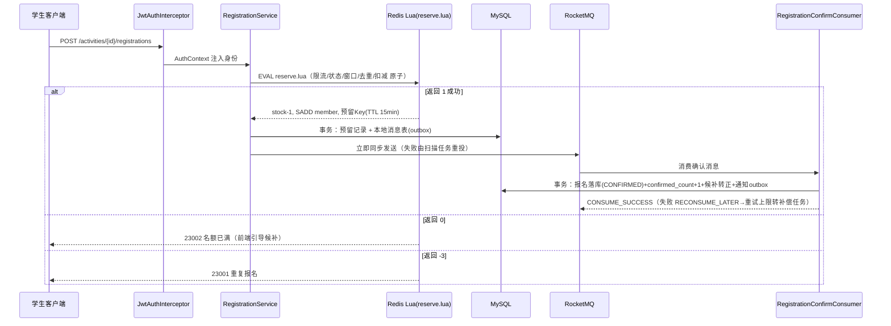

# CampusFlow 架构设计文档

## 一、架构定位：模块化单体（Modular Monolith）

按总控指令，本项目**不引入微服务**（无 Nacos/Gateway/OpenFeign），所有业务运行于单一 Spring Boot 进程，
但通过 Maven 多模块做好领域隔离，未来可平滑拆分：

```
CampusFlow (parent)
├── backend/
│   ├── campusflow-common          # 统一响应/错误码/枚举/雪花ID/JSON 工具（零 Spring 依赖）
│   ├── campusflow-infrastructure  # Redis/Lua/Redisson/RocketMQ/MyBatis-Plus/线程池/多级缓存/布隆/限流/JWT
│   ├── campusflow-business        # 用户/活动/报名/候补/签到/通知/统计/管理/审计/补偿/种子
│   ├── campusflow-server          # 启动装配/Web 配置/全局异常/Flyway/Knife4j/分片配置
│   ├── concurrency-lab            # JUC 实验模块（38 个测试通过，独立讲义）
│   └── jvm-lab                    # JVM 实验模块（30 个测试通过，独立讲义）
├── frontend/                      # Vue3 + TS + Pinia + Element Plus + ECharts
├── deploy/                        # docker-compose / Dockerfile / nginx / 脚本
├── load-test/                     # JMeter .jmx + 数据 + 报告
└── docs/                          # 架构/学习讲义/性能/数据库文档
```

依赖方向（严格单向）：`server → business → infrastructure → common`，杜绝循环依赖。

## 二、核心链路：高并发报名（项目技术核心）



**状态机**：`REDIS_RESERVED → MQ_PUBLISHED → DB_CONFIRMED`；异常路径 `→ COMPENSATING → RELEASED`（幂等释放 + 审计记账 + 通知）。

**三层防超卖**：
1. Redis Lua 原子校验+扣减（前置挡流，P99 5ms，见压测报告）；
2. MQ 异步落库（削峰，消费端事务含 `uk_activity_user` 唯一约束）；
3. 补偿兜底（`CompensationScheduler` 6 任务：预留恢复/消息重投/候补超时/候补兜底/库存对账/状态流转）。

## 三、中间件关键设计

| 主题 | 方案 | 代码位置 |
|---|---|---|
| Redis Key 规范 | `campusflow:{域}:{id}:{含义}` 集中定义 + 统一 TTL（活动结束+7天） | common/RedisKeyConstants |
| 多级缓存 | Caffeine(30s) → Redis(30min) → DB，广播 MQ 失效本地缓存 | infra/redis/MultiLevelCacheService + CacheEvictConsumer |
| 缓存穿透 | 布隆过滤器（Redisson 位图，启动重建）+ 空值占位 60s | infra/redis/BloomFilterService |
| 分布式锁 | 注解式 @DistributedLock（SpEL key + 看门狗）+ 编程式 RedissonLockService | infra/lock/ |
| 可靠消息 | 本地消息表（事务性发件箱）+ 指数退避重投 + 消费幂等三层防线 | infra/mq/MessageDeliverService / MessageConsumeLogService |
| 多环境隔离 | 消费组 group-suffix（避免 Broker 跨环境负载均衡瓜分消息） | infra/mq/MqConsumerFactory |
| 异步任务 | 三个有界线程池（notify/export/compensation），显式拒绝策略 + 优雅关闭 | infra/config/ThreadPoolConfig |

## 四、鉴权与安全

- JWT（jjwt 0.12 / HS256），`JwtAuthInterceptor` 解析 → `AuthContext`(ThreadLocal) → `afterCompletion` 强制清理（防线程复用串号）；
- 服务端角色校验是安全边界：`/api/v1/admin/**` 仅 ADMIN、`/api/v1/organizer/**` 需 ORGANIZER/ADMIN（前端隐藏菜单不是安全边界）；
- 密码 BCrypt(强度10)；签到凭证 SHA-256 摘要存储（明文仅签发时返回一次）；
- TraceId 全链路（Filter→MDC→logback→响应头）；全局异常统一脱敏（不泄漏堆栈）。

## 五、前端架构

- Vue3 + TypeScript + Vite + Pinia + Vue Router + Axios + Element Plus + ECharts + qrcode；
- 三端视图：学生端 7 页 / 组织者端 7 页 / 管理员端 6 页，角色路由守卫；
- Axios 拦截器统一解包 ApiResult、401 跳转、错误码分支（如 23002 名额已满 → 引导候补弹窗）；
- 已解决的联调要点：雪花 Long → String 序列化（JacksonConfig），避免 JS 53 位精度丢失。

## 六、可观测性与运维

- Actuator health/metrics；logback 滚动文件 + 错误独立文件（带 traceId）；
- 管理端可视化：本地消息表状态、补偿任务（含死信重入队）、操作审计、库存对账告警；
- `deploy/` 提供 docker-compose（健康检查、依赖顺序、数据卷、.env.example）与本地一键启动脚本。

## 七、与微服务的演进边界

领域边界已按限界上下文划分（用户/活动/报名/候补/签到/通知/统计），若未来拆分：
- `registration`+`waitlist`+`compensation` 是天然的"报名域服务"；
- 消息契约（MqPayloads record）即服务间事件契约；
- 当前共享 MySQL 单库，拆分时需先完成数据所有权迁移——这是刻意保留的演进步骤（见 16_项目进阶改造练习）。
