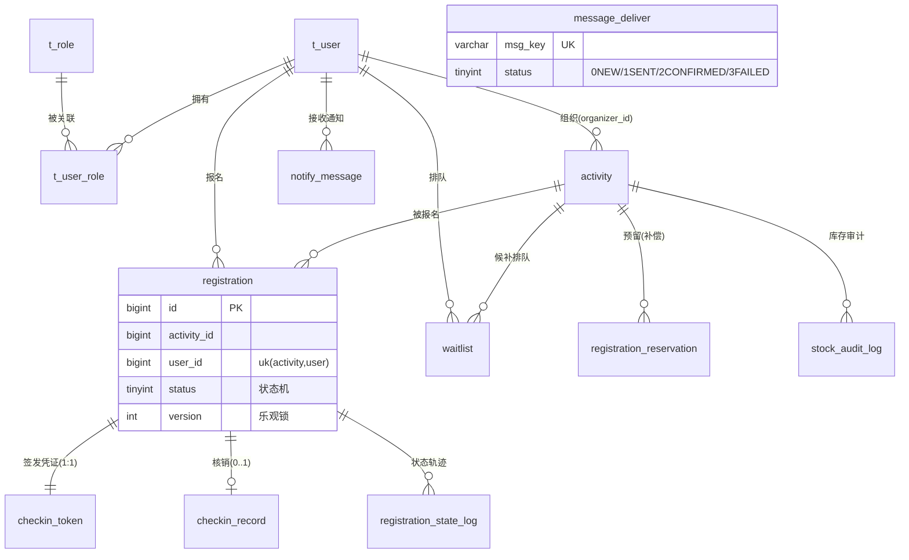

# CampusFlow 数据库设计文档

> 数据库：MySQL 8.0.34 / InnoDB / utf8mb4_unicode_ci
> 真实 DDL：`backend/campusflow-server/src/main/resources/db/migration/V1__init_schema.sql`（Flyway 版本化管理，已真实执行通过）
> 本文档为设计说明与 ER 关系图。

---

## 一、设计总则

| 决策 | 依据 |
|---|---|
| 主键 = 应用层雪花 ID（BIGINT） | 分库分表与多实例下自增 ID 会冲突；雪花 ID 趋势递增对 B+ 树友好 |
| 不使用物理外键 | 高并发写场景外键校验开销大且阻碍分片；一致性由唯一约束 + 状态机 + 对账补偿保证 |
| 乐观锁 version 字段 | registration / activity 存在并发状态竞争，`UPDATE ... WHERE version=?` 防覆盖 |
| 逻辑删除 deleted | 用户/活动需保留审计轨迹 |
| created_at / updated_at | MyBatis-Plus MetaObjectHandler 自动填充 |
| 全表 utf8mb4 | 中文昵称/内容 + emoji 兼容 |

## 二、表清单（17 张）

| 表 | 职责 | 关键索引 |
|---|---|---|
| t_user | 用户 | uk_username |
| t_role / t_user_role | 角色字典与关联 | uk_code / uk_user_role |
| activity | 校园活动 | idx_organizer, idx_status_start, idx_category_status, idx_signup_window |
| registration | 报名（一人一单最终防线） | **uk_activity_user**, idx_user_status, idx_activity_status |
| registration_state_log | 报名状态机审计轨迹 | idx_registration |
| registration_reservation | 预留记录（补偿锚点） | uk_message_key, **idx_status_expire**（补偿扫描） |
| waitlist | 候补队列 | uk_activity_user, uk_activity_queue, idx_status_deadline |
| checkin_token | 签到凭证（SHA-256 摘要） | uk_registration, uk_token_hash |
| checkin_record | 签到记录（一次核销） | **uk_registration**, idx_activity_time |
| notify_message | 站内通知 | idx_user_read（未读列表覆盖索引） |
| stock_audit_log | 库存变更审计（幂等记账） | **uk_biz_key**（防补偿重复加回） |
| sys_audit_log | 操作审计 | idx_action_time |
| message_deliver | 本地消息表（发件箱） | uk_msg_key, **idx_status_retry** |
| message_consume_log | 消费幂等记录 | **uk_msg_group** |
| compensation_task | 补偿任务 | uk_biz_key, idx_status_retry |
| export_task | 异步导出任务 | idx_user |

## 三、ER 关系图（核心业务链路）



## 四、核心状态机

### 报名状态（registration.status）
```
RESERVED(0,确认中) --消费确认--> CONFIRMED(1) --核销--> CHECKED_IN(2)
RESERVED(0) --预留超时补偿--> CONFIRM_FAILED(4)（终态，名额已释放）
CONFIRMED(1) --用户取消--> CANCELLED(3) --重新报名(回迁)--> RESERVED(0)→CONFIRMED(1)
```
> 关键设计：取消后重新报名**复用同一行**做状态回迁，避免唯一索引与业务规则冲突。

### 预留状态（registration_reservation.status）
```
PENDING_CONFIRM(0) --消费成功--> CONFIRMED(1)
PENDING_CONFIRM(0) --超时--> COMPENSATING(2) --幂等释放--> RELEASED(3)
```

## 五、关键 SQL 与 EXPLAIN 分析

### 1. 一人一单防线（唯一约束 + CAS 回迁）
```sql
-- 幂等确认：重复消费不会重复生效
UPDATE registration SET status=1, reservation_id=? WHERE id=? AND version=?
-- 绕过 Redis 的重复插入被唯一索引拦截：
INSERT INTO registration (activity_id, user_id, ...) VALUES (...)  -- DuplicateKey: uk_activity_user
EXPLAIN SELECT * FROM registration WHERE activity_id=? AND user_id=?;
-- type=const, key=uk_activity_user（唯一索引单行定位，最优路径）
```

### 2. 深分页优化
```sql
-- 低效（扫描 offset+limit 行后丢弃）：
SELECT * FROM registration ORDER BY id LIMIT 100000, 10;
-- 优化（游标/覆盖索引定位）：
SELECT r.* FROM registration r
JOIN (SELECT id FROM registration WHERE activity_id=? ORDER BY id LIMIT 100000, 10) t
  ON r.id = t.id;
-- 外层按 PK 回表 10 次，内层覆盖索引（idx_activity_status + PK）扫描不回表
```

### 3. 未读通知列表（覆盖索引）
```sql
SELECT * FROM notify_message WHERE user_id=? AND is_read=0 ORDER BY created_at DESC LIMIT 10;
-- idx_user_read(user_id,is_read,created_at) 完整覆盖过滤+排序，type=ref, Extra=Using index condition
```

### 4. 补偿扫描（状态+时间联合索引）
```sql
SELECT * FROM registration_reservation WHERE status=0 AND expire_at < NOW() LIMIT 50;
-- idx_status_expire(status, expire_at)：等值列在前、范围列在后，扫描量 = 过期行数
```

## 六、事务隔离级别说明

- 使用 MySQL 默认 **REPEATABLE READ**（MVCC 快照读）。
- 本项目高并发一致性主要依赖：唯一约束（当前读隐式锁）+ 应用层 Lua 前置削峰 + 乐观锁，未依赖 SERIALIZABLE。
- `activity.confirmed_count` 用原子自增 `UPDATE ... SET confirmed_count=confirmed_count+1`（当前读行锁，天然并发安全）。

## 七、分库分表（高级模式，默认不启用）

- 逻辑表 `registration` → 物理库 `campusflow_ds0` / `campusflow_ds1`（各含同名表）
- 分片键 `user_id`，INLINE 算法 `ds_${user_id % 2}`
- 启动隔离：`--spring.profiles.active=sharding`（真实集成测试见 `ShardingSphereShardingIT`，3 项断言全部通过：路由正确/单库直达/全路由聚合）
- 全局唯一 ID：应用层雪花，与分片键无关
- 已知取舍：活动维度统计（无 user_id 条件）会全路由广播聚合，代价翻倍——报表类查询建议走异构统计表/T+1 汇总
