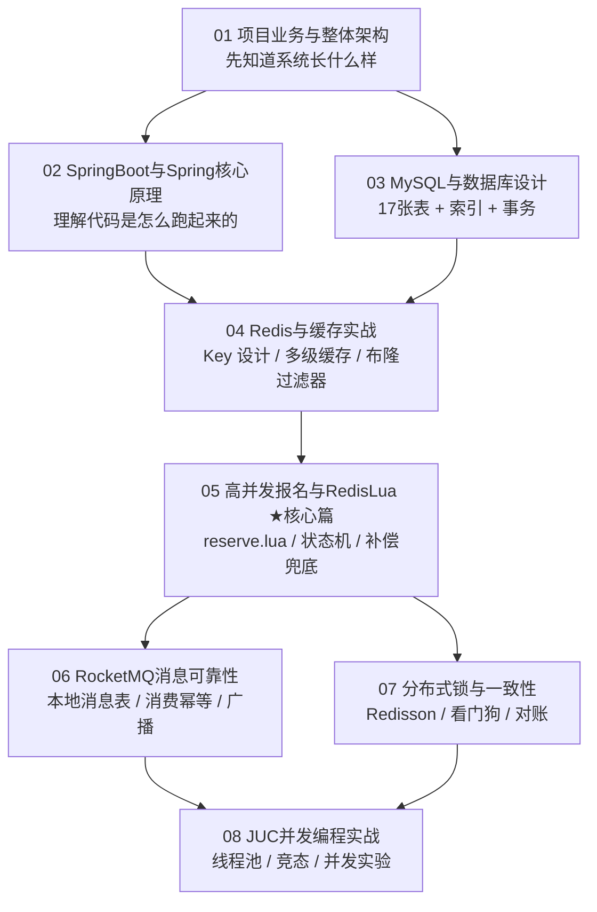
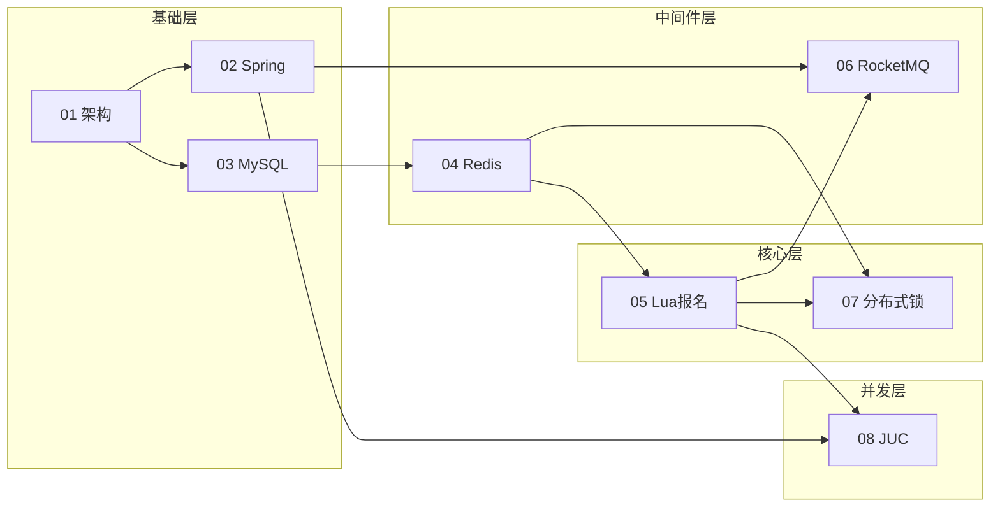

# 00 · CampusFlow 学习总路线与资料索引

> 本讲义系列基于 CampusFlow 项目真实源码编写，所有类名、方法名、Redis Key、MQ Topic 均可在
> `backend/` 目录下找到对应实现。写简历、准备校招面试时，请把每篇的"面试知识"章节当作核心复习材料，
> 把"动手练习"章节当作验证手段——面试官最容易追问的就是"你真的写过吗"这类细节。

---

## 一、项目一句话定位

**CampusFlow** 是一个校园活动管理平台：组织者发布活动（讲座、社团招新、志愿活动、招聘宣讲等），
学生在高并发场景下抢名额、排候补、扫码签到；平台通过 **Redis Lua 原子预留 + RocketMQ 异步落库 +
定时补偿兜底** 保证"5000 人抢 100 个名额不超卖、不丢单、最终一致"。

技术栈：Spring Boot 3 / Spring（IoC、AOP、事务）+ MyBatis-Plus + MySQL（Flyway 管理 17 张表）
+ Redis（Lettuce + Redisson + Lua）+ RocketMQ（本地消息表可靠投递）+ Caffeine 多级缓存 + JUC 并发工具。

## 二、为什么用"报名"场景学后端

报名是校招面试中含金量最高的场景之一，因为它把所有核心问题压缩在一个接口里：

| 场景 | 暴露的问题 | 对应技术 |
|---|---|---|
| 5000 人同时抢 100 名额 | 超卖、库存竞态 | Redis Lua 原子扣减 |
| 一人只能报一单 | 重复提交、并发插入 | 成员 Set 去重 + DB 唯一约束 |
| 名额扣了但没落库 | 分布式一致性 | MQ + 本地消息表 + 补偿 |
| 活动详情被反复查询 | 缓存穿透/击穿/雪崩 | 布隆过滤器 + 多级缓存 |
| 活动容量调整 | 多实例缓存不一致 | 广播 MQ 失效本地缓存 |
| 候补排队晋级 | 分布式锁、串行化 | Redisson 看门狗锁 |
| 同一个二维码扫两次 | 并发幂等 | SETNX + DB CAS + 唯一约束 |
| 线程池配置错误 | OOM、丢数据 | 有界线程池 + 拒绝策略 |

## 三、学习总路线图



**建议总时长：3~4 周**（每天 1.5~2 小时）。

- 第 1 周：01 → 02 → 03（打地基：架构、Spring、数据库）
- 第 2 周：04 → 05（核心：Redis 缓存体系与 Lua 报名链路，05 需要精读 2 遍）
- 第 3 周：06 → 07（一致性：消息可靠性、分布式锁）
- 第 4 周：08（并发收尾）+ 把 05 的面试题串讲一遍 + 动手跑实验

## 四、各篇导读与依赖关系

| 篇 | 标题 | 核心问题 | 前置依赖 | 精读源码 |
|---|---|---|---|---|
| 01 | 项目业务与整体架构 | 模块化单体怎么分层？报名全链路是什么？17 张表各管什么？ | 无 | `RegistrationService`、`V1__init_schema.sql` |
| 02 | SpringBoot 与 Spring 核心原理 | Bean 生命周期、自动装配、AOP、事务传播在项目里长什么样？ | 01 | `MqProducerConfig`、`WaitlistWiringConfig`、`RegistrationTxService` |
| 03 | MySQL 与数据库设计 | 为什么这样建表？唯一索引、乐观锁、雪花 ID、B+ 树索引怎么用？ | 01 | `V1__init_schema.sql`、`RegistrationDO` |
| 04 | Redis 与缓存实战 | Key 命名/TTL、五大数据结构选型、多级缓存、布隆过滤器、击穿雪崩 | 02 | `RedisKeyConstants`、`MultiLevelCacheService`、`BloomFilterService` |
| 05 | 高并发报名与 RedisLua（★核心） | Lua 原子预留怎么防超卖？状态机怎么流转？六任务补偿怎么兜底？ | 03、04 | `reserve.lua`、`StockRedisService`、`CompensationScheduler` |
| 06 | RocketMQ 消息可靠性 | 本地消息表 vs 事务消息？消费幂等三层防线？广播模式失效缓存？ | 05 | `MessageDeliverService`、`MessageConsumeLogService`、`RegistrationConfirmConsumer` |
| 07 | 分布式锁与一致性 | 注解式锁怎么实现？看门狗与误删？锁粒度怎么选？库存对账？ | 04、05 | `DistributedLockAspect`、`RedissonLockService`、`WaitlistPromoteService` |
| 08 | JUC 并发编程实战 | 三个有界线程池的七参数与拒绝策略取舍？并发取消/签到的竞态？ | 02、05 | `ThreadPoolConfig`、`backend/concurrency-lab` 十个实验 |

依赖关系说明：



## 五、两条学习路径

### 路径 A：面试冲刺版（时间紧，约 10 天）

1. 通读 01（1 天）→ 能画出报名链路时序图、背出 17 张表职责；
2. 精读 05（3 天）→ reserve.lua 逐行能讲、状态机五个阶段能推演、六个补偿任务能列举；
3. 精读 06 + 07（3 天）→ 消费幂等三层防线、看门狗机制、库存对账；
4. 04 + 02（2 天）→ 缓存三大问题 + Spring 事务失效八连问；
5. 03 + 08（1 天）→ 索引设计 + 线程池七参数。

### 路径 B：体系化学习版（时间充裕，约 4 周）

按第三节的路线图顺序完整学，每篇完成全部动手练习，并把 `backend/concurrency-lab` 的 10 个实验
（ThreadPoolLab / RaceConditionLab / VolatileLab / CasAbaLab / SynchronizedLab / ReentrantLockLab /
AqsLab / SemaphoreLab / ThreadLocalLab / ConcurrentHashMapLab）至少跑一遍、改一次参数观察差异。

## 六、核心概念速查表（写简历/面试前最后 10 分钟看这个）

### Redis Key（定义于 `campusflow-common/.../constant/RedisKeyConstants.java`）

| Key 模板 | 结构 | 用途 | TTL |
|---|---|---|---|
| `campusflow:activity:{id}:stock` | String | 剩余名额（Lua 扣减对象） | 活动结束+7 天 |
| `campusflow:activity:{id}:meta` | Hash | status/signupStart/signupEnd/capacity | 活动结束+7 天 |
| `campusflow:activity:{id}:members` | Set | 已报名用户（一人一单去重） | 活动结束+7 天 |
| `campusflow:activity:{id}:waitlist` | ZSet | 候补队列（score=入队时间） | 活动结束+7 天 |
| `campusflow:reservation:{aid}:{uid}` | String | 预留状态 REDIS_RESERVED/WAITLIST_RESERVED | 预留 TTL（15min/30min） |
| `campusflow:idempotent:msg:{msgKey}` | String | 消费幂等 processed/claim 标记 | 24h / 60s |
| `campusflow:checkin:once:{tokenHash}` | String SETNX | 签到一次性令牌 | 5min |
| `campusflow:activity:{id}:info` | String(JSON) | 活动详情多级缓存 L2 | 30min |
| `campusflow:ratelimit:signup:{aid}:{uid}` | String INCR | 用户级固定窗口限流 | 窗口 10s |
| `campusflow:bloom:activity` | 位图 | 活动 ID 布隆过滤器（fpp=0.01） | 不过期+重启重建 |

### MQ Topic（定义于 `campusflow-common/.../constant/MqConstants.java`）

| Topic | Tag | 消费组 | 模式 | 职责 |
|---|---|---|---|---|
| `campusflow-registration-confirm-topic` | CONFIRM | campusflow-registration-group | 集群 | 预留→落库确认 |
| `campusflow-cancel-release-topic` | RELEASE | campusflow-cancel-group | 集群 | 取消后候补晋级兜底 |
| `campusflow-waitlist-promote-topic` | PROMOTE | campusflow-waitlist-group | 集群 | 候补晋级通知 |
| `campusflow-notify-topic` | NOTIFY | campusflow-notify-group | 集群 | 站内通知异步落库 |
| `campusflow-checkin-topic` | CHECKIN | campusflow-checkin-group | 集群 | 签到完成异步统计 |
| `campusflow-cache-evict-topic` | EVICT | campusflow-cache-evict-group | **广播** | 多实例 Caffeine 失效 |

### 报名状态机（两个层面）

- **报名记录 `RegistrationStatus`**：RESERVED(0) → CONFIRMED(1) → CHECKED_IN(2)；CANCELLED(3) 可重新报名复用同一行；CONFIRM_FAILED(4) 为补偿终态。
- **预留记录 `ReservationStatus`**：PENDING_CONFIRM(0) → CONFIRMED(1)；超时/重试耗尽 → COMPENSATING(2) → RELEASED(3)。
- 概念链路（`RegistrationService` 类注释原文）：`REDIS_RESERVED -> MQ_PUBLISHED -> DB_CONFIRMED；异常 -> COMPENSATING -> RELEASED`。

### 六个定时补偿任务（`CompensationScheduler`）

| 任务 | 周期 | 职责 |
|---|---|---|
| `reservationRecovery` | 20s | 过期未确认预留：重发消息或幂等释放 |
| `messageRetry` | 15s | 本地消息表 NEW/FAILED 重投（指数退避） |
| `waitlistTimeout` | 30s | 候补晋级超时 → 释放 + 晋级下一位 |
| `waitlistBackfill` | 60s | 库存>0 且队列非空的巡检兜底晋级 |
| `stockReconcile` | 5min | Redis 与 DB 库存对账，漂移≥3 修复+审计 |
| `activityStatusSync` | 60s | 活动状态自动流转 PUBLISHED→ONGOING→FINISHED |

## 七、源码阅读顺序建议（从 Controller 到 Redis/MQ）

第一次跟读主链路，按这个顺序打开文件（IDE 里顺着调用链跳）：

1. `campusflow-server/.../config/JwtAuthInterceptor.java` — 请求进来先过鉴权（ThreadLocal）
2. `campusflow-business/.../registration/controller/RegistrationController.java` — `signup()` 入口
3. `campusflow-business/.../registration/service/RegistrationService.java` — `signup()` 编排：调 Redis、处理 META_MISSING 自愈、调落库
4. `campusflow-infrastructure/.../redis/StockRedisService.java` — `reserve()` 执行 Lua
5. `campusflow-infrastructure/src/main/resources/lua/reserve.lua` — **逐行精读**
6. `campusflow-business/.../registration/service/RegistrationTxService.java` — `persistReservation()` 事务：预留表 + 本地消息表
7. `campusflow-infrastructure/.../mq/MessageDeliverService.java` — `trySendDeliver()` 同步发送
8. `campusflow-business/.../registration/listener/RegistrationConfirmConsumer.java` — 消费端幂等 + 确认
9. `campusflow-business/.../compensation/scheduler/CompensationScheduler.java` — 兜底六任务
10. `campusflow-server/src/main/resources/db/migration/V1__init_schema.sql` — 17 张表对照

## 八、全系列文档索引

| # | 文档 | 状态 |
|---|---|---|
| 00 | [学习总路线与资料索引](00_学习总路线与资料索引.md)（本篇） | ✅ |
| 01 | [项目业务与整体架构](01_项目业务与整体架构.md) | ✅ |
| 02 | [SpringBoot 与 Spring 核心原理](02_SpringBoot与Spring核心原理.md) | ✅ |
| 03 | [MySQL 与数据库设计](03_MySQL与数据库设计.md) | ✅ |
| 04 | [Redis 与缓存实战](04_Redis与缓存实战.md) | ✅ |
| 05 | [高并发报名与 Redis Lua（核心篇）](05_高并发报名与RedisLua.md) | ✅ |
| 06 | [RocketMQ 消息可靠性](06_RocketMQ消息可靠性.md) | ✅ |
| 07 | [分布式锁与一致性](07_分布式锁与一致性.md) | ✅ |
| 08 | [JUC 并发编程实战](08_JUC并发编程实战.md) | ✅ |

> 09-16 为另一主题系列（JVM/性能调优等），不在本系列范围内。

配套资料（项目内真实路径）：

- 数据库设计：`backend/campusflow-server/src/main/resources/db/migration/V1__init_schema.sql`、`V2__seed_base_data.sql`
- 压测：`load-test/` 目录
- 并发实验：`backend/concurrency-lab/`（源码 10 个 Lab + `docs/01_threadpool.md` ~ `docs/10_counter.md`）
- JVM 实验：`backend/jvm-lab/`
- 接口文档：应用启动后访问 `http://localhost:8080/doc.html`（Knife4j）

## 九、动手练习（总路线验收）

1. **观察**：不打开 IDE，口头回答"从 POST /api/v1/activities/{id}/registrations 到数据库出现一行已确认记录，中间经过哪些类和方法？"（答案在 05 篇第⑤节）
2. **改参数**：把 `application.yml` 中 `campusflow.signup.rate-limit-max` 从 8 改成 2，重启后连续点击报名按钮 3 次，观察第三次返回 `RATE_LIMITED(23003)`。
3. **模拟异常**：停掉 RocketMQ，完成一次报名，观察 `message_deliver` 表出现 `status=3(FAILED)` 的记录；重启 MQ 后 15s 内观察 `messageRetry` 任务把它重投并置为 `status=2(CONFIRMED)`。
4. **验证方法**：跑 `backend/campusflow-server/src/test/java/com/campusflow/server/it/LuaOversellIT.java` 集成测试，确认 5000 并发下名额不为负、确认数恰好等于库存。

## 十、简历项目描述写法建议

写简历时按"一句定位 + 三个亮点 + 可量化数字"组织，全部素材取自本系列：

**项目一句话**：
> CampusFlow 校园活动管理平台（Spring Boot 3 + MySQL + Redis + RocketMQ，模块化单体六模块），
> 核心解决高并发报名场景下"5000 人抢 100 名额"的不超卖、不丢单、最终一致问题。

**三个亮点与对应数字/证据**：

| 亮点 | 简历句式参考 | 支撑文档 |
|---|---|---|
| Redis Lua 原子预留 | "用 Lua 脚本把校验+扣减+去重+限流合并为一次原子执行，替代 GET+DECR 两命令方案（并发窗口会超卖至 -999），Redis 层扛 5000 QPS，MySQL 只承接确定性流量（QPS 从 5000 削至 ~200），P99 < 50ms" | 05 |
| 消息可靠性 | "本地消息表（事务性发件箱）+ 同步发送确认 + 指数退避重投 + 消费幂等三层防线（Redis 认领锁/processed 标记/DB 唯一约束），六定时补偿任务兜底最终一致" | 06 |
| 缓存体系 | "布隆过滤器（fpp=1%，~120KB 位图）+ Caffeine(30s)+Redis(30min) 多级缓存 + 广播 MQ 失效本地缓存，2000 QPS 详情查询 DB 零压力" | 04 |

**避坑**：不要写"使用了 Redis、RocketMQ"这种名词堆砌——面试官下一句必然是"怎么用的、为什么这么用、
数据是什么"。每个技术名词都必须能落到 ②③④⑥ 的推演数字上。

## 十一、术语速查表

| 术语 | 一句话解释 | 详见 |
|---|---|---|
| 发件箱模式（Outbox） | 业务事务内写"待发消息表"，提交后异步投递，保证业务与消息原子绑定 | 06 |
| 本地消息表 | 发件箱模式的落地实现，本项目即 `message_deliver` 表 | 06 |
| 消费幂等 | 同一消息被投递多次时业务效果只生效一次（认领锁+processed+唯一约束） | 06 |
| 看门狗（Watchdog） | Redisson 不指定 leaseTime 时，每 10s 自动续期锁到 30s，防业务未完锁先过期 | 07 |
| Cache Aside | 读：缓存→DB 回填；写：更新 DB 后删缓存（Del 非 Update） | 04 |
| 缓存穿透/击穿/雪崩 | 查不存在的数据 / 热 Key 过期瞬间并发回源 / 大量 Key 同时过期 | 04 |
| 布隆过滤器 | 多哈希置位的概率结构，"可能误判存在、绝不漏判"，挡住不存在的 Key | 04 |
| META_MISSING 自愈 | Lua 发现元数据缺失返回 -5，上层锁内按 DB 口径懒预热后重试一次 | 05 |
| 预留（Reservation） | Redis 扣减成功到 DB 确认之间的中间态（TTL 15min），超时由补偿释放 | 05 |
| 库存对账 | 每 5min 用 DB 口径（capacity-有效报名数）校准 Redis stock，漂移≥3 修复 | 07 |
| 乐观锁 version | UPDATE ... WHERE version=? 实现 CAS，并发取消只有一个成功 | 03 |
| 一人一单三层防线 | Redis SISMEMBER → 应用层查库 → DB uk_activity_user 唯一约束 | 03/05 |
| 逻辑删除 | deleted 标记替代物理删除，保留审计轨迹 | 03 |
| 雪花 ID | 1+41 时间戳+10 机器号+12 序列的分布式 ID，趋势递增 | 03 |
| 深分页 | OFFSET 大时扫描丢弃前 N 行，用游标分页（WHERE id>lastId）替代 | 03 |
| MVCC | 多版本并发控制：Undo Log 版本链 + ReadView 实现 RR 快照读 | 03 |
| 广播消费 | BROADCASTING：每个实例都收到消息（缓存失效用），失败不重投 | 06 |
| CallerRuns 反压 | 队列满时提交线程自己执行，天然限流不丢任务 | 08 |
| 先入队后扩容 | 有界队列线程池：core 满 → 入队 → 队列满 → 扩容到 max → 拒绝 | 08 |
| ThreadLocal 串号 | 线程池复用 worker，不清理导致下一请求读到上一用户身份 | 02 |

## 十二、每篇学习自检清单（能全答对才算过）

**01 架构**
- [ ] 六个 Maven 模块的依赖方向？哪两个跨域调用被 WaitlistWiringConfig 打破？
- [ ] 说出报名状态机五个阶段及各自的数据落点
- [ ] 17 张表按域分组背诵

**02 Spring**
- [ ] @Bean(initMethod="start") 管理的是哪些 Bean？为什么 start 失败要让应用挂掉？
- [ ] RegistrationTxService 为什么独立成类（不放在 RegistrationService 里）？
- [ ] 列举 4 个事务失效场景并说出项目里的对应防御
- [ ] afterCompletion 清理的是哪个 ThreadLocal？不清理的后果？

**03 MySQL**
- [ ] uk_activity_user 服务哪条防线？取消后再报名为什么不冲突？
- [ ] registration_reservation 的 idx_status_expire 服务哪个任务的哪条 SQL？
- [ ] 雪花 ID 四段结构与时钟回拨处理？
- [ ] RR 下"查重+插入"为什么还可能重复？项目怎么兜？

**04 Redis**
- [ ] 说出 10 个以上 Redis Key 及其结构与 TTL
- [ ] 多级缓存读路径与写失效路径？广播失败靠什么兜底？
- [ ] 布隆过滤器三特点（误判/不漏判/重启重建）？
- [ ] 为什么本项目不做延迟双删？

**05 Lua（核心）**
- [ ] reserve.lua 六步的顺序能默写吗？每步返回码是什么？
- [ ] GET+DECR 超卖的时间线推演（1000 并发 stock=1）？
- [ ] -5（META_MISSING）的上层处理流程？
- [ ] 六个补偿任务名、周期、职责？
- [ ] cancel_release.lua 的幂等点在哪一行？

**06 RocketMQ**
- [ ] 本地消息表 vs 事务消息的选型理由（三条）？
- [ ] 消费确认返回什么？和 RabbitMQ basicAck 的区别？
- [ ] 幂等三层防线各防什么场景？
- [ ] group-suffix 教训的故事线？
- [ ] 重试耗尽后消息去哪了（compensation_task）？

**07 分布式锁**
- [ ] @DistributedLock 四个属性各自的语义？
- [ ] 锁误删的两侧防护（解锁 Lua 值校验 + 看门狗）？
- [ ] 为什么扣减不加锁而晋级要加锁？
- [ ] tryRun 的 waitTime 为什么是 0？
- [ ] 对账阈值 3 的含义？

**08 JUC**
- [ ] 三个线程池的完整七参数？
- [ ] CallerRuns 与 Abort 各用在哪个池、为什么？
- [ ] "先入队后扩容"流程图能画吗？
- [ ] 并发取消/并发签到各几层防线？
- [ ] RaceConditionLab 的三种计数方案对比结论？

## 十三、常见学习误区

1. **只看文档不动手**：面试官问"reserve.lua 第三步为什么 INCR 后判断 cnt==1 才 EXPIRE"，
   没读过源码的人答不出"INCR+EXPIRE 分离在中间宕机会产生永不过期的死键"。
2. **背答案不背推演**：说"Lua 防超卖"不如说"GET 和 DECR 之间有并发窗口，1000 线程同时 GET 到 1
   各自 DECR 得 -999"——推演数字才是护城河。
3. **忽视失败路径**：成功链路人人会讲，区分度在补偿六任务、幂等三层、广播无重投这些异常设计上。
4. **把"用了什么"当"解决了什么"**：永远是先讲问题（5000 抢 100 会超卖）再讲方案（Lua 原子化）。
5. **跳过动手练习**：每篇⑨节的"模拟异常"系列，做完后你在面试里说的每个故障场景都是亲测的。

## 十四、篇目 × 源码模块映射矩阵（复习时按图索骥）

| 篇 | common | infrastructure | business | server |
|---|---|---|---|---|
| 01 架构 | 常量/枚举 | — | 九大业务域 | 启动类/迁移脚本 |
| 02 Spring | — | config/* lock/* mq/MqProducerConfig | audit/AuditLogAspect config/WaitlistWiringConfig | config/* |
| 03 MySQL | util/SnowflakeIdWorker | config/MybatisPlusConfig | 各域 entity/mapper | db/migration |
| 04 Redis | constant/RedisKeyConstants | redis/* config/RedissonConfig mq/CacheEvictConsumer | activity/ActivityService | application*.yml |
| 05 Lua | enums | resources/lua/* redis/StockRedisService | registration/* compensation/* | — |
| 06 MQ | constant/MqConstants util/JsonUtils | mq/*（发件箱/幂等/工厂） | 各 listener mq/MqPayloads | application-test.yml |
| 07 锁 | constant/RedisKeyConstants | lock/* config/RedissonConfig | waitlist/WaitlistPromoteService activity/ActivityService compensation/* | — |
| 08 JUC | — | config/ThreadPoolConfig | audit/SysAuditService stats/ExportService | test/it/* |
| 并发实验 | — | — | — | backend/concurrency-lab（独立模块） |

## 十五、面试 20 问速问速答（每问 30 秒版本）

1. **为什么不超卖？** Lua 把校验与扣减封成一个原子单元，GET 与 DECR 之间不会插入其他客户端命令。
2. **Redis 挂了报名怎么办？** 快速失败（REDIS_ERROR 30002），可先懒预热自愈重试一次；宁可拒绝不产生脏数据。
3. **消息丢了怎么办？** 本地消息表在业务事务里，NEW/FAILED 由 15s 扫描任务指数退避重投。
4. **消息重复怎么办？** 认领锁（60s）+ processed 标记（24h）+ DB uk_msg_group 三层。
5. **消费确认怎么做的？** 监听器返回 CONSUME_SUCCESS / RECONSUME_LATER，重试 5 次转补偿任务。
6. **怎么保证一人一单？** Redis SISMEMBER → 应用查库 → DB 唯一索引，三层防线。
7. **取消怎么防双释放？** 乐观锁定胜负，只有赢家走释放，Lua SREM 返回值再幂等一层。
8. **缓存一致性？** 更 DB → 删两级缓存 → 广播 MQ 让各实例失效本地缓存 → 本地 TTL 30s 兜底。
9. **穿透怎么办？** 布隆过滤器（1% 误判不漏判）+ 空值占位 60s。
10. **击穿怎么办？** 发布即预热 + META_MISSING 懒预热自愈（均在分布式锁内）。
11. **雪崩怎么办？** TTL 与活动生命周期对齐天然错峰 + 多级缓存缓冲回源洪峰。
12. **分布式锁哪里用了？** 低频复合写、候补晋级串行化、6 个定时任务防重入；扣减不用锁。
13. **锁过期业务没完怎么办？** Redisson 看门狗每 10s 续期到 30s；解锁前 isHeldByCurrentThread 校验。
14. **数据一致性什么级别？** 分层收敛：秒级 Lua 原子 / 分钟级状态机补偿 / 5 分钟级对账修复。
15. **MySQL 压力如何？** 只见确定性流量（~200 QPS），连接池 20 绰绰有余。
16. **为什么单体不分微服务？** 规模不需要；模块边界已单向化，可随时拆分。
17. **线程池怎么配的？** 三个有界池：notify(CallerRuns 保数据)/export(Abort 防 OOM)/compensation(CallerRuns)。
18. **ThreadLocal 坑？** Tomcat 线程复用串号，afterCompletion 强制 clear；MDC 在 Filter finally 清理。
19. **雪花 ID 为什么不用自增？** 分库分表不冲突、insert 前可预取、趋势递增；Long 前端转 String。
20. **如果流量 ×10？** 库存分桶、本地预扣、读写分离、消费扩容与分区——方向明确但先压测再动。

## 十六、学习进度打卡表

| 日期 | 篇目 | 自检清单通过 | 动手练习完成 | 备注 |
|---|---|---|---|---|
|  | 00 | ☐ | ☐ | 建立总览 |
|  | 01 | ☐ | ☐ | 画报名时序图 |
|  | 02 | ☐ | ☐ | 事务失效实验 |
|  | 03 | ☐ | ☐ | EXPLAIN 实测 |
|  | 04 | ☐ | ☐ | 布隆/TTL 观察 |
|  | 05 | ☐ | ☐ | **Lua 逐行 + 超卖复现** |
|  | 06 | ☐ | ☐ | 停 MQ 重投实验 |
|  | 07 | ☐ | ☐ | 看门狗 TTL 观察 |
|  | 08 | ☐ | ☐ | 跑 2 个 Lab + 并发 IT |

## 十七、本系列通用命令速查（练习时随手翻）

**源码检索（Git Bash）**

```bash
# 找某个类的位置
find backend -name "RegistrationTxService.java" -not -path "*/target/*"
# 全局搜常量/方法引用（跳过 target 与测试产物）
grep -rn "TOPIC_REGISTRATION_CONFIRM" backend --include="*.java" | grep -v target
# 数一数项目里有多少个消费者 Bean
grep -rn "initMethod = \"start\"" backend --include="*.java" | grep -v target | wc -l
# 看某个 Lua 脚本被谁调用
grep -rn "reserve.lua" backend --include="*.java" | grep -v target
```

**Redis 观察窗口（redis-cli，按 04 篇 Key 表逐个对照）**

```bash
TTL campusflow:activity:1:stock                 # 验证"结束+7天"策略
GET  campusflow:activity:1:stock                # 剩余名额
HGETALL campusflow:activity:1:meta              # Lua 校验数据源
SMEMBERS campusflow:activity:1:members          # 已报名成员（一人一单前置防线）
SISMEMBER campusflow:activity:1:members 2001    # 某用户是否已占名额
ZRANGE campusflow:activity:1:waitlist 0 -1 WITHSCORES   # 候补队列顺序
TYPE campusflow:bloom:activity                  # 布隆过滤器（string 位图存储）
MEMORY USAGE campusflow:activity:1:info         # 大 Key 检查
--scan --pattern 'campusflow:*'                 # Key 治理巡检
```

**MySQL 排查（配合 03 篇）**

```sql
-- 补偿扫描的执行计划（应走 idx_status_expire）
EXPLAIN SELECT * FROM registration_reservation
 WHERE status=0 AND expire_at < NOW() ORDER BY expire_at LIMIT 50;
-- 消息投递闭环状态分布
SELECT status, COUNT(*) FROM message_deliver GROUP BY status;
-- 库存三方对账：DB 口径 vs Redis 口径（人工执行 stockReconcile 同款查询）
SELECT a.id, a.capacity - COUNT(r.id) AS expected_remaining, a.confirmed_count
  FROM activity a LEFT JOIN registration r
    ON r.activity_id=a.id AND r.status IN (1,2)
 WHERE a.status IN (3,4) GROUP BY a.id;
```

**RocketMQ（mqadmin）**

```bash
# 查看消费组位点与积压
sh bin/mqadmin consumerProgress -g campusflow-registration-group
# 查看某 Topic 的路由与队列数
sh bin/mqadmin topicRoute -t campusflow-registration-confirm-topic
```

**测试与实验**

```bash
mvn -pl backend/campusflow-server test -Dtest=LuaOversellIT          # 不超卖证明
mvn -pl backend/campusflow-server test -Dtest=CancelConcurrencyIT    # 并发取消幂等
java -cp backend/concurrency-lab/target/classes com.campusflow.lab.concurrent.counter.RaceConditionLab
```

---

*本系列所有内容基于 CampusFlow 源码实际实现编写，如与源码不一致，以源码为准。*

---

## 附录：09-16 讲义与 30 天任务索引

### 进阶讲义（09-16）

| 篇 | 主题 | 对应模块/证据 |
|---|---|---|
| [09_JVM与性能排查.md](09_JVM与性能排查.md) | 内存结构/GC日志/G1 vs ZGC/OOM/诊断 | backend/jvm-lab（30 测试通过） |
| [10_分库分表与ShardingSphere.md](10_分库分表与ShardingSphere.md) | user_id 分片/INLINE 算法/路由验证 | ShardingSphereShardingIT（3 测试通过） |
| [11_接口设计与企业工程规范.md](11_接口设计与企业工程规范.md) | 统一响应/TraceId/Long→String | server/config + JacksonConfig |
| [12_Docker部署与Linux实战.md](12_Docker部署与Linux实战.md) | compose/Nginx/Linux 命令 | deploy/ 完整交付物 |
| [13_JMeter性能测试与优化.md](13_JMeter性能测试与优化.md) | 场景设计/真实数据/断言技巧 | docs/performance/LOAD_TEST_REPORT.md |
| [14_项目面试题与参考回答.md](14_项目面试题与参考回答.md) | 36 题（错误示范 vs 满分答法） | 全部锚定真实类名 |
| [15_项目源码阅读路线.md](15_项目源码阅读路线.md) | 7 天路线 + 文件→考点反查表 | 与 daily 任务映射 |
| [16_项目进阶改造练习.md](16_项目进阶改造练习.md) | 12 个进阶练习 | 目标/步骤/验收标准 |

### 30 天学习任务（docs/learning/daily/）

- [README 索引](daily/README.md) → [day01](daily/day01.md) ~ [day30](daily/day30.md)
- 路线：day01-03 环境与架构总览 → day04-07 Spring 核心与工程规范 → day08-11 MySQL 与缓存 → day12-16 高并发报名主链路 → day17-19 候补与签到 → day20-22 分布式锁与一致性 → day23-24 JUC → day25-26 JVM → day27 分库分表 → day28 压测 → day29 部署复盘 → day30 面试串讲
- 每天包含：学习内容 / 真实文件路径 / 八股 / 命令 / 实验 / 面试题（带要点）/ 自检标准
