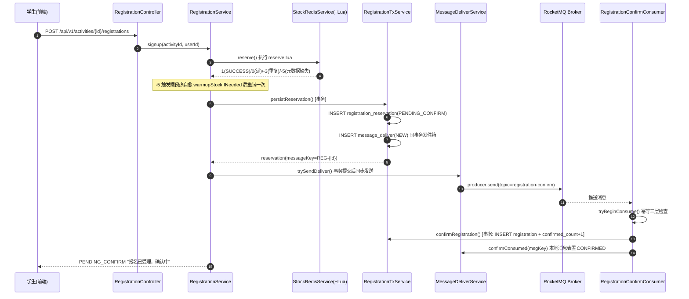
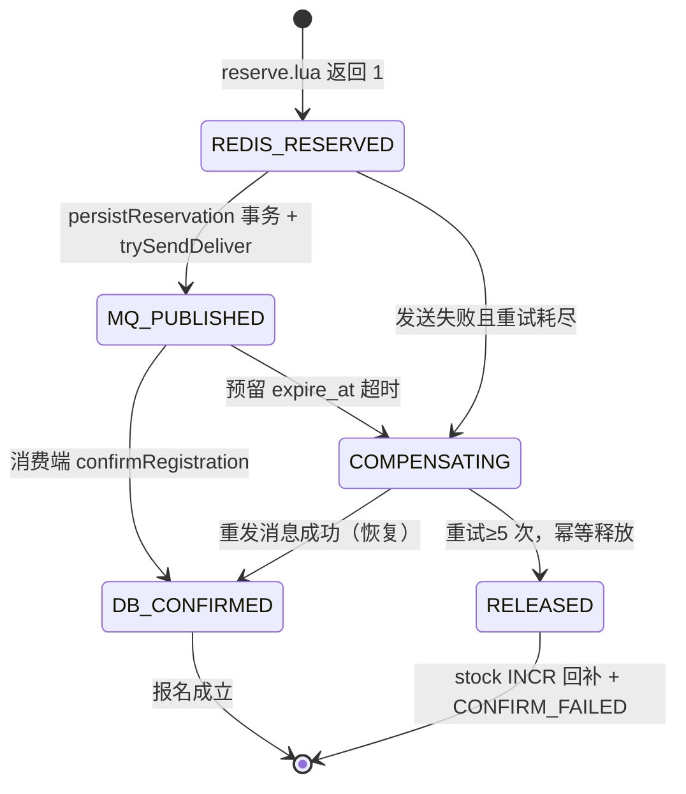
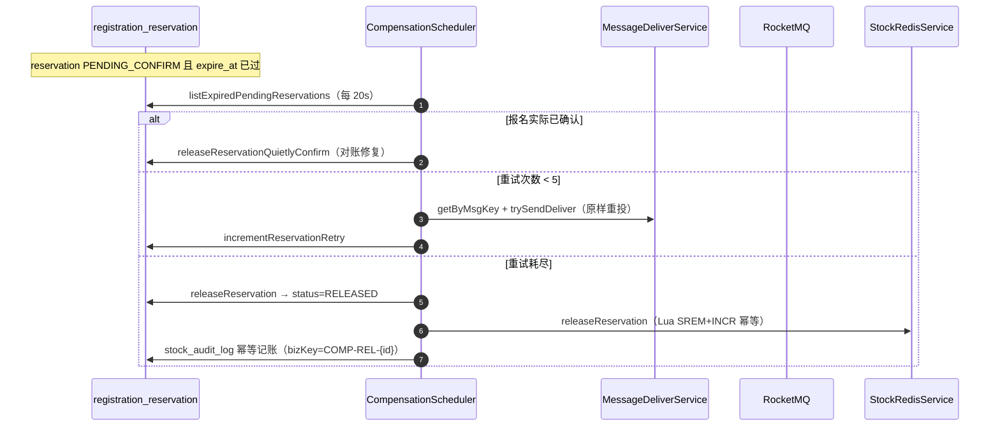

# 01 · CampusFlow 项目业务与整体架构

> 本篇目标：搞清楚 CampusFlow 是什么、分几个模块、每个模块干什么、报名全链路怎么走、
> 17 张表各管什么。学完本篇你应该能画出报名链路时序图，并回答"为什么这样分层"。

---

## ① 业务背景：校园活动的真实痛点

一所 2 万人规模的大学，每到 9 月就会有这些场景：

- **抢名额**：图书馆学术报告厅 100 个座位的院士讲座，5000 名学生在报名开启瞬间涌入；
- **排候补**：抢不到的同学希望"一旦有人取消，我自动顶上"；
- **扫码签到**：活动当天组织者扫学生二维码核销，防止代签、重复签到；
- **审核治理**：学校要求所有活动先审核再发布，防止违规内容；
- **数据导出**：组织者活动结束后导出报名名单 CSV 做考勤存档。

这些需求背后的技术挑战按严重程度排序：**高并发不超卖 > 分布式一致性 > 缓存性能 > 并发幂等**。
CampusFlow 就是围绕这四层挑战设计的单体项目——麻雀虽小，五脏俱全。

## ② 不做任何高并发设计会发生什么（数字推演）

假设活动容量 100，报名开启瞬间 5000 个请求打到最朴素的"查库存 → 判断 → INSERT"接口：

| 环节 | 朴素实现 | 后果推演 |
|---|---|---|
| 库存判断 | `SELECT capacity - count(*) FROM activity`，每次 30ms | 5000 QPS 打到 MySQL，连接池（Hikari 默认 10~20）瞬间耗尽，排队超时 |
| 超卖 | 100 个请求同时查到"剩 1 个名额"，全部通过校验并 INSERT | **超卖 99 单**，现场只有 100 个座位，事故上热搜 |
| 重复报名 | 用户双击按钮发两个请求，都通过"未报名"检查 | 一人两单，挤掉别人名额 |
| 慢查询 | `count(*)` 全表扫描 | 数据量 10 万后单次查询 200ms+，DB CPU 100% |
| 数据一致性 | 服务在 INSERT 后发通知，发通知超时拖垮接口 | P99 从 100ms 恶化到 3s，前端大量超时重试，雪上加霜 |

**结论**：报名场景的本质是"用 Redis 的内存原子操作把 MySQL 挡在后面，用 MQ 把非核心链路异步化"。
这也是本项目的核心设计思想。

## ③ 本项目方案：模块化单体 + 六模块分层

CampusFlow 采用 **模块化单体（Modular Monolith）**：一个可部署单元（`campusflow-server` 打成的 fat-jar），
内部按 Maven 多模块强制隔离职责。相比微服务，它省去了分布式调用开销与服务治理复杂度，
却保留了清晰的边界——将来如需拆分，按模块切出去即可。

### 六个 Maven 模块与依赖方向

```
campusflow-common          通用层：ApiResult/ErrorCode/常量/枚举/雪花ID
        ▲
campusflow-infrastructure  基础设施层：Redis(Lua/多级缓存/布隆) / MQ(发件箱/幂等) / 锁 / JWT / 线程池
        ▲
campusflow-business        业务层：activity / registration / waitlist / checkin / notify / stats / admin / audit / compensation
        ▲
campusflow-server          启动器 + Web 配置（拦截器/过滤器/全局异常）+ Flyway 迁移脚本
```

依赖规则：**只允许上层依赖下层，业务模块之间通过 Service 单向调用**。
唯二的跨域调用（`WaitlistService → RegistrationService`、取消后触发候补晋级）用函数注入打破环，
见 `campusflow-business/src/main/java/com/campusflow/biz/config/WaitlistWiringConfig.java`：

```java
// WaitlistWiringConfig.java（真实源码）
@Configuration
@RequiredArgsConstructor
public class WaitlistWiringConfig {

    private final RegistrationService registrationService;
    private final WaitlistPromoteService waitlistPromoteService;

    @PostConstruct
    public void wire() {
        // 用 LongConsumer 函数注入而非直接 @Autowired，
        // 打破 RegistrationService -> WaitlistPromoteService 与 WaitlistService -> RegistrationService 的循环依赖
        registrationService.setWaitlistPromoteRunner(waitlistPromoteService::tryPromoteNext);
    }
}
```

对应地，`RegistrationService` 中的接收端：

```java
// RegistrationService.java（真实源码片段）
/** 候补晋级入口以函数注入，避免 RegistrationService -> WaitlistService 循环依赖 */
@org.springframework.beans.factory.annotation.Autowired(required = false)
private java.util.function.LongConsumer waitlistPromoteRunner;
```

### 六模块职责清单

| 模块 | 职责 | 关键类 |
|---|---|---|
| campusflow-common | 统一响应 `ApiResult`、错误码 `ErrorCode`、Redis Key/MQ 常量、枚举状态机、`SnowflakeIdWorker` | `RedisKeyConstants`、`MqConstants` |
| campusflow-infrastructure | 技术组件，不含业务：Lua 脚本、多级缓存、布隆过滤器、分布式锁、发件箱、消费幂等、JWT、三个线程池 | `StockRedisService`、`MessageDeliverService`、`DistributedLockAspect` |
| campusflow-business | 九大业务域服务与消费者 | `RegistrationService`、`WaitlistPromoteService`、`CheckinService` |
| campusflow-server | 启动 + Web 层 + 配置 + 数据库迁移 | `JwtAuthInterceptor`、`GlobalExceptionHandler` |

### 3.1 17 张表清单及职责速查（面试背诵版）

建表脚本：`backend/campusflow-server/src/main/resources/db/migration/V1__init_schema.sql`（Flyway 管理）。

| # | 表名 | 一句话职责 | 关键约束/索引 |
|---|---|---|---|
| 1 | t_user | 用户（BCrypt 密码、逻辑删除） | uk_username |
| 2 | t_role | 角色（STUDENT/ORGANIZER/ADMIN） | uk_code |
| 3 | t_user_role | 用户-角色授权 | uk_user_role + idx_role_id |
| 4 | activity | 活动主表：容量/状态机/DB 库存口径 | version 乐观锁 + 4 组合索引 |
| 5 | registration | 报名主表（一人一单，状态回迁复用行） | uk_activity_user |
| 6 | registration_state_log | 报名状态机审计轨迹 | idx_registration |
| 7 | registration_reservation | 预留记录：异步确认待办清单 + 补偿依据 | uk_message_key + idx_status_expire |
| 8 | waitlist | 候补持久化（Redis ZSet 的落库镜像） | uk_activity_user + uk_activity_queue |
| 9 | checkin_token | 签到凭证（只存 SHA-256 摘要） | uk_registration + uk_token_hash |
| 10 | checkin_record | 核销记录（一凭证核销一次） | uk_registration |
| 11 | notify_message | 站内通知 | idx_user_read(user_id,is_read,created_at) |
| 12 | stock_audit_log | 库存变更审计（幂等记账） | uk_biz_key |
| 13 | sys_audit_log | 操作审计（操作人/动作/IP/traceId） | idx_action_time |
| 14 | message_deliver | 本地消息表（发件箱） | uk_msg_key + idx_status_retry |
| 15 | message_consume_log | 消费幂等（最终防线） | uk_msg_group(msg_key,consumer_group) |
| 16 | compensation_task | 业务级死信/补偿任务 | uk_biz_key |
| 17 | export_task | 异步 CSV 导出任务单 | idx_user + idx_activity |

记忆法：**3 张用户域 + 1 张活动域 + 3 张报名域 + 3 张候补签到域 + 3 张可靠性 + 4 张辅助**。
逐表设计依据的深度讲解见 [03_MySQL与数据库设计](03_MySQL与数据库设计.md)。

### 3.2 后端模块目录树（业务模块）

```
campusflow-business/src/main/java/com/campusflow/biz/
├── activity/        controller(2) dto entity mapper service/ActivityService
├── registration/    controller dto entity(3: Registration/Reservation/StateLog) mapper(3)
│                    listener(RegistrationConfirmConsumer/CancelReleaseConsumer)
│                    service(RegistrationService/RegistrationTxService)
├── waitlist/        controller dto entity listener(WaitlistPromoteConsumer) mapper service(2)
├── checkin/         controller dto entity(2) listener(CheckinConsumer) mapper(2) service/CheckinService
├── notify/          controller entity listener(NotifyConsumer) mapper service/NotifyService
├── stats/           dto entity(ExportTaskDO) mapper service(ExportService/StatsService)
├── admin/           controller/AdminController service/AdminService
├── audit/           AuditLog(注解) AuditLogAspect StockAuditService SysAuditService entity(2) mapper(2)
├── compensation/    entity(CompensationTaskDO) mapper scheduler/CompensationScheduler service/CompensationTaskService
├── config/          WaitlistWiringConfig（打破循环依赖）
├── mq/              MqPayloads（5 个 record 消息体）
└── seed/            SeedDataRunner（演示数据）
```

### 3.3 核心路由清单（四类角色视角）

| 角色 | 路由 | Controller |
|---|---|---|
| 公开 | GET /api/v1/activities（列表）、/activities/{id}（详情）、/recommend | `ActivityPublicController` |
| 学生 | POST /api/v1/activities/{id}/registrations（报名）、GET/DELETE /my/registrations | `RegistrationController` |
| 学生 | POST /activities/{id}/waitlists（候补）、POST /my/waitlists/{id}/confirm、DELETE /my/waitlists/{id} 退出 | `WaitlistController` |
| 学生 | GET /my/registrations/{registrationId}/checkin-token（领凭证）、POST /checkins、GET /my/notifications | `CheckinController`/`NotificationController` |
| 组织者 | POST /activities、PUT /activities/{id}、POST /activities/{id}/submit、POST .../checkin/scan | `OrganizerActivityController`/`CheckinController` |
| 管理员 | /api/v1/admin/**（审核/用户/统计/库存对账告警/审计查询） | `AdminController` |

## ④ 技术执行流程：报名全链路全景

### 4.1 核心链路时序图（Redis 预留 → MQ → DB 确认）



### 4.2 状态机全景：REDIS_RESERVED → MQ_PUBLISHED → DB_CONFIRMED → COMPENSATING → RELEASED

这是本项目的灵魂设计。`RegistrationService` 类注释原文：

```
状态机：REDIS_RESERVED -> MQ_PUBLISHED -> DB_CONFIRMED；异常 -> COMPENSATING -> RELEASED。
```

五个阶段与落点：

| 阶段 | 含义 | 数据落点 |
|---|---|---|
| REDIS_RESERVED | Lua 扣减成功，名额在 Redis 被占住 | `campusflow:reservation:{aid}:{uid}` = REDIS_RESERVED；`members` Set +1；`stock` -1 |
| MQ_PUBLISHED | 预留记录与发件箱消息同事务落库，消息已投出 | `registration_reservation.status=0(PENDING_CONFIRM)`，`message_deliver.status=1(SENT)` |
| DB_CONFIRMED | 消费端事务落库 | `registration.status=1(CONFIRMED)`，`reservation.status=1`，`activity.confirmed_count+1` |
| COMPENSATING | 异常路径：预留超时/消息重试耗尽 | `reservation.status=2(COMPENSATING)`，进入 `CompensationScheduler.reservationRecovery` |
| RELEASED | 幂等释放名额 | `reservation.status=3(RELEASED)`，Redis Lua `cancel_release.lua` 回补 stock，`registration.status=4(CONFIRM_FAILED)` |



枚举支撑（真实源码，`campusflow-common/src/main/java/com/campusflow/common/enums/ReservationStatus.java`）：

```java
public enum ReservationStatus {
    PENDING_CONFIRM(0, "预留待确认"),
    CONFIRMED(1, "已确认"),
    COMPENSATING(2, "补偿中"),
    RELEASED(3, "已释放");
}
```

### 4.3 异常链路时序图（消息丢了怎么办）



## ⑤ 结合源码学习：从 Controller 到 Redis/MQ 的完整调用链

**链路一：报名主链路（正向）**

| 步骤 | 文件 | 方法 | 做什么 |
|---|---|---|---|
| 1 | `backend/campusflow-server/src/main/java/com/campusflow/server/config/JwtAuthInterceptor.java` | `preHandle()` | 解析 JWT 写入 `AuthContext`（ThreadLocal） |
| 2 | `backend/campusflow-business/src/main/java/com/campusflow/biz/registration/controller/RegistrationController.java` | `signup()` | 取 `AuthContext.getUserId()` 调服务 |
| 3 | `backend/campusflow-business/src/main/java/com/campusflow/biz/registration/service/RegistrationService.java` | `signup()` | 活动存在性/组织者自报名校验 → 调 Lua |
| 4 | `backend/campusflow-infrastructure/src/main/java/com/campusflow/infra/redis/StockRedisService.java` | `reserve()` | `stringRedisTemplate.execute(reserveScript, 5个KEY, 5个ARGV)` |
| 5 | `backend/campusflow-infrastructure/src/main/resources/lua/reserve.lua` | — | 6 步原子校验扣减，返回码 1/0/-1~-5 |
| 6 | 同 3 | `doPersistReservation()` | 双保险查重 → `persistReservation` → `trySendDeliver` |
| 7 | `backend/campusflow-business/src/main/java/com/campusflow/biz/registration/service/RegistrationTxService.java` | `persistReservation()` | `@Transactional`：预留表 + 发件箱同事务 |

**链路二：消费确认（异步）**

| 步骤 | 文件 | 方法 | 做什么 |
|---|---|---|---|
| 1 | `backend/campusflow-business/src/main/java/com/campusflow/biz/registration/listener/RegistrationConfirmConsumer.java` | `registrationConfirmMessageConsumer()` | `@Bean(initMethod="start")` 创建消费者 |
| 2 | `backend/campusflow-infrastructure/src/main/java/com/campusflow/infra/mq/MessageConsumeLogService.java` | `tryBeginConsume()` | 认领锁(60s) + processed(24h) + DB uk_msg_group |
| 3 | `RegistrationTxService` | `confirmRegistration()` | 幂等确认：唯一约束 catch `DuplicateKeyException` 走回查 |
| 4 | `MessageDeliverService` | `confirmConsumed()` | 闭环：本地消息表置 CONFIRMED |

**链路三：取消报名（反向）**

`RegistrationService.cancel()` 的 5 步：DB 乐观锁取消（`RegistrationTxService.cancelRegistration`）→
Redis Lua 幂等释放（`StockRedisService.releaseReservation`，即 `cancel_release.lua` 的 SREM+INCR）→
库存审计（`StockAuditService.logStockChange`，bizKey=`CANCEL-{registrationId}` 幂等）→
候补晋级（`waitlistPromoteRunner.accept(activityId)`）→ 通知（发件箱 `createAndSend`）。

### 5.4 状态机骨架：六大业务枚举全表（讲架构时先立住这张表）

以下枚举均在 `backend/campusflow-common/src/main/java/com/campusflow/common/enums/` 下：

| 枚举 | 取值 | 关键行为方法 |
|---|---|---|
| `ActivityStatus` | 0草稿/1待审核/2未通过/3已发布/4进行中/5已结束/6已取消 | `canSignup()`（3/4 可报名）、`canCancel()` |
| `RegistrationStatus` | 0确认中(RESERVED)/1已报名(CONFIRMED)/2已签到(CHECKED_IN)/3已取消(CANCELLED)/4确认失败(CONFIRM_FAILED) | `occupiesStock()`（0/1/2 占名额）、`canCancel()`（仅 1） |
| `ReservationStatus` | 0预留待确认/1已确认/2补偿中/3已释放 | 补偿任务的扫描依据 |
| `WaitlistStatus` | 0候补中(WAITING)/1已晋级待确认(PROMOTED)/2候补转正(CONFIRMED)/3晋级超时(EXPIRED)/4已取消 | `WaitlistService.confirm` 只允许 PROMOTED 转正 |
| `CheckinTokenStatus` | 0有效/1已使用/2已过期 | 核销 CAS：WHERE status=0 |
| `NotifyType` | 0报名成功/1确认失败/2取消成功/3候补排队/4候补晋级/5晋级超时/6签到成功/7活动变更/8活动取消/9审核通过/10审核未通过 | 消费端落库 notify_message.type |
| `RoleCode` | STUDENT/ORGANIZER/ADMIN | `JwtAuthInterceptor` 的 ADMIN_PREFIXES/ORGANIZER_PREFIXES 判断 |

`occupiesStock()` 是全项目的枢纽语义（真实源码）：

```java
// RegistrationStatus.java
/** 是否为有效占用名额的状态（Redis members 集合中应存在） */
public boolean occupiesStock() {
    return this == RESERVED || this == CONFIRMED || this == CHECKED_IN;
}
```

它被三处复用：`doPersistReservation` 的双保险查重、`reservationRecovery` 的对账判断、
`stockReconcile` 的 DB 权威口径统计（`countActiveRegistrations`）——一个方法保证三处口径一致。

## ⑥ 并发场景分析：5000 人抢 100 名额的完整数字推演

设定：容量 100，10:00:00 开抢，5000 请求在 1 秒内到达（瞬时 5000 QPS）。

**没有 Redis 层（直打 MySQL）**：
- MySQL 单机行锁 UPDATE 热点行吞吐约 200~500 TPS，5000 请求排队：后 4500 个请求等待超时；
- HikariCP `maximum-pool-size=20`（见 `application-local.yml`），连接等待 `connection-timeout: 10000ms`，大量 `SQLTransientConnectionException`；
- 若用"先查后插"且无唯一约束：100 个名额被 200+ 请求同时判定"可报名" → **超卖 100%**。

**有 Redis Lua 层（本项目实际）**：
- Redis 单线程执行 Lua，单次 `reserve.lua` 约 0.1~0.3ms，理论吞吐 3000~10000 ops/s；
- 5000 请求在前 ~1.5s 内全部得到确定性答案：100 个返回 `1(SUCCESS)`，其余按到达顺序返回
  `0(FULL → STOCK_NOT_ENOUGH 23002)` 或 `-3(DUPLICATE)` 或 `-4(RATE_LIMITED)`；
- MySQL 只收到 100 条 `persistReservation` 事务 + 100 条消费确认事务，QPS 从 5000 被削到 ~200，连接池无压力；
- **超卖数：0**（Lua 内 `GET stock` 与 `DECR` 之间无并发窗口）；**丢单数：0**（发件箱 + 六任务补偿）。

**MQ 削峰对比**：若没有 MQ 同步落库，100 个确认事务虽然不多，但"通知落库、统计刷新"等附属写也在主线程，
P99 会被拖到 200ms+；异步化后主接口 P99 < 50ms（预留链路只有 1 次 Lua + 2 个 INSERT + 1 次发送）。

## ⑦ 优化思路：第一版 → 第二版 → 取舍

| 版本 | 方案 | 问题 | 演进 |
|---|---|---|---|
| 第一版 | MySQL 乐观锁扣库存：`UPDATE activity SET confirmed_count=confirmed_count+1 WHERE id=? AND confirmed_count<capacity` | 5000 并发下热点行自旋失败率高（约 98% 请求失败重试），DB CPU 打满 | 库存前移到 Redis |
| 第二版 | Redis `GET` + `DECR` 两命令扣减 | 两个命令间有并发窗口：1000 线程同时 GET 到 stock=1，各自 DECR 得 -999 | Lua 脚本原子化（见 05 篇） |
| 第三版（现状） | Lua 预留 + 发件箱 + MQ 异步确认 + 补偿兜底 | 引入中间件复杂度：消息可能丢、重复、乱序 | 消费幂等三层防线 + 本地消息表重投 + 六任务对账 |
| 未来可演进 | 库存分桶（如 100 拆 10×10）、本地预扣、ShardingSphere 分库分表（项目已留 `application-sharding.yml` 实验配置） | 复杂度跃升，需压测数据支撑 | 校园场景单活动 5000 人，当前方案性价比最优 |

**关键取舍**：选择"模块化单体"而非微服务——校招项目要展示的是深度而非分布式全家桶；
选择"本地消息表"而非 RocketMQ 事务消息——需要投递轨迹可查、重试策略自主可控（详细对比见 06 篇）。

## 7.5 附录：一次完整报名的日志时间线（真实日志字段格式）

按应用日志（`logs/campusflow.log`，logback 带 traceId）还原一次成功报名，面试时可以"读日志讲故事"：

```
10:00:00.123 INFO  [http-nio-8080-exec-3] c.c.infra.lock... JwtAuthInterceptor 解析通过 userId=2001 roles=STUDENT traceId=a1b2c3
10:00:00.125 INFO  c.c.infra.redis.StockRedisService  Lua 报名预留 activityId=101 userId=2001 code=1
10:00:00.126 INFO  c.c.biz.registration.RegistrationTxService 预留落库完成 reservationId=9001 activityId=101 userId=2001 msgKey=REG-9001
10:00:00.126 INFO  c.c.infra.mq.MessageDeliverService 本地消息表创建(显式键) msgKey=REG-9001 topic=campusflow-registration-confirm-topic
10:00:00.131 INFO  c.c.infra.mq.MessageDeliverService 消息发送成功 msgKey=REG-9001 topic=... msgId=7F0000010A...
10:00:00.134 INFO  c.c.biz.registration.RegistrationService 报名预留链路完成 activityId=101 userId=2001 reservationId=9001 waitlistId=0
10:00:00.2xx INFO  c.c.biz.registration.listener.RegistrationConfirmConsumer 报名确认消费成功 msgKey=REG-9001 activityId=101 userId=2001
10:00:00.2xx INFO  c.c.infra.mq.MessageDeliverService (CONFIRMED 闭环) confirmConsumed msgKey=REG-9001
```

读日志的三把钥匙：
- **msgKey 串三方**：REG-9001 同时出现在消息表、消费幂等表、预留表——全链路排障就搜这一个键；
- **code=1 是 Lua 的成功返回码**：看到 code=-5 立刻联想懒预热自愈，code=-4 联想限流；
- **两次"完成"缺一不可**：`报名预留链路完成`（同步侧）+ `报名确认消费成功`（异步侧），
  只有前者说明 MQ 断了（等补偿），只有后者说明同步侧没走完（不可能，预留是前提）。

## 7.6 部署与环境视角

| Profile | 用途 | 关键差异（`application-{profile}.yml`） |
|---|---|---|
| local | 本地开发 | MySQL 本机 3306；Redis/RocketMQ 指向 VM；Flyway 开启 |
| test | 集成测试 | 独立库 campusflow_test、database 1、Flyway 关闭（测试自建 schema）、`group-suffix: it` |
| docker | 容器部署 | 主机名指向 compose 服务名 |
| sharding | 分库分表实验 | ShardingSphere 数据源（`sharding.yaml`），验证雪花 ID 多库不冲突 |

 JVM 参数建议也写在 local yml 注释里：`-Xms512m -Xmx1g -XX:+UseG1GC -XX:MaxGCPauseMillis=100`。

压测入口在 `load-test/` 目录（JMeter 脚本），配套观测走 Actuator 的
`/actuator/prometheus`（`management.endpoints.web.exposure.include: health,info,metrics,prometheus`）。

## ⑧ 面试知识

### 基础
1. **介绍你的项目**（60 秒版）："CampusFlow 是校园活动管理平台，核心挑战是高并发报名不超卖。
   我采用模块化单体 + 六模块分层，报名链路用 Redis Lua 原子预留挡住 5000 QPS，通过 RocketMQ 异步落库确认，
   本地消息表保证消息不丢，六个定时补偿任务兜底最终一致。"
2. **为什么用单体不用微服务？** 业务规模（单活动 5000 人、9 个业务域）用单体+模块边界足够；
   微服务引入的网络开销、分布式事务、运维成本在这个规模下是负收益。模块间已用接口/函数注入保持单向依赖，可随时拆分。

### 中级
3. **模块化单体如何防止腐化成大泥球？** Maven 模块依赖强制单向；业务层禁止互相直接注入形成环
   （`WaitlistWiringConfig` 函数注入打破环）；技术组件全部下沉 infrastructure，业务代码里没有 Redis 命令细节。
4. **为什么不把库存直接放 MySQL 而要放 Redis？** 见⑥的数字推演：MySQL 热点行 TPS 上限 ~500，
   Redis Lua 可到万级；且 Redis 扛住的是"判断+扣减"两步原子性，MySQL 只承接确定成功的流量。

### 高级
5. **你的状态机为什么设计成 5 个阶段而不是 3 个？** COMPENSATING/RELEASED 的存在是为了让"失败"也有一等公民的轨迹：
   每个进入异常的预留都可追溯（`registration_reservation.retry_count`、`registration_state_log`），补偿任务是幂等可重放的。
6. **如果让你拆微服务，你怎么拆？** 按数据归属拆：活动域（activity+库存预热）、报名域（registration+reservation+补偿）、
   候补域（waitlist）、通知域（notify）；跨域通信用现有 6 个 Topic 的事件即可，因为本地消息表已经是事件化契约。

### 项目追问（高频）
7. **"报名成功返回 PENDING_CONFIRM，用户看到什么？"** `SignupResultVO` 文案："报名已受理，系统确认中（通常数秒内完成）"，
   前端在"我的报名"轮询状态；确认失败由补偿释放并推送 `REGISTER_CONFIRM_FAILED` 通知。
8. **"如果 Redis 挂了会怎样？"** `StockRedisService.reserve` 抛异常/返回 -5，自愈懒预热重试一次后仍失败则抛
   `ErrorCode.REDIS_ERROR(30002)` 快速失败——宁可拒绝报名也不产生脏数据（`StockRedisService` 类注释原话："快速失败优于脏数据"）。
9. **"为什么取消报名后要发 MQ？"** 同步触发候补晋级可能失败（锁超时/Redis 抖动），`TOPIC_CANCEL_RELEASE` 消息
   由 `CancelReleaseConsumer` 兜底再触发一次 `tryPromoteNext`，保证"取消必有晋级"最终成立。

### 底层原理
10. **Redis 为什么单线程还这么快？** 纯内存操作 + IO 多路复用（epoll）+ 无锁无上下文切换；6.0 后网络 IO 多线程化但命令执行仍单线程，这是 Lua 原子性的根基。
11. **RocketMQ 的 Push 消费本质是什么？** `DefaultMQPushConsumer` 客户端内是长轮询 Pull，封装成回调推给监听器；消费确认靠返回 `CONSUME_SUCCESS`/`RECONSUME_LATER`，不是 RabbitMQ 的 basicAck。

### 常见错误回答 vs 参考答案
- ❌ "我用 Redis 分布式锁扣库存所以不会超卖" → ✅ 锁也能防超卖但吞吐低（5000 请求串行排队），
  本项目扣减用 Lua 原子性（无锁），锁只用在预热/晋级/补偿任务这类低频路径。
- ❌ "MQ 保证消息一定送达" → ✅ MQ 只能保证"投出去的消息不丢"，生产端发送本身可能失败，
  所以需要本地消息表 + 重投（`message_deliver` 表）。
- ❌ "报名接口是同步写库的，只是加了缓存" → ✅ 是"Redis 预留 + 异步确认"两阶段，返回的是受理不是终态。

## 7.7 端到端跑通的六步操作清单（环境准备）

1. 启动中间件：MySQL 8（建库 campusflow）、Redis、RocketMQ（NameServer+Broker）；
2. 配置 `application-local.yml` 的连接信息（或用环境变量 MYSQL_HOST/REDIS_HOST/ROCKETMQ_NAMESERVER）；
3. 启动应用：`mvn -pl backend/campusflow-server spring-boot:run`——Flyway 自动执行
   `V1__init_schema.sql` + `V2__seed_base_data.sql`，`SeedDataRunner` 灌入演示活动/用户；
4. 打开 `http://localhost:8080/doc.html`（Knife4j），用演示账号登录拿 token；
5. 走一遍核心流：创建活动 → 提交审核 → 管理员发布（观察 Redis 预热 Key 出现）→ 学生报名
   （观察 registration/message_deliver/notify_message 三表联动）→ 取消（观察候补晋级）→ 扫码签到；
6. 每一步配合 `redis-cli` 与日志验证：`KEYS campusflow:activity:1:*`、`GET campusflow:activity:1:stock`、
   `HGETALL campusflow:activity:1:meta`、`ZRANGE campusflow:activity:1:waitlist 0 -1 WITHSCORES`。

## ⑨ 动手练习

1. **观察代码**：打开 `backend/campusflow-business/src/main/java/com/campusflow/biz/registration/service/RegistrationService.java`，
   数一数 `signup()` 里有几个 switch 分支，分别对应 Lua 的哪个返回码。
2. **改参数**：把 `application.yml` 的 `campusflow.reservation.reserve-ttl-minutes` 从 15 改成 1，
   报名后 90 秒内不观察（模拟消费者宕机），看 `CompensationScheduler` 日志出现"预留恢复"字样。
3. **模拟异常**：把 `application-local.yml` 的 `rocketmq name-server` 改成错误端口，报名一次，
   查询 `message_deliver` 表确认 `status=3`，再把端口改对，15~30 秒后确认 `status=2(CONFIRMED)`。
4. **验证方法**：运行 `mvn -pl backend/campusflow-server test -Dtest=LuaOversellIT`，阅读测试代码理解
   "并发 5000 报名 → 断言确认数 == 库存"的写法（文件：`backend/campusflow-server/src/test/java/com/campusflow/server/it/LuaOversellIT.java`）。
5. **画图**：不看本篇，手绘报名链路时序图，再对照 4.1 节校验漏掉的环节（常见遗漏：META_MISSING 自愈、confirmConsumed 闭环）。

---

*下一篇：[02_SpringBoot与Spring核心原理](02_SpringBoot与Spring核心原理.md) —— 这些类是怎么被 Spring 装配起来的？*
