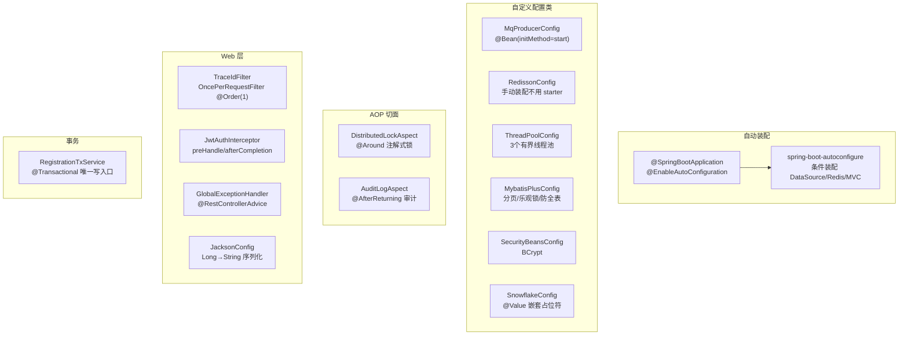
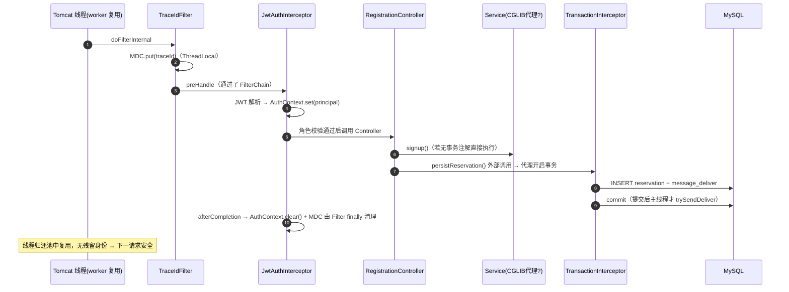
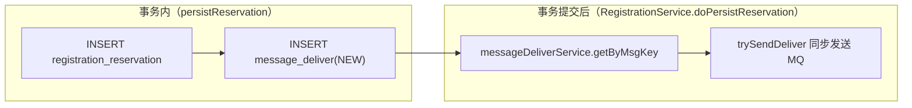

# 02 · SpringBoot 与 Spring 核心原理（结合 CampusFlow 真实源码）

> 本篇目标：把"自动装配、IoC/DI、Bean 生命周期、AOP、事务传播、拦截器 vs 过滤器、ThreadLocal 清理"
> 这些面试八股，逐条映射到 CampusFlow 里**真实存在**的类和方法上。面试时能说出"我在项目里是怎么用的"
> 远比背概念有说服力。

---

## ① 业务背景：Spring 在 CampusFlow 里的位置

CampusFlow 启动类只有 6 行（`backend/campusflow-server/src/main/java/com/campusflow/server/CampusflowApplication.java`）：

```java
@SpringBootApplication
public class CampusflowApplication {
    public static void main(String[] args) {
        SpringApplication.run(CampusflowApplication.class, args);
    }
}
```

但它背后装配了几十个 Bean：`DefaultMQProducer`、6 个 `DefaultMQPushConsumer`、`RedissonClient`、
3 个 `ThreadPoolExecutor`、`SnowflakeIdWorker`、9 个业务 Service……
理解"这些对象何时创建、何时销毁、被谁代理、事务边界在哪"就是本篇的全部内容。

## ② 不懂 Spring 原理会发生什么（用本项目踩坑点推演）

| 不懂的知识点 | 会导致的真实事故 | 项目中的对应防御 |
|---|---|---|
| 事务自调用失效 | 在同类里 `this.confirm()` 调 `@Transactional` 方法，事务不生效，半提交脏数据 | `RegistrationTxService` 独立成类，全部外部调用 |
| 循环依赖 | A 注入 B、B 注入 A，启动报 `BeanCurrentlyInCreationException` | `WaitlistWiringConfig` 函数注入打破环 |
| 忘记 start/shutdown 生命周期 | Producer 没连接 NameServer 就发消息报错；应用关闭连接泄漏 | `@Bean(initMethod="start", destroyMethod="shutdown")` |
| ThreadLocal 不清理 | Tomcat 线程池复用 worker，下一个请求读到上一个用户身份（**越权**） | `JwtAuthInterceptor.afterCompletion` 强制 `AuthContext.clear()` |
| 拦截器/过滤器用错 | 鉴权写在 Filter 里拿不到 Handler 信息、异常处理割裂 | TraceId 用 Filter，鉴权用 Interceptor，职责分明 |
| 事务内做 RPC | 事务里发 MQ，DB 回滚了消息却已发出（幽灵消息） | 事务内只写 `message_deliver`，提交后才 `trySendDeliver` |

## ③ 本项目方案：Spring 核心机制的一览图



## ④ 技术执行流程：一个请求的完整生命周期



### 4.1 Bean 生命周期在项目中的真实体现

`MqProducerConfig`（`backend/campusflow-infrastructure/src/main/java/com/campusflow/infra/mq/MqProducerConfig.java`）：

```java
@Bean(initMethod = "start", destroyMethod = "shutdown")
public DefaultMQProducer defaultMQProducer() {
    DefaultMQProducer producer = new DefaultMQProducer(properties.getMq().getProducerGroup());
    producer.setNamesrvAddr(properties.getMq().getNameServer());
    producer.setSendMsgTimeout(properties.getMq().getSendTimeoutMs());
    producer.setRetryTimesWhenSendFailed(properties.getMq().getSendRetryTimes());
    producer.setMaxMessageSize(1024 * 256);
    return producer;
}
```

对应生命周期：**实例化（new DefaultMQProducer）→ 属性注入（properties 构造器注入）→ Aware 回调 →
BeanPostProcessor 前置 → 初始化（`start()`：连接 NameServer，失败快速失败拒绝启动）→ 使用 →
容器关闭（`shutdown()`：在途消息发完、连接释放）**。

同样的模式出现在所有 6 个消费者上，例如 `RegistrationConfirmConsumer`：

```java
@Bean(initMethod = "start", destroyMethod = "shutdown")
public DefaultMQPushConsumer registrationConfirmMessageConsumer(...) { ... }
```

以及 `CacheEvictConsumer`、`NotifyConsumer`、`CancelReleaseConsumer`、`CheckinConsumer`（签到统计）、
`WaitlistPromoteConsumer`（晋级通知落库）。

### 4.2 条件装配与手动装配：RedissonConfig 的选择

`backend/campusflow-infrastructure/src/main/java/com/campusflow/infra/config/RedissonConfig.java` 刻意**不用**
`redisson-spring-boot-starter`，而是手动装配：

```java
@Bean(destroyMethod = "shutdown")
public RedissonClient redissonClient() {
    Config config = new Config();
    String address = "redis://" + host + ":" + port;
    SingleServerConfig single = config.useSingleServer()
            .setAddress(address)
            .setDatabase(database)
            .setConnectionMinimumIdleSize(8)
            .setConnectionPoolSize(32)
            ...;
    return Redisson.create(config);
}
```

类注释给出三条理由：保留 spring-data-redis(Lettuce) 作缓存主通道；Redisson 专用于分布式锁/布隆过滤器/看门狗；
生命周期由容器管理。这解释了自动装配的本质——**starter 只是把"条件化的 @Configuration"打包，
当你需要精细控制时，自己写 @Configuration 就是终极方案**。

### 4.3 @Value 嵌套占位符：SnowflakeConfig

```java
// backend/campusflow-infrastructure/src/main/java/com/campusflow/infra/config/SnowflakeConfig.java
@Bean
public SnowflakeIdWorker snowflakeIdWorker(
        @Value("${campusflow.worker-id:${CAMPUSFLOW_WORKER_ID:1}}") long workerId) {
    return new SnowflakeIdWorker(workerId);
}
```

三层回退：yml 配置 → 环境变量 → 默认值 1。多实例部署时给每个实例分配不同 workerId（0~1023）保证雪花 ID 不冲突。

### 4.4 AOP：两个真实切面

**切面一：注解式分布式锁**（详见 07 篇，这里看 Spring 机制）

```java
// backend/campusflow-infrastructure/src/main/java/com/campusflow/infra/lock/DistributedLockAspect.java
@Aspect @Component
public class DistributedLockAspect {
    @Around("@annotation(distributedLock)")
    public Object around(ProceedingJoinPoint pjp, DistributedLock distributedLock) throws Throwable {
        String lockKey = KEY_PREFIX + resolveKey(distributedLock.key(), pjp); // SpEL 解析方法参数
        RLock lock = redissonClient.getLock(lockKey);
        ...
        return pjp.proceed();
    }
}
```

使用处（`ActivityService.approvePublish`）：

```java
@DistributedLock(key = "'activity:publish:' + #activityId", waitTimeMillis = 3000)
@Transactional(rollbackFor = Exception.class)
public ActivityVO approvePublish(Long activityId, String remark) { ... }
```

注意切面顺序：`DistributedLockAspect` 包在事务外（锁先获取、事务后开），保证"持锁期间才开事务、
事务提交后才释放锁"——否则事务还没提交锁就释放了，另一个线程可能读到未提交的旧数据。

**切面二：操作审计**（`backend/campusflow-business/src/main/java/com/campusflow/biz/audit/AuditLogAspect.java`）：

```java
@AfterReturning("@annotation(auditLog)")
public void afterSuccess(JoinPoint joinPoint, AuditLog auditLog) {
    ...
    audit.setTraceId(MDC.get(com.campusflow.common.util.TraceUtils.MDC_KEY));
    sysAuditService.recordAsync(audit); // notifyExecutor 异步落库
}
```

选 `@AfterReturning` 而非 `@After`：失败的操作不记审计（审计语义是"成功动作"）。

### 4.5 事务传播与事务边界：RegistrationTxService

项目把**所有报名相关 DB 变更收口到一个事务服务类**（类注释："所有报名相关 DB 变更的唯一入口（事务边界集中管理）"）：

```java
// backend/campusflow-business/src/main/java/com/campusflow/biz/registration/service/RegistrationTxService.java
@Transactional(rollbackFor = Exception.class)
public RegistrationReservationDO persistReservation(long activityId, long userId, long waitlistId) {
    // 预留记录（先手工生成雪花 ID，messageKey 依赖它且列非空）
    ...
    reservationMapper.insert(reservation);
    // 发件箱消息（同事务）
    messageDeliverService.createDeliverRecordWithKey(reservation.getMessageKey(),
            MqConstants.TOPIC_REGISTRATION_CONFIRM, ...);
    return reservation;
}
```

三个要点：
1. **为什么独立成类**：`RegistrationService.signup()` 没有事务（Redis 操作不该在 DB 事务里），
   只有落库部分才开事务——自调用会让 `@Transactional` 失效（AOP 代理原理），所以拆到 `RegistrationTxService`。
2. **rollbackFor = Exception.class**：默认只回滚 RuntimeException，受检异常会提交半事务；显式声明全覆盖。
3. **REQUIRED 传播行为**：`persistReservation` 与 `confirmRegistration` 都被消费者/编排层外部调用，
   各自独立成事务；若未来有嵌套调用（如 `cancelRegistration` 内再调 `writeStateLog`），同事务合并。

事务内/外操作的严格划分（这是消亡幽灵消息的关键）：



`MessageDeliverService.createDeliverRecord` 的注释明确写着："本方法无 @Transactional，加入调用方事务"。

### 4.6 拦截器 vs 过滤器：职责边界

`TraceIdFilter` 类注释给出了教科书式答案："TraceId 属于协议层关注点（所有请求，包括静态资源/actuator），用 Filter；
鉴权属于 MVC 层关注点（仅业务路由），用 HandlerInterceptor。"

| 维度 | TraceIdFilter | JwtAuthInterceptor |
|---|---|---|
| 规范 | Servlet 规范 `OncePerRequestFilter` | Spring MVC `HandlerInterceptor` |
| 范围 | 所有请求（含静态资源、/actuator） | 仅 `/api/**`，且放行登录/注册/文档（见 `WebMvcConfig.PUBLIC_PATHS`） |
| 时机 | FilterChain 之前，HandlerMapping 之前 | HandlerMapping 之后、Controller 之前 |
| 能拿到什么 | 只有 request/response | 能拿到 `handler`（方法级信息） |
| 清理 | `finally { MDC.remove(...) }` | `afterCompletion { AuthContext.clear() }` |

`JwtAuthInterceptor` 主体（真实源码）：

```java
// backend/campusflow-server/src/main/java/com/campusflow/server/config/JwtAuthInterceptor.java
public boolean preHandle(HttpServletRequest request, HttpServletResponse response, Object handler) {
    String auth = request.getHeader("Authorization");
    if (auth == null || !auth.startsWith("Bearer ")) {
        throw BizException.of(ErrorCode.UNAUTHORIZED);
    }
    UserPrincipal principal = jwtUtils.parseToken(auth.substring(7).trim());
    AuthContext.set(principal);
    if (ADMIN_PREFIXES.stream().anyMatch(request.getRequestURI()::startsWith) && !principal.isAdmin()) {
        throw BizException.of(ErrorCode.FORBIDDEN);
    }
    ...
    return true;
}

@Override
public void afterCompletion(HttpServletRequest request, HttpServletResponse response,
                            Object handler, Exception ex) {
    AuthContext.clear(); // 线程复用清理：防止下一个请求读到上一个用户身份
}
```

### 4.7 异常处理与序列化定制

- `GlobalExceptionHandler`（`@RestControllerAdvice`）：`BizException` 返回业务码；参数校验 40001；
  兜底 `Exception` 返回 50000 且"记录完整堆栈（带 traceId），对外只返回通用文案（防内部信息泄漏）"。
- `JacksonConfig`：雪花 ID 是 19 位 Long，超过 JS `Number.MAX_SAFE_INTEGER(2^53-1)`，
  前端会精度丢失（注释举例 `2123838677402947593 -> ...600`），所以全局 `Long → String`：

```java
@Bean
public Jackson2ObjectMapperBuilderCustomizer longToStringCustomizer() {
    return builder -> builder
            .serializerByType(Long.class, ToStringSerializer.instance)
            .serializerByType(Long.TYPE, ToStringSerializer.instance);
}
```

## ⑤ 结合源码学习：Spring 机制 → 真实文件对照表

| Spring 机制 | 项目落点文件（绝对路径前缀 `backend/`） |
|---|---|
| 启动与自动装配 | `campusflow-server/src/main/java/com/campusflow/server/CampusflowApplication.java` |
| Bean 生命周期 initMethod/destroyMethod | `campusflow-infrastructure/.../mq/MqProducerConfig.java`、`campusflow-business/.../registration/listener/RegistrationConfirmConsumer.java` 等 6 个消费者 |
| 手动装配替代 starter | `campusflow-infrastructure/.../config/RedissonConfig.java` |
| @ConfigurationProperties | `campusflow-infrastructure/.../property/CampusflowProperties.java`（prefix="campusflow"） |
| @Value 嵌套占位符 | `campusflow-infrastructure/.../config/SnowflakeConfig.java` |
| AOP @Around + SpEL | `campusflow-infrastructure/.../lock/DistributedLockAspect.java` |
| AOP @AfterReturning | `campusflow-business/.../audit/AuditLogAspect.java` |
| 事务边界集中 | `campusflow-business/.../registration/service/RegistrationTxService.java`（7 个 @Transactional 方法） |
| 循环依赖破解 | `campusflow-business/.../config/WaitlistWiringConfig.java` |
| 拦截器注册 | `campusflow-server/.../config/WebMvcConfig.java`（`addInterceptors`，order=2） |
| 过滤器 | `campusflow-server/.../config/TraceIdFilter.java`（@Order(1)） |
| 全局异常 | `campusflow-server/.../config/GlobalExceptionHandler.java` |
| Jackson 定制 | `campusflow-server/.../config/JacksonConfig.java` |
| ThreadLocal 上下文 | `campusflow-infrastructure/.../auth/AuthContext.java` + `JwtAuthInterceptor` |
| MyBatis-Plus 插件链 | `campusflow-infrastructure/.../config/MybatisPlusConfig.java`（分页/乐观锁/BlockAttack + `FillMetaObjectHandler` 自动填充） |

**Controller → DB 调用链（以取消报名为例）**：
`RegistrationController.cancel` → `RegistrationService.cancel` → `RegistrationTxService.cancelRegistration`
（@Transactional，乐观锁 UPDATE + 发件箱 INSERT）→ 事务提交 → `StockRedisService.releaseReservation`（Lua）
→ `StockAuditService.logStockChange` → `waitlistPromoteRunner.accept`（函数注入）→ `messageDeliverService.createAndSend`。

## ⑥ 并发场景分析：ThreadLocal 与线程复用的事故推演

Tomcat `maxThreads` 默认 200，线程处理完请求**不销毁而是归还线程池复用**。

**不清理 ThreadLocal 的推演**：
1. 用户 A（userId=1001，角色 STUDENT）请求 `/api/v1/my/registrations`，`AuthContext.set(A)`；
2. 请求结束，`afterCompletion` 忘了 clear → ThreadLocalMap 里残留 A；
3. 用户 B（userId=2002）的请求**恰好分配到同一线程**，假设鉴权代码只在首次 set——B 请求查到的是 A 的身份；
4. 若 B 调用管理员接口，而线程里残留的是某个 ADMIN 的 principal → **水平/垂直越权**。
   在报名场景下：B 看到 A 的报名记录、用 A 的身份取消报名，审计日志全是错误的人。

**本项目防御**：`afterCompletion` 无条件 `AuthContext.clear()`（即使业务抛异常也会执行——afterCompletion
是请求完成后的**必然回调**，这正是选 Interceptor 而非在 Filter/Controller 里管理的原因之一）。
`TraceIdFilter` 同理在 `finally` 里 `MDC.remove`。

**@Async 场景的坑**（`AuthContext` 注释原文）："本 ThreadLocal 跨 @Async 线程池不可用（ThreadLocal 不传递），
异步任务需要的身份信息必须显式作为参数传入。" 证据：`SysAuditService.recordAsync` 在提交异步任务**之前**
就把 userId/username 抄进了 `SysAuditLogDO` 对象（`AuditLogAspect.afterSuccess` 第 34~38 行），而不是在异步线程里读 `AuthContext`。

**数字推演**：假设 QPS 500、平均处理 20ms，线程池 200 → 每秒每线程处理 50 个请求。
不清理时每个请求有 1/50 概率读到上一个用户的身份——一天 4300 万请求中约 86 万次串号，且难以复现排查。

## ⑦ 优化思路：第一版 → 第二版 → 取舍

| 主题 | 第一版（常见初学写法） | 第二版（本项目） | 取舍理由 |
|---|---|---|---|
| 鉴权 | 每个 Controller 里手动解析 JWT | 拦截器统一处理 + AuthContext | 横切关注点集中；Controller 保持纯业务 |
| TraceId | 每个 log 手拼 | Filter + MDC + `ApiResult.traceId` 返给前端 | 无侵入贯穿；联调时前端可直接回传 traceId |
| 事务 | Service 方法上随手 @Transactional | 独立 TxService 收口 + 明确"事务内只做 DB" | 避免 Redis/MQ 混入事务拉长持锁时间 |
| MQ Producer | @Component 里 new + 手动 start | @Bean(initMethod/destroyMethod) | 生命周期纳入容器，启动失败快速暴露 |
| 循环依赖 | @Lazy 注入或 setter 注入 | 函数注入（LongConsumer） | 依赖语义更清晰：只暴露"一个动作"而非整个 Bean |
| 配置散落 | 魔法数字写死在代码 | `CampusflowProperties` 集中 | 注释原话："禁止在业务代码中散落魔法数字" |

## ⑧ 面试知识

### 基础
1. **IoC 是什么？** 控制反转：对象的创建和依赖装配交给容器。项目中 `RegistrationService` 从不 new
   `StockRedisService`，全部构造器注入（`@RequiredArgsConstructor` + final 字段）。
2. **@Autowired 和构造器注入区别？** 构造器注入可以 final 不可变、便于单测、启动即暴露循环依赖。
   项目统一用 Lombok `@RequiredArgsConstructor`。
3. **@SpringBootApplication 包含哪三个注解？** `@SpringBootConfiguration`、`@EnableAutoConfiguration`、`@ComponentScan`。

### 中级
4. **自动装配原理？** `@EnableAutoConfiguration` → `AutoConfigurationImportSelector` 读取
   `META-INF/spring/org.springframework.boot.autoconfigure.AutoConfiguration.imports`（Boot 3）→
   按 `@ConditionalOnClass/@ConditionalOnMissingBean` 等条件过滤 → 注册配置类。
   项目对应：Spring Boot 自动配了 Lettuce `StringRedisTemplate`，我们没写一行模板代码。
5. **Bean 生命周期？** 结合 `MqProducerConfig` 讲：实例化 → 属性填充 → Aware → BeanPostProcessor#before →
   initMethod `start()` → 使用 → 销毁回调 `shutdown()`。
6. **事务失效场景**（结合项目逐条说）：
   - 自调用：所以 `RegistrationTxService` 独立成类；
   - 方法非 public：项目所有 @Transactional 方法都是 public；
   - 异常被 catch 吞掉：`RegistrationConfirmConsumer.handleFailure` 里对 `BizException` 分类处理，
     消费端确认事务失败靠返回 `RECONSUME_LATER` 重试，而不是靠 catch 保事务；
   - 默认只回滚 RuntimeException：全部加了 `rollbackFor = Exception.class`；
   - 传播行为配错：本项目统一 REQUIRED（同事务合并）。
7. **AOP 代理是 JDK 还是 CGLIB？** Boot 2 起默认 CGLIB（`proxyTargetClass=true`）；
   `RegistrationService` 无接口 → CGLIB 子类代理。`DistributedLock` 注解在 `adjustCapacityInternal` 这类
   **同类内部调用**处会失效（`DistributedLock` 注释明确警告"锁注解不可用于同一类内部自调用"），
   所以 `warmupStockIfNeeded` 由 `RegistrationService` 外部调用，代理才生效。

### 高级
8. **为什么锁切面要在事务切面外层？** 若事务先开、锁后获取：锁内业务提交事务前锁已可能被等待者拿走，
   出现"读不到已提交数据"的幻读窗口。Spring 默认切面优先级 `@EnableTransactionManagement(order=Ordered.LOWEST_PRECEDENCE)`，
   自定义切面默认更低优先级包在外面，正合需要（显式控制可用 `@Order`）。
9. **Spring 如何解决循环依赖？三级缓存。** 但**构造器注入的循环依赖无法解决**（实例化阶段就需要依赖）。
   本项目绕开问题本身：`WaitlistWiringConfig` 用函数注入把"A 需要 B 的一个动作"降维成 setter 回调，
   两个 Service 互不持有引用。

### 项目追问（高频）
10. **"你的事务边界怎么划的？"** 口诀：事务内只做 DB 写（预留记录+发件箱+状态日志），Redis 操作在事务外，
    MQ 发送在事务提交后；发件箱表在事务里保证"业务成功 ⇔ 消息必有记录"。
11. **"为什么 Producer 启动失败要让应用直接挂？"** `MqProducerConfig` 注释："start() 连接 NameServer 失败会
    快速失败（应用拒绝启动），避免'看似启动成功实际 MQ 不可用'"——发布环节出问题的代价远小于上线后静默丢消息。
12. **"afterCompletion 一定执行吗？"** 是，HandlerInterceptor 的 afterCompletion 在任何情况下（正常返回/异常）都会回调，
    这是它与 finally 块等价性的保证来源。

### 底层原理
13. **CGLIB 原理**：运行时生成目标类的子类字节码，方法调用先走 `MethodInterceptor` 链；
    final 方法/类无法代理（不能被继承），private 方法根本不可见——这就是"自调用失效"的根源：`this.method()` 走的是原始对象。
14. **ThreadLocal 内存结构**：每个 Thread 持有 `ThreadLocalMap`，Entry 的 key 是 ThreadLocal 弱引用、value 是强引用；
    线程池场景线程不死，value 永远可达 → 泄漏。`AuthContext.clear()` 调 `remove()` 摘掉 Entry。
15. **事务的 AOP 实现**：`TransactionInterceptor` → `PlatformTransactionManager`（DataSourceTransactionManager），
    开启时拿连接 setAutoCommit(false) 并绑定到 `TransactionSynchronizationManager` 的 ThreadLocal；
    `MybatisPlusConfig` 的自动填充（`FillMetaObjectHandler`）发生在 MyBatis 层，与 Spring 事务正交。

### 常见错误回答 vs 参考答案
- ❌ "@Transactional 加在类上就所有方法都有事务" → ✅ 类级注解仅对 public 方法生效，且自调用失效。
- ❌ "过滤器比拦截器先执行，所以鉴权也应该用过滤器" → ✅ 先执行不等于更合适；鉴权需要 Handler 级信息与
  afterCompletion 生命周期，Filter 无法拿到 Controller 方法元数据。
- ❌ "Spring 用反射创建 Bean 所以慢" → ✅ Bean 只创建一次（单例池缓存，一级 `singletonObjects`），运行期零反射创建成本。

## ⑨ 动手练习

1. **观察代码**：`grep -rn "initMethod" backend --include="*.java"`（排除 target），数一数有几个 Bean 定义了
   生命周期方法，并说出每个 start() 分别连的是哪个中间件。
2. **改参数**：把 `ThreadPoolConfig.notifyExecutor` 的核心线程从 4 改成 2、队列从 200 改成 10，
   压测登录+报名混合流量，观察 `CallerRunsPolicy` 触发时（线程名变为 http-nio 执行）响应时间变化。
3. **模拟异常**：在 `RegistrationTxService.persistReservation` 的发件箱 insert 后加一行
   `if (true) throw new RuntimeException("boom");`，报名一次，验证 registration_reservation 与
   message_deliver **同时回滚**（事务原子性证据），Redis 里 stock 却已 -1（→ 由 20s 补偿任务释放，观察
   `reservationRecovery` 日志）。
4. **验证方法**：在 `AuthContext.clear()` 打断点，发两个不同账号的请求，观察 Tomcat 是否复用同一线程名
   （http-nio-8080-exec-N 相同）且 ThreadLocal 值先 A 后 B、每次请求结束都被置空。
5. **验证代理失效**：在 `ActivityService` 内部新增一个自调用 `this.adjustCapacityInternal(...)` 的方法
   （临时），打日志验证锁没有生效（两次并发请求都进入临界区），再改回外部调用验证生效。

---

*下一篇：[03_MySQL与数据库设计](03_MySQL与数据库设计.md) —— 17 张表为什么这样设计？*
