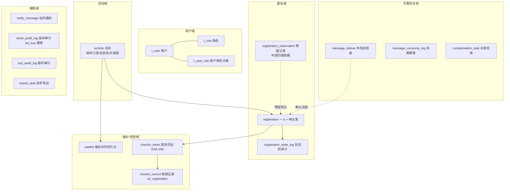
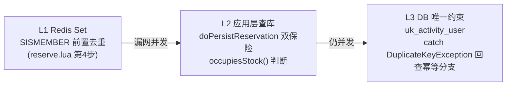

# 03 · MySQL 与数据库设计（17 张表逐一精讲）

> 本篇目标：吃透 `backend/campusflow-server/src/main/resources/db/migration/V1__init_schema.sql` 里
> 17 张表的设计依据，掌握唯一索引"一人一单"、乐观锁 version、逻辑删除、雪花主键、B+ 树索引设计、
> EXPLAIN、事务隔离级别与 MVCC、深分页。面试里"讲讲你的表怎么设计的"是必问题。

---

## ① 业务背景：报名系统的数据长什么样

一个校园活动从创建到结束，数据流是：

```
用户注册(t_user) → 创建活动(activity) → 审核流转(activity.status) → 报名预留(registration_reservation)
→ MQ 确认(registration + registration_state_log) → 候补(waitlist) → 签到凭证(checkin_token)
→ 核销(checkin_record) → 通知(notify_message) → 事后审计/导出(stock_audit_log/sys_audit_log/export_task)
```

中间穿插两根"可靠性支柱"：`message_deliver`（发件箱）与 `message_consume_log`（消费幂等），
以及一张"异常兜底"表 `compensation_task`。共 **17 张表**。

## ② 不做规范设计会发生什么（数字推演）

| 错误设计 | 具体后果 |
|---|---|
| 报名表不加 `uk_activity_user` 唯一索引 | 双击/重试/并发下同一用户插入多行；10 万条报名数据里混入 ~3% 脏数据，考勤对不上 |
| 用自增主键 | 分库分表（项目预留 `application-sharding.yml`）时各库 ID 段冲突；前端 JS 精度丢失（19 位） |
| 不加 `version` 乐观锁 | 两个管理员同时审核同一活动，后写覆盖先写（lost update）；并发取消两次都"成功"释放两次名额 |
| 物理删除 | 报名记录删掉后无法审计"谁在什么时间取消的"；候补晋级丢失依据 |
| 不建 `(activity_id,status)` 组合索引 | 补偿任务 `stockReconcile` 每 5 分钟全表扫 registration 统计有效数，10 万行表单次 300ms+，一天 288 次拖垮 DB |
| 每张表都有物理外键 | 高并发报名时外键校验额外锁父表；分库分表后外键直接失效。V1 脚本头注释："不使用物理外键……数据一致性由业务层保证" |

## ③ 本项目方案：17 张表总览与分组



### 3.1 逐表精讲（设计依据）

以下均出自 `V1__init_schema.sql`，仅摘关键列与索引并说明"为什么"。

**1. t_user 用户表** — `uk_username` 唯一（登录名即学号，天然唯一）；`password VARCHAR(100)` 存 BCrypt
（60 字符定长 + 头部参数段，100 留余量）；`deleted` 逻辑删除；`status 0正常/1禁用`。

**2. t_role / 3. t_user_role** — 角色编码 STUDENT/ORGANIZER/ADMIN；关联表 `uk_user_role(user_id, role_id)`
防重复授权，`idx_role_id` 支持"按角色查人"。经典 RBAC 三件套。

**4. activity 活动表** — 本项目最核心的表：
- `capacity` + `confirmed_count` + `checked_in_count`：**DB 侧库存口径**。`confirmed_count` 注释明确
  "MQ消费端维护，用于DB侧对账"——它是 Redis 库存的权威校准源（`CompensationScheduler.doStockReconcile`
  用 `capacity - 有效报名数` 修正 Redis）；
- `status` 7 个值（0草稿~6已取消）承载审核状态机；
- `version` 乐观锁：审核、取消、容量调整都走 `updateById`（MyBatis-Plus `OptimisticLockerInnerInterceptor` 自动拼 `WHERE version=?`）；
- 四个组合索引全部围绕查询模式：`idx_organizer(organizer_id,status)` 组织者工作台、
  `idx_status_start(status,start_time)` 学生列表+状态流转扫描、`idx_category_status` 分类筛选、
  `idx_signup_window(signup_start_time,signup_end_time)` 候补兜底巡检"报名窗口未结束的活动"。

**5. registration 报名表（一人一单最终防线）** — SQL 注释原文值得背诵：

```sql
-- 报名表（一人一单最终防线：uk_activity_user 唯一约束）
-- 重新报名复用同一行：取消后再报名走状态回迁（CANCELLED -> RESERVED），保证唯一索引不冲突
UNIQUE KEY uk_activity_user (activity_id, user_id),
```

三个要点：唯一索引是**最终防线**（Redis Set 是前置防线，见 05 篇）；取消不物理删，状态回迁复用同一行，
所以唯一索引永远不冲突；`reservation_id` 反向追踪异步链路，`idx_registered_at` 支持导出按时间排序。

**6. registration_state_log 状态机审计** — `from_status/to_status/reason/operator_id` 四元组，
每次状态推进都写一行（`RegistrationTxService.writeStateLog`）。面试可以讲："任何一条报名的生命周期
都可以用这表重放出来，出了客诉直接查轨迹。"

**7. registration_reservation 预留记录表** — 异步确认链路的"待办清单"：
- `status 0预留待确认/1已确认/2补偿中/3已释放`（对应 `ReservationStatus` 枚举）；
- `uk_message_key` 唯一：msgKey=预留雪花 ID，"REG-{id}"，串起预留表、消息表、消费幂等三方；
- `idx_status_expire(status,expire_at)` 是补偿扫描的命脉：`listExpiredPendingReservations` 查询
  `WHERE status=0 AND expire_at < now ORDER BY expire_at LIMIT 50` 走范围扫描，50 行毫秒级；
- `retry_count` 上限 `reservation-max-retry: 5`，耗尽转 RELEASED。

**8. waitlist 候补队列表** — 注释点明定位："Redis ZSet 为实时队列，此表为持久化依据与审计"。
双唯一：`uk_activity_user` 一人一位、`uk_activity_queue(activity_id, queue_no)` 排队号唯一（`INCR` 发号）。
`idx_status_deadline(status,confirm_deadline)` 供 `waitlistTimeout` 补偿任务扫描超时未确认者。

**9. checkin_token 签到凭证表** — `token_hash CHAR(64)` 只存 SHA-256 摘要（明文仅签发时返回一次），
`uk_registration` 一报名一凭证，`uk_token_hash` 防摘要碰撞重放。安全设计：截获二维码也拿不到库里的"可复用凭证"。

**10. checkin_record 核销记录表** — `uk_registration` 与 token 表互为印证："一凭证只成功核销一次"；
`idx_activity_time(activity_id, checkin_at)` 支撑"活动签到曲线"统计。

**11. notify_message 站内通知表** — `idx_user_read(user_id, is_read, created_at)` 是三级索引：
未读列表查询 `WHERE user_id=? AND is_read=0 ORDER BY created_at DESC` 完整命中索引（等值+等值+排序），
这是讲解"联合索引最左前缀 + 排序消除 filesort"的绝佳例子。

**12. stock_audit_log 库存变更审计表** — `uk_biz_key` 唯一是**幂等防线**：补偿重复释放不会重复记账，
因为 bizKey 如 `COMP-REL-{reservationId}` 第二次插入直接 `DuplicateKeyException`。

**13. sys_audit_log 操作审计表** — `idx_action_time(action, created_at)` 支持"最近一小时谁干了什么"。

**14. message_deliver 本地消息表** — 发件箱模式核心：
```sql
UNIQUE KEY uk_msg_key (msg_key),
KEY idx_status_retry (status, next_retry_time)  -- 补偿扫描 messageRetry 的查询路径
```
状态机 0待发送→1已发送→2消费方已确认/3发送失败，`retry_count` + 指数退避 `next_retry_time`。

**15. message_consume_log 消费幂等表** — `uk_msg_group(msg_key, consumer_group)`：
**按消费组幂等**，同一消息允许被不同消费组各消费一次（如一条取消消息同时服务候补晋级组和统计组——
本项目拆成了独立 Topic，但表结构保留了多组能力）。

**16. compensation_task 补偿任务表** — 业务级死信：消费重试 5 次仍失败的消息转成任务
（`RegistrationConfirmConsumer.handleFailure` 里 `compensationTaskService.createTask`），
`uk_biz_key` 防同一异常重复建任务，`max_retry` 默认 5。

**17. export_task 导出任务表** — 异步 CSV 导出的任务单：前端提交任务 → `exportExecutor` 执行 →
前端轮询 `status` 后下载 `file_path`。

### 3.2 全链路写路径与表交互

```mermaid
sequenceDiagram
    participant Lua as reserve.lua(Redis)
    participant Tx as RegistrationTxService[事务]
    participant DB as MySQL
    participant Cons as RegistrationConfirmConsumer[事务]
    participant Comp as CompensationScheduler

    Lua->>Tx: 预留成功(activityId,userId)
    Tx->>DB: INSERT registration_reservation(status=0, expire_at=+15min)
    Tx->>DB: INSERT message_deliver(msg_key=REG-{id}, status=0)
    Note over DB: commit（一个事务，两行同生共死）
    Cons->>DB: tryBeginConsume → INSERT message_consume_log(uk_msg_group)
    Cons->>DB: INSERT registration(uk_activity_user) + confirmed_count+1
    Cons->>DB: UPDATE reservation status=1; UPDATE message_deliver status=2
    Comp->>DB: 每20s: SELECT reservation WHERE status=0 AND expire_at<now
    Comp->>DB: 超时→ UPDATE status=3 + stock_audit_log(uk_biz_key) + Redis INCR
```

## ④ 技术执行流程：核心技术专题

### 4.1 唯一索引一人一单：三层防线



`RegistrationTxService.confirmRegistration` 真实源码（L3 的处理方式）：

```java
try {
    registrationMapper.insert(registration);
} catch (org.springframework.dao.DuplicateKeyException e) {
    // 并发重复插入：回查已有记录走幂等分支
    existing = registrationMapper.selectOne(...);
    if (existing == null) { throw e; }
    return idempotentConfirm(existing, msg);
}
```

要点：**捕获唯一约束异常后回查走幂等**，而不是把异常抛出去触发消息重试——重试也会命中同一约束，
白白消耗 5 次重试机会。

### 4.2 乐观锁 version：两个真实使用点

MyBatis-Plus 配置（`backend/campusflow-infrastructure/src/main/java/com/campusflow/infra/config/MybatisPlusConfig.java`）：

```java
interceptor.addInnerInterceptor(new PaginationInnerInterceptor(DbType.MYSQL));
interceptor.addInnerInterceptor(new OptimisticLockerInnerInterceptor());
interceptor.addInnerInterceptor(new BlockAttackInnerInterceptor()); // 全表更新/删除防护
```

`RegistrationDO.version` 字段 + `cancelRegistration` 的失败语义：

```java
int affected = registrationMapper.updateById(reg); // UPDATE registration SET status=3, version=version+1
                                                   // WHERE id=? AND version=?
if (affected == 0) {
    log.info("取消报名并发竞争 registrationId={} -> 幂等处理", registrationId);
    return false; // 并发取消竞争：另一请求已成功，视为幂等
}
```

数字推演：两个请求同时取消同一报名，都读到 version=3；先到者 UPDATE 命中 1 行并把 version 推到 4；
后到者 `WHERE version=3` 命中 0 行 → `affected=0` → 幂等返回 false → Redis 释放只会被先到者触发一次。
**这就是"并发取消只有一个真正生效"的完整机制。**

### 4.3 雪花主键 vs 自增

`SnowflakeIdWorker`（`backend/campusflow-common/src/main/java/com/campusflow/common/util/SnowflakeIdWorker.java`）：
64 bit = 1 符号 + 41 时间戳 + 10 机器ID + 12 序列号，单机每毫秒 409.6 万 ID，时钟回拨 ≤5ms 等待追平、
超过抛异常。选雪花而非自增的理由：

1. 应用层生成，INSERT 前就拿到 ID（`persistReservation` 需要先拼 messageKey="REG-"+id）；
2. 分库分表不冲突（预留 `application-sharding.yml`）；
3. 趋势递增保留 InnoDB 顺序插入优势（页分裂少）；
4. 代价：19 位超 JS 安全整数 → `JacksonConfig` 全局 Long→String。

### 4.4 索引设计：B+ 树视角

以 `registration` 为例核对每条索引与 SQL 的匹配：

| 索引 | 服务的 SQL | 匹配方式 |
|---|---|---|
| `uk_activity_user(activity_id,user_id)` | 消费确认的查重、`idx` 回查 | 唯一聚簇式点查，ref |
| `idx_user_status(user_id,status)` | "我的报名"分页 | 等值 user + 等值 status + filesort 或借索引序 |
| `idx_activity_status(activity_id,status)` | 补偿统计 `count(CONFIRMED,CHECKED_IN)` | 范围 IN，index 扫描 |
| `idx_registered_at` | CSV 导出按时间排序 | 覆盖排序避免 filesort |

EXPLAIN 要点（面试背诵版）：
- `type` 优先级 system>const>eq_ref>ref>range>index>ALL，报名查重应是 `ref`/`const`；
- `key_len` 判断联合索引用了几列（BIGINT=8，TINYINT=1，可 NULL +1）；
- `Extra` 出现 `Using index`（覆盖索引）最好；`Using filesort`/`Using temporary` 需要优化；
- `rows` 是估算扫描行数，配合 `ANALYZE TABLE` 更新统计信息。

**深分页**：`OFFSET 100000, 20` 要扫描并丢弃前 10 万行（回表 10 万次）。项目做法：
`MybatisPlusConfig` 注释"分页插件（深分页防护：单页上限 100，超出直接返回空并在 SQL 层拒绝）"；
更大数据量的方案是**游标分页**（`WHERE id > lastId ORDER BY id LIMIT 20`，利用雪花主键趋势递增）。

### 4.5 事务隔离级别与 MVCC

MySQL InnoDB 默认 **REPEATABLE READ**。结合项目场景：

- **可重复读如何保护对账**：`doStockReconcile` 里"先 count 再 preload"若并发有新报名，
  RR 下同一事务内两次读到一致快照，不会出现"count 了两次不同值"的诡异漂移（项目按单条查询执行，
  依赖语句级一致性即可，但原理要会）；
- **MVCC 实现**：每行隐藏列 `DB_TRX_ID`/`DB_ROLL_PTR` + Undo Log 版本链 + ReadView
  （m_ids/min_trx_id/max_trx_id/creator_trx_id）。RC 每语句生成 ReadView，RR 事务首次读生成后复用；
- **幻读**：RR 下快照读靠 MVCC 防幻读，当前读（`SELECT ... FOR UPDATE`）靠间隙锁（Next-Key Lock）防；
  `confirmRegistration` 的"查重 → 插入"在 RR 下两个并发事务可能同时查到"不存在"然后一个插入成功一个撞唯一索引
  ——项目正是用 `DuplicateKeyException` 兜底，这就是**为什么不能只依赖查重**的原理性解释。

### 4.6 逻辑删除

```yaml
# application.yml
mybatis-plus:
  global-config:
    db-config:
      logic-delete-field: deleted
      logic-delete-value: 1
      logic-not-delete-value: 0
```

效果：`activityMapper.selectById(id)` 自动追加 `AND deleted=0`；所有业务查询天然过滤已删数据；
`ActivityService.requireActivity` 里仍显式判 `activity.getDeleted() == 1` 双保险。

## ⑤ 结合源码学习：表 ↔ 类 ↔ 方法对照

| 表 | 实体类 | 关键 Mapper 方法（XML/注解定义） | 调用方 |
|---|---|---|---|
| registration | `campusflow-business/.../registration/entity/RegistrationDO.java` | `insert/updateById/selectOne` | `RegistrationTxService.confirmRegistration/cancelRegistration` |
| registration_reservation | `.../registration/entity/RegistrationReservationDO.java` | `markConfirmed/markReleased/incrementRetry` | 消费确认与补偿恢复 |
| registration_state_log | `.../registration/entity/RegistrationStateLogDO.java` | `insert`（`writeStateLog`） | 所有状态推进 |
| message_deliver | `campusflow-infrastructure/.../mq/MessageDeliverDO.java` | `markSent/markFailed/markConfirmed` | `MessageDeliverService` |
| message_consume_log | `campusflow-infrastructure/.../mq/MessageConsumeLogDO.java` | `markSuccess/markFailed` | `MessageConsumeLogService` |
| stock_audit_log | `campusflow-business/.../audit/entity/StockAuditLogDO.java` | `insert`（bizKey 幂等） | `StockAuditService.logStockChange` |
| activity | `.../activity/entity/ActivityDO.java` | `incrementConfirmedCount/incrementCheckedInCount` | 消费确认/签到核销 |
| waitlist | `.../waitlist/entity/WaitlistDO.java` | `markPromoted/markExpired/markConfirmed/markCancelled` | `WaitlistPromoteService`/`CompensationScheduler` |
| checkin_token / checkin_record | `.../checkin/entity/*.java` | CAS 状态推进 | `CheckinService.scan` |

调用链示例（签到核销涉及 4 张表 1 个事务）：`CheckinService.scan` → `checkin_token` UPDATE(USED) +
`registration` UPDATE(CHECKED_IN, 乐观锁) + `registration_state_log` INSERT + `checkin_record` INSERT(uk_registration)
+ `activity.checked_in_count` INCR + 发件箱 2 条（CHECKIN + NOTIFY）——全部在 `@Transactional` 内，
任一失败整体回滚。

## ⑥ 并发场景分析：数字推演

**场景 1：1000 并发确认同一预留（消息重复投递）**
- L1 Redis 认领锁（60s TTL）：999 个并发直接跳过；
- 若 Redis 挂了：L2 DB `INSERT message_consume_log` 撞 `uk_msg_group`，998 个收到 `DuplicateKeyException`；
- 即使两层都失效：L3 `uk_activity_user` 保证 registration 只有一行。
- 结果：`registration` 表里永远恰好 1 行，`confirmed_count` 恰好 +1。

**场景 2：3 个管理员同时扫同一个二维码**
- `CheckinService.scan`：第 1 个 `SETNX campusflow:checkin:once:{tokenHash}` 成功；
- 第 2、3 个立即 `ALREADY_CHECKED_IN(25003)`（0.1ms 内被拦截，不碰 DB）；
- 极端情况 SETNX 都穿透（Redis 重启丢键）：事务内 token 状态 CAS `WHERE status=0` 只有一个成功；
  唯一约束 `uk_registration` 再兜一层 → 事务回滚，无重复核销记录。

**场景 3：补偿任务与用户操作赛跑**
- 用户报名后 15 分钟整（预留 expire_at 边界）刚好消费确认成功，同时 `reservationRecovery` 也在扫这条：
  消费端 `markConfirmed` 与补偿端 `releaseReservationQuietlyConfirm` 都是状态 CAS 推进
  （0→1 或 0→3 只能发生一次），两者谁先到谁生效，后者幂等跳过；
- 数字化：补偿批次 50 条/次、每 20s 一批，处理速率上限 150 条/分钟，而消费确认单条 <5ms，
  正常流量下补偿队列始终为空，只有 MQ 长时间不可用时才积压。

**场景 4：不用乐观锁的 lost update**
管理员 A 与 B 同时编辑容量（100→150 与 100→80）：无 version 时后提交者覆盖先提交者，
confirmed_count 若也被覆盖将直接破坏库存口径。有 version：B 的 UPDATE 命中 0 行，
`ACTIVITY_STATUS_CONFLICT(22004)` 提示刷新。

## ⑦ 优化思路：第一版 → 第二版 → 取舍

| 主题 | 第一版 | 第二版（现状） | 取舍 |
|---|---|---|---|
| 主键 | 自增 AUTO_INCREMENT | 雪花 BIGINT | 可分库分表 + 前置可取；代价是 Long→String 序列化 |
| 防重 | 应用层查询后插入 | Redis Set → 查库 → 唯一约束三层 | 单点防线不可靠，纵深防御 |
| 状态 | 只有"报名/未报名"两态 | 5 态报名 + 4 态预留 + 状态日志 | 可审计可补偿；代价是查询要理解状态语义 |
| 删除 | DELETE 物理删 | deleted 标记 | 留审计线索；代价是唯一索引被旧数据占用（registration 用状态回迁解决） |
| 外键 | 建物理外键 | 不建，业务层保证 | V1 注释："高并发写入场景外键校验开销大、且不利于分库分表" |
| 分页 | `LIMIT offset,size` | 单页上限 100 + 未来游标分页 | 简单可控，深分页风险前置拦截 |
| 消息可靠 | 发送后不管 | 本地消息表 + uk_msg_key + 幂等表 | 保证至少一次 + 幂等去重 = 效果恰好一次 |

## ⑧ 面试知识

### 基础
1. **InnoDB 与 MyISAM 区别？** 事务/行锁/崩溃恢复/外键支持；本项目 InnoDB + utf8mb4。
2. **为什么选 BIGINT 雪花主键？** 见 4.3 四条理由。
3. **唯一索引和普通索引区别？** 唯一约束（防重）+ 查到即停；普通索引可重复、优化器可能用 MRR。

### 中级
4. **B+ 树为什么适合索引？** 3~4 层可索引千万行（扇出 ~1000+），叶子节点双向链表支持范围扫描；
   对比 B 树：非叶子不存数据 → 扇出更大、范围查询不用回溯。
5. **聚簇索引 vs 二级索引？** 二级索引叶子存主键值，`SELECT *` 需回表；覆盖索引（`Using index`）免回表。
   `notify_message.idx_user_read` 三列覆盖"未读列表"查询，无需回表。
6. **RR 和 RC 区别？** ReadView 生成时机（事务首读 vs 每语句）；本项目用默认 RR。
7. **explain 里 type=range 和 index 的区别？** range 走索引范围（如 `expire_at < now`），index 是扫全索引树，
   后者通常意味着索引未利用到过滤条件。

### 高级
8. **为什么"查重 + 插入"在 RR 下仍有并发问题？** 两个事务的快照读都看不到对方未提交的插入 → 都判定不存在
   → 撞唯一约束。解决：唯一约束兜底 + `DuplicateKeyException` 回查（项目实做），
   或 `INSERT ... ON DUPLICATE KEY` / `INSERT IGNORE`（牺牲可观测性）。
9. **间隙锁什么时候会引发死锁？** 两个事务先后对不存在的 id 做 `SELECT FOR UPDATE`（都拿到同一间隙锁）
   再各自 INSERT → 互相等待。项目用无锁的 Lua + 唯一约束模式，刻意回避了当前读间隙锁。
10. **count(*)、count(1)、count(id) 区别？** InnoDB 都走最小的可用索引，性能基本一致（8.0 已优化）；
    `count(列)` 会排除 NULL 且不能享受免回表优化时更慢。

### 项目追问（高频）
11. **"一人一单怎么保证的？"** 三层防线（4.1 图）：Redis SISMEMBER 前置、应用层 `occupiesStock()` 双保险、
    `uk_activity_user` 最终防线 + DuplicateKeyException 幂等回查。
12. **"取消的报名为什么删不掉行？"** 状态回迁复用（CANCELLED→CONFIRMED 改回），唯一索引永不冲突，
    保留审计轨迹（`registration_state_log`）。
13. **"confirmed_count 会不会和实际报名数不一致？"** 会短暂不一致（异步），`stockReconcile` 每 5 分钟用
    `capacity - count(CONFIRMED|CHECKED_IN)` 修正 Redis，漂移≥3（`reconcile-threshold: 3`）时修复并写
    `RECONCILE-{activityId}-{window}` 幂等审计。
14. **"为什么不用数据库行锁 select for update 扣库存？"** 热点行串行化（见 01 篇⑥推演，吞吐 ~500 TPS 顶不住 5000 QPS），
    且事务持锁时间长会放大连接池占用；Redis Lua 无锁原子扣减是正确选择。

### 底层原理
15. **MVCC 版本链查找规则**：沿 roll_ptr 找 Undo Log，比较 trx_id 与 ReadView：未提交的跳过、
    在 min/max 区间且活跃的跳过，直到找到可见版本。
16. **change buffer**：二级索引的写缓冲（读少写多的索引收益大），主键/唯一索引不能用（必须校验唯一性）——
    这也是 `uk_activity_user` 每次插入都要即时校验的原因。

### 常见错误回答 vs 参考答案
- ❌ "加了唯一索引就一定不会重复" → ✅ 约束本身防重复插入没错，但重复请求会收到 DuplicateKeyException，
  必须像项目一样捕获后回查走幂等分支，否则用户看到 500。
- ❌ "RR 下 select 到不存在再 insert 就不会插重" → ✅ 快照读不可见 ≠ 插入会成功，唯一索引在物理层拦你。
- ❌ "逻辑删除就是把 deleted 置 1，没别的影响" → ✅ 唯一索引会被历史数据占用（username 改名后重注册等），
  registration 用状态回迁规避了这一点。

## ⑨ 动手练习

1. **观察代码**：打开 `V1__init_schema.sql`，为 17 张表各写一句话职责（对照本篇 3.1 节自查）。
2. **改参数**：把 `campusflow.stock.reconcile-threshold` 从 3 改成 1，观察对账日志更频繁地出现
   "库存漂移"（说明阈值越小越敏感、误报越多）。
3. **模拟异常**：手工在 DB 执行 `INSERT INTO registration(activity_id,user_id,status,registered_at,version)`
   插入一条与已有报名相同的 (activity_id,user_id)，观察 MySQL 报 `Duplicate entry`，
   再确认消费链路为什么不会因此报 500（回查幂等分支）。
4. **验证方法**：`EXPLAIN SELECT * FROM registration WHERE activity_id=1 AND status IN (1,2);`
   确认 type=range、key=idx_activity_status；再把条件改成 `WHERE status IN (1,2)`（去掉 activity_id），
   观察 type 变为 ALL/index，理解最左前缀。
5. **验证 MVCC**：开两个 mysql 会话，A 会话 `BEGIN; SELECT status FROM registration WHERE id=X;`（读到旧值），
   B 会话 UPDATE 后提交，A 再 SELECT 仍是旧值（RR 快照），A 提交后重开事务读到新值。

---

*下一篇：[04_Redis与缓存实战](04_Redis与缓存实战.md) —— 报名以外的读路径，怎么把 DB 藏在缓存后面？*
