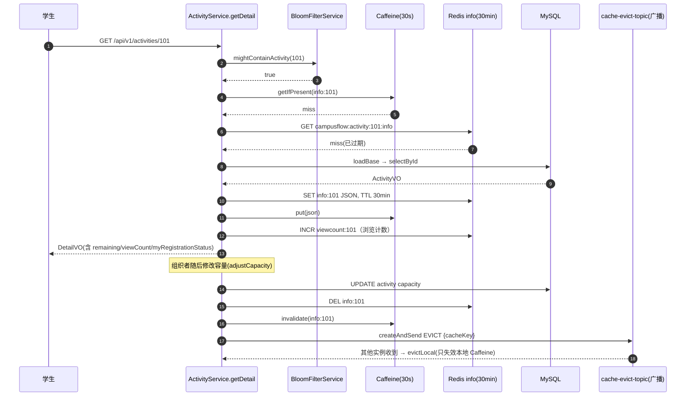

# 04 · Redis 与缓存实战（Key 设计 / 数据结构选型 / 多级缓存 / 三大问题）

> 本篇目标：掌握 CampusFlow 的 Redis 使用全景——Key 命名规范与 TTL 设计、五种数据结构的业务选型、
> Cache Aside 与 `MultiLevelCacheService` 双级缓存、布隆过滤器防穿透、击穿与雪崩的应对、
> Redisson 看门狗、热 Key/大 Key 治理。报名扣减（Lua）在 05 篇专讲，本篇聚焦"读缓存"与"治理"。

---

## ① 业务背景：活动详情页的读压力

报名前每个学生都会反复刷新活动详情页（看剩余名额、时间、介绍）。推演一个真实热点：

- 一场 5000 人关注的讲座，详情页 QPS 峰值可达 2000+；
- 详情 SQL：`activity` 主键查 + `user` 查组织者昵称 + `registration` 查个人报名状态 ≈ 3~5 条 SQL；
- 2000 QPS × 3 条 = 6000 SQL/s，单实例 MySQL 读瓶颈一般 3000~5000 QPS → **DB 挂掉，连带报名链路一起挂**
  （报名链路第一步 `activityMapper.selectById` 也要读库）；
- 学生活动列表页还会按分类/状态分页查询——这些**不要求强实时**（晚 30 秒看到新活动没关系），
  典型"读多写少 + 允许短暂旧数据"的缓存友好场景。

## ② 不使用缓存/用错缓存会发生什么（数字推演）

| 反面方案 | 推演结果 |
|---|---|
| 完全不缓存 | 2000 QPS 详情查询直达 MySQL，64 连接池耗尽时间 <1s，全站 5xx |
| 只加 Redis 不设 TTL | 活动取消后详情永久显示"报名中"（脏数据无界）；Redis 内存被无主数据慢慢吃光 |
| TTL 全部 60min 且同一时刻批量预热 | 同一秒数千 Key 集中过期 → 下一秒全部回源 DB（**雪崩**），DB 瞬时 10 倍负载 |
| 恶意请求不存在的 activityId | 全部穿透到 DB（**穿透**），爬虫/攻击者用随机 ID 打出 100% miss |
| 热门活动详情单 Key 读 2000 QPS | 单 Redis 节点单 Key 带宽打满（**热 Key**），其他业务跟着超时 |
| 把 10MB 的活动长描述塞 String | Redis 大对象（**大 Key**），读写阻塞单线程，主从复制延迟飙升 |
| 只用本地缓存不用 Redis | 多实例间数据互不可见，实例 A 改了容量、实例 B 还显示旧名额 |
| 只用 Redis 不用本地缓存 | 每次详情多一次 RTT（~1ms），2000 QPS 下 Redis 单节点 CPU 无谓消耗 |

## ③ 本项目方案：Key 体系与多级缓存架构

### 3.1 Key 命名规范与 TTL 策略

所有 Key 集中在 `backend/campusflow-common/src/main/java/com/campusflow/common/constant/RedisKeyConstants.java`，
类注释给出规范："campusflow:{业务域}:{id}:{数据含义}；所有 Key 必须集中在此定义，避免散落在业务代码里
造成治理困难；TTL 策略统一在注释中标注，禁止使用永不过期的大对象 Key。"

| Key 模板 | 结构 | TTL | 归属 |
|---|---|---|---|
| `campusflow:activity:{id}:stock` | String | 活动结束+7 天（`preloadStock` 统一设置） | 报名扣减（05 篇） |
| `campusflow:activity:{id}:meta` | Hash(status/signupStart/signupEnd/capacity) | 活动结束+7 天 | Lua 校验数据源 |
| `campusflow:activity:{id}:members` | Set(userId) | 活动结束+7 天 | 一人一单去重 |
| `campusflow:activity:{id}:waitlist` | ZSet(member=userId, score=入队毫秒) | 活动结束+7 天 | 候补队列 |
| `campusflow:activity:{id}:waitlist:seq` | String INCR | 随预热/入队 | 排队号发生器 |
| `campusflow:activity:{id}:info` | String(JSON) | 30min（`redis-activity-ttl-minutes`） | 详情多级缓存 L2 |
| `campusflow:activity:{id}:viewcount` | String INCR | 活动结束+7 天 | 浏览量 |
| `campusflow:reservation:{aid}:{uid}` | String(REDIS_RESERVED/WAITLIST_RESERVED) | 预留 TTL 15min/30min | 预留状态 |
| `campusflow:idempotent:msg:{...}` | String SETNX | claim 60s / processed 24h | 消费幂等（06 篇） |
| `campusflow:checkin:once:{tokenHash}` | String SETNX | 5min | 签到一次性令牌 |
| `campusflow:ratelimit:signup:{aid}:{uid}` | String INCR | 窗口 10s | 用户级限流 |
| `campusflow:bloom:activity` | Redisson RBloomFilter 位图 | 不过期 + 启动重建 | 防穿透 |

TTL 设计的三条规律（面试可直接说）：
1. **业务生命周期对齐**：与"活动"相关的 Key 一律 TTL = 活动结束 + 7 天（结算期可查后自动清理），
   见 `StockRedisService.preloadStock` 里 `activityEnd.plusDays(7)` 的计算；
2. **防重/幂等类 Key 短 TTL**：签到令牌 5min（扫码即用）、幂等 claim 60s（覆盖一次处理时长）、
   processed 24h（Broker 重投上限内有效）；
3. **拒绝永不过期**：唯一例外布隆过滤器（位图 12KB 级），靠启动时 `initActivityBloomIfAbsent` 重建。

### 3.2 五大数据结构的业务选型

| 结构 | 选它的理由 | 项目用例 |
|---|---|---|
| String | 原子 INCR/DECR、SET NX EX | 库存、限流计数、预留状态、浏览量 |
| Hash | 字段级读写、体积小 | meta（status/signupStart/... 四字段，Lua 只读需要的字段） |
| Set | 天然去重、SISMEMBER O(1)、SREM 幂等 | 已报名成员集合（一人一单前置防线） |
| ZSet | score 排序 + ZPOPMIN 出队首 + rank 查排位 | 候补队列（score=入队时间保证先来先得） |
| 位图（布隆） | 内存极省、O(k) 判存 | 活动存在性过滤器 |

反例也值得说：`StockRedisService` 类注释明确"**不适合缓存**：活动长描述、审核记录等大文本
（读少写多、体积大，缓存收益低）"——长描述随详情 JSON 缓存的是 VO 摘要而非全量富文本。

### 3.3 多级缓存读链路

```mermaid
flowchart TD
    A["请求: GET /activities/{id}"] --> B{"布隆过滤器<br/>mightContainActivity"}
    B -->|false| X["直接抛 ACTIVITY_NOT_EXIST<br/>DB 零压力"]
    B -->|true(可能误判放行)| C{"L1 Caffeine 本地缓存<br/>TTL 30s, max 500"}
    C -->|命中| R1["返回(含个人状态装饰)"]
    C -->|未命中| D{"L2 Redis<br/>campusflow:activity:{id}:info<br/>TTL 30min"}
    D -->|命中| E["回填 L1 → 返回"]
    D -->|未命中| F["loader: activityMapper.selectById<br/>(loadBase)"]
    F -->|DB 有| G["写 Redis(30min) + 写 L1 → 返回"]
    F -->|DB 无| H["缓存空值占位 60s<br/>(防穿透二线) → 抛 NOT_EXIST"]
```

写链路（Cache Aside，Del 而非 Update）在 `ActivityService.evictDetailCache`：

```java
// backend/campusflow-business/src/main/java/com/campusflow/biz/activity/service/ActivityService.java
public void evictDetailCache(Long activityId) {
    String cacheKey = RedisKeyConstants.activityInfo(activityId);
    multiLevelCacheService.evict(cacheKey);   // 删 Redis + 删本实例 Caffeine
    messageDeliverService.createAndSend(MqConstantsPrefix.CACHE_EVICT,
            MqConstants.TOPIC_CACHE_EVICT, MqConstants.TAG_CACHE_EVICT,
            "CACHE_EVICT", Map.of("cacheKey", cacheKey)); // 广播让其他实例失效本地缓存
}
```

`MultiLevelCacheService`（`backend/campusflow-infrastructure/src/main/java/com/campusflow/infra/redis/MultiLevelCacheService.java`）
核心方法 `get(key, loader, clazz)`：L1 `getIfPresent` → L2 `opsForValue().get` → `loader.apply(key)` →
null 则"空值防穿透：TTL 60s"，非 null 则双写回填。Caffeine 构建：

```java
private final Cache<String, String> localCache = Caffeine.newBuilder()
        .maximumSize(500)
        .expireAfterWrite(Duration.ofSeconds(30))
        .recordStats()
        .build();
```

**为什么写用 Delete 不用 Update**（类注释）："避免并发写覆盖与双写不一致"——两个写请求 A(改标题)
和 B(改容量) 并发时，Update 模式可能出现"B 先写缓存、A 后写缓存"，缓存里留下 A 的旧容量；
Del 模式下最后缓存被删，下次读时按 DB 最新值重建。

**一致性兜底**（注释原文）："本地 TTL 仅 30 秒，即使广播丢失，脏读窗口也被限制在该 TTL 内
（延迟双删的适用场景说明见学习讲义）"——这就是下面的专题。

### 3.4 延迟双删在本项目的适用性讨论

经典"延迟双删"：写库前删缓存 → 写库 → 延迟 N ms 再删一次，用于清理"删后又被旧读回填"的脏缓存。
本项目**没有采用**，原因推演：

1. Cache Aside 的脏读窗口来自"读-回填"与"写-删除"的竞态：读请求在删缓存前查了旧值、在删缓存后回填。
   本项目的写路径（审核发布/取消/容量调整）是低频管理操作，与读竞态概率极低；
2. 双删的延迟值难选：太短竞态窗口还在，太长脏读窗口被拉长；
3. 项目有更强兜底：本地 Caffeine 30s 硬过期 + 广播失效 + 消费端 `CacheEvictConsumer` 兜底，
   脏读上限就是 30 秒且只影响详情展示，不影响库存扣减正确性（库存走 Lua 直读 Redis，不经过 info 缓存）；
4. 若是"写后立刻强一致读"的场景（如支付状态），才值得引入双删或干脆读写都走权威源。

面试话术："我知道延迟双删解决什么问题，也分析了我们项目为什么不需要——用 TTL + 广播失效 + 缓存与
库存职责分离达到了同样的效果，复杂度更低。"

### 3.5 布隆过滤器防穿透

`backend/campusflow-infrastructure/src/main/java/com/campusflow/infra/redis/BloomFilterService.java`：

```java
public static final String ACTIVITY_BLOOM_NAME = "campusflow:bloom:activity";

public boolean mightContainActivity(long activityId) {
    return redissonClient.getBloomFilter(ACTIVITY_BLOOM_NAME).contains(activityId);
}
```

类注释的三个设计点（背下来）：
- **存在误判（fpp=0.01）但不漏判**：误判只是把不存在的放行到缓存/DB 一次，由空值占位（60s）兜底，安全；
- **不支持删除**：活动取消后仍会放行查询，交给空值缓存兜底；
- **Redis 重启数据丢失**：启动时从 DB 全量重建（`initActivityBloomIfAbsent` 用 `tryInit` 幂等；
  `rebuildActivityBloom` 全删重建），活动量小代价可忽略。

配置：`bloom-expected-insertions: 100000`、`bloom-fpp: 0.01` → 位图约 120KB，k≈7 个哈希函数。
数学：n=100000、fpp=0.01 时位数 m ≈ -n·ln(p)/(ln2)² ≈ 9.6 bit/元素 ≈ 0.96Mbit ≈ 120KB。

### 3.6 缓存击穿与雪崩的应对

**击穿**（热 Key 过期瞬间并发回源）本项目两层应对：
1. **预热代替冷启动**：`ActivityService.approvePublish` 在审核通过时就把 stock/meta/members 预热进 Redis
   （`preloadStock`，且在 `@DistributedLock(key="'activity:publish:' + #activityId")` 锁内防并发重复预热）；
   活动详情经 `getDetail` 被第一个访问者回源后持续命中；
2. **懒预热自愈**：`warmupStockIfNeeded`（`@DistributedLock(key="'stock:warmup:' + #activityId")`），
   元数据缺失时锁内按 DB 权威口径重建——多实例同时发现缺失也只有一个真正预热（其余等锁后读到了新值直接返回语义）。

**雪崩**（大量 Key 同时过期）本项目应对：
- TTL 天然分散：活动 Key 的 TTL = 活动结束+7 天，每个活动结束时间不同 → 过期时间天然错峰；
- 详情缓存 30min TTL + 广播主动失效，不依赖"同时到期"；
- 多级缓存：即使 Redis 层全过期，Caffeine 30s 内还能顶住回源洪峰的第一波；
- 若做超大规模（如全站公告类 Key），进一步方案是"基础 TTL + 随机抖动 TTL"（TTL = base + rand(0,300s)），
  本项目活动域不需要——面试时说清楚"为什么用得上、为什么这里用不上"比背方案更加分。

### 3.7 Redisson 看门狗（先给结论，细节在 07 篇）

`RedissonConfig` 类注释："使用 lock()/tryLock(waitTime, unit) 两参形式时不传 leaseTime，
Redisson 启动 watchdog（默认 30s，每 10s 续期），防止业务未完成锁先过期被误删。"
`DistributedLock` 注解的 `leaseTimeMillis() default -1` 就是"启用看门狗"的语义开关。
本篇记住选型逻辑：**预热/晋级/补偿任务这类"时长不可预估"的操作用看门狗；
签到 SETNX 这类"固定短 TTL"直接 SETNX+EXPIRE 就够，不需要锁**。

### 3.8 两个独立 Redis 客户端的分工（Lettuce vs Redisson）

| 通道 | 客户端 | 职责 | 关键配置 |
|---|---|---|---|
| 缓存主通道 | spring-data-redis（Lettuce `StringRedisTemplate`） | String/Hash/Set/ZSet 读写、Lua 脚本执行、INCR/SETNX | `application-local.yml`：lettuce pool max-active=32 / max-idle=8 / min-idle=2，timeout 5000 |
| 锁与布隆 | Redisson `RedissonClient`（手动装配） | RLock（看门狗）、RBloomFilter | `RedissonConfig`：connectionMinimumIdleSize=8 / poolSize=32 |

分工理由（`RedissonConfig` 注释原文）："1. 保留 spring-data-redis(Lettuce) 作为缓存主通道；
2. Redisson 专用于分布式锁 / 布隆过滤器 / 看门狗机制；3. 生命周期由 Spring 容器管理。"
两个客户端**连同一个 Redis 实例**（复用 `spring.data.redis.*` 配置），但连接池独立、超时独立，
锁通道阻塞不会拖垮缓存通道——这是一层朴素的故障域隔离。

### 3.9 独立限流服务与浏览量计数

`RateLimiterService`（`backend/campusflow-infrastructure/src/main/java/com/campusflow/infra/redis/RateLimiterService.java`）
是报名限流之外、给其他端点用的通用固定窗口限流：

```java
public boolean tryAcquire(String key, int limit, int windowSeconds) {
    String fullKey = "campusflow:ratelimit:svc:" + key;
    Long count = stringRedisTemplate.opsForValue().increment(fullKey);
    if (count != null && count == 1) {
        stringRedisTemplate.expire(fullKey, windowSeconds, TimeUnit.SECONDS);
    }
    boolean allowed = count != null && count <= limit;
    ...
}
```

类注释同时指出了固定窗口的边界突刺问题与升级路径："若需平滑限流可替换为滑动窗口（ZSet）或
令牌桶（Redisson RRateLimiter），此处业务量下固定窗口足够。"
对比：报名链路的限流**内嵌在 reserve.lua 里**（原子且省一次往返），`tryAcquire` 只服务
非报名端点——两套限流的分工要在面试讲清楚。

浏览量计数（`ActivityService.getDetail`）：

```java
Long viewCount = stringRedisTemplate.opsForValue()
        .increment(RedisKeyConstants.activityViewCount(activityId));
detail.setViewCount(viewCount);
```

INCR 的天然原子性让"边读边计数"无竞态；TTL=活动结束+7 天自动清理；
展示用读不回写 DB（统计上报是另一条异步链路的事，详情接口不背这个延迟）。

### 3.10 缓存值的序列化契约

多级缓存里 L1/L2 都存 JSON 字符串（`JsonUtils.toJson` / `fromJson`），为什么不用 JDK 序列化：
- 可读（redis-cli 直接 GET 能看懂）、跨语言、体积小；
- `JsonUtils` 是纯静态工具类（`campusflow-common/.../util/JsonUtils.java`），统一 ObjectMapper 配置与
  Long→String 序列化（与 `JacksonConfig` 同源）；
- 空值占位存的是**空字符串**（`MultiLevelCacheService.deserialize` 对空串返回 null）——
  "空值防穿透"的实现细节：`set(key, "", 60s)`，读方识别空串即视为"DB 确认不存在"。

## ④ 技术执行流程：详情读 + 写失效完整时序



广播消费端 `CacheEvictConsumer`（`backend/campusflow-infrastructure/src/main/java/com/campusflow/infra/mq/CacheEvictConsumer.java`）要点：
广播模式（`factory.create(..., true, ...)` → `MessageModel.BROADCASTING`）、各实例只失效本地缓存、
"广播模式消费失败不重投（无重试语义），所以本地 TTL 30s 是最终兜底 —— 设计上接受秒级脏读"。

## ⑤ 结合源码学习：从 Controller 到 Redis 的调用链

**链路一：活动详情读**
`ActivityPublicController`（`backend/campusflow-business/src/main/java/com/campusflow/biz/activity/controller/ActivityPublicController.java`）
→ `ActivityService.getDetail()` → `BloomFilterService.mightContainActivity()` →
`MultiLevelCacheService.get(cacheKey, loader, ActivityVO.class)` → `loadBase()`(DB) →
`StringRedisTemplate.increment(viewcount)` → `StockRedisService.getStock()`(剩余名额展示)。

**链路二：发布预热（写路径）**
`OrganizerActivityController`/管理员审核 → `ActivityService.approvePublish()`
（`@DistributedLock` + `@Transactional`）→ `countActiveRegistrations()`(DB 权威口径) →
`StockRedisService.preloadStock()`（写 stock/meta/members 三个 Key + 统一 TTL）→ `evictDetailCache()`。

**链路三：候补入队（ZSet 实战）**
`WaitlistController` → `WaitlistService.join()` → `opsForZSet().addIfAbsent()`（ZADD NX 原子防重）→
`opsForValue().increment(seqKey)`（INCR 发排队号）→ `opsForZSet().rank()`（查排位）→ 通知发件箱。

**链路四：签到一次性令牌（SETNX 实战）**
`CheckinController` → `CheckinService.scan()` →
`stringRedisTemplate.opsForValue().setIfAbsent(RedisKeyConstants.checkinOnce(tokenHash), "1", Duration.ofMinutes(5))`。

## ⑥ 并发场景分析：数字推演

**场景 1：热点活动详情 2000 QPS**
- 全命中 L1（单实例 Caffeine read ~100ns）：0 次 Redis、0 次 DB；
- L1 过期后 30s 窗口内：第一次读 miss → 1 次 Redis 命中（~1ms）回填；
- Redis TTL 30min 到期瞬间：并发 2000 请求同时 miss L2 → 2000 个 DB 查询？不会——
  Caffeine 的 `getIfPresent` 无加载锁，理论上会并发回源，但详情回源是主键单查（~2ms），
  2000 个主键查对 MySQL 是 4s 的工作量摊在毫秒窗口 → 峰值压力存在但可承受；
  若要绝对消除，可把 `multiLevelCacheService.get` 换成 Caffeine `get(key, loader)`（同 key 加载互斥）或加锁单飞。
  **这是项目可演进点，面试主动说出来是加分项。**

**场景 2：恶意 ID 穿透**
- 攻击者用随机 activityId 打 5000 QPS：布隆 99% 在 `mightContain` 处拦截（1 次 Redis contains ~0.05ms）；
- 1% 误判（~50 QPS）进入缓存层：空值占位 60s 内后续同 ID 直接返回 null，DB 只承受首查；
- DB 实际新增压力 ≈ 每个随机 ID 每 60s 一次 ≈ 忽略不计。

**场景 3：广播失效风暴**
管理员批量取消 100 个活动：100 条 EVICT 广播消息，每实例各消费 100 条本地 invalidate（内存操作 ~0.1ms/条），
Redis DEL 100 次（更新方执行）——总耗时 <100ms，无雪崩风险。

**场景 4：viewcount 热 Key**
`viewcount` 是典型写热 Key：5000 QPS 下每秒 5000 次 INCR 集中在一个 Key。当前规模（单 Redis 单实例，
INCR 是 O(1) 内存操作）完全可承受；若上到 10 万 QPS 级别需分片计数（`viewcount:{id}:{shard}` N 个 Key
随机写、读取时 SUM），本项目预留了该思路但未实现——诚实讲清取舍即可。

## ⑦ 优化思路：第一版 → 第二版 → 取舍

| 主题 | 第一版 | 第二版（现状） | 取舍说明 |
|---|---|---|---|
| 读详情 | 每次查库 | 布隆 + Caffeine 30s + Redis 30min 三级 | 2000 QPS 详情 0 DB；代价是多级一致性问题（广播失效解决） |
| 写失效 | 更新缓存（Update） | 删除缓存（Del） + 广播 | 并发写不覆盖；代价是下次读多一次回源 |
| 防穿透 | 只做"DB 无则缓存空值" | 布隆前置 + 空值占位双防线 | 布隆挡住 99% 随机 ID；空值兜底误判与"取消后仍放行" |
| 防击穿 | 无（依赖 TTL 自然过期） | 发布即预热 + 懒预热自愈（锁内） | 热点活动上线即就绪；代价是预热代码路径 |
| TTL | 全部固定 60min | 业务生命周期对齐（结束+7d）+ 详情 30min | 自动清理防泄漏；Key 无界风险归零 |
| 大 Key | 富文本全量塞缓存 | 缓存 VO 摘要，长描述按需读 | Redis 单线程不被 10MB 对象阻塞 |

## ⑧ 面试知识

### 基础
1. **Redis 为什么快？** 内存操作 + 单线程无锁竞争 + epoll 多路复用 + 高效结构（SDS/跳表/压缩列表）。
2. **五种结构各自底层？** String=SDS；Hash=ziplist/listpack→hashtable；Set=intset→hashtable；
   ZSet=ziplist/listpack→skiplist+dict；本项目成员集元素是 userId 字符串，小集合走紧凑编码省内存。
3. **TTL 是怎么实现的？** `expires` 字典存过期时间戳，访问时惰性删除 + 每周期随机抽样主动删除。

### 中级
4. **Cache Aside 为什么是删缓存不是更新缓存？** 并发写覆盖问题（本篇 3.3）；且缓存值常由多表聚合，
   更新需要重算，删除更廉价。
5. **穿透/击穿/雪崩一句话区分？** 穿透=查不存在的数据（布隆+空值）；击穿=热 Key 过期（预热+锁）；
   雪崩=大量 Key 同时过期或 Redis 整体不可用（TTL 分散+多级+集群高可用）。
6. **布隆过滤器原理？** k 个哈希函数置位 k 个 bit；查询全 1 才"可能存在"，任一为 0 必不存在；
   不支持删除（删除会误伤其他元素，要删用计数布隆/Cuckoo）。

### 高级
7. **Redis 与 DB 双写一致性的完整方案谱系？** 先更 DB 再删缓存（Cache Aside，主流）→ 订阅 binlog
   异步删除（Canal，解耦但延迟）→ 延迟双删（对付读回填竞态）→ 强一致只能加分布式锁或走权威源。
   本项目选 Cache Aside + 广播 + TTL 兜底，因为详情读允许 ≤30s 旧值、库存走独立权威链路。
8. **热 Key 发现与治理？** 发现：`redis-cli --hotkeys`、监控 `keyspace` QPS、客户端埋点；
   治理：本地缓存承接（本项目 Caffeine 就是热 Key 治理）、读写分片、单 Key 拆多 Key。
9. **大 Key 发现与治理？** `redis-cli --bigkeys`/`memory usage`；治理：拆 Hash 分段、限制序列化体积
   （本项目详情只存 VO）、删除大 Key 用 UNLINK 异步（DEL 会阻塞单线程）。

### 项目追问（高频）
10. **"你的本地缓存怎么和 Redis 保持一致？"** 更新方：DB 更新 → `evict`(Redis DEL + 本地 invalidate) →
    广播 `campusflow-cache-evict-topic`(BROADCASTING) → 每实例 `evictLocal`；兜底：本地 TTL 30s。
11. **"布隆过滤器误判了怎么办？"** 放行到缓存层，DB 查无 → 写空值占位 60s（`MultiLevelCacheService.get` 的 null 分支），
    同一 ID 60s 内不再打 DB。
12. **"活动取消后布隆为什么还不拦？"** 布隆不能删位（误伤他人）；取消活动放行后由"活动已取消"的业务校验
    （`cancelActivity` 置状态 + `evictStockKeys`）和空值缓存处理——布隆只负责"存在性"，不负责"状态"。
13. **"为什么 stock 不走 Cache Aside 而要 Lua 直写？"** 库存是"写竞争"数据，读缓存回填会覆盖原子扣减结果；
    Cache Aside 适合读多写少，扣减场景必须以 Redis 为权威、DB 异步对账（`stockReconcile`）。

### 底层原理
14. **Caffeine W-TinyLFU**：准入用 Count-Min Sketch 频率估计 + 窗口区/保护区分段 LRU，
    命中率优于纯 LRU（本项目 500 条上限的详情缓存足够）。
15. **Redis 单线程为什么 Lua 不会被插队？** 命令执行模型：IO 线程读包 → 单线程按序执行命令队列，
    EVALSHA 的整个脚本是一个命令单元，执行期间不处理其他客户端命令——这就是 05 篇原子性的来源。
16. **Redisson 看门狗续期实现**：锁成功后注册 `Timeout`（默认 30s/3 = 10s 间隔），到期检查客户端仍持锁
    则用 Lua 重置 PTTL 到 30s；客户端异常退出（GC/断网超时）不续期 → 锁按 TTL 自然释放，服务不死者才续。

### 常见错误回答 vs 参考答案
- ❌ "布隆过滤器 100% 准确" → ✅ 有 fpp 误判率（本项目 1%），但**绝不漏判**，防线语义是"可能放行、绝不误拦"。
- ❌ "缓存一致性就是要强一致" → ✅ 缓存的定义就是允许旧数据；要做的是把不一致窗口控制在业务可接受范围
  （30s）且不影响正确性关键路径（库存不走该缓存）。
- ❌ "本地缓存用 HashMap 就行" → ✅ 需要 TTL、容量上限、淘汰策略与并发安全（分段/CAS），
  HashMap 手写这些等于重造 Caffeine 还容易出并发 bug。

## ⑨ 动手练习

1. **观察代码**：`grep -n "campusflow:" backend/campusflow-common/src/main/java/com/campusflow/common/constant/RedisKeyConstants.java`
   列出全部 Key，给每个 Key 标注数据结构与 TTL（对照本篇 3.1 表格自查）。
2. **改参数**：把 `campusflow.cache.local-ttl-seconds` 相关的 Caffeine `expireAfterWrite` 从 30s 改成 5s，
   压测详情接口，对比 L1 命中率下降（`recordStats()` 已开启，可打印 `localCache.stats()`）。
3. **模拟异常**：手动 `DEL campusflow:activity:1:stock`（模拟预热丢失），调报名接口，观察日志出现
   "库存元数据缺失，触发懒预热自愈"且第二次 Lua 调用成功（META_MISSING 自愈路径）。
4. **验证布隆**：用 redis-cli `GETBIT campusflow:bloom:activity 12345` 前后对比（先 `mightContainActivity` 再
   `addActivityId` 后再查），再随机试 100 个不存在的 ID 观察误判率 ~1%。
5. **验证广播失效**：本地起两个实例（不同端口），实例 A 修改活动容量，在实例 B 打日志确认收到
   `[broadcast] 本地缓存失效 cacheKey=...`（CacheEvictConsumer 的日志原文）。
6. **TTL 治理巡检**：`redis-cli --scan --pattern 'campusflow:*'` 配合 `TTL <key>` 逐类抽查，
   确认没有"永不过期的大对象 Key"（布隆位图除外），并算出 stock Key 的剩余天数。
7. **空值占位观察**：请求一个不存在的活动 ID，在布隆误判放行（1% 概率）或直接绕过布隆调用
   `MultiLevelCacheService.get` 时，观察 `GET campusflow:activity:99999:info` 返回空串、`TTL` ≤60s。
8. **限流边界**：为 `RateLimiterService.tryAcquire` 写个小单测，在窗口交界处（windowSeconds 的
   最后 50ms 与下个窗口前 50ms）连打 2×limit 次，复现类注释提到的"边界突刺"。

## ⑩ 本篇常见追问补充（面试官连环三连）

**Q1：Redis 重启，哪些数据能自愈？**
分两类自愈：布隆过滤器启动重建（`initActivityBloomIfAbsent`）；stock/meta 缺失走 META_MISSING
懒预热自愈 + `stockReconcile` 5 分钟兜底重建。不能自愈的是幂等标记（认领锁/processed）——
丢失的后果只是"幂等快路径失效"，由 DB 唯一约束兜底，正确性无损。

**Q2：多级缓存为什么本地 TTL 只有 30 秒？**
它是"广播丢失时的脏读上限"，不是性能参数。30s 是产品可接受的详情页旧数据窗口；
若业务要求 10s，把 `localTtlSeconds` 调小即可，代价是 L1 命中率下降、Redis 压力上升——
**TTL 是一致性窗口和缓存收益的交换旋钮**。

**Q3：为什么活动详情缓存是 String(JSON) 而不是 Hash？**
整个 VO 一次读一次写、无字段级更新需求；Hash 的字段级优势用不上，反而多一层字段序列化约定。
选型原则：**结构服务于访问模式**——meta 用 Hash 是因为 Lua 只读 status/signupStart 等个别字段，
详情用 String 是因为整存整取。

---

*下一篇：[05_高并发报名与RedisLua](05_高并发报名与RedisLua.md) —— 核心篇：逐行拆解 reserve.lua 与状态机全链路。*
