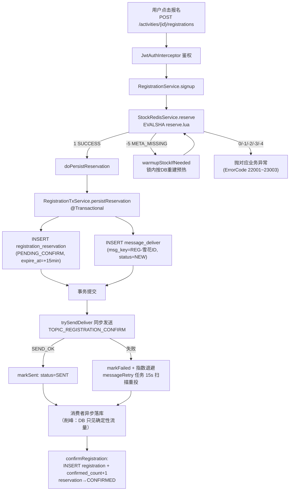
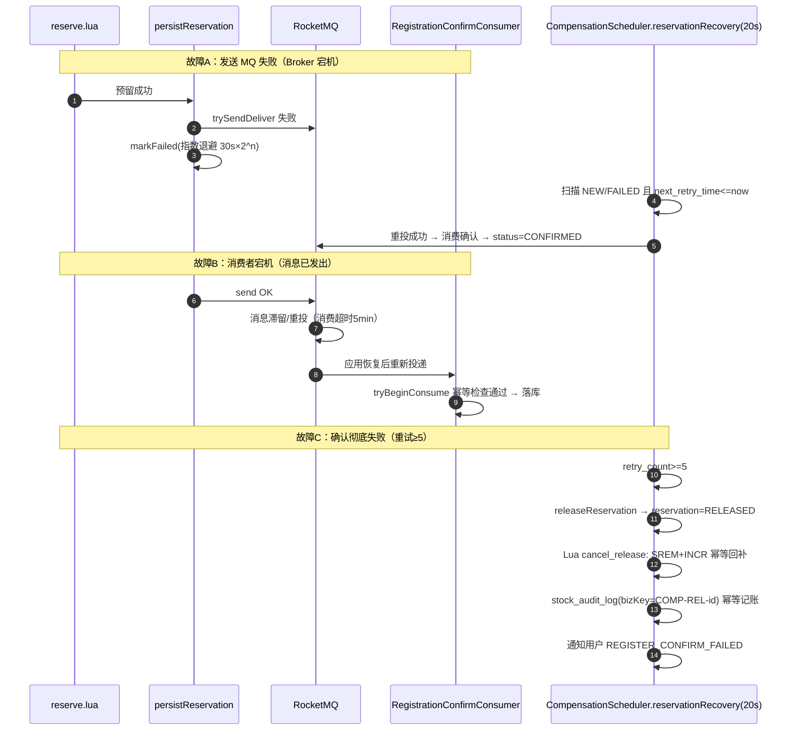

# 05 · 高并发报名与 Redis Lua（核心篇）

> 本篇是整个讲义的**核心**：逐行讲解 `reserve.lua`，推演"为什么 GET+DECR 会超卖"，讲透 Lua 原子性、
> 成员集去重、限流内嵌、META_MISSING 自愈、MQ 削峰、状态机全链路与六个补偿任务兜底。
> 面试问"你项目里最难的点"，答这篇。

---

## ① 业务背景：一场 5000 人抢 100 名额的讲座

晚上 8 点，院士讲座报名开启。5000 个学生几乎同时点"立即报名"：
- 每个人都要经历：是否可报（状态/时间窗）→ 是否重复 → 是否还有名额 → 扣名额 → 登记 → 返回结果；
- 前 4 步是**判断**，第 5 步是**变更**——所有并发灾难都发生在"判断与变更之间"；
- 还有用户疯狂刷新：同一人 1 秒点 10 次（防刷需求）；
- 抢不到的人要能进候补队列；
- 名额从 Redis 扣掉之后，数据库里必须最终出现一条"已报名"记录，不能丢。

## ② 为什么 GET+DECR 会超卖（数字推演）

### 2.1 朴素方案的时间线

假设库存 Key `stock=1`，并发 1000 个线程，每个线程执行两步 Redis 命令：

```
线程X: GET stock -> "1"   （判断：还有名额）
线程X: DECR stock         （变更：扣 1）
```

命令执行时间线（Redis 单线程按序执行，但**线程间命令交错**）：

| 时刻 | Redis 执行的命令 | stock 值 | 说明 |
|---|---|---|---|
| t1 | T1: GET stock | 1 → T1 看到 "1" | T1 判断可报名 |
| t2 | T2: GET stock | 1 → T2 也看到 "1" | T2 也判断可报名（T1 还没 DECR） |
| t3 | T3: GET stock | 1 → T3~T1000 全部看到 "1" | 判断阶段全员通过 |
| t4 | T1: DECR stock | 0 | |
| t5 | T2: DECR stock | **-1** | 开始超卖 |
| ... | T1000: DECR stock | **-999** | 库存变负数，999 人"报名成功" |

这正是 `reserve.lua` 头注释写的内容（原文）：

> 为什么不用 GET+DECR 组合：两条命令间存在并发窗口，
> 1000 个并发同时 GET 到 stock=1 再各自 DECR 会变成 -999（超卖）。
> Lua 脚本在 Redis 中原子执行，检查与扣减之间不会插入其他命令。

### 2.2 各种"打补丁"方案为什么也不行

| 方案 | 问题 |
|---|---|
| `DECRBY` 先扣再判断负数回滚 | 多线程 DECR 到 -999 后要"回滚 999"，但中间穿插的取消 INCR 会被错误回滚，无法精确补偿 |
| WATCH/MULTI 乐观事务 | 高并发下 WATCH 冲突率 ~99%，全部重试 → 命令量爆炸、Redis CPU 打满 |
| 应用层分布式锁 | 1000 请求串行化，单次锁往返 ~1ms → P99 秒级，吞吐坍缩到锁粒度（详见 07 篇对比） |
| DB `UPDATE ... WHERE stock>0` | 每个请求都打 DB（5000 QPS），热点行锁排队，DB 先死 |

**结论：把"判断+变更"合并成 Redis 里的一个不可分割执行单元 = Lua 脚本。**

## ③ 本项目方案：一次原子执行做完六件事

`reserve.lua` 在**一个脚本内**完成：元数据校验 → 时间窗校验 → 用户级限流 → 一人一单去重 →
库存原子扣减 → 成员登记 + 预留状态写入。整个链路方案：

1. **Redis 权威层**：Lua 预留（本篇主角）；
2. **持久化层**：`RegistrationTxService.persistReservation` 事务写预留表 + 发件箱（不阻塞用户返回）；
3. **异步确认层**：RocketMQ `campusflow-registration-confirm-topic` → `RegistrationConfirmConsumer` 落库；
4. **兜底层**：`CompensationScheduler` 六任务兜底（2.4 节）。

Redis Key 与入参（`StockRedisService.reserve` 的调用参数，真实代码）：

```java
Long ret = stringRedisTemplate.execute(reserveScript,
        List.of(activityStock(activityId),      // KEYS[1] campusflow:activity:{id}:stock
                activityMembers(activityId),    // KEYS[2] campusflow:activity:{id}:members
                activityMeta(activityId),       // KEYS[3] campusflow:activity:{id}:meta
                reservationState(activityId, userId),   // KEYS[4] campusflow:reservation:{aid}:{uid}
                signupRateLimit(activityId, userId)),   // KEYS[5] campusflow:ratelimit:signup:{aid}:{uid}
        String.valueOf(userId),                 // ARGV[1]
        String.valueOf(System.currentTimeMillis()), // ARGV[2]
        String.valueOf(reserveTtlMinutes * 60L),    // ARGV[3] 预留TTL(秒)=15*60
        String.valueOf(rateWindowSeconds),      // ARGV[4] 限流窗口=10s
        String.valueOf(rateMaxPerWindow));      // ARGV[5] 窗口最大次数=8
```

## ④ 技术执行流程：reserve.lua 逐行精读

### 4.1 逐行讲解（`backend/campusflow-infrastructure/src/main/resources/lua/reserve.lua` 全文）

```lua
-- KEYS[1]=stock(String)  KEYS[2]=members(Set)  KEYS[3]=meta(Hash)
-- KEYS[4]=reservation:{aid}:{uid}(String)  KEYS[5]=ratelimit:signup:{aid}:{uid}
local userId       = ARGV[1]
local now          = tonumber(ARGV[2])
local reserveTtl   = tonumber(ARGV[3])
local rateWindow   = tonumber(ARGV[4])
local rateMax      = tonumber(ARGV[5])

-- 1. 活动元数据校验（未预热直接拒绝，防止脏读）
local status = redis.call('HGET', metaKey, 'status')
if (not status) then
    return -5                                   -- META_MISSING：触发上层懒预热自愈
end
if status ~= '3' and status ~= '4' then         -- 3=已发布 4=进行中
    return -1
end

-- 2. 报名时间窗口校验
local signupStart = tonumber(redis.call('HGET', metaKey, 'signupStart') or '0')
local signupEnd   = tonumber(redis.call('HGET', metaKey, 'signupEnd') or '0')
if now < signupStart or now > signupEnd then
    return -2
end

-- 3. 用户级固定窗口限流（防刷：窗口内第一次 INCR 时设置过期）
local cnt = redis.call('INCR', rateKey)
if cnt == 1 then
    redis.call('EXPIRE', rateKey, rateWindow)   -- 只在首个请求设置 TTL，避免续期漂移
end
if cnt > rateMax then
    return -4
end

-- 4. 一人一单前置校验（成员集合，幂等）
if redis.call('SISMEMBER', membersKey, userId) == 1 then
    return -3
end

-- 5. 库存原子校验与扣减（防超卖核心）
local stock = redis.call('GET', stockKey)
if (not stock) then
    return -5                                   -- stock 也不存在：同样自愈
end
stock = tonumber(stock)
if stock <= 0 then
    return 0                                    -- FULL：引导去候补
end
redis.call('DECR', stockKey)                    -- 此处与 GET 之间无并发窗口！

-- 6. 登记成员 + 写预留状态（带 TTL，超时自动失效交给补偿释放）
redis.call('SADD', membersKey, userId)
redis.call('SET', reserveKey, 'REDIS_RESERVED', 'EX', reserveTtl)
return 1
```

逐段讲解：

**步骤 1~2（防御性校验）**：meta Hash 由 `preloadStock` 写入。`HGET meta status` 为 nil 时返回 -5，
这是"自愈信号"而不是终态错误——上层 `RegistrationService` 会触发懒预热后重试一次（4.3 节）。
Lua 里比较的是字符串 `'3'`/`'4'`，因为 Redis Hash 值全是字符串，这是 Lua 脚本常见坑（`tonumber` 转换缺失）。

**步骤 3（限流内嵌）**：把限流做进 Lua 有两个理由：a) 与扣减**同一次网络往返**，省一次 RTT；
b) 原子性——`INCR` 判断 `cnt==1` 再 `EXPIRE` 的经典"INCR+EXPIRE 非原子"问题（中间宕机导致无 TTL 死键）
在脚本内不存在。窗口参数：10 秒内最多 8 次（`campusflow.signup.rate-limit-window-seconds: 10`、`rate-limit-max: 8`）。

**步骤 4（成员集去重）**：`SISMEMBER` O(1)，Set 元素是 userId 字符串。它是"一人一单"的**前置防线**：
Lua 层拒绝后根本不会产生 DB 写入；最终防线是 `uk_activity_user` 唯一索引（03 篇）。

**步骤 5（防超卖核心）**：`GET` 检查后立刻 `DECR`，两命令同属一个脚本执行单元，
**期间 Redis 不会调度其他客户端的命令**——这就是 Lua 原子性的本质。
stock 缺失返回 -5 而不是把库存当 0（区分"没数据"和"没名额"，两种错误的上层处理完全不同）。

**步骤 6（登记与预留）**：`SADD` 成员 + `SET reserveKey REDIS_RESERVED EX ttl`。
预留 TTL（15 分钟）是**自我清理机制**：如果确认链路彻底失败，15 分钟后预留 Key 自动消失，
补偿任务据此幂等释放名额——Redis 层不会永久悬挂一个"占了名额但没人认领"的状态。

**返回码协议**（与 `StockRedisService.ReserveResult` 枚举一一对应）：

| 返回码 | 枚举 | 上层动作 |
|---|---|---|
| 1 | SUCCESS | 走 `doPersistReservation` |
| 0 | FULL | 抛 `STOCK_NOT_ENOUGH(23002)`（前端引导候补） |
| -1 | ACTIVITY_NOT_AVAILABLE | 抛 `ACTIVITY_NOT_PUBLISHED(22002)` |
| -2 | NOT_IN_WINDOW | 抛 `ACTIVITY_NOT_IN_SIGNUP_WINDOW(22003)` |
| -3 | DUPLICATE | 抛 `ALREADY_REGISTERED(23001)` |
| -4 | RATE_LIMITED | 抛 `RATE_LIMITED(23003)` |
| -5 | META_MISSING | **自愈重试**（见 4.3），仍失败抛 `REDIS_ERROR(30002)` |

### 4.2 全链路状态机与 MQ 削峰



**MQ 削峰的本质**：Redis 已经把 5000 QPS 的"不确定流量"筛成 100 个"确定成功"，
MQ 再把"确认落库 + 通知 + 统计"从用户请求线程剥离——主接口耗时只含 Lua + 2 INSERT + 1 发送，
P99 < 50ms；DB 承接的是平滑的 100 级 QPS。

### 4.3 META_MISSING 自愈懒预热

`RegistrationService.signup` 真实源码：

```java
StockRedisService.ReserveResult result = stockRedisService.reserve(...);
// 自愈路径：元数据缺失（预热丢失/Redis 重启）-> 锁内按 DB 权威口径重建 -> 重试一次
if (result == StockRedisService.ReserveResult.META_MISSING) {
    log.info("库存元数据缺失，触发懒预热自愈 activityId={}", activityId);
    activityService.warmupStockIfNeeded(activityId);
    result = stockRedisService.reserve(...);   // 只重试一次
}
```

`ActivityService.warmupStockIfNeeded` 带 `@DistributedLock(key = "'stock:warmup:' + #activityId")`：
5000 并发同时发现 -5 时，只有一个实例真正执行"DB 权威口径重建"（`capacity - countActiveRegistrations`），
其余等待锁（waitTime 3s）或自行重试——**防止并发重建期间用户扣到旧值**。
自愈失败（活动刚被取消/Redis 不可用）转业务错误 `REDIS_ERROR`，快速失败优于脏数据。

### 4.4 异常时序图（三个典型故障的走向）



### 4.5 六个补偿任务兜底（CompensationScheduler 全表）

`backend/campusflow-business/src/main/java/com/campusflow/biz/compensation/scheduler/CompensationScheduler.java`，
类注释"5 个独立任务"实际代码 6 个 `@Scheduled` 方法（注释列了 6 项），全部用
`lockService.tryRun(RedisKeyConstants.lockCompensationJob("..."), ...)` 防多实例重复执行：

| 任务 | fixedDelay | 输入查询 | 兜底动作 |
|---|---|---|---|
| `reservationRecovery` | 20s | `status=0 AND expire_at<now-1min LIMIT 50` | 已确认→修复预留状态；未确认→重发消息或重试耗尽→幂等释放+通知 |
| `messageRetry` | 15s | `status IN (0,3) AND next_retry_time<=now AND retry_count<8 LIMIT 50` | 发件箱重投（指数退避 30s×2^min(n,6)） |
| `waitlistTimeout` | 30s | `waitlist status=PROMOTED AND confirm_deadline<now LIMIT 50` | Lua 释放→markExpired→审计→通知→晋级下一位 |
| `waitlistBackfill` | 60s | PUBLISHED 且窗口未结束的活动 | stock>0 且 waiting>0 → `tryPromoteNext`（防晋级漏触发） |
| `stockReconcile` | 5min | PUBLISHED/ONGOING 活动 LIMIT 200 | Redis 无值→重建预热；漂移`|expected-redis|>=3`→按 DB 修复+审计+告警任务 |
| `activityStatusSync` | 60s | 到点未流转的活动 | PUBLISHED→ONGOING、ONGOING→FINISHED（同步刷新/清理 Redis） |

兜底设计哲学（类注释原文）："幂等保证：每个任务的操作依赖底层幂等机制（Lua SREM、DB 状态 CAS、
审计 bizKey 唯一），重复执行不会产生副作用叠加。"

### 4.6 候补出队脚本（waitlist_serve.lua 简析）

```lua
-- 前提：已持有活动级 Redisson 锁（WaitlistPromoteService.tryPromoteNext）
local stock = redis.call('GET', KEYS[2])
if (not stock) or tonumber(stock) <= 0 then return 0 end   -- 库存不足
local head = redis.call('ZPOPMIN', KEYS[1])                 -- 弹出 score 最小（最早入队）
if #head == 0 then return 1 end                             -- 队列空
local userId = head[1]
redis.call('DECR', KEYS[2])
redis.call('SADD', KEYS[3], userId)
redis.call('SET', KEYS[4] .. userId, 'WAITLIST_RESERVED', 'EX', tonumber(ARGV[1]))
return userId
```

`ZPOPMIN` 弹出即移除，配合 DB 侧 `waitlistMapper.markPromoted` CAS；DB 失败时调用方
`releaseReservation` 回滚 Redis（SREM+INCR 幂等）再继续下一位——"Redis 先行、DB 校准、失败可逆"。

## ⑤ 结合源码学习：完整调用链（Controller → Redis → MQ → DB）

| # | 文件（前缀 `backend/`） | 类.方法 | 关键点 |
|---|---|---|---|
| 1 | `campusflow-business/.../registration/controller/RegistrationController.java` | `signup` | 入口，`AuthContext.getUserId()` |
| 2 | `campusflow-business/.../registration/service/RegistrationService.java` | `signup` | 组织者自报名拦截 + Lua + 自愈 + 返回码映射 |
| 3 | `campusflow-infrastructure/.../redis/StockRedisService.java` | `reserve` | `DefaultRedisScript` 预加载（类注释："缓存脚本摘要，使用 EVALSHA 减少网络传输"） |
| 4 | `campusflow-infrastructure/src/main/resources/lua/reserve.lua` | — | 本篇 4.1 逐行 |
| 5 | `campusflow-business/.../activity/service/ActivityService.java` | `warmupStockIfNeeded` | 懒预热自愈（锁内） |
| 6 | `campusflow-business/.../registration/service/RegistrationTxService.java` | `persistReservation` | 预留表+发件箱同事务 |
| 7 | `campusflow-infrastructure/.../mq/MessageDeliverService.java` | `createDeliverRecordWithKey` / `trySendDeliver` | 显式 msgKey（预留链路检索用）+ SendStatus 校验 |
| 8 | `campusflow-business/.../registration/listener/RegistrationConfirmConsumer.java` | Bean(initMethod=start) | 消费幂等 + BizException 业务性拒绝 + 重试上限转补偿 |
| 9 | `campusflow-business/.../registration/service/RegistrationTxService.java` | `confirmRegistration` | 幂等确认 + afterConfirm 四步联动 |
| 10 | `campusflow-business/.../compensation/scheduler/CompensationScheduler.java` | 6 个 @Scheduled | 4.5 节全表 |
| 11 | `campusflow-infrastructure/src/main/resources/lua/cancel_release.lua` | — | 幂等释放（SREM 返回值判幂等） |

`afterConfirm` 的四步联动（同一事务，值得背）：

```java
private void afterConfirm(...) {
    markReservationConfirmedQuietly(msg.reservationId());  // 1. 预留→CONFIRMED
    activityMapper.incrementConfirmedCount(...);           // 2. DB 对账口径人数+1
    if (msg.waitlistId() > 0) waitlistMapper.markConfirmed(msg.waitlistId()); // 3. 候补转正联动
    messageDeliverService.createDeliverRecord("NTF", TOPIC_NOTIFY, ...);      // 4. 通知随事务提交
}
```

## ⑥ 并发场景分析：5000 人抢 100 名额全景数字

| 指标 | 无 Lua（GET+DECR） | 分布式锁方案 | 本项目 Lua 方案 |
|---|---|---|---|
| 超卖数量 | -999（负库存 999 单） | 0（但吞吐差） | **0** |
| Redis 命令量 | 1000×GET + 1000×DECR（判断与扣减交错） | 锁 GET/SET + 队列等待 | 5000 次 EVALSHA（单次 5 KEYS + 5 ARGV，~1KB） |
| 单请求耗时（P99） | 立即返回但结果错误 | 1000 串行 × ~1ms = 末位 1s+ | **~1ms**（脚本 6 步全内存） |
| MySQL 峰值 QPS | 1000（全部涌入插表，含 900 脏单） | 100 | **~200**（100 确认事务 + 少量查询） |
| 重复报名 | 靠 DB 唯一索引事后拦截（异常返回 500） | 锁内查改 | Lua SISMEMBER 前置拦截（0 写入，返回 23001） |
| 防刷能力 | 无 | 无 | 窗口 10s/8 次内嵌（第 9 次起返回 23004 RATE_LIMITED） |
| 消息丢失后果 | — | — | 预留 15min TTL + 20s 补偿扫描 + 重试耗尽幂等释放，**最终一致** |

**库存变负是不可能的**：`stock <= 0 → return 0` 在 `DECR` 之前判断，且脚本内无并发窗口——
这是与"先 DECR 再判断负数回滚"方案的本质区别（后者在负数区间还要处理取消 INCR 的交错，无法正确回滚）。

**限流的边界突刺**：固定窗口在交界处可能放行 2×limit（如 9.99s 放 8 个 + 10.01s 又放 8 个）。
用户级防刷场景可接受；接口级更平滑的限流可用 `RateLimiterService`（滑动窗口/令牌桶）——
它的类注释恰好讨论了这一点。

## ⑦ 优化思路：第一版 → 第二版 → 取舍

| 版本 | 方案 | 发现的问题 | 演进为 |
|---|---|---|---|
| v1 | DB 行锁 `UPDATE ... WHERE stock>0` | 5000 QPS 打死 DB，热点行串行 ~500 TPS | 库存前移 Redis |
| v2 | Redis GET+DECR | 并发窗口超卖 -999 | Lua 原子脚本 |
| v3 | Lua 预留 + 同步落库确认 | 确认写库在请求线程，通知拖慢 P99 | 拆出 MQ 异步确认 |
| v4（现状） | Lua + 发件箱 + 异步确认 + 六任务补偿 | 引入"消息可能重复/丢失/乱序"新问题 | 消费幂等三层 + 本地消息表重投 + 状态机对账（06 篇） |
| 可演进 | 库存分桶（10 桶×10）、Segment 预扣 | 校园场景收益有限、复杂度上升 | 维持现状，记录为扩展点 |

**关键取舍问答**：
- 为什么不用 WATCH/MULTI？冲突重试风暴，且 MULTI 内不能"读到值再决定写什么"（须预提交变更），
  Lua 可以（脚本里有 if 分支）；
- 为什么预留 TTL 是 15 分钟？消费确认正常 <5s；15min 覆盖 Broker 短暂不可用 + 多次重投退避
  （30s/60s/120s...），又不至于让用户久等后才知道失败；
- 为什么 Lua 里不做 DB 查询？Redis 脚本执行期间阻塞其他命令，DB 网络调用会把 0.1ms 放大到 10ms+，
  所以 meta/members 全部预热进 Redis——"让 Lua 只碰 Redis"是铁律。

## ⑧ 面试知识

### 基础
1. **Lua 脚本为什么能保证原子性？** Redis 单线程执行命令队列，脚本作为一个命令单元一次性执行完，
   期间不调度其他客户端命令。
2. **EVAL 和 EVALSHA 区别？** EVAL 每次传全文（大脚本浪费带宽）；EVALSHA 传 SHA1 摘要。
   项目用 `DefaultRedisScript`（Spring Data Redis 自动先试 EVALSHA、NOSCRIPT 时回退 EVAL 并缓存）。
3. **Lua 脚本能操作多个 Key 吗？** 能，但要传对 KEYS 数组（集群模式要求同 slot，单机无此限制）。

### 中级
4. **Redis Lua 与数据库事务的区别？** Lua 无回滚：执行中某步报错（运行时错误）之前的写不回滚；
   所以脚本要像本项目一样**先全量校验再变更**，把运行时错误概率降到 0。
5. **超卖的根因是什么？** "检查"与"行动"不是原子操作（check-then-act 竞态）。所有解法（Lua/锁/DB 条件更新）
   本质都是把 check+act 绑成原子的。
6. **固定窗口限流的缺陷？** 窗口边界突刺（2×limit）；改进=滑动窗口（ZSet 存请求时间戳）或令牌桶。

### 高级
7. **如果 Redis 脚本执行一半实例宕机怎么办？** 脚本是原子执行单元，宕机则整个脚本未生效（未持久化的写
   随实例重启消失）；持久化视角：AOF 按脚本整体追加，不会出现"半脚本"。上层还有预留 TTL + 补偿双兜底。
8. **怎么压测证明不超卖？** 项目集成测试 `LuaOversellIT`（`backend/campusflow-server/src/test/java/com/campusflow/server/it/LuaOversellIT.java`）：
   并发报名 + 断言 `registration` 有效行数 == capacity 且 Redis stock == 0。
9. **Redis 扛不住怎么办？** 排序：先确认单实例 Lua 吞吐（万级）足够；不够则库存分桶（按 userId 路由桶，
   扣减分散到 N 个 Key，桶间配额再平衡）、本地预扣+批量同步、读写分离的从库承接查询。

### 项目追问（高频）
10. **"讲讲 reserve.lua 的返回码设计"**：7 个返回码（1/0/-1~-5），每个都有明确的上层语义映射；
    -5 特殊——是自愈信号不是错误（4.3 节）。
11. **"预留成功但用户关了页面，名额怎么办？"** 预留 Key 15min TTL 自动过期；`registration_reservation`
    状态由 `reservationRecovery` 每 20s 扫描：重发消息（可能用户实际已确认）或重试耗尽后幂等释放
    （`COMPENSATING→RELEASED`）并推送确认失败通知。
12. **"取消报名为什么用单独的 Lua？"** 释放必须幂等：`cancel_release.lua` 用 `SREM` 返回值（1=确曾是成员）
    决定是否 `INCR`——并发取消/重复消费第二次返回 0，不会重复回补库存（脚本头注释原文）。
13. **"为什么限流放在 Lua 里而不是网关？"** 与扣减同一往返省 RTT、天然原子（INCR+EXPIRE 不会产生死键）、
    且以"用户+活动"为粒度业务化限流；网关限流是全局粗粒度，两者互补。

### 底层原理
14. **Redis 事件循环**：IO 多路复用（epoll/kqueue）→ 事件分派 → 命令执行（单线程）→ 响应写回；
    脚本执行期间事件循环不处理新命令（Redis 7 脚本内允许主动 `redis.call` 触发 GC 等，但外部命令仍按序）。
15. **脚本复制**：主从复制传播的是脚本全文（效果复制），从库重放同一脚本保证幂等一致——
    因此脚本必须写成确定性的（本项目无随机/时间依赖注入，now 由 ARGV 传入而不是 `redis.call('TIME')`）。
16. **为什么要 ARGV 传时间**：脚本内取宿主机时钟在主从间可能不一致，把 `now` 作为参数保证主从重放结果一致
    （确定性脚本原则）。

### 常见错误回答 vs 参考答案
- ❌ "Redis 的 DECR 本身是原子的，所以不会超卖" → ✅ 单命令原子 ≠ check-then-act 原子；
  超卖发生在 GET 和 DECR **之间**，必须把两步绑进一个原子单元。
- ❌ "Lua 脚本里可以查 MySQL 补数据" → ✅ 脚本阻塞 Redis 单线程，外部 IO 会放大延迟并拖垮吞吐；
  正确做法是预热进 Redis（meta Hash）+ 上层自愈。
- ❌ "异步落库可能丢，所以最终还是同步写" → ✅ 丢的兜底是发件箱重投 + 预留 TTL + 补偿释放，
  一致性靠状态机收敛，而不是退回同步牺牲吞吐。

## ⑨ 动手练习

1. **观察代码**：把 `reserve.lua` 打印出来，遮住注释，自己给每一段写注释；再对照 `ReserveResult` 枚举
   检查返回码覆盖是否完整。
2. **改参数**：把 `rate-limit-max` 改成 2，用 curl 连续报名 3 次（第三次应返回 `code=23003`）；
   再把 `reserve-ttl-minutes` 改成 1，报名后等 `reservationRecovery`（60s+）观察释放日志。
3. **模拟异常**：`redis-cli DEL campusflow:activity:1:meta campusflow:activity:1:stock`，报名一次，
   观察日志"触发懒预热自愈"→ 第二次 reserve 返回 1 → DB 出现确认记录（全程用户无感知）。
4. **模拟超卖（对照实验）**：临时写一个绕过 Lua 的测试端点（GET 后判断再 DECR），用 JMeter 500 并发打它，
   观察 stock 变负数；再用正式 Lua 链路跑 `load-test/` 压测脚本，对比 stock 恒 >= 0——亲手复现 ② 的推演。
5. **验证补偿**：停掉 RocketMQ，报名 2 次，等 `messageRetry` 重投失败 5 次后（约 30×(1+2+4+8+16) 秒）
   观察 `reservationRecovery` 把预留置为 RELEASED、stock 回补 +1、`stock_audit_log` 出现
   `source=COMPENSATE, biz_key=COMP-REL-{id}`。

---

*下一篇：[06_RocketMQ消息可靠性](06_RocketMQ消息可靠性.md) —— 消息怎么保证不丢、不重、可追溯？*
