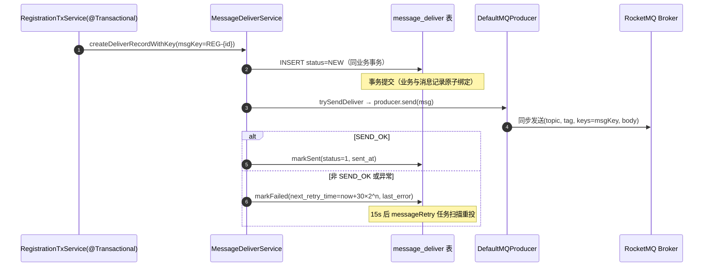
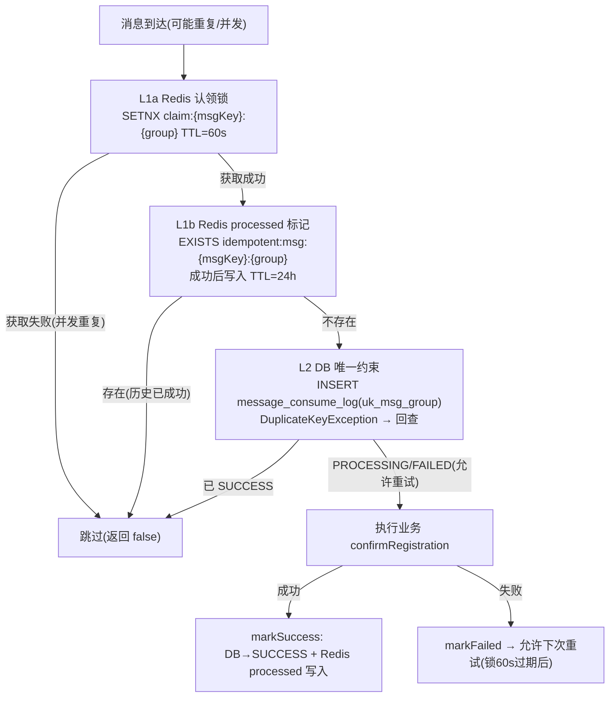
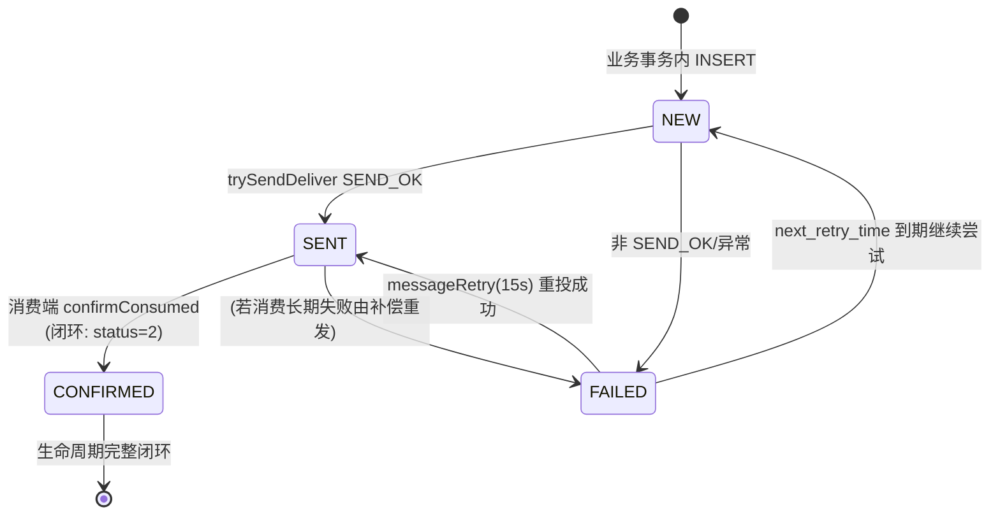

# 06 · RocketMQ 消息可靠性（本地消息表 / 消费确认 / 消费幂等 / 广播模式）

> 本篇目标：讲透消息从"业务事务里诞生"到"消费端幂等落库"再到"补偿接管死信"的完整可靠性设计。
> 重点澄清两个高频混淆：**RocketMQ 的消费确认不是 RabbitMQ 的 basicAck**；**本地消息表 vs 事务消息怎么选**。
> 并复盘 group-suffix 多环境隔离的血泪教训。

---

## ① 业务背景：报名确认为什么要坐"消息大巴"

报名主接口把"确认落库"交给 MQ 异步执行（05 篇），这就产生了新的可靠性命题：

- **不丢**：预留成功后，确认消息必须最终送达消费者——哪怕 Broker 短暂宕机；
- **不重**：Broker 至少一次投递语义必然带来重复投递，消费端必须幂等；
- **可追溯**：哪条消息发了没发、消费了没有，要能在数据库里查（客服/排查/对账）；
- **可接管**：重试耗尽的消息不能堆积成毒丸，要转成人工/定时可处理的补偿任务；
- **多环境隔离**：本地开发、集成测试、docker 部署共用一台 Broker 时不能互相"偷"消息。

CampusFlow 有 6 个 Topic：`registration-confirm`（确认）、`cancel-release`（取消兜底）、
`waitlist-promote`（晋级通知）、`notify`（站内通知）、`checkin`（签到统计）、`cache-evict`（广播失效）。

## ② 不做消息可靠性会发生什么（数字推演）

| 缺陷 | 推演后果 |
|---|---|
| 业务事务提交后直接 `producer.send`，发送失败就完 | Redis 已扣名额但 DB 永远没有报名记录；15 分钟后预留过期被补偿释放——用户"报名成功"变"报名失败"，投诉率 100% 命中 |
| 消费端不幂等（直接落库） | Broker 重投一次 → 同一用户插两条报名 → 撞 `uk_activity_user` 报错 → 消息无限 RECONSUME → 队列堆积 |
| 重试无上限 | 毒丸消息（脏数据）卡住队列，每小时浪费 5 分钟级延迟重投 ×N 条，消费吞吐被拖垮 |
| 无死信处理 | `%DLQ%{group}` 里躺着 1000 条无人处理的死信，用户报名状态永远停在"确认中" |
| 本地缓存失效用集群模式 | 多实例下消息被负载均衡到一台 → 其他实例 Caffeine 旧值最长 30 分钟不失效，容量显示错乱 |
| 生产/测试共用消费组 | 测试环境实例和生产实例同组负载均衡：测试消息被生产实例消费写进生产库（真实事故级 bug） |

## ③ 本项目方案：本地消息表（事务性发件箱）

### 3.1 本地消息表 vs 事务消息（选型必背）

`MessageDeliverService` 类注释给出了完整理由（原文）：

> 为什么不用"事务消息"替代本地消息表：
> - 事务消息适用场景：业务侧只关心"DB 提交与消息发送的原子性"，且能接受半消息反查机制；
> - 本地消息表适用场景：需要持久化投递轨迹（对账/审计/管理端可视化消息状态），并希望重试策略完全自主可控；
>   本项目两个都要，主链路用本地消息表，事务消息在集成测试中做实验对比。

| 维度 | 本地消息表（本项目） | RocketMQ 事务消息 |
|---|---|---|
| 原子性来源 | 业务事务内 INSERT message_deliver（同库同事务） | 半消息 + 本地事务 + 回查 |
| 投递轨迹 | 表里全生命周期可查（0待发送/1已发送/2已确认/3失败） | Broker 侧不可见、无业务轨迹 |
| 重试策略 | 自主可控：指数退避 30s×2^min(n,6)，上限 8 次 | Broker 固定频率回查 |
| 对账 | SQL 直接对账（NEW/FAILED 与 registration_reservation 关联） | 难 |
| 代价 | 多一次同库 INSERT + 扫描任务 | 反查逻辑侵入业务 |
| 适用 | 需要审计/对账/复杂重试（本项目） | 简单"发送即忘"场景 |

### 3.2 生产端三步走



生产端关键源码（`backend/campusflow-infrastructure/src/main/java/com/campusflow/infra/mq/MessageDeliverService.java`）：

```java
public boolean trySendDeliver(MessageDeliverDO record) {
    try {
        Message msg = new Message(record.getTopic(), record.getTag(),
                record.getMsgKey(), record.getBody().getBytes(StandardCharsets.UTF_8));
        SendResult result = producer.send(msg);
        if (result != null && result.getSendStatus() == SendStatus.SEND_OK) {
            deliverMapper.markSent(record.getMsgKey(), LocalDateTime.now());
            return true;
        }
        // 非 SEND_OK（FLUSH_SLAVE_TIMEOUT 等）：按失败处理进入重试
        handleSendFail(record, "sendStatus=" + ...);
        return false;
    } catch (Exception e) {
        handleSendFail(record, e.getClass().getSimpleName() + ": " + e.getMessage());
        return false;
    }
}

private void handleSendFail(MessageDeliverDO record, String error) {
    int retry = record.getRetryCount() == null ? 0 : record.getRetryCount();
    long backoff = (long) properties.getMq().getMessageRetryBaseSeconds() * (1L << Math.min(retry, 6));
    LocalDateTime next = LocalDateTime.now().plusSeconds(backoff);
    deliverMapper.markFailed(record.getMsgKey(), next, truncate(error));
}
```

三个细节值得在面试讲：
1. **只认 SEND_OK**：`FLUSH_SLAVE_TIMEOUT/SLAVE_NOT_AVAILABLE` 也按失败处理（宁可重投也不放行）；
2. **同步发送**（`producer.send`）：`retryTimesWhenSendFailed=2` 是客户端自动重试，表级重试是兜底二级；
3. **指数退避封顶**：`1L << Math.min(retry, 6)` → 30s/1min/2min/4min/8min/16min/32min，避免退避爆炸。

### 3.3 消费端确认：CONSUME_SUCCESS / RECONSUME_LATER（不是 basicAck！）

`MqConsumerFactory` 类注释（原文）：

> 消费确认遵循 RocketMQ 客户端约定（不是 RabbitMQ 的 basicAck）：
> 监听器返回 CONSUME_SUCCESS 即向 Broker 确认（Broker 删除在途消息）；
> 返回 RECONSUME_LATER 触发延迟重投，达到 maxReconsumeTimes 后进入 DLQ(%DLQ%{consumerGroup})。

| 概念 | RocketMQ | RabbitMQ |
|---|---|---|
| 确认方式 | 监听器**返回值** `ConsumeConcurrentlyStatus` | `channel.basicAck/deliveryTag` 显式 API |
| 重试 | 返回 `RECONSUME_LATER`，延迟级别投递回原队列 | nack/reject 后进死信队列 |
| 重试上限 | `maxReconsumeTimes`（本项目 5）后进 `%DLQ%{consumerGroup}` | 队列参数 `x-dead-letter-exchange` |
| 顺序消费 | `MessageListenerOrderly`（本项目用并发 `Concurrently`） | 单队列单消费者 |

`RegistrationConfirmConsumer` 的完整确认逻辑（真实源码节选）：

```java
for (MessageExt msg : msgs) {
    String msgKey = msg.getKeys();
    try {
        if (!consumeLogService.tryBeginConsume(msgKey, MqConstants.GROUP_REGISTRATION)) {
            log.info("报名确认消息重复投递，跳过 msgKey={}", msgKey);
            continue;                              // 幂等命中 → 直接成功
        }
        MqPayloads.RegistrationConfirmMessage payload = JsonUtils.fromJson(...);
        if (payload == null) {                     // 解析失败：毒丸 → 转补偿任务
            compensationTaskService.createTask(TYPE_REGISTRATION_CONFIRM, msgKey, body);
            consumeLogService.markSuccess(msgKey, GROUP_REGISTRATION);
            continue;
        }
        registrationTxService.confirmRegistration(payload);
        consumeLogService.markSuccess(msgKey, GROUP_REGISTRATION);
        messageDeliverService.confirmConsumed(msgKey);   // 投递-消费闭环
        ...
    } catch (BizException e) {
        if (e.getCode() == ACTIVITY_NOT_PUBLISHED || ACTIVITY_NOT_EXIST) {
            consumeLogService.markSuccess(...);    // 业务性拒绝：终态，防无效重投
            continue;
        }
        handleFailure(...);                        // 转入失败路径
        status = ConsumeConcurrentlyStatus.RECONSUME_LATER;
    } catch (Exception e) {
        handleFailure(...);
        status = ConsumeConcurrentlyStatus.RECONSUME_LATER;
    }
}
return status;
```

`handleFailure`（静态方法，多消费者复用）：

```java
static void handleFailure(...) {
    consumeLogService.markFailed(msgKey, group);
    if (msg.getReconsumeTimes() >= properties.getMq().getConsumerMaxReconsume()) {
        // 达到重试上限：转补偿任务接管（业务死信处理），确认消费防堆积
        compensationTaskService.createTask(CompensationTaskDO.TYPE_REGISTRATION_CONFIRM, msgKey, body);
        consumeLogService.markSuccess(msgKey, group);
    }
}
```

### 3.4 消费幂等三层防线

`MessageConsumeLogService.tryBeginConsume`（`backend/campusflow-infrastructure/src/main/java/com/campusflow/infra/mq/MessageConsumeLogService.java`）
类注释与本篇对应的三层：



源码核心（保留原注释语义）：

```java
public boolean tryBeginConsume(String msgKey, String consumerGroup) {
    // L1a: 并发认领锁（互斥进入处理）
    String claimKey = RedisKeyConstants.msgIdempotent("claim:" + msgKey + ":" + consumerGroup);
    Boolean claimed = stringRedisTemplate.opsForValue().setIfAbsent(claimKey, "1", Duration.ofSeconds(60));
    if (!Boolean.TRUE.equals(claimed)) { return false; }
    // L1b: processed 标记
    Boolean processed = stringRedisTemplate.hasKey(RedisKeyConstants.msgIdempotent(msgKey + ":" + consumerGroup));
    if (Boolean.TRUE.equals(processed)) { return false; }
    // L2: DB 唯一约束
    MessageConsumeLogDO existing = consumeLogMapper.selectOne(...msgKey + consumerGroup...);
    if (existing == null) {
        ... insert(row);   // 撞 uk_msg_group 时 catch DuplicateKeyException 回查
    }
    // 已成功处理 -> 重复消息；失败/处理中 -> 允许本次重试
    return existing == null || existing.getStatus() != MessageConsumeLogDO.STATUS_SUCCESS;
}
```

为什么需要 L1a（认领锁）？类注释解释了原理："Broker 对'业务键相同的两条独立消息'不做去重，并发投递时
DB 唯一约束存在检查-插入竞态窗口"——SELECT 没查到和 INSERT 成功之间，另一个线程可能已经插入，
唯一约束能兜住插入（DuplicateKeyException），但**认领锁把绝大多数并发重复在 0.1ms 内拒绝**，省掉 DB 往返。

为什么认领锁 60s 过期？——"处理崩溃后 Broker 重投（重投间隔递增）仍能在锁过期后重试"，
若锁不过期，一次消费崩溃的消息将永远无法重试。

### 3.5 group-suffix 多环境隔离的教训

`MqConsumerFactory` 真实源码：

```java
// 多环境消费组隔离：同一 Broker 下 local/test/docker 各自独立组，避免消息被跨环境瓜分
String suffix = properties.getMq().getGroupSuffix();
String effectiveGroup = (suffix == null || suffix.isEmpty()) ? group : group + "-" + suffix;
```

`application-test.yml`：

```yaml
campusflow:
  mq:
    group-suffix: it   # 与运行中的应用实例隔离消费组，防止 Broker 负载均衡瓜分测试消息
```

**教训复盘（面试讲故事素材）**：集群模式下，同一消费组的所有实例**平摊**队列消息。
集成测试跑 `IdempotencyIT/LuaOversellIT` 时，若与本地开发的应用实例共用 `campusflow-registration-group`，
Broker 会把测试消息分给开发实例（连接着生产/开发库），导致：
a) 测试断言失败（消息"消失"）；b) 开发库出现脏报名数据。
修复：测试 profile 加 `group-suffix: it`，消费组变成 `campusflow-registration-group-it`，
独立成组、独立位点、独立重试队列——消费隔离是**组级别**的，改 suffix 一行配置解决。

### 3.6 广播模式缓存失效

`CacheEvictConsumer`（本篇只讲机制，缓存侧详见 04 篇）：

```java
return factory.create(MqConstants.GROUP_CACHE_EVICT, MqConstants.TOPIC_CACHE_EVICT, true,  // broadcast=true
        (msgs, ctx) -> {
            for (MessageExt msg : msgs) {
                ...
                multiLevelCacheService.evictLocal(cacheKey == null ? "" : cacheKey);
            }
            return ConsumeConcurrentlyStatus.CONSUME_SUCCESS;  // 广播失败不重投，TTL 兜底
        });
```

| 模式 | 集群（CLUSTERING） | 广播（BROADCASTING） |
|---|---|---|
| 投递对象 | 组内一个实例 | 组内**每个**实例 |
| 典型用途 | 业务处理（确认/通知） | 多实例本地缓存同步 |
| 失败重投 | 有（RECONSUME_LATER） | **无**（位点每实例自己管，失败不重投） |
| 本项目 | 5 个业务 Topic | `campusflow-cache-evict-topic` |

广播没有重试语义 → `CacheEvictConsumer` 类注释："广播模式失败不重投：记录日志，依赖本地 TTL 兜底"。

### 3.7 死信与补偿任务接管

两级死信处理：
1. **Broker 级 DLQ**：`maxReconsumeTimes=5`（`consumer-max-reconsume: 5`）耗尽后消息进 `%DLQ%{group}`——
   但项目**不依赖它**：`handleFailure` 在达到上限前一刻就把消息转成 `compensation_task`（业务级死信），
   并 `markSuccess` 让 Broker 移除，防止 DLQ 堆积+队列阻塞；
2. **业务级 compensation_task**：`uk_biz_key` 幂等建任务，`CompensationTaskService` 扫描执行，
   处理逻辑全部依赖底层幂等（DB CAS/Lua/唯一约束）。解析失败毒丸也走这条路径（3.3 节代码）。

### 3.8 消息全生命周期状态机



## ⑤ 结合源码学习：生产与消费两条链路

**生产链路**（以报名确认消息为例）：
`RegistrationTxService.persistReservation`（事务内）→ `MessageDeliverService.createDeliverRecordWithKey`
（INSERT message_deliver）→ 事务提交 → `RegistrationService.doPersistReservation` →
`MessageDeliverService.getByMsgKey + trySendDeliver`（同步发送 + markSent/markFailed）。

**消费链路**（6 个消费者全列表，均 `@Bean(initMethod="start", destroyMethod="shutdown")`）：

| 消费者文件（前缀 `backend/campusflow-business/...` 或 infra） | Topic | 职责 |
|---|---|---|
| `biz/registration/listener/RegistrationConfirmConsumer.java` | registration-confirm | 落库确认（本篇主角） |
| `biz/registration/listener/CancelReleaseConsumer.java` | cancel-release | 兜底触发 `tryPromoteNext` |
| `biz/waitlist/listener/WaitlistPromoteConsumer.java` | waitlist-promote | 晋级消息处理 |
| `biz/notify/listener/NotifyConsumer.java` | notify | 通知落库 notify_message |
| `biz/checkin/listener/CheckinConsumer.java` | checkin | 签到统计 |
| `campusflow-infrastructure/.../mq/CacheEvictConsumer.java` | cache-evict | 广播失效本地缓存 |

消费端逐个对齐三件套：`tryBeginConsume`（幂等）→ 业务处理 → `markSuccess + confirmConsumed`（闭环）；
失败 → `markFailed + RECONSUME_LATER`；重试耗尽 → `compensationTaskService.createTask`。

**消息体契约**：`backend/campusflow-business/src/main/java/com/campusflow/biz/mq/MqPayloads.java`
全部是 Java 17 record + `@JsonIgnoreProperties(ignoreUnknown = true)`（向前兼容：消费端老代码收到
生产端新增字段的旧消息不报错）。msgKey 生成规则：`前缀-雪花ID`（REG/CANCEL/WL/NTF/CK，
`MqConstants.BIZ_KEY_*`），预留链路特殊：msgKey=预留记录的 messageKey（"REG-{reservationId}"），
保证预留表、消息表、幂等表三方可以按同一键关联。

## ⑥ 并发场景分析：数字推演

**场景 1：同一消息并发重复投递 50 次**
- L1a 认领锁（SETNX 60s）：第 1 个拿到，其余 49 个在 Redis 层 0.1ms 内被拒（无 DB 往返）；
- 若 50 个并发跨越 60s（锁过期）边界：L1b processed 标记（成功后写入）拦截；
- 若 Redis 整体不可用：L2 DB `uk_msg_group` 撞唯一约束，`DuplicateKeyException` 回查幂等分支；
- 最终 `registration` 行数：**恒为 1**。

**场景 2：Broker 宕机 10 分钟内的消息积压**
- 10 分钟内 500 个报名：全部 Lua 预留成功、发件箱 status=NEW/FAILED；
- Broker 恢复后：客户端发送重试（2 次）+ `messageRetry` 每 15s 批量 50 条 → ~2 分钟内全部追平；
- 预留 TTL 15min：Broker 停机 <15min 时所有消息都能在预留有效期内送达，无一单释放；
- 若停机 >15min：`reservationRecovery` 把过期预留释放，恢复后用户可重新报名——**一致性优先于体验**。

**场景 3：消费吞吐与线程池**
- `consume-thread-min: 5`、`consume-thread-max: 20`（`MqConsumerFactory.create` 设置）；
- 单条确认事务 ~5ms → 单线程 200 TPS，20 线程理论 4000 TPS；
- 报名峰值 100 确认/秒：5 线程即可消化，其余容量留给通知类高频消息。

**场景 4：广播消息在 3 实例下的到达**
- 集群模式：1 条消息只到 1 台 → 其他 2 台 Caffeine 旧值 30s；
- 广播模式：3 台各收 1 条（各自位点独立）→ 全部即时失效；
- 若 1 台消费失败：该台最多脏 30s（本地 TTL），其余正常——**秒级脏读是有意设计**。

## ⑦ 优化思路：第一版 → 第二版 → 取舍

| 主题 | 第一版 | 第二版（现状） | 取舍 |
|---|---|---|---|
| 可靠投递 | 事务提交后直接 send，失败打日志 | 本地消息表 + 状态机 + 指数退避重投 | 多一张表换"投递轨迹可查 + 不丢"；事务消息被论证后放弃（3.1） |
| 消费确认 | 手写 channel.ack 思维（RabbitMQ 习惯） | 返回 CONSUME_SUCCESS/RECONSUME_LATER | RocketMQ 语义；消费超时 5min 由 Broker 兜底重投 |
| 幂等 | 只靠 DB 唯一约束 | 认领锁 + processed + 唯一约束三层 | DB 兜底保留，Redis 层省掉 99% 的并发 DB 往返 |
| 死信 | 依赖 %DLQ% 人工捞 | 重试耗尽转 compensation_task | 业务级死信可自动执行 + 幂等，无需人工 |
| 多环境 | 共用消费组 | group-suffix 后缀隔离 | 一行配置根除跨环境消息瓜分 |
| 消息体 | Map 裸传 | record + @JsonIgnoreProperties | 类型安全 + 向前兼容 |
| 消费者创建 | 手写 new DefaultMQPushConsumer ×6 | MqConsumerFactory 统一工厂 | 线程数/重试/广播模式/超时一处收敛 |

## ⑧ 面试知识

### 基础
1. **RocketMQ 架构角色？** NameServer（路由注册，无状态）→ Broker（存储/投递，主从）→ Producer/Consumer；
   Topic 逻辑概念，Queue 物理分片，消费位点按 (group, queue) 维度存储。
2. **至少一次投递是什么意思？** Broker 保证已提交的消息至少投一次（重试机制），所以重复不可避免，
   幂等是消费端的责任——这是"Exactly-once 靠业务实现"的经典论述。
3. **消息什么时候会丢？** 生产端：send 超时/失败放弃；Broker：刷盘前宕机（异步刷盘）；
   消费端：返回 CONSUME_SUCCESS 但业务实际没做完（先确认后处理）。本项目逐条有对应防御。

### 中级
4. **本地消息表怎么保证业务与消息一致？** 同一个 DB 事务里 INSERT message_deliver——要么都在要么都不在；
   发送动作在事务**提交后**执行（避免事务内做网络 IO），失败由扫描任务重投。
5. **事务消息的半消息/回查机制？** sendHalf → 执行本地事务 → commit/rollback/unknown →
   unknown 时 Broker 定时回查 `checkLocalTransaction`。与本地消息表对比背 3.1 表格。
6. **消费重试的延迟规则？** RECONSUME_LATER 按 level 递增（10s/30s/1m/2m/...2h），达上限进 DLQ；
   本项目 5 次上限 + 业务级接管。

### 高级
7. **顺序消息怎么实现？为什么本项目不用？** 生产端按 key 选择同一 queue（MessageQueueSelector）+
   消费端 MessageListenerOrderly 单线程队列内串行。本项目确认消息互不依赖（不同 userId 独立），
   并发消费吞吐更高；候选补晋级顺序由**活动级 Redisson 锁 + ZPOPMIN** 保证，不在消息层解决——
   "顺序性放在有状态的地方（锁+ZSet），消息层保持无序高吞吐"。
8. **如何设计消息幂等的 key？** 业务唯一键 > msgId。本项目 msgKey=REG-{reservationId}（业务键），
   msgId（Broker 生成）只用于日志检索；同一业务事件重发时 msgKey 不变 → 天然幂等。
9. **广播模式位点语义？** 广播消费位点不提交到 Broker（各实例内存/本地），Broker 不做重投——
   这是"广播无重试"的底层原因；所以可靠性必须由业务兜底（本地 TTL）。

### 项目追问（高频）
10. **"为什么不用 RabbitMQ？"** 团队栈统一 + 需要：延迟重投级别、广播模式、事务消息实验对比、
    DLQ 按组自动命名——RocketMQ 都原生提供。
11. **"消息重复投递的全场景你能列几个？"** a) 生产端超时但实际发送成功（重试导致双发）；
    b) 消费超时（consumeTimeout 5min）Broker 判失败重投；c) 消费返回 RECONSUME_LATER 后原消息与新投递并存；
    d) 客户端 Rebalance 重复拉取。全部被三层幂等覆盖。
12. **"confirmConsumed 是必须的吗？"** 不是正确性必须（幂等表已防重），但它是**对账必需**：
    message_deliver.status=2 表示"投递-消费闭环完成"，`messageRetry` 只重投 NEW/FAILED，
    不会重投已确认消息——没有闭环，重投会把已消费消息再发一遍。
13. **"消费失败和业务性拒绝怎么区分？"** 抛 `BizException` 且 code ∈ {ACTIVITY_NOT_PUBLISHED,
    ACTIVITY_NOT_EXIST} → markSuccess（终态，防无限重投）；其余 → markFailed + RECONSUME_LATER。
    区别在于"重试有没有意义"。

### 底层原理
14. **消费位点（Offset）**：ConsumeQueue 存 (offset, size, tagHash) 索引，CommitLog 顺序写全量消息；
    集群模式位点提交到 Broker，广播模式本地持有。
15. **Rebalance 触发**：消费者数量变化/订阅变化/queue 数变化 → 组内重新分配 queue →
    分配期间可能出现短暂重复消费（又一个必须幂等的证据）。
16. **刷盘与复制**：SYNC_FLUSH（同步刷盘，金融级）/ASYNC_FLUSH（默认）；主从 SYNC/ASYNC 复制。
    `MqProducerConfig` 注释："消息持久化由 Broker 承担（SYNC_FLUSH 可配，默认 ASYNC_FLUSH + 主从复制）；
    本端通过'同步发送 + 发送结果校验 + 本地消息表重试'保障投递可靠性"——生产端不赌 Broker 配置。

### 常见错误回答 vs 参考答案
- ❌ "消费成功后调 basicAck 确认" → ✅ 这是 RabbitMQ；RocketMQ 是监听器**返回** CONSUME_SUCCESS，
  监听器方法返回即视为确认（异常/RECONSUME_LATER 则重投）。
- ❌ "MQ 天生不丢消息" → ✅ 至少一次只覆盖"已成功提交到 Broker"的消息；生产失败、异步刷盘丢失、
  消费后处理失败都会丢，三层都要防御。
- ❌ "用消息 ID 做幂等就够了" → ✅ 同一业务事件两次独立发送会产生两个 msgId（业务键相同），
  必须用业务键（msgKey=REG-{reservationId}）。
- ❌ "广播模式比集群模式更可靠" → ✅ 相反：广播无重试、位点不托管，可靠性更弱，胜在"全员必达"语义。

## ⑨ 动手练习

1. **观察代码**：对照 `MqConstants` 给 6 个 Topic 各找齐"生产者调用点"（grep `TOPIC_`）
   和"消费者文件"，画成表（本篇⑤已有答案，先自己填再对照）。
2. **改参数**：把 `message-retry-base-seconds` 从 30 改成 5，制造一次发送失败，观察 next_retry_time
   的递增节奏（5s/10s/20s/40s...）。
3. **模拟异常**：停 RocketMQ → 报名 → 查 `message_deliver`（status=3, last_error 有内容）→
   重启 MQ → 等 `messageRetry`（≤15s）重投 → status 先变 1（SENT）再变 2（CONFIRMED）。
4. **验证幂等**：在 `tryBeginConsume` 里临时把认领锁 TTL 改成 0（等效禁用 L1a），双开两个消费者实例
   （不同 group-suffix 相同、不同端口），压一条重复消息，观察 DuplicateKeyException 回查日志——
   验证"唯一约束兜底"确实接住了穿透。
5. **验证广播**：两个实例都开 debug 日志，实例 A 调活动更新接口，确认实例 B 日志出现
   `[broadcast] 本地缓存失效 cacheKey=campusflow:activity:{id}:info`，且 Redis 里该 Key 已被 A 删除。
6. **复现 group 隔离问题（教学实验）**：临时去掉 `application-test.yml` 的 `group-suffix` 跑一次
   集成测试，同时本地 dev 实例在线——观察测试消息被 dev 实例抢走（消息表确认状态不推进），
   然后加回 suffix 复测通过。

---

*下一篇：[07_分布式锁与一致性](07_分布式锁与一致性.md) —— 锁的正确姿势：注解式锁、看门狗、锁粒度与对账。*
