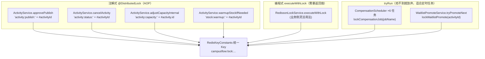
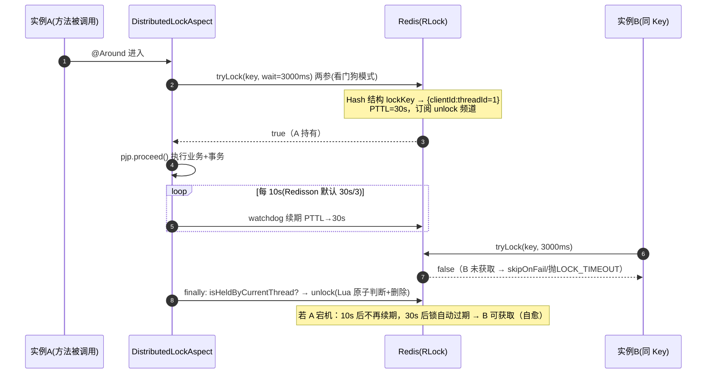
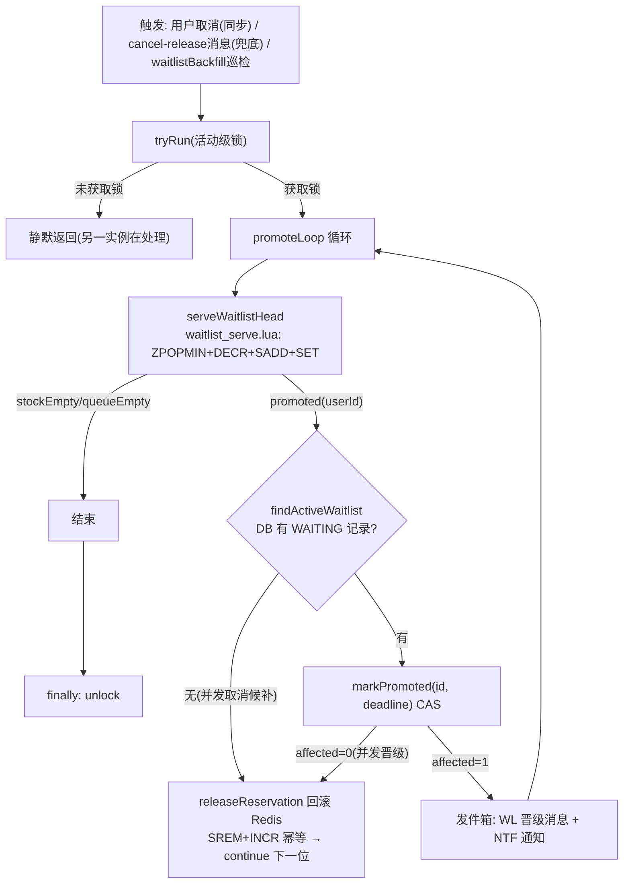

# 07 · 分布式锁与一致性（Redisson / 看门狗 / 锁粒度 / 对账修复）

> 本篇目标：讲清 CampusFlow 里分布式锁的完整体系——注解式锁的实现原理、SpEL key、看门狗机制与
> 锁误删风险分析、锁粒度选择（活动级/任务级）、`tryRun` 防重入、候补晋级串行化、库存对账修复一致性。
> 核心观点先亮出来：**本项目高并发扣减不用锁（用 Lua），锁只服务于低频的"多实例互斥"场景**。

---

## ① 业务背景：哪些操作必须"同时只有一个实例在做"

CampusFlow 可能部署 2~3 个实例做负载均衡，以下操作天然不允许多实例同时执行：

| 场景 | 为什么需要互斥 | 并发破坏推演 |
|---|---|---|
| 活动发布时预热库存 | 两个实例同时按 DB 算 remaining 并写 Redis | 实例 A 在 T1 算出 remaining=100，实例 B 在 T2 算出 98（期间有人报名），B 后写覆盖 → 库存虚高 2 → **超卖 2 单** |
| 候补晋级（出队首转正） | 同一活动的晋级必须串行 | 两实例同时 ZPOPMIN：A 弹出用户 1、B 弹出用户 2，各自 DECR 一次 → 库存扣 2 但只释放 1 个名额语义错乱；或 DB markPromoted 冲突后回滚时序错乱 |
| 定时补偿任务 | 6 个 @Scheduled 任务多实例都会触发 | `reservationRecovery` 两实例同时扫同一批过期预留 → 重复发送消息（幂等表能挡，但白费资源、日志噪音） |
| 审核通过/取消活动 | 状态变更+预热+失效缓存的复合操作 | 审核与取消同时进行，预热了已取消活动的库存 → 取消后仍可报名 |
| 容量调整 | 重算 remaining 依赖"读-算-写" | 并发调整 100→150 与 100→80 交错，Redis 写入顺序与 DB 不一致 |

单机时代用 JVM 锁（synchronized/ReentrantLock）解决，多实例下 JVM 锁**只锁住自己进程**——
这就是需要分布式锁的根本原因。

## ② 不用分布式锁（或用错）会发生什么（数字推演）

**场景：取消报名触发候补晋级，无锁两实例并发**：

```
T0: 候补队列 ZSet = [U1(score=1000), U2(score=1001)]，stock=1
T1: 实例A 取消流程 → tryPromoteNext；实例B 收到 cancel-release 消息 → tryPromoteNext（同时！）
T2: A: serveWaitlistHead → ZPOPMIN 弹出 U1，DECR stock→0，SADD U1，SET reservation{U1}
T3: B: serveWaitlistHead → ZPOPMIN 弹出 U2（U1 已出队）……
```

看似 Lua 自身原子（B 会因 stock<=0 返回 0 停止），问题出在 **DB 侧**：
A 拿到 U1 后要执行 `findActiveWaitlist → markPromoted → 发消息`（毫秒级耗时），
B 若与 A 交错：可能 A 的 markPromoted 尚未提交、B 的 `findActiveWaitlist(U2)` 正常推进……
真正的破坏来自**回滚分支的交错**：

```
T3: A: findActiveWaitlist(U1) 为空（U1 刚退出候补）→ A: releaseReservation(U1) 回滚 INCR stock→1
T4: B: 若读到 A 回滚后的 stock=1 → B 弹出 U2 成功 → 双重服务窗口
```

无锁时"检查-回滚-再服务"的链路在两实例间交错，形成名额重复分配或漏分配。
**解法：把同一活动的晋级循环整体串行化**（活动级锁 `campusflow:lock:waitlist:promote:{activityId}`），
拿到锁的一方完整执行"出队-校验-DB-回滚-再出队"循环，另一方 tryLock 失败直接放弃
（取消消息消费兜底会再触发）。

## ③ 本项目方案：三种锁形态与使用分布



三份锁 Key 常量（`RedisKeyConstants` 真实定义）：

```java
public static final String LOCK_STOCK_PRELOAD = "campusflow:lock:stock:preload:%d";      // 预热
public static final String LOCK_WAITLIST_PROMOTE = "campusflow:lock:waitlist:promote:%d"; // 候补晋级
public static final String LOCK_COMPENSATION_JOB = "campusflow:lock:job:%s";              // 定时任务
public static final String LOCK_ACTIVITY_STATUS = "campusflow:lock:activity:status:%d";   // 状态切换
```

## ④ 技术执行流程

### 4.1 注解式锁完整实现

注解（`backend/campusflow-infrastructure/src/main/java/com/campusflow/infra/lock/DistributedLock.java`）：

```java
@Target(ElementType.METHOD)
@Retention(RetentionPolicy.RUNTIME)
public @interface DistributedLock {
    String key();                       // SpEL，实际拼上前缀 campusflow:lock:
    long waitTimeMillis() default 3000; // 获取锁最大等待，0 表示不等待
    long leaseTimeMillis() default -1;  // <=0 启用看门狗续期
    boolean skipOnFail() default false; // false=抛 LOCK_TIMEOUT
}
```

切面（`DistributedLockAspect.java` 全文核心）：

```java
@Around("@annotation(distributedLock)")
public Object around(ProceedingJoinPoint pjp, DistributedLock distributedLock) throws Throwable {
    String lockKey = KEY_PREFIX + resolveKey(distributedLock.key(), pjp);  // "campusflow:lock:aspect:" + SpEL结果
    RLock lock = redissonClient.getLock(lockKey);
    boolean acquired = false;
    try {
        if (distributedLock.leaseTimeMillis() > 0) {
            acquired = lock.tryLock(waitTime, leaseTime, MILLISECONDS);   // 显式租期：看门狗失效
        } else {
            acquired = lock.tryLock(waitTime, MILLISECONDS);              // 看门狗模式（两参重载）
        }
        if (!acquired) {
            if (distributedLock.skipOnFail()) return null;
            throw BizException.of(ErrorCode.LOCK_TIMEOUT);
        }
        return pjp.proceed();
    } finally {
        if (acquired && lock.isHeldByCurrentThread()) {
            lock.unlock();      // isHeldByCurrentThread 校验：防止锁已过期被他人持有后误删
        }
    }
}
```

SpEL 解析（`resolveKey`）：`SpelExpressionParser` + `DefaultParameterNameDiscoverer` 把参数名绑进
`StandardEvaluationContext`，于是 `#activityId` 就是方法第 1 个参数的值。解析失败抛
`IllegalStateException`（快速暴露配置错误，而不是拿 null Key 锁住所有请求）。

使用示例（真实源码）：

```java
// ActivityService.approvePublish —— 审核 + 预热 + 失效缓存，三步必须在锁内
@DistributedLock(key = "'activity:publish:' + #activityId", waitTimeMillis = 3000)
@Transactional(rollbackFor = Exception.class)
public ActivityVO approvePublish(Long activityId, String remark) { ... }
```

### 4.2 锁执行时序与看门狗



### 4.3 看门狗机制与锁误删风险分析

`DistributedLockAspect` 类注释是一段可以直接背的分析（原文）：

> 锁误删风险分析（本实现的防护）：
> 1. 业务超时锁过期：使用看门狗续期模式（leaseTimeMillis<=0），锁不会在业务执行期间过期；
> 2. 非持有者误删：Redisson 锁值带客户端唯一 ID（UUID:threadId），删除前校验持有者，
>    错误的客户端无法删除别人的锁；
> 3. 看门狗不可用场景（显式 leaseTime）：必须保证 leaseTime > 业务最大耗时（P99），
>    否则配合"锁值校验 + Lua 原子删除"仍可能存在窗口，需评估业务幂等性兜底。

对应 Redisson 源码层的三个机制：
- **加锁 Lua**：`HSET lockKey uuid:threadId 1` + `PEXPIRE 30s`（不存在才加，存在则可重入计数 +1）；
- **看门狗**：加锁成功后注册 `Timeout`（30s/3=10s），到期校验仍持有则用 Lua 重置 PTTL→30s；
- **解锁 Lua**：`if HGET lockKey == uuid:threadId then DEL`——"检查+删除"原子化，
  即使锁已过期被 B 持有，A 的删除请求也会因值不匹配而失败（这正是防误删的核心）。

**经典误删事故还原（面试必讲）**：无看门狗实现里常见错误写法是 `SET key value EX 10` + 业务执行 20s +
`DEL key`——A 执行到第 12s 锁已过期被 B 拿走，A 的 DEL 把 B 的锁删了，C 又拿到锁 → 三线程同时进临界区。
Redisson 的"值校验 + Lua 删除"与"看门狗续期"分别从删除侧和过期侧封死了这个链条。

### 4.4 锁粒度选择：活动级 / 任务级

| 粒度 | Key | 保护对象 | 为什么是这个粒度 |
|---|---|---|---|
| 活动级 | `lock:waitlist:promote:{activityId}` | 单活动的晋级循环 | 晋级的临界资源（ZSet+stock）都是活动维度的；不同活动完全可并行 |
| 任务级 | `lock:job:{jobName}` | 每个 @Scheduled 方法体 | 任务之间独立，粒度到方法避免"抢到 jobA 锁阻塞 jobB" |
| 活动级 | `lock:activity:publish:{id}` / `lock:activity:capacity:{id}` | 单活动的发布/容量复合写 | 同活动互斥即可，跨活动并行 |
| 不加锁 | 报名扣减 | stock Key | **Lua 脚本就是原子性**，加锁反而把 5000 并发串行化（05 篇⑥对比过） |

**粒度设计原则**：锁的作用域 = 临界资源的作用域。锁太粗（全局锁）损失吞吐；锁太细（行级逻辑锁）
碎片化难以推理。本项目所有锁 Key 都带业务维度 ID，且前缀集中在 `RedisKeyConstants` 便于审计。

### 4.5 tryRun 防重入：定时任务与晋级

`RedissonLockService.tryRun`（`backend/campusflow-infrastructure/src/main/java/com/campusflow/infra/lock/RedissonLockService.java`）：

```java
public boolean tryRun(String lockKey, Runnable task) {
    RLock lock = redissonClient.getLock(lockKey);
    boolean acquired = false;
    try {
        acquired = lock.tryLock(0, TimeUnit.MILLISECONDS);  // waitTime=0：不等待
        if (!acquired) {
            return false;                                   // 拿不到说明另一实例在跑，静默放弃
        }
        task.run();
        return true;
    } finally {
        if (acquired && lock.isHeldByCurrentThread()) {
            lock.unlock();
        }
    }
}
```

`waitTime=0` 是关键：定时任务场景"抢不到锁"不是异常而是**常态**（另一实例正在执行），
不应等待更不应报错。`CompensationScheduler` 每个任务入口都是同一模式：

```java
@Scheduled(fixedDelay = 20_000, initialDelay = 30_000)
public void reservationRecovery() {
    lockService.tryRun(RedisKeyConstants.lockCompensationJob("reservationRecovery"),
            this::doReservationRecovery);
}
```

候补晋级同一模式：`WaitlistPromoteService.tryPromoteNext` →
`lockService.tryRun(RedisKeyConstants.lockWaitlistPromote(activityId), () -> promoteLoop(activityId))`，
未获取锁时静默返回——因为取消消息消费端（`CancelReleaseConsumer`）会兜底再触发。

### 4.6 候补晋级串行化 + 失败回滚（完整流程）



这个循环是"锁 + Lua + DB CAS"三件套协同的教科书案例：锁保证循环内决策串行，
Lua 保证 Redis 侧原子，`markPromoted` CAS（WHERE status=0）保证 DB 侧幂等，
而回滚分支 `releaseReservation` 的幂等性（SREM 返回 1 才 INCR）保证循环可以安全 continue。

### 4.7 库存对账修复一致性

`CompensationScheduler.doStockReconcile`（每 5 分钟）：

```java
int dbActive = activityServiceCountActive(activity.getId());   // count(CONFIRMED,CHECKED_IN)
int expectedRemaining = Math.max(0, activity.getCapacity() - dbActive);
int drift = expectedRemaining - redisStock.intValue();
int threshold = properties.getStock().getReconcileThreshold();  // 3
if (Math.abs(drift) >= threshold) {
    log.warn("库存漂移 activityId={} redis={} expected={} drift={}", ...);
    stockRedisService.preloadStock(activity.getId(), expectedRemaining, ...);  // DB 权威修复
    stockAuditService.logStockChange(activity.getId(), drift, SOURCE_RECONCILE,
            "RECONCILE-" + activity.getId() + "-" + System.currentTimeMillis() / 300_000,  // 5min 窗口幂等键
            null, "库存对账修复 drift=" + drift);
    compensationTaskService.createTask(TYPE_STOCK_RECONCILE_ALERT, ...);       // 告警任务
}
```

一致性模型总结（面试表述）：

> 本项目是一套**分层一致性**：秒级——Redis Lua 保证扣减原子（强一致临界区）；
> 分钟级——预留状态机 + 消费幂等保证"预留必被确认或释放"（最终一致）；
> 5 分钟级——stockReconcile 用 DB 权威口径校准 Redis（对账收敛），漂移 ≥3 才修复避免频繁抖动；
> 审计层——stock_audit_log 的 bizKey 幂等保证修复动作本身可重放。

## ⑤ 结合源码学习：锁的完整调用链

**链路一：注解式锁（审核发布）**
`OrganizerActivityController/AdminController` → `ActivityService.approvePublish`
→ AOP `DistributedLockAspect.around`（SpEL `'activity:publish:' + #activityId` →
`campusflow:lock:aspect:activity:publish:101`）→ `tryLock` → 事务内 UPDATE activity + preloadStock + evictDetailCache → unlock。

**链路二：编程式 tryRun（候补晋级）**
`RegistrationService.cancel`（`waitlistPromoteRunner.accept`）或 `CancelReleaseConsumer`
或 `CompensationScheduler.waitlistBackfill` → `WaitlistPromoteService.tryPromoteNext`
→ `RedissonLockService.tryRun(lockWaitlistPromote(activityId))` → `promoteLoop`
→ `StockRedisService.serveWaitlistHead`（`waitlist_serve.lua`）→ `waitlistMapper.markPromoted`
→ 失败 `releaseReservation` 回滚 → 成功发件箱两条（WL + NTF）。

**链路三：定时任务防重入**
`CompensationScheduler` 6 个任务 → `lockService.tryRun(lockCompensationJob(jobName))`。

**对照表：锁相关文件清单**

| 文件（前缀 `backend/campusflow-infrastructure/src/main/java/com/campusflow/infra/`） | 角色 |
|---|---|
| `lock/DistributedLock.java` | 注解定义（SpEL key / 看门狗开关 / skipOnFail） |
| `lock/DistributedLockAspect.java` | AOP 切面（tryLock/看门狗/isHeldByCurrentThread） |
| `lock/RedissonLockService.java` | 编程式 executeWithLock / tryRun |
| `config/RedissonConfig.java` | RedissonClient 手动装配（专用锁/布隆/看门狗） |
| `common constant RedisKeyConstants.java` | 锁 Key 模板统一管理 |

## ⑥ 并发场景分析：数字推演

**场景 1：3 实例同时触发 `messageRetry`**
- 实例 A 在 T0 抢到 `lock:job:messageRetry`；B、C 在 T0+ε tryLock(waitTime=0) 立即失败返回；
- A 扫描 50 条、发送 50 次（每次 ~5ms）→ 250ms 完成；
- 若无锁：3 实例各扫到同一批 50 条 → 150 次发送（重复 100 次）——
  Broker 侧消息重复（msgKey 相同会被幂等表挡住，正确性无损但浪费 3 倍资源、日志翻倍）。

**场景 2：5000 并发报名 + 100 次候补晋级交替**
- 报名扣减（无锁 Lua）：5000 EVALSHA 并行，Redis 单线程串行执行，总耗时 ~1.5s；
- 晋级（活动级锁）：取消发生 50 次 → 50 次同步 tryPromoteNext，同活动串行（每次 ~10ms）→ 总 ~500ms；
- 两个机制互不干扰：锁的范围只圈住"出队-DB-回滚"决策链，报名扣减继续满速并行——
  **如果给报名也加这把活动级锁，5000 请求串行 × 1ms = 5 秒起步，P99 直接爆炸（对照 05 篇⑥）。**

**场景 3：看门狗救场（业务超长执行）**
- `waitlistBackfill` 扫 100 个活动，每个活动一次 `count` 查询 + 判断，DB 偶发慢查询让任务跑了 40s；
- 无看门狗（leaseTime=10s 写死）：第 10s 锁过期 → 另一实例启动同任务 → 双倍扫描+双倍修复动作
  （幂等兜底但不优雅）；本实现两参 tryLock → 看门狗 10s/次续期 → 任务全程独占，结束后才释放。

**场景 4：锁服务（Redis）短暂不可用**
- `tryLock` 抛 RedisException → `tryRun` 外层 catch（`WaitlistPromoteService.tryPromoteNext` 的
  try-catch）记录日志后放弃；报名主链路不受影响（Lua 走的是 Lettuce 连接的 Redis，可用性独立评估）；
- 定时任务错过一轮（15s~60s 后自然重跑）——**锁服务降级策略：宁可跳过一轮，不做不可靠的互斥**。

## ⑦ 优化思路：第一版 → 第二版 → 取舍

| 主题 | 第一版 | 第二版（现状） | 取舍 |
|---|---|---|---|
| 锁实现 | 手写 `SETNX key value EX 10` + `DEL` | Redisson RLock（可重入/看门狗/防误删 Lua） | 手写方案的误删窗口与续期难题是出名的事故源 |
| 锁 API | 每处手写 tryLock/finally | @DistributedLock 注解 + tryRun 双形态 | 业务代码零锁细节；需要返回值时用 executeWithLock |
| 锁 Key | 各业务自己拼字符串 | RedisKeyConstants 集中模板 | Key 治理可审计，避免不同业务意外同 Key |
| 晋级互斥 | 依赖 Lua 原子性（无锁） | 活动级锁 + Lua + DB CAS | Lua 只保 Redis 原子，锁保"决策链"串行，CAS 兜底 |
| 扣减互斥 | 全局锁串行 | 不加锁（Lua） | 5000 并发下锁方案吞吐不可接受 |
| 一致性 | 赌消息不丢 | 六任务补偿 + 库存对账 + 幂等审计 | 把"一致性"从单点保证拆成分层收敛 |

## ⑧ 面试知识

### 基础
1. **为什么需要分布式锁？** 多实例部署下 JVM 锁只作用于单进程；跨进程互斥需要外部共享存储
   （Redis/ZooKeeper/DB）实现。
2. **Redisson 加锁默认过期时间？** 30s（`lockWatchdogTimeout`），两参 lock/tryLock 不传 leaseTime 时启用
   看门狗，每 10s（30s/3）续期。
3. **tryLock 和 lock 区别？** tryLock 带等待上限，获取失败可降级处理（本项目 skipOnFail/静默放弃）；
   lock 无限等待（定时任务场景不可用，会积压线程）。

### 中级
4. **Redisson 可重入怎么实现？** 锁值是 Hash：field=clientId:threadId，value=重入计数；
   同线程再 lock 计数 +1，unlock 计数 -1，归零才真正删除。
5. **锁误删怎么防？** 两侧封堵：解锁 Lua 校验持有者（值不匹配不删）；看门狗防业务期间过期。
   本项目切面还有第三道：`isHeldByCurrentThread()` 再校验一次才 unlock。
6. **锁的等待时间怎么定？** waitTime=业务可接受的最大排队时长（本项目 3s，超时抛 LOCK_TIMEOUT 30001）；
   定时任务用 0（抢不到就走）。

### 高级
7. **Redis 分布式锁 vs ZooKeeper 锁？** Redis：性能高（内存 Lua）、AP 倾向（主从切换可能丢锁）；
   ZK：CP（临时顺序节点，session 断自动释放），性能低。本项目临界区都有幂等兜底（Lua SREM/CAS），
   丢锁窗口可容忍 → 选 Redis；若是不允许双写的资金操作，应选 ZK/etcd 或 Redis RedLock 讨论。
8. **RedLock 靠谱吗？** 多主节点过半数加锁；争议（Martin Kleppmann 与 antirez 的论战）：
   时钟跳变/长 GC 下仍有失效窗口，需 fencing token 兜底。本项目单实例 Redis + 业务幂等，
   不引入 RedLock 的复杂度——能讲清这场争论的论点即可加分。
9. ** fencing token 是什么？** 锁服务颁发单调递增令牌，存储层校验"只接受最新令牌的写"，
   从根本上免疫"锁过期后旧持有者还在写"的问题（DB 场景等价物是 version CAS——本项目正用了）。

### 项目追问（高频）
10. **"你哪里用了分布式锁？"** 三个场景：低频复合写（发布/取消/容量调整，注解式）、候补晋级循环
    （活动级 tryRun）、6 个定时任务防多实例重复执行（任务级 tryRun）——并强调扣减链路**不用锁**。
11. **"锁为什么包在事务外面？"** 锁内开事务：锁释放时事务可能未提交，另一实例读到旧数据；
    本项目锁（AOP 默认优先级外层）→ 事务（内层），保证"持锁期间事务提交完成后才放锁"。
12. **"取消报名触发晋级，锁没抢到怎么办？"** 静默放弃 + 双兜底：`TOPIC_CANCEL_RELEASE` 消费端再触发 +
    `waitlistBackfill` 巡检兜底——"锁竞争失败"被设计成可重试事件而非异常。
13. **"对账为什么阈值是 3 不是 0？"** 漂移在途：预留→确认异步链路里 Redis 已扣而 DB count 未含
    （或反之）的瞬时差是常态；阈值 3 过滤瞬时漂移只修真异常，避免每 5 分钟无意义重写预热。

### 底层原理
14. **Redisson 解锁 Lua 为什么必须原子？** "检查持有者 + 删除"两步若分离，检查后锁恰好过期被 B 持有，
    A 的 DEL 就误删了 B 的锁——Lua 把两步封死为一个原子单元。
15. **RLock 的 pub/sub 唤醒**：tryLock 等待中订阅 `redisson_lock__channel:{key}`，
    持有者 unlock 时 publish 唤醒等待者立即重试，减少轮询空转。
16. **主从切换丢锁场景**：A 在主加锁未同步到从 → 主宕机 → 从晋升 → B 在新主加锁成功 → 双持锁。
    缓解：keyspace 通知/哨兵 min-replicas-to-write、或业务幂等兜底（本项目方案）。

### 常见错误回答 vs 参考答案
- ❌ "加了分布式锁就不会超卖" → ✅ 锁能防超卖但本项目扣减用 Lua（吞吐），锁用在不放并发使用的
  复合操作上；说"全靠锁"暴露没做过压测对比。
- ❌ "leaseTime 设大一点（如 10 分钟）就不用看门狗了" → ✅ leaseTime > P99 是底线，但正常完成时
  白白占用锁 10 分钟（阻塞同 Key 其他实例 10 分钟）；看门狗是"按需续期、用完即还"。
- ❌ "finally 里直接 unlock 就行" → ✅ 必须 `isHeldByCurrentThread()` 前置校验：极端情况下
  锁已过期被他人持有，直接 unlock 会误删（或抛 IllegalMonitorStateException）。
- ❌ "对账就是全量刷 Redis" → ✅ 每 5 分钟全量刷等于用 DB 口径覆盖 Redis，抹掉了 Redis 在途预留
  的语义；正确做法是阈值判断 + 幂等审计 + 告警任务，只修异常。

## ⑨ 动手练习

1. **观察代码**：在 `DistributedLockAspect` 的 tryLock/unlock 处打断点，调用一次审核发布接口，
   观察锁 Key 的实际拼接值（含 `campusflow:lock:aspect:` 前缀）与 waitTime 行为。
2. **改参数**：把 `@DistributedLock` 的 `waitTimeMillis` 改成 0，模拟两实例（本地两端口启动）同时
   审核同一活动，观察一方抛 `LOCK_TIMEOUT(30001)`。
3. **模拟看门狗**：在 `warmupStockIfNeeded` 里 `Thread.sleep(40000)`（40s > 默认 30s 租期），
   用 `redis-cli TTL campusflow:lock:aspect:stock:warmup:1` 每 5 秒观察——TTL 会反复回到 ~30
   （看门狗续期证据）；注释掉 sleep 后恢复正常。
4. **验证防误删**：手动 `redis-cli HGETALL campusflow:lock:aspect:stock:warmup:1` 查看锁值结构
   （uuid:threadId），再尝试用另一个客户端 `DEL`，随后持有者 unlock 正常完成——对比"手写 SETNX+DEL"
   方案在同样场景下的误删窗口。
5. **验证对账**：手动把某活动的 Redis stock 改大（`SET campusflow:activity:1:stock 999`），
   等 `stockReconcile`（≤5min）观察日志"库存漂移"→ 修复回 `capacity - active`，且
   `stock_audit_log` 出现 `source=RECONCILE` 的幂等记录；再改一次看 `biz_key` 的 5 分钟窗口变化。

---

*下一篇：[08_JUC并发编程实战](08_JUC并发编程实战.md) —— 从线程池七参数到并发竞态，回到 JVM 内部的并发世界。*
