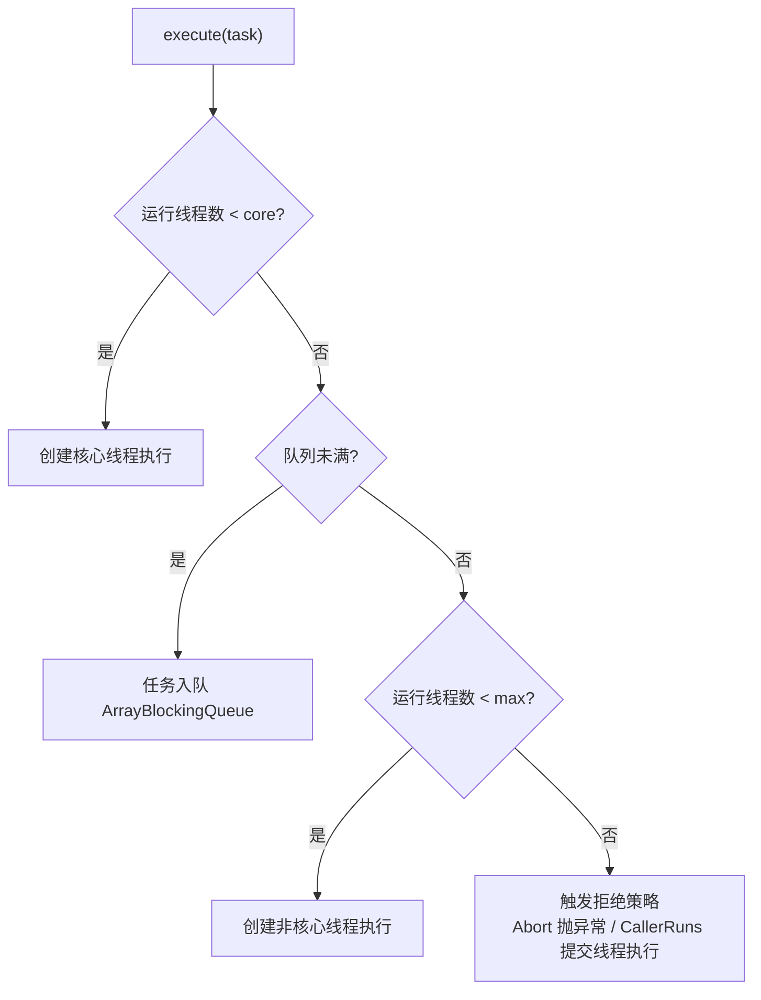
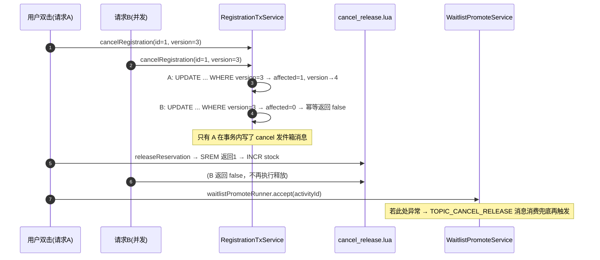

# 08 · JUC 并发编程实战（线程池 / 消费端并发 / 竞态与解法）

> 本篇目标：把 JUC 的知识体系落到 CampusFlow 的真实代码上——`ThreadPoolConfig` 三个有界线程池的
> 七参数与拒绝策略选择理由、消费端并发控制、并发取消/并发签到的竞态与解法，最后串起
> `backend/concurrency-lab` 模块的 10 个动手实验。JUC 是校招面试第二大高频区（仅次于集合），而
> "项目里线程池怎么配的"是必被追问的一题。

---

## ① 业务背景：服务里所有"异步"的地方

CampusFlow 中需要并发的四类工作：

| 工作类型 | 特征 | 归属 |
|---|---|---|
| 审计/通知落库 | 高频、轻量、IO 密集、**不能丢** | `notifyExecutor`（CallerRuns） |
| CSV 异步导出 | 低频、重负载（可能扫 10 万行）、CPU+IO | `exportExecutor`（Abort） |
| 补偿单项修复 | 中频、幂等、可延迟 | `compensationExecutor`（CallerRuns） |
| MQ 消费 | 持续流式、多 Topic 隔离 | `MqConsumerFactory` 的 consumeThread 5~20 |
| 并发请求本身 | 5000 人抢 100 名额 | Tomcat 200 线程 + Redis/Lua/无锁 |

`ThreadPoolConfig` 类注释开宗明义（原文）："线程池集中治理（禁止在业务代码 `Executors.newXxx`
创建无界线程池）"——`Executors.newFixedThreadPool` 的 `LinkedBlockingQueue` 无界、
`newCachedThreadPool` 的最大线程数 Integer.MAX_VALUE，分别是 OOM 的两大经典来源（堆积任务 or 堆积线程）。

## ② 线程池配错会发生什么（数字推演）

| 错误配置 | 推演后果 |
|---|---|
| 审计用 `newCachedThreadPool` | 突发 5000 请求 → 5000 个审计线程同时创建（每线程 1MB 栈）→ ~5GB 内存，OOM kill |
| 导出用 `LinkedBlockingQueue` 无界 + core=2 | 50 个用户同时导出，48 个排队；每个任务持 10 万行数据引用 → 堆积数十 GB 堆外数据，Full GC 风暴 |
| 拒绝策略用 DiscardPolicy | 队列满时审计日志**静默丢失**——审计缺失在合规上是事故 |
| 用 CallerRuns 于导出 | 队列满时**Tomcat 线程亲自跑 10 分钟导出**，用户请求超时，且拖慢整个 worker |
| 不设 uncaughtExceptionHandler | 异步任务抛 NPE 无声无息，审计/通知悄悄断了三天才发现 |
| 容器关闭不 shutdown | 在途导出写一半文件损坏；kill -9 后 `export_task` 状态永远"执行中" |

## ③ 本项目方案：三个有界线程池全参数对照

`backend/campusflow-infrastructure/src/main/java/com/campusflow/infra/config/ThreadPoolConfig.java`
（真实源码全文核心部分）：

```java
@Slf4j
@Configuration
public class ThreadPoolConfig {

    private static final int SHUTDOWN_WAIT_SECONDS = 30;

    /** MQ 消费端异步落通知、审计异步落库：IO 密集，核心 4 / 最大 8，有界队列 200，CallerRuns（不丢数据） */
    @Bean(destroyMethod = "shutdown")
    public ThreadPoolExecutor notifyExecutor() {
        return build("notify-worker", 4, 8, 200, new ThreadPoolExecutor.CallerRunsPolicy());
    }

    /** CSV 异步导出：CPU+IO 密集、任务少而重，核心 2 / 最大 4，有界队列 50，Abort（防 OOM） */
    @Bean(destroyMethod = "shutdown")
    public ThreadPoolExecutor exportExecutor() {
        return build("export-worker", 2, 4, 50, new ThreadPoolExecutor.AbortPolicy());
    }

    /** 补偿扫描后的单项修复任务：核心 2 / 最大 4，队列 100，CallerRuns */
    @Bean(destroyMethod = "shutdown")
    public ThreadPoolExecutor compensationExecutor() {
        return build("compensation-worker", 2, 4, 100, new ThreadPoolExecutor.CallerRunsPolicy());
    }

    private ThreadPoolExecutor build(String prefix, int core, int max, int queue,
                                     java.util.concurrent.RejectedExecutionHandler handler) {
        ThreadFactory factory = new ThreadFactory() {
            private final AtomicInteger seq = new AtomicInteger(1);
            @Override
            public Thread newThread(Runnable r) {
                Thread t = new Thread(r, prefix + "-" + seq.getAndIncrement());
                t.setDaemon(false);                       // 非守护：确保优雅关闭前任务跑完
                t.setUncaughtExceptionHandler((thread, e) ->
                        log.error("[{}] 线程未捕获异常", thread.getName(), e));
                return t;
            }
        };
        ThreadPoolExecutor executor = new ThreadPoolExecutor(
                core, max,
                60L, TimeUnit.SECONDS,                    // keepAliveTime
                new ArrayBlockingQueue<>(queue),          // 有界队列
                factory,
                handler);
        executor.allowCoreThreadTimeOut(true);            // 核心线程也允许超时回收，低峰释放资源
        return executor;
    }
}
```

### 3.1 七参数逐项选择理由

| 参数 | notifyExecutor | exportExecutor | 选择依据 |
|---|---|---|---|
| corePoolSize | 4 | 2 | IO 密集（DB 写）可略超 CPU 核数；导出 CPU 拷贝行数据，核数×1 即可 |
| maximumPoolSize | 8 | 4 | 突发翻倍能力；上限防线程爆炸 |
| keepAliveTime | 60s | 60s | 非核心线程空闲 1 分钟回收 |
| workQueue | ArrayBlockingQueue(200) | ArrayBlockingQueue(50) | **有界**是底线；队列长度≈吞吐×可容忍延迟 |
| threadFactory | notify-worker-N | export-worker-N | 命名便于 jstack 排查；UncaughtExceptionHandler 兜底日志 |
| rejectedHandler | **CallerRunsPolicy** | **AbortPolicy** | 见 3.2 |
| allowCoreThreadTimeOut | true | true | 低峰期（夜间）释放 4~8 个常驻线程 |

### 3.2 拒绝策略的取舍（面试核心题）

| 策略 | 行为 | 本项目用在哪 | 为什么 |
|---|---|---|---|
| AbortPolicy（默认） | 抛 `RejectedExecutionException` | exportExecutor | 导出任务队列满=系统过载，**快速失败优于积压 OOM**；`ExportService` 捕获后向用户返回"导出任务过多，请稍后再试" |
| CallerRunsPolicy | 提交线程自己执行（天然限流+反压） | notifyExecutor / compensationExecutor | 审计/通知是业务数据附属，**一条都不能丢**；Tomcat 线程代跑一条的代价可接受，且自动降低上游提交速率 |
| DiscardPolicy | 静默丢弃 | 不用 | 丢审计数据不可接受 |
| DiscardOldestPolicy | 丢队首再提交 | 不用 | 审计需要时序完整性，丢最老的更糟糕 |

`SysAuditService` 的实际用法（`backend/campusflow-business/src/main/java/com/campusflow/biz/audit/SysAuditService.java`）：

```java
public void recordAsync(SysAuditLogDO auditLog) {
    notifyExecutor.execute(() -> {
        try {
            sysAuditLogMapper.insert(auditLog);
        } catch (Exception e) {
            // 审计失败不能影响主业务，只记录错误日志
            log.error("操作审计落库失败 action={}", auditLog.getAction(), e);
        }
    });
}
```

注意两层"不丢"：提交层 CallerRuns（队列满也不丢任务），执行层 try-catch（DB 抖动不炸线程、不影响主业务）。

`ExportService` 的 Abort 用法：

```java
// backend/campusflow-business/src/main/java/com/campusflow/biz/stats/service/ExportService.java
// 类注释：使用有界 exportExecutor（core2/max4/queue50/Abort）执行重任务：
// - 拒绝时 AbortPolicy 抛 RejectedExecutionException -> 明确告知"导出任务过多"；
// - 导出结果落 export_task，前端轮询任务状态后下载文件。
```

### 3.3 任务提交后的流转顺序（最容易答错的点）



**注意顺序是"先入队、后扩容"**——与很多面试者以为的"先扩到 max 再入队"相反。
以 notifyExecutor 为例：core=4 满后第 5~204 个任务进队列，队列 200 满后才扩到 max=8，
8 线程+200 队列都满才 CallerRuns。这意味着 max 参数实际是**过载缓冲后的扩容**，
而不是第一道扩容手段（这是 ArrayBlockingQueue 有界队列的语义，SynchronousQueue 才会直接扩容）。

### 3.4 优雅关闭

`@Bean(destroyMethod = "shutdown")` + 类注释："优雅关闭：setWaitForTasksToCompleteOnShutdown +
awaitTermination，Spring 容器关闭时先拒绝新任务、等待存量任务完成"。结合 `SHUTDOWN_WAIT_SECONDS = 30`：
容器关闭 → `shutdown()`（拒绝新任务，存量执行完）→ 线程非 daemon 保证 JVM 等待 →
最差 30s 后 `shutdownNow` 兜底。导出场景尤其重要：kill 进程前让在途 CSV 写完，`export_task` 状态才能正确落库。

## ④ 技术执行流程：消费端并发与竞态场景

### 4.1 消费端并发控制

`MqConsumerFactory.create`（真实源码）：

```java
consumer.setConsumeThreadMin(properties.getMq().getConsumeThreadMin());   // 5
consumer.setConsumeThreadMax(properties.getMq().getConsumeThreadMax());   // 20
consumer.setMaxReconsumeTimes(properties.getMq().getConsumerMaxReconsume()); // 5
consumer.setConsumeTimeout(5);  // 消费超时(分钟)：超过 Broker 认为失败重新投递
```

并发消费（`MessageListenerConcurrently`）下，同一 Topic 的消息会被 5~20 个消费线程并发处理，
**且同一 msgKey 的重复消息可能同时到达**——这正是 06 篇"认领锁"存在的原因。
时序：Broker push → 消费线程池（5~20）→ `tryBeginConsume` 认领（并发互斥点）→ 业务事务 → markSuccess。
消费端线程是**共享池按 listener 分组**，每个 `DefaultMQPushConsumer` 有自己的消费线程池
（consumeThreadMin/Max 是单个 consumer 的规格）。

### 4.2 并发取消的竞态与解法（完整推演）



三层解法叠加：① DB 乐观锁保证"只有一个请求真正取消"（后面版本不匹配 affected=0）；
② 只有 `changed=true` 的请求走释放链路（`cancel` 方法 `if (changed)` 分支）；
③ Lua SREM 幂等保证即使释放被重复调用（消息重投）也只回补一次。

### 4.3 并发签到的竞态与解法

`CheckinService.scan` 的三层防线（类注释原文）：

> 1. Redis SETNX 一次性令牌（快路径，拦截绝大多数并发重复）；
> 2. DB 事务内 CAS：checkin_token WHERE status=0 与 registration WHERE status=1 在同一事务内推进，
>    任一失败整体回滚 —— 数据库层最终防线；
> 3. checkin_record uk_registration 唯一约束兜底。

数字推演：两个核销员同时扫同一二维码——请求 A `SETNX campusflow:checkin:once:{tokenHash}` 成功
（~0.05ms），请求 B 立即收到 `ALREADY_CHECKED_IN(25003)`；DB 层零交互。
若 Redis 恰好重启（快路径失效）：B 进入 DB 事务，token CAS `WHERE status=0` 失败回滚；
极端都穿透：`checkin_record` 撞 `uk_registration` 抛 DuplicateKeyException → 事务回滚 → 无重复签到。

### 4.4 AtomicLong/LongAdder 在项目里的影子

- `ThreadPoolConfig` 的 `ThreadFactory` 用 `AtomicInteger seq` 命名线程——CAS 计数的最小应用；
- 雪花 ID 的 `sequence` 用 `synchronized` 而非 CAS（`SnowflakeIdWorker` 注释："线程安全：synchronized
  保护状态位（该实现下争用极低，够用且易懂）"）——**低竞争下 synchronized 反而优于自旋 CAS**
  （JDK6 后锁升级：偏向→轻量→重量，争用低时几乎无成本）；
- 库存计数不走 JVM 原子类而走 Redis INCR——跨进程计数原子类无能为力；
- `activity.confirmed_count` 走 DB 原子自增 SQL（`incrementConfirmedCount`）——持久层计数。

### 4.5 集成测试如何"制造"并发：CountDownLatch 起跑线

项目的并发正确性不是靠嘴说的，而是四个集成测试用 JUC 工具机器证明的
（`backend/campusflow-server/src/test/java/com/campusflow/server/it/`）：

| 测试类 | 验证目标 | 并发工具 |
|---|---|---|
| `LuaOversellIT` | 5000 并发报名不超卖、确认数==库存 | 线程池 + CountDownLatch 同步起跑 |
| `CancelConcurrencyIT` | N 个并发取消只有 1 个真正释放名额 | CountDownLatch + 原子计数器断言 |
| `CheckinConcurrencyIT` | 多核销员并发扫同一二维码只成功 1 次 | 同上 |
| `IdempotencyIT` | 消息重复投递消费效果只生效 1 次 | 重复发送同一 msgKey |
| `CompensationRecoveryIT` | 消息丢失后补偿任务恢复最终一致 | 人为停发消息 + 等待调度 |

CountDownLatch 模式（所有并发 IT 的骨架）：

```java
CountDownLatch startGate = new CountDownLatch(1);   // 发令枪
CountDownLatch done     = new CountDownLatch(n);    // 收割
for (int i = 0; i < n; i++) {
    executor.submit(() -> {
        try {
            startGate.await();        // 所有线程先在此排队，保证"同时"起跑
            doSignup();
        } finally {
            done.countDown();
        }
    });
}
startGate.countDown();                // 枪响，N 线程同一毫秒并发
done.await(30, TimeUnit.SECONDS);     // 等全部完成再断言
```

为什么不用 `Thread.sleep(100)` 代替发令枪：sleep 无法保证线程都已在跑，而 `await()` 保证
所有线程都到达阻塞点后才放行——**并发测试的第一原则是把"并发度"变成确定事件**。
这与 `RaceConditionLab.demoLostUpdate()` 里两线程 join 前先 `startSignal` 等待是同一思想。

### 4.6 happens-before 在项目里的三处体现

1. **线程池提交/执行**：`notifyExecutor.execute(task)` happens-before 工作线程执行 task——
   `AuditLogAspect.afterSuccess` 里构建好的 `SysAuditLogDO` 对象（含已抄出的 userId/username）
   对异步线程可见，无需 volatile；
2. **volatile 懒加载**：`JwtUtils.key` 声明 volatile——写线程完成 `Keys.hmacShaKeyFor(...)`
   后其他请求线程立即可见新引用（防"看到半初始化对象"）；
3. **CountDownLatch**：`countDown()` happens-before `await()` 返回——测试主线程在 `await()`
   之后读到的所有工作线程写入（DB 行、Redis 值）都是可见的，断言才可靠。

## ⑤ 结合源码学习：JUC ↔ 项目对照与并发实验

**项目内 JUC 使用点全清单**：

| JUC 工具 | 项目落点 |
|---|---|
| ThreadPoolExecutor 七参数 | `ThreadPoolConfig` 三个 @Bean |
| CallerRuns/Abort | notify/export/compensation 的拒绝策略 |
| AtomicInteger | `ThreadPoolConfig.build` 线程序号 |
| synchronized | `SnowflakeIdWorker.nextId()`（低争用选型） |
| volatile | `JwtUtils.key`（双重检查式懒加载的可见性） |
| CountDownLatch | 集成测试并发起跑（`CancelConcurrencyIT`/`CheckinConcurrencyIT` 等） |
| ThreadLocal | `AuthContext`（含 afterCompletion 清理协议） |
| AQS（间接） | Redisson RLock、`ReentrantLock` 实验理解 |

**backend/concurrency-lab 十个实验索引**（`backend/concurrency-lab/src/main/java/com/campusflow/lab/concurrent/`）：

| 实验 | 文件 | 讲什么 |
|---|---|---|
| 1 | `threadpool/ThreadPoolLab.java` | 七参数流转、四种拒绝策略、优雅关闭、运行期动态调参 |
| 2 | `sync/SynchronizedLab.java` | 锁升级、对象头、同步方法/块 |
| 3 | `visibility/VolatileLab.java` | 可见性、happens-before、停止标志 |
| 4 | `cas/CasAbaLab.java` | CAS 原理、ABA 问题、AtomicStampedReference |
| 5 | `lock/ReentrantLockLab.java` | 可重入/公平锁/Condition |
| 6 | `aqs/AqsLab.java` | AQS 队列与 state |
| 7 | `semaphore/SemaphoreLab.java` | 信号量限流 |
| 8 | `threadlocal/ThreadLocalLab.java` | ThreadLocalMap 结构、泄漏、InheritableThreadLocal |
| 9 | `concurrenthashmap/ConcurrentHashMapLab.java` | CAS+synchronized 桶头节点、size 统计 |
| 10 | `counter/RaceConditionLab.java` | 丢失更新复现 + synchronized/AtomicLong/LongAdder 三方案对比 |

配套讲解文档：`backend/concurrency-lab/docs/01_threadpool.md` ~ `docs/10_counter.md`。

运行方式（实验文件头注释原文）：

```bash
mvn -pl backend/concurrency-lab compile
java -cp backend/concurrency-lab/target/classes com.campusflow.lab.concurrent.threadpool.ThreadPoolLab
```

`RaceConditionLab` 的核心结论（类注释）值得背：

> 1) count++ 在字节码层面是 getfield/iadd/putfield 三步，两线程交错执行必然丢失更新；
> 2) synchronized 简单可靠但有锁开销；AtomicLong 无锁 CAS 低-中竞争性能好，高竞争大量自旋；
>    LongAdder 分段累加（Cell[]），写分散、读 sum 汇总，高竞争写多读少最优；
> 3) 选型：简单低频用 synchronized；计数统计读少写多用 LongAdder；
>    需要"读改写后基于结果做决定"（如 ID 生成器要拿到返回值）用 AtomicLong。

`ThreadPoolLab` 的结论第一条正是 3.3 的"先入队、后扩容"——两个实验与项目配置互相印证。

## ⑥ 并发场景分析：数字推演

**场景 1：报名峰值下 notifyExecutor 的水位**
- 峰值 100 确认/秒，每条确认触发 1 条通知落库（消费端 NotifyConsumer 同步处理，不走 notifyExecutor）；
  notifyExecutor 实际主要承接审计（登录/发布/审核 ~5 次/秒，每次 10ms）；
- 4 核心线程容量 = 4×100 ops/s = 400 ops/s，利用率 ~1.5%；
- 队列 200 意味着可缓冲 200 个审计任务 = 40 秒的突发，之后 CallerRuns 反压——水位健康。

**场景 2：导出并发 60 个用户**
- exportExecutor：4 线程 + 50 队列 = 同时容纳 54 个任务；
- 第 55~60 个提交者收到 `RejectedExecutionException` → `ExportService` 返回明确错误"导出任务过多"；
- 若换成 CallerRuns：第 55 个用户的 Tomcat 线程开始亲自导出 10 万行（~10s）→
  该请求 P99 从 200ms 变成 10s+，且占死一个 Tomcat worker（200 个 worker 被耗 6 个，尚可承受但体验崩溃）；
  **Abort 的"快速失败"是重任务场景的正解。**

**场景 3：消费线程 20 并发 × 幂等竞态**
- 同一 msgKey 被 Broker 重投 2 次且分到不同消费线程：
  线程 A 认领成功开始处理（事务 ~5ms），线程 B 认领锁 SETNX 失败跳过；
- 没有认领锁的假想推演：A、B 同时 `tryBeginConsume` 的 SELECT 都返回 null → 都 INSERT 业务行 →
  一个成功一个撞 `uk_activity_user`——正确性由 DB 兜底但浪费一次完整事务+异常栈开销（~2ms+日志）；
  认领锁把这类冲突在 Redis 层解决（0.1ms）。

**场景 4：5000 并发报名下 Tomcat 线程池水位**
- Tomcat 200 worker，单请求平均 8ms（鉴权 1ms + Lua 1ms + 事务 4ms + 发送 2ms）→
  单 worker 吞吐 125 req/s → 全实例 25000 req/s 容量 >> 5000 QPS 峰值；
- 若 notifyExecutor 配错成 newCachedThreadPool 且 CallerRuns→无限扩容：审计高峰可瞬间创建上千线程，
  反向挤压 Tomcat worker 的 CPU 时间片——**隔离的线程池正是为了故障域隔离**。

## ⑦ 优化思路：第一版 → 第二版 → 取舍

| 主题 | 第一版 | 第二版（现状） | 取舍 |
|---|---|---|---|
| 线程池创建 | `Executors.newFixedThreadPool` 散落各处 | `ThreadPoolConfig` 集中 + 七参数显式 | 有界队列/命名/异常处理强制统一；拒绝策略按业务选型 |
| 拒绝策略 | 全部默认 Abort | notify=CallerRuns（保数据）、export=Abort（防OOM） | **策略跟着数据价值走**：不可丢用反压，可拒绝用快速失败 |
| 审计写入 | 同步 insert 拖慢主请求 | recordAsync 异步（但提交前已抄好身份字段） | 异步不丢不慢；代价是审计与业务事务解耦（可能先有业务后有审计行） |
| 消费并发 | 无界或默认 20 | consumeThreadMin=5/Max=20 显式 | 与下游 DB 写能力匹配（20×5ms ≈ 4000 TPS 上限） |
| 优雅关闭 | 无（kill -9） | @Bean(destroyMethod="shutdown") + 30s 等待 | 在途导出/审计完成；部署重启不丢任务 |
| 并发计数验证 | 凭感觉 | `concurrency-lab` 10 实验 + 4 个并发 IT 测试 | 用 `CancelConcurrencyIT`/`CheckinConcurrencyIT`/`IdempotencyIT`/`LuaOversellIT` 机器证明 |

## ⑧ 面试知识

### 基础
1. **线程池核心参数（背七个）**：corePoolSize、maximumPoolSize、keepAliveTime、unit、workQueue、
   threadFactory、rejectedExecutionHandler。
2. **线程池工作流程？** core 未满建核心线程 → 满了入队 → 队列满建非核心线程（到 max）→ 都满触发拒绝。
   **先入队后扩容**是高频易错点。
3. **为什么禁用 Executors 快捷方法？** newFixedThreadPool/newSingleThreadExecutor 用无界
   LinkedBlockingQueue（任务堆积 OOM）；newCachedThreadPool 允许 Integer.MAX_VALUE 线程（线程爆炸 OOM）。

### 中级
4. **四种拒绝策略 + 项目选型？** 背 3.2 表格，落点：不可丢的数据用 CallerRuns 反压；
   重任务可拒绝用 Abort 快速失败；**没有万能策略，按数据价值选**。
5. **synchronized 与 ReentrantLock 区别？** synchronized JVM 内建（锁升级自动优化、不可中断、
   无公平选项）；ReentrantLock 可中断/超时/公平/多 Condition。雪花 ID 用 synchronized（低争用），
   分布式锁底层 ReentrantLock 语义（Redisson 自己实现可重入计数）。
6. **volatile 能解决什么？** 可见性 + 禁止指令重排（内存屏障），**不能**保证复合操作原子性
   （count++ 依然竞态）。`JwtUtils.key` 的 volatile 语义是"别的线程能看到已初始化的 SecretKey"。

### 高级
7. **AQS 原理？** volatile int state + CLH 双向等待队列 + `acquire/release` 模板方法；
   ReentrantLock 的 state=重入计数，Semaphore 的 state=许可数。Redisson 的 RLock 也是类似模型
   （Redis Hash 计数替代 JVM state，pub/sub 替代 park/unpark 唤醒）。
8. **LongAdder 为什么快？** 分段 Cell[] 分散写竞争、`sum()` 时汇总；代价是读时刻一致性弱于 AtomicLong。
   适用"写多读少计数"——如果 confirmed_count 只在 JVM 内，LongAdder 是首选；但它是跨进程持久数据，走 DB 自增。
9. **如何证明线程池参数合理？** 三步：容量公式（线程数≈核数×(1+等待/计算)估初值）→
   压测观测队列水位/拒绝次数（Actuator + 自定义 metrics）→ 调参收敛。本项目参数就是压测迭代出来的保守值。

### 项目追问（高频）
10. **"说说你项目里的线程池"**（标准答案框架）：三个池各自职责 → 七参数 → 两种拒绝策略的选型理由 →
    ThreadFactory 命名+异常兜底 → destroyMethod 优雅关闭。一段话覆盖全部考点。
11. **"为什么审计线程池用 CallerRuns 也不怕拖慢用户请求？"** 审计单条 10ms、队列 200 缓冲 40s，
    CallerRuns 只在极端过载触发；触发时用户请求慢 10ms 换"审计一条不丢"——权衡明确。
12. **"并发取消怎么保证名额只释放一次？"** 乐观锁判胜负 → 只有赢家走释放 → Lua SREM 幂等再保一层
    （即使赢家链路被消息重放也只回补一次）。
13. **"ThreadLocal 用在哪个地方，怎么清理的？"** `AuthContext`（鉴权身份）+ MDC（TraceId，`TraceIdFilter`
    的 finally remove）；清理发生在 `JwtAuthInterceptor.afterCompletion`（必然回调），
    原因是 Tomcat 线程复用会串号。

### 底层原理
14. **execute 的源码骨架**：`if (wc < core) addWorker(cmd, true); else if (isRunning && workQueue.offer)
    ... else if (!addWorker(cmd, false)) reject(cmd);`——offer 入队与 addWorker 的顺序决定了"先入队后扩容"。
15. **addWorker 的 CAS**：`ctl` 一个 AtomicInteger 高 3 位状态 + 低 29 位线程数，一次 CAS 同时改两件事——
    状态与数量的原子绑定设计。
16. **ThreadLocalMap 弱引用**：key 弱引用（ThreadLocal 被回收后 Entry.key=null），value 强引用仍可达 →
    必须显式 remove；`AuthContext.clear()` 与 `ThreadLocalLab` 实验的泄漏演示互相印证。
17. **CallerRuns 的隐含语义**：提交线程执行时**不消耗池资源**且天然抑制上游提交速率（反压），
    这是有界队列之外的第二道过载保护。

### 常见错误回答 vs 参考答案
- ❌ "核心线程数设成 CPU 核数最科学" → ✅ 取决于任务类型：IO 密集用 核数×(1+等待/计算比)；
  本项目 notify 是 DB 写 IO 密集配 4（8 核机器），export 重计算配 2——照搬公式不如压测。
- ❌ "CallerRuns 就是最好的策略，都不丢" → ✅ 它把负载转嫁给提交线程：用户请求线程跑重任务时
  请求超时、Tomcat worker 被占用；重任务（导出）用它等于拒绝服务。
- ❌ "AtomicInteger 一定比 synchronized 快" → ✅ 高竞争下 CAS 自旋大量失败反而更耗 CPU；
  雪花 ID 选 synchronized 正是基于"争用极低"的实测判断（注释原话）。
- ❌ "ThreadLocal 不清理只是内存泄漏，没功能问题" → ✅ 更严重的是**数据串号**（下一个复用线程
  读到上一个用户身份）——越权事故级别，这也是 afterCompletion 清理的必要性。

## ⑨ 动手练习

1. **观察代码**：运行 `java -cp backend/concurrency-lab/target/classes com.campusflow.lab.concurrent.threadpool.ThreadPoolLab`，
   对照输出验证"先入队、后扩容"与四种拒绝策略的实际效果。
2. **改参数**：把 `notifyExecutor` 队列从 200 改成 10、拒绝策略改成 Abort，连续执行 20 次登录
   （每次触发审计），观察日志出现 RejectedExecutionException——理解队列长度的缓冲意义。
3. **模拟异常**：在审计异步任务里临时抛 RuntimeException，确认线程因 `UncaughtExceptionHandler`
   打印 `[notify-worker-N] 线程未捕获异常` 且池未挂（线程池会补充新线程执行后续任务）。
4. **验证反压**：把队列改成 1、core=1/max=1，用 20 并发触发审计，jstack 抓栈观察 http-nio 线程
   出现在 notifyExecutor 的任务栈里（CallerRuns 生效证据）。
5. **跑并发 IT**：`mvn -pl backend/campusflow-server test -Dtest=CancelConcurrencyIT,CheckinConcurrencyIT`
   ——阅读两个测试类如何用 CountDownLatch 让 N 线程同一起跑、如何断言"只有一个取消/签到成功"，
   这是把本篇 4.2/4.3 的推演变成机器证明的过程。
6. **对照实验**：运行 `RaceConditionLab`（LongAdder vs AtomicLong vs synchronized 的耗时对比），
   把"计数器"类比到 `ThreadPoolConfig` 的 seq（低频）与一个假想的"本机请求计数器"（高频），
   给出各自选型。

---

*回到总路线：[00_学习总路线与资料索引](00_学习总路线与资料索引.md)*
