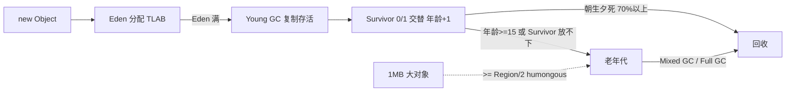
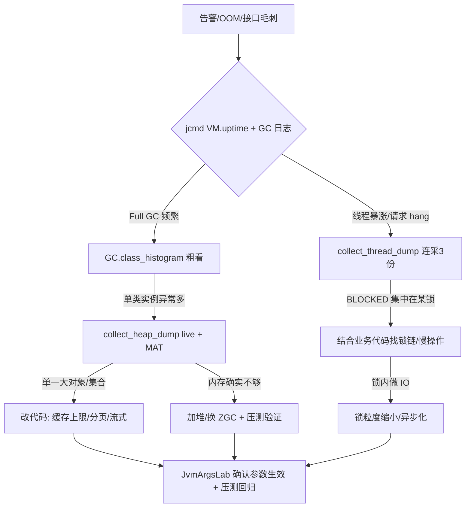

# 09 · JVM 与性能排查（结合 jvm-lab 真实实验）

> 学习目标：把 JVM 内存结构、GC、OOM 排查从"背概念"变成"跑过实验、看过真实输出"。
> 本讲所有实验均来自 `backend/jvm-lab`（10 个 main 实验 + 30 个 JUnit 用例 + 8 个诊断脚本），
> 输出均为 Temurin JDK 17.0.21.1（Windows x64）真实运行记录，可复现。
>
> 项目关联：压测报告 `docs/performance/LOAD_TEST_REPORT.md` 中
> "应用 JVM：压测期间无 GC 报警日志（默认 G1）；Tomcat 线程池 200 并发下队列稳定" ——
> 这句话的底气就来自本讲的诊断能力。

---

## 一、业务背景：为什么后端面试必考 JVM

CampusFlow 是高并发报名系统：999 个请求 5 秒内打到 8080（场景 A），每个请求都会分配
Lua 脚本入参、DTO、VO 等大量朝生夕死的对象。JVM 是这些对象的"房东"：

- 分配太快回收不及时 → **Full GC 频繁 / 接口毛刺**（P99 从 5ms 涨到几百 ms）；
- 引用该释放不释放 → **OOM**，服务假死；
- 元空间加载了太多动态类 → **Metaspace OOM**；
- 线程开太多（每个线程栈默认 1MB 虚拟内存）→ **无法创建线程 OOM**。

面试官问"线上 OOM 怎么排查"，想听到的不是"用 MAT 看看"，而是：
**复现能力（你有没有真的触发过 OOM）→ 参数意识（你知道每个参数影响什么）→ 工具链（jstack/jmap/jcmd/gc 日志）→ 结论落地（改参数还是改代码）**。
`jvm-lab` 就是让你把这条链完整走一遍的实验集。

## 二、jvm-lab 模块地图（先知道有什么）

模块路径 `backend/jvm-lab`，纯 JDK 实现（无 Spring 依赖），包名 `com.campusflow.lab.jvm.<主题>`：

| # | 实验 | 类 | 关键参数 | 学什么 |
|---|---|---|---|---|
| 1 | 堆溢出 | `memory.HeapOverflowLab` | `-Xmx64m` | OOM 现场与 G1 humongous 代价 |
| 2 | 栈溢出 | `memory.StackOverflowLab` | `-Xss256k`（可选） | -Xss 与递归深度的关系 |
| 3 | 元空间溢出 | `memory.MetaspaceLab` | `-XX:MaxMetaspaceSize=32m` | 动态类加载与元空间泄漏 |
| 4 | GC 日志 | `gc.GcLogLab` | `-Xlog:gc*:file=gc.log` | JDK17 统一日志解读 |
| 5 | G1/ZGC 对比 | `gc.GcCompareLab` | `-XX:+UseG1GC` / `-XX:+UseZGC` | 收集器选型 |
| 6 | 双亲委派 | `classloader.ClassLoaderLab` | 无 | 类同一性 = loader + FQCN |
| 7 | 四种引用 | `reference.ReferenceLab` | `-Xmx64m`（可选） | 强/软/弱/虚 |
| 8 | 死锁检测 | `deadlock.DeadlockLab` | 无 | ThreadMXBean 自动检测 |
| 9 | OOM 诊断 | `oom.OomDiagnosisLab` | `-Xmx64m` | HeapDumpOnOutOfMemoryError 实证 |
| 10 | 参数观测 | `args.JvmArgsLab` | 建议带参运行 | 改参数后验证生效的仪表盘 |

配套讲义在 `backend/jvm-lab/docs/01_memory.md` ~ `07_args.md`（含真实输出与面试追问）。

## 三、运行时数据区：先建立"地图"

### 3.1 五块区域与项目对应

```
线程私有：
  程序计数器   —— 线程执行字节码行号
  虚拟机栈     —— 栈帧（局部变量表/操作数栈）；-Xss 控制单线程栈上限
  本地方法栈   —— native 方法
线程共享：
  堆（Heap）   —— 对象实例；-Xms/-Xmx；分代（新生代 Eden/Survivor + 老年代）；G1 下是 Region 集合
  方法区/元空间（Metaspace, JDK8+ 本地内存）—— 类元数据、常量池、方法字节码
补充：
  直接内存（DirectByteBuffer / Netty）—— 不受 -Xmx 限制，受 -XX:MaxDirectMemorySize 控制
```

### 3.2 用 JvmArgsLab 验证参数生效（实验 10）

```bash
# 在 backend/jvm-lab 目录下（先 mvn -pl backend/jvm-lab compile）
java -Xms128m -Xmx512m -Xss512k -XX:+UseG1GC -XX:MaxMetaspaceSize=64m \
     -cp target/classes com.campusflow.lab.jvm.args.JvmArgsLab
```

它通过 `ManagementFactory` 的 `MemoryMXBean` / `MemoryPoolMXBean` / `GarbageCollectorMXBean`
打印各内存池实际大小、当前 GC 名称与 JVM 实际生效参数（`getInputArguments`）。
**调优纪律：改任何参数后先跑它确认生效**——面试中"你说的 -XX:MaxGCPauseMillis 真的生效了吗"
可以用"我每次改动都跑 JvmArgsLab 对比"来回答，这是工程师习惯，不是背书。

## 四、三种 OOM：每个都亲手触发过（实验 1/2/3）

### 4.1 堆溢出 HeapOverflowLab

```bash
java -Xmx64m -cp target/classes com.campusflow.lab.jvm.memory.HeapOverflowLab
```

实验逻辑：`List<byte[]>` 强引用持续持有 1MB 的 `byte[]`，对象始终可达、GC 无法回收，
堆耗尽后抛 `OutOfMemoryError: Java heap space`。

**真实运行结论（jvm-lab README 第七节记录）：64m 堆里 31 个 1MB byte[] 即 OOM。**
为什么不是 64 个？——1MB 对象在 G1 里属于 humongous 对象（超过 Region 一半即 1MB），
直接进老年代 Region，且必须占连续 Region 空间，实际可用容量 < 名义 64m。
这是面试的加分点：**"大对象在 G1 下的隐性代价"我实验量过**。

代码要点（`HeapOverflowLab.java`）：
- 在**子线程**里触发、main 里 catch —— 测试安全设计（surefire 测试 JVM 限定 `-Xmx256m`）；
- catch 内只置标志、先释放引用，**不做任何内存分配** —— 因为 OOM 后任何分配都可能二次 OOM
  （实验中 `Class.getName()`、StringConcatFactory 均真实复现过二次 OOM）。

### 4.2 栈溢出 StackOverflowLab

```bash
java -cp target/classes com.campusflow.lab.jvm.memory.StackOverflowLab
java -Xss256k   -cp target/classes com.campusflow.lab.jvm.memory.StackOverflowLab
```

真实结论：`-Xss256k` 使 main 线程递归深度从 **16435 → 2307**；而用
`new Thread(group, runnable, name, stackSize)` 构造的线程不受 `-Xss` 影响（用构造参数）。
记两个面试结论：
1. `-Xss` 只影响单线程栈上限，不影响堆；线程数 × -Xss ≈ 栈区总虚拟内存；
2. StackOverflowError 属于 Error 不是 Exception，但实践上等同"代码 bug"（无界递归/循环引用 toString）。

### 4.3 元空间溢出 MetaspaceLab

```bash
java -XX:MaxMetaspaceSize=32m -cp target/classes com.campusflow.lab.jvm.memory.MetaspaceLab
```

实验思路（纯 JDK，不依赖 ASM）：
1. 手工拼一个最小合法 `.class` 字节数组（常量池 4 项 + 类头）；
2. 每个类用**独立**的自定义 ClassLoader 加载，并把所有 loader 强引用保存在静态 List
   —— 这正是真实元空间泄漏的典型形态（Groovy 脚本、动态代理、Tomcat 反复 redeploy）；
3. 32m 上限下，真实测得 **5373 个极小类即触顶**（每个约 6KB 元数据开销）。

一个精妙细节：为什么不"同一份字节码反复 defineClass 不同类名"？
`defineClass` 会校验字节码常量池里的类名与传入 name 一致，否则抛
`NoClassDefFoundError: wrong name`。所以实验按目标类名逐个重新生成字节码。

### 4.4 OOM 类型速查表（面试默写级）

| OOM | 触发原因 | 排查方向 | 对应实验 |
|---|---|---|---|
| Java heap space | 可达对象撑爆堆 | heap dump 看 Dominator Tree | HeapOverflowLab |
| Metaspace | 动态类 + loader 泄漏 | dump 看 ClassLoader 占用类数 | MetaspaceLab |
| unable to create new native thread | 线程数 × 栈超限 | jstack 数线程数、降 -Xss 或线程池化 | （线程池治理见 ThreadPoolConfig） |
| GC overhead limit exceeded | 98% 时间 GC 却回收不到 2% 堆 | 同 heap space | HeapOverflowLab 变体 |
| Direct buffer memory | 堆外内存超限 | -XX:MaxDirectMemorySize | Netty/IO 场景 |

## 五、GC：日志解读与 G1/ZGC（实验 4/5）

### 5.1 JDK17 统一日志 -Xlog 语法（必须会）

```bash
java -Xmx256m -Xlog:gc*,gc+heap=debug,gc+metaspace:file=gc.log:time,uptime,level,tags \
     -cp target/classes com.campusflow.lab.jvm.gc.GcLogLab
```

`-Xlog` 四段式：`-Xlog:<tag集>[:<输出目标>[:<装饰字段>[:选项]]]`

- tag 集：`gc`、`gc+heap`、`gc+humongous` 等，`gc*` 表示 gc 及其子标签全部；
- 输出：`stdout` / `file=gc.log`，支持轮转 `filecount=5,filesize=20m`；
- 装饰字段：`time,uptime,level,tags`（一般全带上）；
- **版本坑（面试常问）**：JDK8 的 `-XX:+PrintGCDetails -XX:+PrintGCDateStamps`
  在 JDK9+ 已移除，统一由 `-Xlog` 接管（GCeasy 等日志工具两种格式都能解析）。

### 5.2 一条真实 Young GC 日志怎么读

```
[2026-11-21T02:11:05.123+0800][42.1s][info][gc] GC(37) Pause Young (Normal) (G1 Evacuation Pause)
  Edens: 2048M->0M(2048M)  Survivors: 256M->512M  Heap: 4.2G(32%)->2.1G(16%)
  [Times: user=0.03 sys=0.00, real=0.02 secs]
```

- `GC(37)`：GC 编号；`Pause Young (Normal)`：Young GC；
- `(G1 Evacuation Pause)`：G1 通过复制（疏散）存活对象完成回收；
- `Eden 2048M->0M`：Eden 清空，活对象进 Survivor / 老年代；
- `real=0.02s`：实际暂停 20ms（stop-the-world 时长）；`user` 是所有 GC 线程 CPU 时间和。

统计手段：`grep 'Pause' gc.log` 数次数，取 real 字段求 P99 —— run_with_gclog.sh 尾部就这么打印提示。

### 5.3 G1 与 ZGC 对比（实验 5，同一负载跑两遍）

收集器在 JVM 启动时确定，程序无法在同一 JVM 内切换，所以 `GcCompareLab` 的方案是
**同一负载程序跑两次**：

```bash
java -Xms256m -Xmx256m -XX:+UseG1GC -Xlog:gc*:file=g1.log:time,uptime,level,tags \
     -cp target/classes com.campusflow.lab.jvm.gc.GcCompareLab g1
java -Xms256m -Xmx256m -XX:+UseZGC  -Xlog:gc*:file=zgc.log:time,uptime,level,tags \
     -cp target/classes com.campusflow.lab.jvm.gc.GcCompareLab zgc
```

程序内用 `GarbageCollectorMXBean.getCollectionTime()` 增量 / 墙钟时间测 GC 时间占比，
用 `com.sun.management.ThreadMXBean#getThreadAllocatedBytes` 测真实分配速率。
已知边界（如实记录）：秒级负载下 MXBean 近似测量有失真，精确对比需分钟级负载并解析 Pause 行；
Shenandoah 在 Temurin 构建不可用，实验只覆盖 G1/ZGC。

选型结论（面试标准答案）：

| | G1（JDK9+ 默认） | ZGC（JDK15+ 生产可用） |
|---|---|---|
| 原理 | Region 化分代 + 混合回收 | 着色指针 + 读屏障，并发整理 |
| 停顿 | 可设目标（默认 200ms），随堆增长变差 | 亚毫秒级，与堆大小基本无关 |
| 代价 | 吞吐优先，内存占用低 | 吞吐略降（读屏障）、内存多花 |
| 适用 | 一般服务（CampusFlow 单实例 1g 堆） | 超大堆（>8G）、P99 敏感服务 |

### 5.4 对象的生死流转（mermaid）



GcLogLab 的负载就是按这个规律构造的：70% 1KB 对象立即变垃圾，30% 进轮转存活列表跨过 Young GC 后置空。

## 六、生产排查四步法 + 诊断脚本（scripts/）

`backend/jvm-lab/scripts/` 提供 4 组 `.sh`/`.bat` 脚本（Linux/Windows 双份），是"生产模拟器"：

### 第一步：定位进程与存活确认

```bash
jps -l                     # 或 ps -ef | grep java
jcmd <pid> VM.uptime       # 确认进程跑了多久（刚重启？长期运行？）
jcmd <pid> VM.flags        # 确认参数是否真的生效（比 VM.command_line 更全，含默认值修正）
jcmd <pid> VM.command_line # 启动命令原样回显
```

### 第二步：线程问题 → jstack 连采 3 份（collect_thread_dump.sh）

```bash
./scripts/collect_thread_dump.sh <pid> ./diagnostics
# 脚本行为：jstack -l 连采 3 份、间隔 2 秒
```

为什么连采 3 份：**一份只能看到瞬时状态，三份对比才能确认线程长期 BLOCKED/WAITING**
（瞬时阻塞是正常的，跨 3 份都 BLOCKED 在同一把锁才是事故）。死锁检查：

```bash
grep -A5 'Found one Java-level deadlock' ./diagnostics/threaddump_*.txt
```

脚本头部注释还写了生产要点：jstack 版本必须与目标 JVM 主版本一致；权限不足时
`sudo -u <运行用户>`；替代方案 `jcmd <pid> Thread.print`（推荐）或 `kill -3`。

### 第三步：内存问题 → heap dump（collect_heap_dump.sh）

```bash
./scripts/collect_heap_dump.sh <pid> ./diagnostics live
# jmap -dump:live,format=b,file=heap_<pid>_live_<ts>.hprof <pid>
```

**`:live` 只转储存活对象，但会先触发一次 Full GC —— 大堆高负载生产服务可能秒级 STW。**
所以脚本注释里写明：抓 dump 前先评估业务影响；推荐优先 `jcmd <pid> GC.heap_dump <path>`；
确保磁盘余量 > 进程堆占用。分析用 Eclipse MAT 的 Leak Suspects / Dominator Tree。

### 第四步：一站式采集（jcmd_diagnose.sh）

```bash
./scripts/jcmd_diagnose.sh <pid> ./diagnostics            # VM.uptime/VM.flags/Thread.print/class_histogram/heap_info
./scripts/jcmd_diagnose.sh <pid> ./diagnostics --with-heap-dump
```

`GC.class_histogram` 按类统计实例数与内存占用——**比 dump 快得多，先粗看谁占内存**；
但它与 `GC.heap_dump` 一样会触发 Full GC，生产大堆服务需评估影响（脚本头部原话）。

### 死锁实验（DeadlockLab）：制造 + 自动检测

```bash
java -cp target/classes com.campusflow.lab.jvm.deadlock.DeadlockLab
```

两个线程交叉获取两把锁形成循环等待（死锁四要素：互斥、请求与保持、不可剥夺、循环等待），
然后用 `ThreadMXBean.findDeadlockedThreads()` 自动检测并打印死锁栈。
两个面试细节：
1. main 结束前 `System.exit(0)`——否则非 daemon 死锁线程把进程永久挂住；
2. JVM 不会自动解开 synchronized 死锁，生产只能 jstack 找锁链后修复代码或重启。

### OOM 现场自动留证（OomDiagnosisLab 实证）

```bash
java -Xmx64m -XX:+HeapDumpOnOutOfMemoryError -XX:HeapDumpPath=./heapdump.hprof \
     -cp target/classes com.campusflow.lab.jvm.oom.OomDiagnosisLab
```

实验用 `HotSpotDiagnosticMXBean` 读取 MaxHeapSize 等参数，并演示**运行时动态打开**：
`setVMOption("HeapDumpOnOutOfMemoryError", "true")`（manageable 参数可运行时改）。
真实记录：设置后首次 OOM 生成了 35MB hprof。
**生产必配**这两个参数，事故发生时才有现场可查。

### OOM 排查决策流程（mermaid）



## 七、生产 JVM 参数模板（可直接背 + 可直接抄）

`backend/campusflow-server/src/main/resources/application-local.yml` 末尾的项目建议（本地开发）：

```text
-Xms512m -Xmx1g -XX:+UseG1GC -XX:MaxGCPauseMillis=100 -Xlog:gc*:file=./logs/gc-dev.log
```

生产模板（在 jvm-lab `docs/07_args.md` 基础上扩展，逐条给理由）：

```text
# ===== 堆 =====
-Xms4g -Xmx4g                    # Xms=Xmx 避免运行期伸缩抖动
-XX:MaxMetaspaceSize=256m        # 动态类上限，防 Metaspace OOM（实验3教训）
-Xss512k                         # 高并发服务线程多，512k 够用省虚拟内存（实验2：递归深度仍>2000）
# ===== GC =====
-XX:+UseG1GC -XX:MaxGCPauseMillis=100
# ===== 事故现场留存 =====
-XX:+HeapDumpOnOutOfMemoryError -XX:HeapDumpPath=/data/logs/heapdump.hprof
-Xlog:gc*,gc+heap=debug:file=/data/logs/gc-%t.log:time,uptime,level,tags:filecount=5,filesize=50m
# ===== 观测 =====
-XX:+ExitOnOutOfMemoryError      # 容器/K8s 下 OOM 直接退出交给重启策略，避免半死状态
```

配一个 `start.sh`（生产启动脚本骨架）：

```bash
#!/usr/bin/env bash
PID_FILE=./app.pid
nohup java @jvm-opts.txt -jar campusflow-server.jar \
  --spring.profiles.active=prod > /dev/null 2>&1 &
echo $! > $PID_FILE
```

面试答法：**"我不背参数表，我背三类：容量（堆/栈/元空间）、收集器（G1+暂停目标）、
事故留存（dump + gc 日志轮转）。每一类我都在 jvm-lab 里实验过。"**

## 八、面试题

### 基础

**Q1：JVM 运行时数据区有哪些？哪些线程共享？**
参考答案：线程私有——程序计数器、虚拟机栈、本地方法栈；线程共享——堆、方法区（JDK8 后为元空间，使用本地内存）。CampusFlow 里每个 Tomcat 工作线程有自己的栈（-Xss 控制），所有请求线程共享堆上的对象。

**Q2：JDK8 的永久代去哪了？**
参考答案：永久代（HotSpot 特有实现）被移除，类元数据移到本地内存的 Metaspace。好处：不再受 -XX:MaxPermSize 固定上限约束、与堆 GC 解耦；风险：不设 -XX:MaxMetaspaceSize 理论上可吃光物理内存，所以生产要显式限制。我在 MetaspaceLab 里用 32m 上限实测 5373 个动态类触顶。

**Q3：对象什么时候进老年代？**
参考答案：三条路径——年龄阈值（默认 15，G1 可自适应）、大对象直接进（G1 下超过 Region 一半的 humongous 对象）、Young GC 后 Survivor 放不下的对象提前晋升。我在 HeapOverflowLab 验证过 humongous 的代价：64m 堆 31 个 1MB 数组就 OOM。

### 中级

**Q4：线上 CPU 100% 怎么排查？**
参考答案：① `top` 找到进程；② `top -Hp <pid>` 找到耗 CPU 线程 tid；③ `printf '%x' tid` 转十六进制；④ `jstack <pid> | grep -A20 0x<hex>` 定位线程栈；⑤ 结合栈看是业务死循环、锁竞争还是 GC 线程（GC 线程高 CPU 说明内存问题，转 heap dump 路线）。还可以用 `jcmd <pid> GC.class_histogram` 快速看内存分布。

**Q5：-Xlog:gc* 日志里你最先看什么？**
参考答案：① Pause 行的 real 时间——P99 暂停是否达标；② GC 原因——`(G1 Evacuation Pause)` 是正常 Young GC，`to-space exhausted`、`Full (Allocation Failure)` 是坏信号；③ 频率趋势——Young GC 间隔缩短说明分配速率上升或 Survivor 过早晋升。统计用 `grep 'Pause' gc.log`，深入分析丢给 GCeasy。

**Q6：G1 的 Mixed GC 和 Full GC 区别？**
参考答案：Mixed GC 是 YGC 后附带回收部分老年代 Region（按垃圾比例收益排序选择），并发标记周期后进行，属于设计内的增量回收；Full GC 是兜底的串行/并行回收（JDK10 后并行化），触发通常是 Mixed 赶不上分配速度、to-space exhausted 或大对象分配失败——出现 Full GC 基本等于"该调参或该扩容了"。

### 高级

**Q7：设计一个 OOM 应急预案。**
参考答案：四层。① 预防：容量参数（堆/元空间）+ 压测验证 + 代码层缓存必须有上限（CampusFlow 的 Caffeine maximumSize=500 就是例子）；② 留证：`HeapDumpOnOutOfMemoryError` + HeapDumpPath + `-Xlog:gc*` 轮转（我在 OomDiagnosisLab 实证过 35MB hprof 自动生成）；③ 兜底：`ExitOnOutOfMemoryError` 让进程退出交给重启策略，避免半死状态继续接流量；④ 演练：OOM 复现实验入库（jvm-lab 方式），新人能亲手触发一次。

**Q8：为什么选 G1 不选 ZGC？（结合本项目）**
参考答案：CampusFlow 单实例堆 -Xmx1g 量级、对象小而生命周期短（Lua 入参、DTO），G1 分代复制回收对这种负载吞吐高、内存占用低；ZGC 的亚毫秒暂停优势在超大堆/老年代大对象场景才体现，且读屏障有吞吐税、内存 footprint 更高。压测报告场景 A P99=5ms 无 GC 报警，说明当前默认 G1 已达标。若未来堆扩到 8G+ 且对 P99 极度敏感，ZGC 是下一步选项。

**Q9：catch (OutOfMemoryError) 有什么坑？**
参考答案：① OOM 后堆几乎不可用，catch 块里再做字符串拼接、日志格式化、`Class.getName()` 等分配都可能二次 OOM（我在 HeapOverflowLab 真实复现过 StringConcatFactory 二次 OOM）；② 正确做法：catch 内只置标志位、先释放强引用、把恢复动作交给外部（重启/摘流量）；③ 更根本的是 OOM 不是 Exception 而是 Error，大多数业务代码不该 catch 它，用 HeapDump 留证 + ExitOnOutOfMemoryError 兜底。

## 九、动手练习

1. **复现三种 OOM**：跑 HeapOverflowLab / StackOverflowLab / MetaspaceLab，把"触发参数 + 真实异常信息 + 递归深度/类数"记进你的学习笔记（对照 `backend/jvm-lab/docs/01_memory.md`）。
2. **读一条 GC 日志**：用 `run_with_gclog.sh` 跑 GcLogLab，`grep 'Pause'` 统计暂停次数与均值，回答"这次运行 GC 时间占比多少"。
3. **G1 vs ZGC 对比报告**：同一负载跑两遍 GcCompareLab，记录分配速率、GC 时间占比、平均暂停，形成 3 行结论。
4. **死锁演练**：跑 DeadlockLab 后，另开终端用 `collect_thread_dump.sh` 连采 3 份，找到 `Found one Java-level deadlock` 段落并理解锁链。
5. **给 CampusFlow 写启动参数**：为 `campusflow-server.jar` 写一份带事故留证的生产参数（参考第七节模板），并用 JvmArgsLab 验证其中 3 个参数生效。

---
> 下一篇：10_分库分表与ShardingSphere.md —— 当 registration 表过亿，怎么拆、怎么路由、代价是什么。
