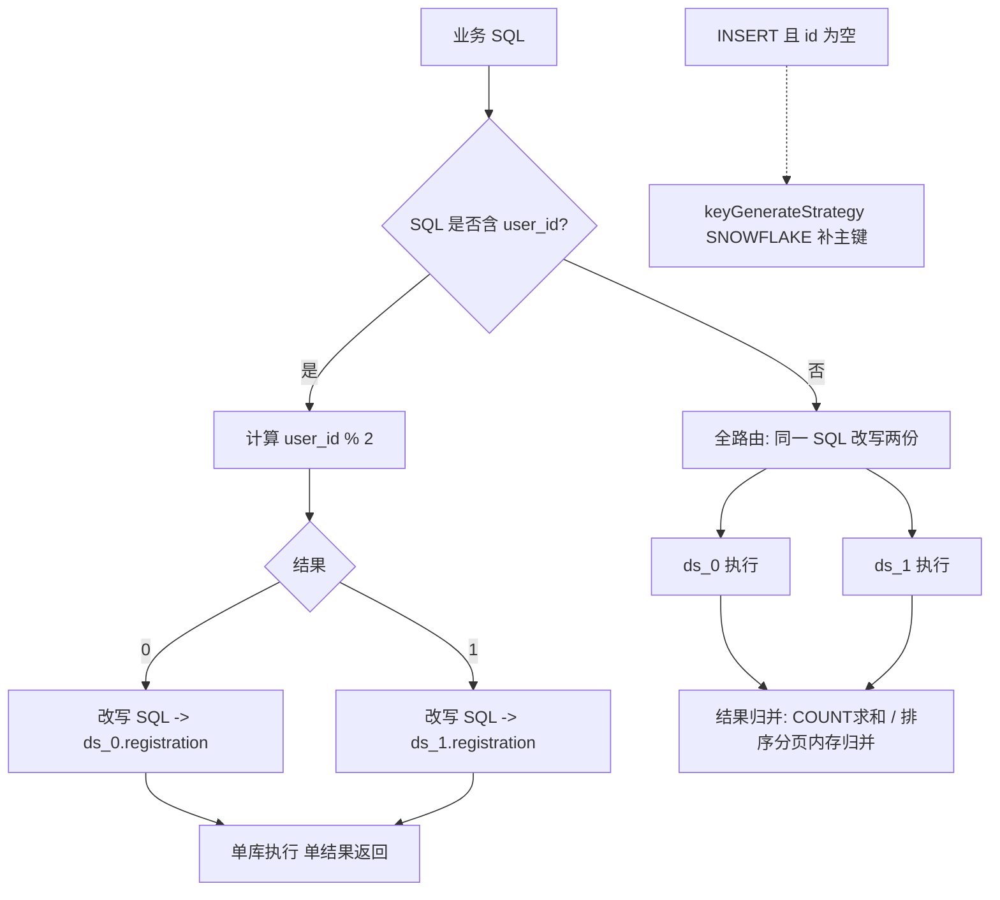

# 10 · 分库分表与 ShardingSphere（结合真实通过的 ShardingSphereShardingIT）

> 学习目标：理解"什么时候需要分库分表、分片键怎么选、经典配置怎么写、不带分片键的查询代价"。
> 项目真实材料：
> - 配置：`backend/campusflow-server/src/main/resources/sharding.yaml` + `application-sharding.yml`
> - 测试：`backend/campusflow-server/src/test/java/com/campusflow/server/it/ShardingSphereShardingIT.java`
>   （真实 MySQL 双分片库 campusflow_ds0 / campusflow_ds1 上通过的集成测试）
> - 版本：ShardingSphere-JDBC 5.4.1（根 pom.xml `shardingsphere.version`）

---

## 一、业务背景：registration 表为什么迟早要拆

CampusFlow 的核心数据是报名记录 `registration`：每个学生 × 每个活动一行。
压测场景 A 里 999 个用户抢 1 个活动；放大到全校一学期几百场活动、几万学生，
这张表的写入模式是**热点突发**（活动发布瞬间集中写入），查询模式是
**"我的报名"（按 user_id）**、"活动报名名单"（按 activity_id）两类。

单表超过千万级以后：B+ 树层数增加、缓冲池命中率下降、DDL 变更锁表时间变长、
`uk_activity_user` 唯一索引维护成本上升。这时有两个方向：

1. **垂直拆分**：按业务域拆库（用户库/活动库/报名库）。CampusFlow 的模块划分
   （user/activity/registration/checkin...）已经是逻辑垂直拆分，物理上一库承载。
2. **水平拆分**：同一张表按某个键分散到多个库/表。ShardingSphere 解决的就是这个。

**本项目的选择**：registration 按 `user_id` 水平分片到 `campusflow_ds0` / `campusflow_ds1`，
其余表暂不拆。这是一个"教学级完整、生产可延伸"的方案——分片对象选了增长最快、
按用户维度查询最频繁的表。

## 二、为什么分片键选 user_id（不是 id，也不是 activity_id）

`sharding.yaml` 顶部注释原文：

```yaml
# 逻辑表：registration -> 物理表 campusflow_ds0.registration / campusflow_ds1.registration
# 分片键：user_id（按用户维度分片，用户维度查询直达单库；活动维度统计查询为广播路由）
# 全局唯一 ID：应用层雪花算法（MP ASSIGN_ID），分片键不含 ID 也能保证全局唯一
```

三个候选键的对比：

| 候选 | 优点 | 缺点 |
|---|---|---|
| `id`（主键） | 雪花 ID 本身分散 | **没有业务查询按 id 查报名列表**，等于白拆 |
| `activity_id` | 活动名单查询直达单库 | 热点活动全部落在一个分片（1000 人抢同一活动=单分片热点）；"我的报名"变广播 |
| `user_id` | "我的报名"最高频查询直达单库；用户天然分散无热点 | 活动维度统计/名单是跨分片广播 |

**结论：分片键 = 该表最高频等值查询的维度**。报名系统的 C 端主语是"用户"，
所以 user_id 胜出；活动名单这类跨分片需求走广播或（进阶）异构一份按 activity_id 的索引表。

## 三、真实配置逐段解读（sharding.yaml）

```yaml
databaseName: campusflow_sharding

mode:                      # 运行模式：单机元数据存 JDBC 库（H2），不依赖 zookeeper/etcd
  type: Standalone
  repository:
    type: JDBC

dataSources:               # 两个物理库各自独立的 HikariCP 连接池（maximumPoolSize: 10）
  ds_0: { ... campusflow_ds0 ... }
  ds_1: { ... campusflow_ds1 ... }

rules:
  - !SHARDING
    tables:
      registration:
        actualDataNodes: ds_${0..1}.registration          # 逻辑表 -> 2 库 × 1 表
        databaseStrategy:
          standard:                                        # 经典"标准分片策略"：单分片键 + 算法
            shardingColumn: user_id
            shardingAlgorithmName: registration_user_mod
        keyGenerateStrategy:
          column: id
          keyGeneratorName: snowflake                      # 兜底分布式 ID
    shardingAlgorithms:
      registration_user_mod:
        type: INLINE
        props:
          algorithm-expression: ds_${user_id % 2}          # 偶数 -> ds0，奇数 -> ds1
    keyGenerators:
      snowflake:
        type: SNOWFLAKE

props:
  sql-show: false   # 打开可观察路由日志（ds0/ds1 广播与定向）
```

注意三个细节：
1. 唯一约束跟随数据走：每个物理库里的 registration 都有自己的
   `uk_activity_user (activity_id, user_id)`（见 IT 的 DDL）——单用户的所有行必然同分片，
   唯一约束依然有效；
2. `sql-show` 打开后日志能看到 `Logic SQL` 与 `Actual SQL`（路由到哪些真实库），
   是验证路由的第一工具；
3. `${user_id % 2}` 是 Groovy 表达式，INLINE 是"行表达式 + 取模"的经典组合。

### 3.1 真实教训：MOD 算法在经典配置下启动失败

第一版配置很自然地写成：

```yaml
shardingAlgorithms:
  registration_user_mod:
    type: MOD          # ❌ 启动报错
```

**启动即失败**：ShardingSphere 5.x 把内置算法分两类管理，
`MOD` 归在 **AUTO_SHARDING（自动分片）** 分类，只服务 auto-sharding 配置形态；
经典配置（`!SHARDING` + `databaseStrategy.standard`）下初始化分片规则时，
按"类型 -> 算法实现"找不到匹配的 SHARDING 类别算法，直接抛异常退出。

**正确姿势**（即当前 sharding.yaml）：经典 standard 策略用
`INLINE` + `algorithm-expression: ds_${user_id % 2}` 表达同样的取模语义。
教训一句话：**算法类型要和配置形态匹配——经典分片用 INLINE/HASH_MOD 等 SHARDING 类算法，
MOD/AUTO_INTERVAL 等 AUTO_SHARDING 类算法只用于自动分片表规则**。
这也是面试里"你踩过什么 ShardingSphere 的坑"的真实素材。

## 四、与默认模式的启动隔离（怎么做到互不影响）

分片不是默认能力，而是**独立启动形态**。三个文件配合：

1. `application-sharding.yml`（profile=sharding 才加载）：

```yaml
spring:
  datasource:
    driver-class-name: org.apache.shardingsphere.driver.ShardingSphereDriver
    url: jdbc:shardingsphere:classpath:sharding.yaml   # 用 ShardingSphere 驱动包装真实数据源
  flyway:
    enabled: false   # 物理分片库 schema 由脚本独立初始化
```

2. 默认运行模式（local profile）根本不加载这个文件，仍是单库 + 普通 MySQL 驱动 + Flyway 自动迁移；
3. 集成测试 `ShardingSphereShardingIT` 更进一步：**编程式**用
   `YamlShardingSphereDataSourceFactory.createDataSource(yamlBytes)` 构建数据源，
   完全独立于 Spring 配置——保证"默认运行模式完全不加载 ShardingSphere"。

启动方式：`--spring.profiles.active=sharding`。
Flyway 关闭的原因：分片物理库的 schema 由部署脚本独立初始化（application-sharding.yml 注释原文），
Flyway 的版本化迁移表放在哪个分片库会引入额外一致性问题。

## 五、路由行为：五个测试讲透（ShardingSphereShardingIT）

测试类用真实 MySQL（campusflow_ds0/ds1）+ 内嵌 YAML 数据源，DDL 与主库一致
（含 `UNIQUE KEY uk_activity_user (activity_id, user_id)`、`KEY idx_user_status (user_id, status)`）。
用 `SnowflakeNext`（`SnowflakeIdWorker(99)`）生成主键，验证分片键无关的全局唯一。

### 测试 1：带分片键写入路由正确

插入 user_id=101..110（奇偶各 5 条），然后**绕过 ShardingSphere 直连两个物理库**核对：

```java
assertEquals(5, countInDs(JDBC_DS0, activityId), "ds0 应有 5 条（偶数 user_id）");
assertEquals(5, countInDs(JDBC_DS1, activityId), "ds1 应有 5 条（奇数 user_id）");
```

——这是验证路由最硬的方式：不看框架说什么，看数据真的落在哪。

### 测试 2：带分片键查询直达单库

```sql
SELECT COUNT(*) FROM registration WHERE activity_id = ? AND user_id = ?
```

SQL 同时含 activity_id 与 user_id，标准策略按 user_id 计算出唯一分片，**只发一条 SQL 到目标库**。
代价 = 单库查询；这就是"用户维度查询直达"的兑现。

### 测试 3：不带分片键 → 全路由（广播）聚合

```sql
SELECT COUNT(*) FROM registration WHERE activity_id = ?   -- 没有 user_id！
```

ShardingSphere 把它**改写成两条 SQL 分别发到 ds0/ds1，把结果聚合**返回（COUNT 求和）。
测试断言两库之和 = 10。代价：**每次查询翻倍（N 个分片 N 次）+ 应用侧归并开销**。
生产上这类"活动维度统计"应该走：异构统计表 / 宽表 / ES，而不是每次广播。

### 测试 4：跨分片分页排序归并

```sql
SELECT user_id FROM registration WHERE activity_id = ? ORDER BY user_id DESC LIMIT 3
-- 断言返回 List.of(110L, 109L, 108L)
```

LIMIT 深分页的坑：`ORDER BY x LIMIT 100000, 10` 会变成每个分片取 `LIMIT 100010, 10`
再内存归并排序——**offset 越大，每个分片要拉的数据越多**。测试只取 3 条所以轻松，
但原理必须知道：跨分片分页是 ShardingSphere 内存归并，深 offset 是性能炸弹。

### 测试 5：全局唯一 ID

主键由测试内 `SnowflakeIdWorker(99)` 生成（与主工程
`com.campusflow.common.util.SnowflakeIdWorker` 同一实现思路），
或由 ShardingSphere 的 `keyGenerateStrategy -> SNOWFLAKE` 兜底。
要点：**分片键不是主键时，主键必须全局唯一**（自增 ID 在两个库里会冲突），
雪花 ID 与分片键无关也能全局唯一。

### 报名主链路在分片模式下的影响（进阶理解）

消费端 `RegistrationTxService.confirmRegistration` 用
`activity_id + user_id` 查/插 registration——带 user_id，路由正常；
`CompensationScheduler.doStockReconcile` 的
`selectCount(activity_id IN ...)` 不带 user_id → 广播到两个库聚合。
**结论：分片模式下所有 SQL 都要过一遍"有没有带上 user_id"**，这也是
`idx_user_status (user_id, status)` 索引设计的由来。

## 六、路由流程（mermaid）



## 七、面试题

### 基础

**Q1：什么时候需要分库分表？**
参考答案：两个信号——数据量信号（单表行数/索引体积让 B+ 树变深、DDL 慢、缓冲池命中率降，经验值千万行级）与吞吐信号（单库连接数/磁盘 IO/主从延迟扛不住写峰值）。CampusFlow 选增长最快、按用户查询最频繁的 registration 先拆，其余表不跟风。

**Q2：水平拆分常用策略？**
参考答案：取模（均匀无热点，扩容要迁移）、范围（按时间/ID 段，易扩容但热点集中）、一致性哈希（扩容迁移少）。CampusFlow 用 INLINE 表达式实现取模（user_id % 2），教学规模 2 分片；生产扩容会配一致性哈希或基因法。

**Q3：ShardingSphere-JDBC 和 Proxy 的区别？**
参考答案：JDBC 是增强驱动，嵌在应用进程内、零额外部署、性能好，但只支持 Java 且与应用同生命周期；Proxy 是独立中间件（MySQL 协议），语言无关、可集中管控，多一跳网络。CampusFlow 单体应用选 JDBC 版。

### 中级

**Q4：分片键怎么选？（用本项目回答）**
参考答案：选"最高频等值查询维度 + 天然分散无热点"。registration 的查询主体是"我的报名"（user_id），热点是活动（activity_id），所以 user_id 分片让 C 端直达单库，活动名单接受广播或异构。反例是按 activity_id 分：1000 人抢同一活动=单分片被打爆，分片失去意义。

**Q5：不带分片键的查询会发生什么？代价多大？**
参考答案：全路由（广播）——SQL 改写发到所有分片，应用侧归并。N 分片就是 N 次查询 + 归并内存；分页更危险，`LIMIT 100000,10` 每分片都取前 100010 行。所以：查询设计必须尽量带分片键；跨分片统计走异构/汇总表；深分页用"上次最大值游标"替代 offset。我在 ShardingSphereShardingIT 里专门写了广播 COUNT 与 ORDER BY DESC LIMIT 3 两条断言验证归并正确性。

**Q6：分片后唯一约束和事务怎么办？**
参考答案：唯一约束——把分片键放进唯一索引（uk_activity_user 含 user_id，同一 user 的行必同分片，约束在本库依然生效）；跨库事务——本项目用"Redis 预留 + MQ 异步确认 + 补偿"的最终一致，天然避开跨分片分布式事务；真需要强一致的跨分片写，才考虑 XA/Seata，代价极大。

### 高级

**Q7：2 分片扩到 4 分片怎么不停机迁移？**
参考答案：双写方案——① 新分片集群上线，老分片继续服务；② 开启双写（user_id % 4 路由到新集群），老写照旧；③ 存量数据按 user_id % 4 从老库搬迁（搬迁期间老库为准）；④ 数据校验对账（count/抽样/全量 checksum）；⑤ 读流量灰度切新集群；⑥ 停老写，收尾。工程细节：迁移脚本要幂等、按 user_id 批次切分、失败可重跑。INLINE 表达式从 `ds_${user_id % 2}` 改成 `ds_${user_id % 4}` 只是配置变化，难的是数据与流量迁移。

**Q8：你的 ShardingSphere 配置踩过什么坑？**
参考答案：两个。一是算法分类：把经典 standard 策略的算法写成 `type: MOD`，启动即失败——MOD 在 5.x 属 AUTO_SHARDING 分类，经典配置要用 INLINE + `algorithm-expression: ds_${user_id % 2}`；二是启动隔离：分片驱动会接管 DataSource 与 Flyway，所以分片 profile 里 `flyway.enabled=false`、物理库 schema 由脚本独立初始化，且默认 local 模式完全不加载 sharding 配置，两套形态通过 profile 严格区分。集成测试用编程式 YAML 数据源独立构建，进一步保证互不干扰。

**Q9：为什么不用 ShardingSphere 的自动分片（auto-sharding）配置？**
参考答案：自动分片要求算法输出"分片资源名"由框架调度（MOD/AUTO_INTERVAL），配置更简洁但定制性弱；经典配置能用 INLINE 复杂表达式、HINT 强制路由、复合分片键，迁移到 Proxy/多规则共存时更可控。本项目场景简单，两种都能跑，选经典的另一个原因是 MOD 那次踩坑后顺手统一到了 INLINE。

## 八、动手练习

1. **搭环境**：本机 MySQL 建 `campusflow_ds0` / `campusflow_ds1`，跑
   `mvn -pl backend/campusflow-server test -Dtest=ShardingSphereShardingIT`，5 个测试全绿后，
   直连两个物理库 `SELECT COUNT(*)` 亲眼确认数据分布。
2. **看路由**：把 sharding.yaml 的 `sql-show` 改 true，重跑测试，抄下
   "Logic SQL / Actual SQL"日志，标出哪条是定向、哪条是广播。
3. **踩一遍 MOD 的坑**：把算法改成 `type: MOD` 启动（或跑 IT），记录真实异常，
   再改回 INLINE 修复——把这段写进你的"踩坑记录"。
4. **深分页实验**：在 IT 基础上插 1000 条，执行
   `ORDER BY user_id LIMIT 900, 10`，开 sql-show 观察每个分片实际执行的 LIMIT 值。
5. **思考题**：如果活动报名名单查询 QPS 很高，给出两种落地异构方案（按 activity_id 的索引表 / 消费 binlog 写宽表），写出表结构草案与一致性保障方式。

---

## 九、扩展：分片相关高频问题速答

**Q：分片后 `INSERT ... ON DUPLICATE KEY UPDATE` 还能用吗？**
能，但要保证 ON DUPLICATE 的唯一索引包含分片键（uk_activity_user 含 user_id），
否则冲突检测本身就要广播。

**Q：MyBatis-Plus 的分页插件和 ShardingSphere 冲突吗？**
不冲突但会叠加：ShardingSphere 先做跨分片归并（内存），MP 分页插件再对归并结果分页。
本项目 registration 查询都带 user_id（单分片），两者各司其职；若是不带分片键的分页，
深 offset 会双重放大（归并拉全量 + 插件再 limit），务必避免。

**Q：事务里跨分片写怎么办？**
本项目设计上不存在：一个用户的所有报名数据都在同一分片（分片键 user_id），
confirmRegistration 的事务永远单库。跨分片统计走对账（CompensationScheduler）而非跨库事务。
这也是"按维度分片"的隐藏收益——**维度内强一致，维度间最终一致**。

**Q：ShardingSphere 的元数据存在哪？重启会丢吗？**
sharding.yaml 配置 `mode: Standalone + repository: JDBC`——元数据（规则定义）
存本地 JDBC 库（H2 内嵌），随应用打包；生产可选 Cluster 模式（ZooKeeper/etcd）
实现多实例规则共享与热更新。本项目单应用形态下 Standalone 足够。

**Q：怎么排查"SQL 被路由到错误的库"？**
三步定位法：① `sql-show: true` 看 Logic SQL 与 Actual SQL 的对应关系；
② 手算 `user_id % 2` 与 Actual 库名比对；③ 用测试同款手法
——**绕过 ShardingSphere 直连物理库**核对数据真实位置（IT 的 countInDs 方法）。
三层证据从"框架说的"到"数据真的在哪"，排查思路与 15 讲的源码阅读方法论一致。

## 十、落地检查清单（从单库切到分片 profile 时逐项打勾）

- [ ] 所有 SQL（含 Mapper 内手写 XML/LambdaQueryWrapper）逐一检查是否带分片键 user_id；
- [ ] 不带分片键的查询（统计/后台报表）确认频率可接受，或列入异构改造清单；
- [ ] 分片键必须包含在所有唯一索引中（uk_activity_user 已满足）；
- [ ] Flyway 关闭确认（application-sharding.yml），分片库 schema 由独立脚本初始化；
- [ ] 物理库连接池规格重新评估（两个库各 maximumPoolSize=10，总连接数翻倍）；
- [ ] 逻辑删除字段 deleted 与分片无冲突确认（逻辑删除不改变分片键）；
- [ ] 主键生成策略确认（应用层雪花 or ShardingSphere SNOWFLAKE，二选一避免双重生成）；
- [ ] 扩容预案文档化（双写迁移六步，16 讲练习 12）。

---
> 下一篇：11_接口设计与企业工程规范.md —— 从 ApiResult 到 TraceId，校招面试官想看的"工程素养"。
