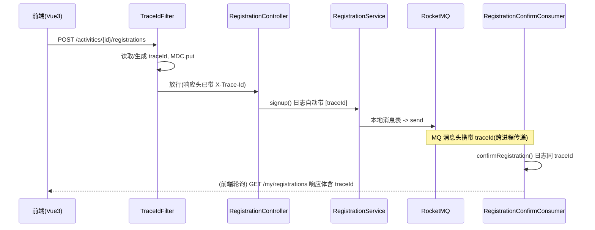

# 11 · 接口设计与企业工程规范（统一响应/分层/幂等/TraceId）

> 学习目标：校招面试里"项目经验"之外的分水岭是**工程规范**。
> 本讲用 CampusFlow 真实代码讲六件事：统一响应与错误码分段、DTO/VO/DO 分层、
> 参数校验、幂等设计、TraceId 全链路、全局异常处理与 API 文档，
> 外加一个前端联调真实踩坑（Long 精度丢失）。

---

## 一、业务背景：为什么规范不是"花活"

一个 6 模块 Maven 项目（campusflow-common/infrastructure/business/server/concurrency-lab/jvm-lab）
+ Vue3 前端，如果没有统一规范：

- 每个接口返回结构不一样，前端要写 N 种解析逻辑；
- 错误码随手编，出问题只能翻代码；
- TraceId 缺失，一条请求跨 Controller→Service→MQ→消费端，日志对不上号；
- 19 位雪花 ID 直接下发给 JS，前端拿到的 ID 是错的（真实踩坑，见第七节）。

规范的本质是**降低团队沟通成本和线上排障成本**。以下每一项都来自真实代码。

## 二、统一响应 ApiResult 与错误码分段

### 2.1 ApiResult（campusflow-common/.../result/ApiResult.java）

```java
@Data
public class ApiResult<T> implements Serializable {
    private int code;
    private String message;
    private T data;
    private String traceId;      // 全链路日志排查，由 TraceIdFilter 注入

    public static <T> ApiResult<T> ok(T data) { ... }         // code=0, message="success"
    public static <T> ApiResult<T> fail(ErrorCode errorCode) { ... }
    public boolean isSuccess() { return code == ErrorCode.SUCCESS.getCode(); }
}
```

设计要点：泛型承载业务数据；`traceId` 字段直接进响应体（前端报障时用户可截图这个 ID，
后端 `grep` 日志秒定位）；工厂方法收敛构造入口。

### 2.2 ErrorCode 分段规则（common/error/ErrorCode.java）

枚举注释原文：**"0 成功；2xxxx 业务错误；3xxxx 基础设施错误；4xxxx 通用 HTTP 语义错误"**

| 段 | 含义 | 真实例子 |
|---|---|---|
| 0 | 成功 | SUCCESS(0, "success") |
| 21xxx~26xxx | 按业务模块分段 | 用户 21001 用户名已存在；活动 22002 未发布；报名 23001 已重复报名、23002 名额已满、23003 限流；候补 24001；签到 25001；消息补偿 26001 |
| 3xxxx | 基础设施 | LOCK_TIMEOUT 30001、REDIS_ERROR 30002、MQ_ERROR 30003、DB_ERROR 30004 |
| 4xxxx/5xxxx | 通用语义 | PARAM_ERROR 40001、UNAUTHORIZED 40101、FORBIDDEN 40301、SYSTEM_ERROR 50000 |

**为什么这样分段**：一看错误码就知道"是用户的问题、是代码的 bug、还是中间件挂了"，
告警分级（4xxxx 般不打告警、3xxxx 触发基础设施告警）和排障路径都直接受益。
业务码 23002（名额已满）还有一个特殊角色：它是**业务正常态**——报名满员返回 23002，
HTTP 仍是 200，前端据此引导去候补队列（压测场景 A 的 999 个请求里 899 个就是它）。
所以规范里要区分：**HTTP 状态码表达传输层结果，业务码表达业务结果**。

## 三、DTO / VO / DO 分层

CampusFlow 的分层事实（以活动模块为例，均真实存在）：

```
controller/ActivityPublicController.java
dto/ActivityUpsertRequest.java   <- 入参 DTO（ jakarta.validation 注解校验）
dto/ActivityVO.java              <- 出参 VO（只暴露前端需要的字段）
entity/ActivityDO.java           <- DO（映射 activity 表，含 deleted/version 等 DB 字段）
mapper/ActivityMapper.java       <- MyBatis-Plus Mapper
service/ActivityService.java     <- 业务编排
```

- **DO**：与表结构一一对应，禁止直接出 Controller（否则泄露 deleted/version 等内部字段，且未来改表就破坏 API 契约）；
- **DTO**：入参对象，校验注解挂这里。真实例子 `RegisterRequest.java`：

```java
@NotBlank(message = "用户名不能为空")
@Size(min = 4, max = 32, message = "用户名长度 4-32 位")
@Pattern(regexp = "^[a-zA-Z0-9_]+$", message = "用户名只能包含字母、数字、下划线")
private String username;
@Pattern(regexp = "STUDENT|ORGANIZER", message = "注册身份只能为学生或组织者")
private String role = "STUDENT";
@Pattern(regexp = "^$|^1[3-9]\\d{9}$", message = "手机号格式不合法")
private String phone;
```

- **VO**：出参对象，做字段裁剪与组装。`RegistrationVO` 聚合了报名 + 活动标题 + 用户昵称
  + hasCheckinToken，由 `RegistrationService.toVO()` 组装——聚合逻辑放服务层，不放前端。

面试一句话：**DO 对表、DTO 对入参（校验）、VO 对出参（裁剪），转换发生在 Service 层；
小项目可以懒，但校招项目分层清晰是加分项。**

## 四、幂等设计：四处真实落地

幂等 = 同一操作执行一次与执行多次，结果一致。本项目每个写链路都回答了"重复请求怎么办"：

### 4.1 报名（最重要）：Lua 成员集 + DB 唯一约束 双保险

- 第一道：`lua/reserve.lua` 里 `SISMEMBER membersKey userId`，重复报名返回 -3（DUPLICATE）；
- 第二道：`RegistrationService.doPersistReservation` 落库前再查一次有效报名（"双保险：Lua 已拦截，防御性校验"，源码注释原文）；
- 第三道（最终防线）：MySQL `uk_activity_user` 唯一索引，消费端 insert 撞 `DuplicateKeyException` 转幂等分支返回已有记录 id。
  集成测试 `IdempotencyIT.数据库唯一约束拦截绕过Redis的重复报名` 直接绕过 Redis 手工插第二行，
  断言 `assertThrows(DuplicateKeyException.class, ...)`——**唯一约束是唯一不依赖任何中间件状态的防线**。

### 4.2 取消：乐观锁状态 CAS

`RegistrationTxService.cancelRegistration`：状态已是 CANCELLED 直接返回 false（幂等成功）；
并发竞争 `updateById` 影响 0 行（version 不匹配）也视为幂等。
集成测试 `CancelConcurrencyIT`（10 线程并发取消同一报名）验证"名额只恢复一次、审计只一条"。

### 4.3 签到：Redis SETNX + 事务内 CAS + 唯一约束 三层

`CheckinService.scan` 注释原文给了完整答案：
"①Redis SETNX 一次性令牌（快路径，拦截绝大多数并发重复）；②DB 事务内 CAS：
checkin_token WHERE status=0 与 registration WHERE status=1 同一事务推进；
③checkin_record uk_registration 唯一约束兜底。"

### 4.4 消费幂等：三层防线（MessageConsumeLogService.tryBeginConsume）

```java
// L1a: Redis 认领锁（SETNX 60s TTL）—— 并发重复消息只有一个线程进入处理
// L1b: Redis processed 标记（成功后写入，TTL 24h）—— 已处理消息快速跳过
// L2 : DB 唯一约束 uk_msg_group —— Redis 数据丢失后的最终防线
```

注释里的关键推理：**Broker 对"业务键相同的两条独立消息"不做去重**，
并发投递时只靠 DB 唯一约束存在检查-插入竞态窗口，所以需要 Redis 认领锁前置互斥；
认领锁 60s 过期保证崩溃后 Broker 重投仍能重试。这是面试"消息消费幂等怎么设计"的满分素材。

## 五、TraceId 全链路：Filter → MDC → 日志 → 响应头 → 异常处理器

### 5.1 为什么需要

报名链路跨 5 层：HTTP → RegistrationService → 本地消息表 → RocketMQ → RegistrationConfirmConsumer → DB。
没有 traceId，用户说"报名失败了"，你只能按时间猜日志。

### 5.2 真实实现（三段代码 + 一段配置）

第一段 `TraceIdFilter`（campusflow-server/config/TraceIdFilter.java）：

```java
String traceId = request.getHeader(TraceUtils.TRACE_HEADER);   // X-Trace-Id
if (traceId == null || traceId.isEmpty() || traceId.length() > 64) {
    traceId = TraceUtils.newTraceId();                          // 32 位无连字符 UUID
}
MDC.put(TraceUtils.MDC_KEY, traceId);
response.setHeader(TraceUtils.TRACE_HEADER, traceId);          // 回传给调用方
try { filterChain.doFilter(request, response); }
finally { MDC.remove(TraceUtils.MDC_KEY); }  // MDC 底层也是 ThreadLocal：Tomcat 线程复用，必须清理
```

注释里有一个高频面试点：**Filter 与 Interceptor 的边界**——
"TraceId 属于协议层关注点（所有请求，包括静态资源/actuator），用 Filter；
鉴权属于 MVC 层关注点（仅业务路由），用 HandlerInterceptor。"

第二段 `logback-spring.xml`：pattern 里 `%X{traceId}` 直接取 MDC 值：

```xml
<pattern>%d{yyyy-MM-dd HH:mm:ss.SSS} [%thread] %-5level [%X{traceId}] %logger{40} - %msg%n</pattern>
```

第三段 `GlobalExceptionHandler`：每个 handler 把 `MDC.get(TraceUtils.MDC_KEY)`
塞进 ApiResult.traceId 返回；同时 `log.error("系统异常 traceId={}", ...)` 记录完整堆栈。

`WebMvcConfig.addCorsMappings` 还把 `X-Trace-Id` 加进 `exposedHeaders`，前端 JS 才读得到。

### 5.3 全链路示意（mermaid）



排障方式固定为一条命令：`grep 'a1b2c3...' logs/campusflow.log`，
一条 traceId 串起 HTTP 入口到消费落库的全过程；ERROR 单独落
`campusflow-error.log`（logback LevelFilter），排障先看这个文件。

## 六、全局异常处理 GlobalExceptionHandler

真实处理器（`@RestControllerAdvice`）覆盖六类异常：

| 异常 | 返回 | 处理逻辑 |
|---|---|---|
| BizException | 业务码 + message，HTTP 200 | 业务分支走异常表达，log.warn 记录 |
| MethodArgumentNotValidException / BindException | 400 + 40001 | 拼接所有字段错误：`field: message; field: message` |
| ConstraintViolationException | 400 + 40001 | 方法级校验 |
| MissingServletRequestParameter / TypeMismatch | 400 + 40001 | 参数缺失/类型错 |
| HttpRequestMethodNotSupported | 405 | METHOD_NOT_ALLOWED |
| Exception（兜底） | 500 + 50000 | **log.error 完整堆栈，对外只返回"系统繁忙"通用文案（防内部信息泄漏）** |

两条原则（面试可直接说）：① 业务异常用 `BizException.of(ErrorCode.XXX)` 随手抛，
让 Controller 层零 try-catch；② 兜底 handler 永不外泄堆栈/SQL 细节，只给 traceId 让用户报障。

## 七、真实踩坑：前端 Long 精度丢失（JacksonConfig）

`campusflow-server/config/JacksonConfig.java` 全文其实只有 6 行核心逻辑，注释是关键：

```java
/**
 * 雪花 ID 是 19 位 Long，超出 JavaScript Number 安全整数范围（2^53-1），
 * 直接以 JSON number 下发会被前端舍入导致 ID 错乱（如 2123838677402947593 -> ...600）。
 * 统一将 Long 序列化为字符串，是雪花 ID + Vue 前端的标准解法。
 */
@Bean
public Jackson2ObjectMapperBuilderCustomizer longToStringCustomizer() {
    return builder -> builder
            .serializerByType(Long.class, ToStringSerializer.instance)
            .serializerByType(Long.TYPE, ToStringSerializer.instance);
}
```

原理：JS `Number` 遵循 IEEE 754 双精度，安全整数上限 `Number.MAX_SAFE_INTEGER = 2^53-1 ≈ 9.007e15`，
而雪花 ID 约 1.9e18，**后 2~3 位会被静默舍入**——接口看似正常，前端拿这个 ID 再查详情就 404，
且极难排查。三种解法对比：

| 方案 | 做法 | 代价 |
|---|---|---|
| 全局 Long→String（本项目） | Jackson customizer | 后端零侵入；前端把 id 当字符串用 |
| 逐字段 @JsonSerialize | VO 字段级注解 | 漏标即踩坑 |
| 前端 json-bigint 解析 | axios transformResponse | 侵入所有请求，第三方库兼容问题 |

注意入参方向不受影响：前端把字符串 id 传回，Spring 的参数绑定会自动转 Long。

## 八、API 文档：Knife4j + springdoc

`application.yml`：

```yaml
springdoc:
  api-docs: { enabled: true }
  swagger-ui: { enabled: true }
knife4j:
  enable: true
  setting: { language: zh_cn }
```

`OpenApiConfig` 注册了 `BearerAuth` 安全方案，`/doc.html`（Knife4j UI）里点 Authorize
输入 JWT 即可联调。所有 Controller 方法带
`@Tag/@Operation(summary = "报名活动（Redis Lua 原子预留 + MQ 异步确认）")`——
**文档注释写的是"怎么实现的"，新人读文档即读架构**。
安全提示：生产环境应关闭文档端点（或加权限），避免接口信息外泄。

## 九、面试题

### 基础

**Q1：为什么所有接口统一 ApiResult？traceId 为什么要放进响应体？**
参考答案：统一结构让前端只写一种解析器，错误码可编程分支；HTTP 状态码表达传输层语义（401/500），业务码表达业务结果（满员 23002 是正常态）。traceId 放响应体是给排障留抓手：用户报障截图里就有 traceId，后端 `grep` 一条命令串起全链路日志。

**Q2：DTO/VO/DO 为什么要分开？**
参考答案：DO 绑表结构（含 deleted/version 等内部字段），直接出参会让表结构成为 API 契约，改表即破坏兼容；DTO 承载校验注解；VO 做字段裁剪与跨表聚合（RegistrationVO 聚合活动标题、用户昵称）。分层代价是转换代码，收益是各层独立演进。

**Q3：Filter 和 Interceptor 的区别？**
参考答案：Filter 是 Servlet 规范，DispatcherServlet 之前生效，覆盖所有请求（含静态资源/actuator），本项目的 TraceIdFilter 用它因为 traceId 是协议层关注点；Interceptor 是 Spring MVC 机制，只对 handler 方法生效、能拿到 handler 元数据，JwtAuthInterceptor 用它做业务路由鉴权 + preHandle 写 ThreadLocal / afterCompletion 清理。

### 中级

**Q4：讲讲你的幂等设计（报名为例）。**
参考答案：四层——Lua SISMEMBER 前置拦截（-3 重复）；Service 落库前防御性查询；MySQL uk_activity_user 唯一约束是最终防线（不依赖任何中间件状态，集成测试专门验证了绕过 Redis 直插被拦截）；消费端三层幂等（Redis 认领锁 SETNX 60s + processed 标记 24h + DB uk_msg_group）。设计原则：快路径用 Redis 省 DB，最终防线必须在 DB 约束上。

**Q5：TraceId 是怎么贯穿到 MQ 消费端的？Tomcat 线程复用要注意什么？**
参考答案：HTTP 层 TraceIdFilter 生成/透传 X-Trace-Id 并 MDC.put；logback pattern %X{traceId} 输出到每行日志；跨进程通过 MQ 消息属性携带，消费端继续写日志。关键点：MDC 和 AuthContext 都是 ThreadLocal，Tomcat 线程复用会串号，所以 Filter finally 里 MDC.remove、Interceptor afterCompletion 里 AuthContext.clear——漏清理是经典事故（下一个请求读到上一个用户的身份）。

**Q6：参数校验注解挂哪一层？校验失败返回什么？**
参考答案：挂 DTO（RegisterRequest 的 @NotBlank/@Size/@Pattern），Controller 参数加 @Valid 触发；校验失败抛 MethodArgumentNotValidException，GlobalExceptionHandler 转成 40001 + "字段: 原因"拼接明细，HTTP 400。业务性校验（如"组织者不能报名自己的活动"）在 Service 用 BizException 表达。

### 高级

**Q7：为什么 Long 要转 String？如果不用全局转换器，还有什么方案？**
参考答案：雪花 ID 19 位超出 JS Number 2^53-1 安全范围，IEEE 754 双精度会静默舍入末几位（真实例子 ...593 舍成 ...600），前端再用错误 ID 回查必然 404，且报障现象诡异。方案对比：全局 ToStringSerializer（零侵入，本项目）；字段级 @JsonSerialize(ToStringSerializer)；前端 json-bigint 解析。注意响应方向转换即可，请求方向 Spring 自动把字符串绑定成 Long。

**Q8：500 的响应体里为什么只给"系统繁忙"？**
参考答案：对外暴露堆栈/SQL 片段是信息泄漏（攻击者可据其构造注入）；正确姿势是服务端 log.error 带完整堆栈 + traceId，对外只回通用文案 + traceId。CampusFlow 的 GlobalExceptionHandler.handleUnknown 就是这么做的，且 ERROR 单独落 campusflow-error.log 便于第一时间排查。

**Q9：错误码分段 2xxxx/3xxxx/4xxxx 的工程价值？**
参考答案：① 排障路径分流：4xxxx 多为客户端问题、3xxxx 触发中间件告警、2xxxx 是业务正常分支不打告警；② 前端可按段做统一提示策略；③ 新模块只占用新段位（26xxx 消息补偿），避免码冲突。分段是"约定优于配置"在错误码上的落地。

## 十、动手练习

1. **加一个模块的错误码**：给"导出"模块设计 27xxx 段错误码（如 EXPORT_TASK_FAILED 27001），加入 ErrorCode 并在适当 Service 使用，用 /doc.html 验证接口文档同步。
2. **手动复现精度丢失**：临时注释 JacksonConfig 的 customizer，启动后登录拿一个报名记录 id，在浏览器控制台执行该 id 的 `+1`，观察结果变成什么；恢复配置对比。
3. **TraceId 排障演练**：在 GlobalExceptionHandler 临时抛一个异常触发 500，从响应体拿 traceId，用 `grep <traceId> logs/campusflow.log` 拉出完整日志并定位到堆栈行。
4. **给 signup 接口写校验**：为报名路径参数加最小约束（activityId > 0），并写一条测试证明校验生效（预期 40001）。
5. **文档补全**：任选一个 Controller，补全 @Tag/@Operation/@Parameter 注解，让 /doc.html 展示与 `docs/learning/15_项目源码阅读路线.md` 描述一致的接口清单。

---
> 下一篇：12_Docker部署与Linux实战.md —— 让项目在你自己的服务器上跑起来。
