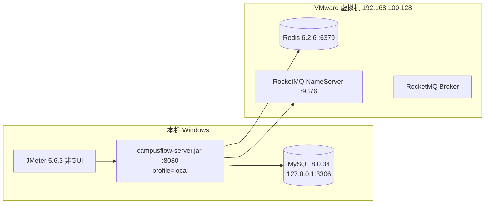
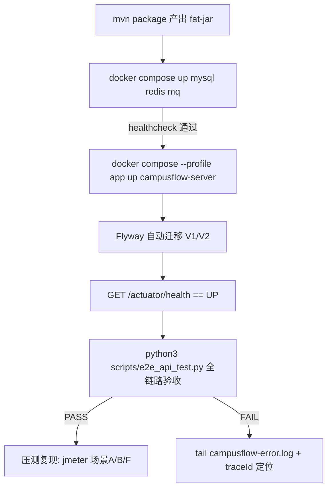

# 12 · Docker 部署与 Linux 实战

> 学习目标：把 CampusFlow 从"本机能跑"变成"服务器上跑得稳"。
> 项目真实材料：
> - `backend/campusflow-server/src/main/resources/application-docker.yml`（Docker Compose 环境配置，
>   服务名互访：`mysql` / `redis` / `rocketmq-namesrv`）
> - `application.yml` 的 Actuator 配置（health/info/metrics/prometheus，压测期观测）
> - `application-local.yml`（本地真实拓扑：本机 MySQL + VMware 虚拟机 Redis/RocketMQ）
> - `backend/jvm-lab/scripts/`（Linux 诊断脚本 4 组）
> - `backend/campusflow-server/src/main/resources/logback-spring.xml`（日志落盘结构）
> - `scripts/e2e_api_test.py`（部署后的端到端验收）
>
> 说明：`deploy/` 目录现已成为完整交付物（docker-compose.yml / backend.Dockerfile / frontend.Dockerfile / nginx/nginx.conf / rocketmq/broker.conf / scripts/*.sh），本讲义以讲解其实现原理为主：
> 是本讲第十二节的**落地练习交付物**——讲义给出与 application-docker.yml 环境变量
> 完全对齐的参考实现，你亲手写入并验证。

---

## 一、业务背景：为什么简历项目必须"能部署"

面试官问"你的项目怎么部署的"，考的不是 Docker 命令背诵，而是：
**服务拓扑（谁依赖谁）、配置注入（环境变量 vs 写死）、健康检查（怎么算"活着"）、
日志与诊断（挂了怎么查）**。CampusFlow 的部署设计在这四点上都有真实代码支撑。

## 二、先看真实运行拓扑（本地开发环境）

`application-local.yml` 注释原文："本地开发环境：MySQL 用 Windows 本机 3306；
Redis/RocketMQ 用 VMware 虚拟机 192.168.100.128"：



这套拓扑不是"演示配置"，压测报告（docs/performance/LOAD_TEST_REPORT.md）就是在这套
真实环境上跑出来的：JDK17 Temurin / MySQL 8.0.34 本机 / Redis 6.2.6 与 RocketMQ 4.9.4 跑在虚拟机。
**它教会你一件事：应用与中间件可以跨网段部署，只要连接信息全部环境变量化。**

## 三、Docker Compose 环境：application-docker.yml 逐行解读

容器化部署时切到 docker profile，配置原文：

```yaml
# ===== Docker Compose 环境：容器内服务名互访 =====
spring:
  datasource:
    url: jdbc:mysql://${MYSQL_HOST:mysql}:${MYSQL_PORT:3306}/${MYSQL_DB:campusflow}?...&rewriteBatchedStatements=true
    username: ${MYSQL_USERNAME:campusflow}
    password: ${MYSQL_PASSWORD:campusflow123}
  flyway:
    enabled: true
    locations: classpath:db/migration
    baseline-on-migrate: true
  data:
    redis:
      host: ${REDIS_HOST:redis}
      port: ${REDIS_PORT:6379}
      password: ${REDIS_PASSWORD:123321}
campusflow:
  mq:
    name-server: ${ROCKETMQ_NAMESERVER:rocketmq-namesrv:9876}
```

四个关键点（每点都是面试素材）：

1. **服务名即主机名**：`${MYSQL_HOST:mysql}` 默认值是 `mysql`——Compose 网络里容器名就是
   DNS 名，应用容器用 `mysql` 就能连到 MySQL 容器，这是容器编排最基础的"互访"机制；
2. **环境变量三层兜底**：`${ENV:default}`，同一个 jar 不改一行代码/配置，
   通过 `-e MYSQL_HOST=...` 适配任意环境（本地 local / 测试 test / 容器 docker）；
3. **Flyway 启动自动建表**：`classpath:db/migration`（V1__init_schema.sql 全量 17 张表 + V2__seed_base_data.sql 种子数据），
   容器首启即就绪，`baseline-on-migrate` 兼容已有库；
4. **RocketMQ 依赖 NameServer 发现 Broker**：应用只配 NameServer 地址。

对应地，`application.yml` 里其余中间件无关配置（JWT secret、限流阈值、MQ producer 参数、
缓存 TTL、布隆过滤器 expected-insertions=100000/fpp=0.01）全部环境变量可覆盖，例如：

```yaml
campusflow:
  jwt:
    secret: ${JWT_SECRET:campusflow-dev-secret-please-change-me-32bytes!!}  # 生产必须环境变量注入
  mq:
    name-server: ${ROCKETMQ_NAMESERVER:127.0.0.1:9876}
```

## 四、deploy/docker-compose.yml 实现讲解

以下参考实现与 application-docker.yml 的默认环境变量**严格对齐**（服务名 mysql/redis/
rocketmq-namesrv/rocketmq-broker，端口、密码、卷挂载），写入 `deploy/docker-compose.yml`：

```yaml
version: "3.8"

services:
  mysql:
    image: mysql:8.0.34
    container_name: campusflow-mysql
    environment:
      MYSQL_ROOT_PASSWORD: "1234"
      MYSQL_DATABASE: campusflow
      MYSQL_USER: campusflow
      MYSQL_PASSWORD: campusflow123
    ports: ["3306:3306"]
    volumes:
      - mysql-data:/var/lib/mysql
    healthcheck:                       # 应用 depends_on condition: service_healthy 依赖它
      test: ["CMD", "mysqladmin", "ping", "-h", "localhost", "-p1234"]
      interval: 10s
      timeout: 5s
      retries: 10

  redis:
    image: redis:6.2.6
    container_name: campusflow-redis
    command: ["redis-server", "--requirepass", "123321"]
    ports: ["6379:6379"]
    volumes: [redis-data:/data]
    healthcheck:
      test: ["CMD", "redis-cli", "-a", "123321", "ping"]
      interval: 10s
      timeout: 5s
      retries: 10

  rocketmq-namesrv:
    image: apache/rocketmq:4.9.4
    container_name: campusflow-namesrv
    command: ["sh", "mqnamesrv"]
    ports: ["9876:9876"]

  rocketmq-broker:
    image: apache/rocketmq:4.9.4
    container_name: campusflow-broker
    command: ["sh", "mqbroker", "-n", "rocketmq-namesrv:9876",
              "-c", "/home/rocketmq/conf/broker.conf"]
    depends_on: [rocketmq-namesrv]
    ports: ["10911:10911", "10909:10909"]
    environment:
      JAVA_OPT_EXT: "-Xms512m -Xmx512m -Xmn128m"   # 笔记本跑得起的 Broker 堆

  campusflow-server:
    build: ../backend            # Dockerfile 练习：多阶段构建，见第十二节
    container_name: campusflow-app
    profiles: ["app"]            # 先起中间件，app 用 --profile app 单独拉起
    environment:
      SPRING_PROFILES_ACTIVE: docker
      MYSQL_HOST: mysql
      MYSQL_USERNAME: campusflow
      MYSQL_PASSWORD: campusflow123
      REDIS_HOST: redis
      REDIS_PASSWORD: "123321"
      ROCKETMQ_NAMESERVER: rocketmq-namesrv:9876
      JWT_SECRET: "change-me-in-production-32bytes-min!!"
      LOG_HOME: /data/logs
    ports: ["8080:8080"]
    volumes:
      - app-logs:/data/logs
      - ../backend/data:/data/app-data          # CSV 导出目录（campusflow.export.dir）
    depends_on:
      mysql:
        condition: service_healthy
      redis:
        condition: service_healthy
      rocketmq-namesrv:
        condition: service_started
    healthcheck:                     # Spring Boot Actuator 是应用级健康检查标准答案
      test: ["CMD-SHELL", "curl -fs http://localhost:8080/actuator/health | grep -q '\"UP\"'"]
      interval: 15s
      timeout: 5s
      retries: 10

volumes:
  mysql-data: {}
  redis-data: {}
  app-logs: {}
```

### 4.1 服务编排三件套（面试必考）

- **depends_on + condition**：只解决"启动顺序"，`service_healthy` 才解决"就绪依赖"——
  MySQL 容器起来 ≠ 能接受连接，必须等 healthcheck 通过应用才启动，否则 Flyway 首连失败；
- **healthcheck**：MySQL 用 `mysqladmin ping`、Redis 用 `redis-cli ping`、应用用
  `GET /actuator/health`。application.yml 里 Actuator 暴露
  `health,info,metrics,prometheus`，健康检查零额外开发；
- **数据卷**：mysql-data/redis-data 保证容器重建数据不丢；日志挂到宿主目录方便 `tail -f`。

### 4.2 应用 Dockerfile（多阶段构建练习）

```dockerfile
# ---- 阶段 1：构建 ----
FROM maven:3.9-eclipse-temurin-17 AS build
WORKDIR /build
COPY backend/pom.xml backend/ ./
RUN mvn -q -pl campusflow-server -am package -DskipTests
# ---- 阶段 2：运行 ----
FROM eclipse-temurin:17-jre
WORKDIR /app
COPY --from=build /build/campusflow-server/target/campusflow-server.jar app.jar
ENV JAVA_OPTS="-Xms512m -Xmx1g -XX:+UseG1GC -Xlog:gc*:file=/data/logs/gc-%t.log:time,uptime,level,tags:filecount=5,filesize=50m"
ENTRYPOINT ["sh","-c","java $JAVA_OPTS -jar app.jar"]
```

要点：最终镜像只带 JRE（体积小、攻击面小）；JVM 参数走 JAVA_OPTS 环境变量可覆盖
（呼应 09 讲的生产参数模板）；gc 日志落在挂载卷里。

## 五、Nginx 反向代理（deploy/nginx/nginx.conf 已交付）

典型单机部署拓扑：Nginx 80 → 静态前端 `frontend/dist`（Vite 构建产物）+ `/api` 反代 8080。
参考 `deploy/nginx/campusflow.conf`：

```nginx
server {
    listen 80;
    server_name campusflow.example.com;

    # 前端静态资源（Vue3 history 路由）
    root /opt/campusflow/frontend/dist;
    index index.html;
    location / {
        try_files $uri $uri/ /index.html;
    }

    # 反向代理 API
    location /api/ {
        proxy_pass http://127.0.0.1:8080;
        proxy_set_header Host $host;
        proxy_set_header X-Real-IP $remote_addr;
        proxy_set_header X-Forwarded-For $proxy_add_x_forwarded_for;
        proxy_set_header X-Forwarded-Proto $scheme;
        # 把真实客户端 IP 带给应用（日志与审计需要）
    }

    # Knife4j/Actuator 不要直接暴露公网（可按需放行内网）
    location ~ ^/(actuator|doc\.html|webjars|swagger-ui|v3/api-docs) {
        deny all;
    }
}
```

三个为什么：
1. `try_files ... /index.html`——Vue Router history 模式刷新 404 的标准解法；
2. `/api/` 反代让前后端同源，CORS 压力最小（WebMvcConfig 的 CORS 是开发期跨域方案）；
3. 文档与 Actuator 端点 deny——呼应 11 讲"生产关闭文档端点"的规范。

多实例进阶（练习 6）：`upstream campusflow { server 127.0.0.1:8081; server 127.0.0.1:8082; }`
+ `proxy_pass http://campusflow`，即可验证项目已为多实例做的准备
（Redisson 分布式锁防定时任务重入、缓存失效广播 MQ、消费组水平扩展）。

## 六、常用 Linux 命令（按"部署CampusFlow的一天"组织）

```bash
# ===== 0. 环境 =====
java -version && mvn -version          # 确认 JDK17/Maven
free -h && df -h                        # 内存与磁盘（启动前检查）
lsof -i:8080                            # 端口占用

# ===== 1. 构建 =====
mvn -pl campusflow-server -am package -DskipTests   # 多模块构建（-am 连带依赖模块）

# ===== 2. 启动 =====
nohup java -jar campusflow-server.jar --spring.profiles.active=docker \
     > /dev/null 2>&1 & echo $! > app.pid
curl -s http://127.0.0.1:8080/actuator/health      # 就绪确认

# ===== 3. 日志（logback-spring.xml 的落盘结构）=====
tail -f logs/campusflow.log                        # 主日志实时滚动
grep 'traceId=a1b2c3' logs/campusflow.log          # 按 traceId 串全链路（11 讲）
tail -200 logs/campusflow-error.log                # ERROR 独立文件，排障先看
less logs/campusflow.log +/Lua 报名预留             # less 内搜索
awk '/报名确认消费成功/' logs/campusflow.log | wc -l   # 统计消费成功条数

# ===== 4. 进程诊断（jvm-lab scripts 的 Linux 版直接可用）=====
./backend/jvm-lab/scripts/collect_thread_dump.sh <pid> ./diagnostics   # jstack 连采3份
./backend/jvm-lab/scripts/collect_heap_dump.sh <pid> ./diagnostics live
./backend/jvm-lab/scripts/jcmd_diagnose.sh <pid> ./diagnostics

# ===== 5. 中间件侧 =====
mysql -uroot -p campusflow -e "SELECT COUNT(*) FROM registration;"
redis-cli -a 123321 GET campusflow:activity:1:stock        # 业务四断言之一
redis-cli -a 123321 --hotkeys                              # 热点 key

# ===== 6. 部署验收（scripts/e2e_api_test.py）=====
python3 scripts/e2e_api_test.py     # 端到端业务链路：报名/取消/候补/签到全链路 PASS/FAIL 报告
```

## 七、日志体系：从 logback 到排障路径

`logback-spring.xml` 定义了三个 appender（真实结构）：

| 文件 | 角色 | 关键配置 |
|---|---|---|
| CONSOLE | 开发期/容器 stdout | pattern 含 %X{traceId} |
| campusflow.log | 主日志 | SizeAndTimeBased 滚动，100MB/文件，30 天，总量 5GB 上限 |
| campusflow-error.log | 错误日志 | LevelFilter 只收 ERROR，50MB/文件，30 天 |

级别治理：`com.campusflow` DEBUG（业务细粒度可观测——报名/消费/补偿全链路打点），
三方降噪 `org.apache.rocketmq=WARN`、`org.redisson=INFO`、`com.zaxxer.hikari=INFO`。

排障 SOP（背下来）：
**① 什么时间点？② `grep <traceId>` 主日志；③ 现象分类——业务码看 WARN、系统异常看
campusflow-error.log、消费问题看"消息发送失败/重试"关键字、性能问题转 jcmd/jstack 脚本。**

## 八、部署流程总览（mermaid）



## 九、面试题

### 基础

**Q1：讲讲你的项目怎么部署的。**
参考答案：两种形态——本地开发 profile=local（本机 MySQL + 虚机 Redis/RocketMQ，全部环境变量注入）；容器形态 profile=docker（docker compose 编排 mysql/redis/rocketmq-namesrv/broker/应用五服务，应用通过服务名互访，Flyway 首启自动建表，actuator healthcheck 作为就绪标准）。部署后跑 scripts/e2e_api_test.py 做端到端验收。

**Q2：healthcheck 为什么不能用"容器起来了"判断？**
参考答案：进程启动 ≠ 服务就绪。MySQL 容器起来后还要初始化才能接受连接；Spring Boot 起来后还要 Flyway 迁移、Bean 初始化。所以 depends_on 用 service_healthy 等底层件健康，应用自身用 GET /actuator/health 返回 UP 判定——这是 application.yml 里 exposure.include 配 health 的直接用途。

**Q3：镜像里为什么要用多阶段构建？**
参考答案：构建阶段需要 Maven+JDK+全部依赖（体积 GB 级），运行只需要 fat-jar+JRE。多阶段构建把构建产物拷进 JRE 镜像，最终镜像小（几百 MB），部署快且攻击面小。

### 中级

**Q4：应用连不上 MySQL，你的排查顺序？**
参考答案：① 容器网络层：`docker exec -it app sh -c "getent hosts mysql"` 确认服务名解析；② 连接层：看启动日志 HikariPool 连接异常（application.yml 里 hikari 参数与超时配置在 application-local.yml）；③ 权限层：账号密码/允许主机（MySQL user 表 host 限制）；④ 配置层：环境变量是否被宿主机变量意外覆盖（`${MYSQL_HOST:mysql}` 的默认值机制）。每一层都有确定证据，不靠猜。

**Q5：Nginx 反代后，应用拿到的客户端 IP 是什么？怎么拿真实的？**
参考答案：默认是 Nginx 的 IP。要在 proxy_pass 时设置 X-Real-IP / X-Forwarded-For，应用侧（或 Spring Boot 的 server.forward-headers-strategy）信任这些头。这也是审计日志（SysAuditLog）与限流（用户级 key）准确性的前提。

**Q6：日志文件 30 天滚动 + 5GB 总量上限是怎么配的？为什么要限制？**
参考答案：logback SizeAndTimeBasedRollingPolicy：maxFileSize=100MB、maxHistory=30、totalSizeCap=5GB；错误日志单独 50MB/文件。不限制的后果是日志盘打满——磁盘满会导致 MySQL 写入失败、应用日志 IO 阻塞，比应用崩溃更难排查。

### 高级

**Q7：如果部署两个应用实例，项目里哪些设计会"自动生效"，哪些要人工介入？**
参考答案：自动生效——① 消费组模式 RocketMQ 队列自动在实例间均分（水平扩展消费能力）；② Redisson 分布式锁：CompensationScheduler 六个定时任务都用 lockService.tryRun 抢锁，多实例只有一个执行；③ Redis 侧 Lua 原子性天然跨实例。要人工介入——① 多实例本地 Caffeine 缓存不一致问题：项目已有广播 MQ（CacheEvictConsumer，BROADCASTING 模式每实例消费）兜底 + 30s 本地 TTL，但要确认每台都能连上 MQ；② 用户级限流 key 依赖网关给的 IP/用户标识要统一；③ 日志聚合（两台日志分散，需要 ELK/Loki 收敛后 traceId 才好 grep）。

**Q8：生产 JWT secret 怎么管理？**
参考答案：绝不写进仓库。application.yml 的 `${JWT_SECRET:...}` 默认值仅供本地，生产由部署系统注入环境变量（Compose secret/K8s Secret/启动脚本）。轮换策略：JWT 带过期时间（expire-hours: 24），换 secret 后旧 token 全部失效，配合"低峰发布"可接受；更平滑的双密钥验证是进阶练习。

## 十、动手练习

1. **写出 compose 并跑通**：把第四节 YAML 写入 `deploy/docker-compose.yml`，先 `docker compose up -d mysql redis rocketmq-namesrv rocketmq-broker`，确认三个 healthcheck/端口就绪；再写 Dockerfile 构建 `campusflow-server` 镜像，`--profile app` 拉起，`curl /actuator/health` 返回 UP。
2. **Flyway 首启验证**：新挂载空卷启动 mysql，观察应用日志 Flyway 执行 V1/V2 的输出，`SHOW TABLES` 数一遍是否 17 张。
3. **Nginx 落地**：构建 `frontend/dist`，写 `deploy/nginx/campusflow.conf`，实现"80 端口刷新页面不 404 + /api 反代"，并用 `curl -I` 验证响应头。
4. **故障演练**：`docker stop campusflow-mysql` 后观察 /actuator/health 变 DOWN 与应用日志报错；恢复后确认应用自愈（Hikari 池重建），记录一次完整的故障-恢复时间线。
5. **Linux 诊断走一遍**：在 Linux 服务器上用 jvm-lab 的三个 .sh 脚本对运行中的应用做一次全套体检（线程/堆/histogram），把输出归档到 `deploy/scripts/`。

---
> 下一篇：13_JMeter性能测试与优化.md —— 用真实压测数字讲高并发故事。
