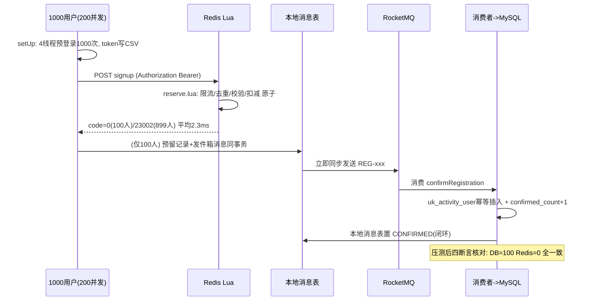

# 13 · JMeter 性能测试与优化（真实压测报告复盘）

> 学习目标：不是"会用 JMeter"，而是会**设计场景、保证负载真实性、做业务正确性核对、
> 做优化前后对比**。全部素材来自项目真实产物：
> - 脚本：`load-test/jmeter/scenario-A-grab-spots.jmx` / `scenario-B-single-user-duplicate.jmx` /
>   `scenario-F-hot-activity-view.jmx`
> - 数据准备：`scripts/prepare_loadtest.py`
> - 报告：`docs/performance/LOAD_TEST_REPORT.md`（真实执行记录，数字全部来自 .jtl 统计）
> - 原始数据：`load-test/reports/scenario-{A,B,F}.jtl` + HTML 报告

---

## 一、压测结果总览（先看真实数字）

| 场景 | 脚本 | 负载模型 | 采样 | 错误率 | 平均(ms) | P95 | P99 | 吞吐(/s) |
|---|---|---|---|---|---|---|---|---|
| A：1000 用户抢 100 名额 | scenario-A-grab-spots.jmx | setUp 1000 预登录 + 200 并发 × 5 循环突发报名 | 999 | **0%** | 2.3 | 4 | 5 | 88（含登录阶段） |
| B：单用户重复抢 | scenario-B-single-user-duplicate.jmx | 50 线程 × 20 循环 = 1000 次同一用户并发报名 | 1000 | **0%** | 3.6 | 5 | 7 | 357 |
| F：热点活动查询 | scenario-F-hot-activity-view.jmx | 200 并发 × 50 循环 = 10000 次详情查询 | 10000 | **0%** | 33.5 | 59 | 96 | **1677** |

执行环境（报告原文）：Windows 11 / JDK17 / MySQL 8.0.34 本机 / Redis 6.2.6 与 RocketMQ 4.9.4
在 VMware 虚拟机，JMeter 5.6.3 非 GUI 模式。

**面试第一步就是把这个表背下来**——它是你所有高并发回答的"证据链起点"。

## 二、场景设计思路：三个场景各测什么

### 2.1 场景 A：高并发抢名额（核心）

测的是**瞬时洪峰下系统的正确性与延迟**。两个关键设计决策：

**决策一：setUp 线程组预登录，把 BCrypt 慢哈希挡在突发之外。**
登录密码用 BCrypt 校验（故意慢，防彩虹表）。如果 1000 个登录也压进抢购瞬间，
BCrypt 的 CPU 开销会把报名链路的延迟数字完全污染——你测出来的 P99 就不知道是谁贡献的。
所以 jmx 结构是两个线程组（`TestPlan.serialize_threadgroups=true` 串行执行）：

```
setUp 线程组（4 线程 × 250 循环 = 1000 次登录）
   └─ 登录 POST /api/v1/auth/login（CSV: users.csv 用户名密码）
   └─ JSR223 后处理器：正则提取 token -> 追加写 tokens.csv
主压测线程组（${__P(threads,200)} 并发 × ${__P(loops,5)} 循环 = 1000 次报名）
   └─ CSV 读 token -> Authorization: Bearer ${token}
   └─ POST /api/v1/activities/${__P(activityId)}/registrations
```

这模拟真实业务："活动发布前的用户在线登录"与"发布瞬间的抢购"是两个时间阶段。

**决策二：不按 1000 线程硬压，按"1000 真实用户 × 200 并发分批"建模。**
报告原文："未按 1000 线程同压（避免 JMeter 客户端自身成为瓶颈造成虚假数据）"。
笔记本跑 1000 JMeter 线程，压力机先趴下，数字全废。**压测第一原则：压力机不能是瓶颈**。
补充验证：集成测试 `LuaOversellIT`（30 用户瞬时并发抢 10 名额）用 JUnit 多线程精确对齐竞态窗口。

### 2.2 场景 B：一人一单（正确性场景）

同一用户 jmeter0001 对同一活动 1000 次并发报名（1 线程登录提取 token，50 线程 × 20 循环报名）。
它验证的是三层防线在并发下的真实生效比例（应用日志统计 Lua 返回码分布）：

| Lua 返回码 | 次数 | 含义 |
|---|---|---|
| 1 预留成功 | **1** | 恰好一次成功 |
| -3 重复报名 | 7 | Lua 成员集拦截（并发窗口内） |
| -4 限流 | 992 | 用户级固定窗口限流 8 次/10s 生效 |

**面试金句**：1000 次并发报名，1 次成功、7 次 Lua 去重、992 次限流拦截，
DB 中该用户最终只有 1 条有效报名——三层防线全部生效且各有分工。

### 2.3 场景 F：热点查询（读多写少）

200 并发 × 50 循环 = 10000 次**同一活动详情**查询。测多级缓存：
Caffeine（本地 30s TTL）→ Redis（30min TTL）→ DB。结果 1677 req/s，
DB 全程 0 次活动主表查询，布隆过滤器拦截不存在 ID 的穿透路径。

## 三、JMeter 工程细节（脚本里真实的坑）

### 3.1 token 跨线程组传递：必须用全局作用域

JMeter 的 `vars`（局部变量）是**线程私有**的，setUp 线程组设置的变量，
主压测线程组读不到。两个可行方案（本项目两个都用了）：

1. **CSV 文件中转（场景 A）**：setUp 的 JSR223 后处理器把 token 追加写进
   `load-test/data/tokens.csv`，主线程组用 CSVDataSet `shareMode=All threads` 读取。
   注意脚本里写文件用了 `synchronized` 块——4 个登录线程并发追加，防止交叉写坏行；
2. **属性 props（场景 F）**：`-Jtoken=<JWT>` 从命令行注入，
   jmx 里 `Bearer ${__P(token)}` 引用。props 是 JMeter 全局的，天然跨线程组。

**真实教训**：如果只把 token 存在 `vars` 里，跨线程组必翻车（拿到 `${token}` 字面量，
请求 401）。面试讲这个细节 = 证明你真的跑过压测。

### 3.2 断言：JSR223 而不是 Response Assertion

场景 A/B 的业务断言（真实 Groovy 脚本）：

```groovy
def body = prev.getResponseDataAsString()
if (!(body =~ /"code":(0|23001|23002|23003|23004|42901)/)) {
    AssertionResult.setFailure(true)
    AssertionResult.setFailureMessage("unexpected business code: " + body.substring(0, 120))
}
```

为什么这样写：报名接口**业务上的"拒绝"不是错误**——HTTP 全部 200，
code=0 成功 / 23001 重复 / 23002 满员 / 23003 限流 / 23004 确认中 / 42901 并发防护，
这些都是合法结局。如果用简单 Response Assertion 只匹配 "code":0，
会把 899 个"满员"误报为错误。**高并发压测的错误率语义必须先定义清楚**，
这是这份压测"999 请求 0% 错误率"的含义所在。

### 3.3 非 GUI 模式 + 参数化执行

```bash
jmeter -n -t load-test/jmeter/scenario-A-grab-spots.jmx \
  -l load-test/reports/scenario-A.jtl -e -o load-test/reports/scenario-A \
  -JactivityId=<活动ID> -Jthreads=200 -Jrampup=5 -Jloops=5
```

- `-n` 非 GUI：GUI 模式的 Swing 渲染吃掉大量 CPU，数字不可信；
- `-l` 落 .jtl 原始数据，`-e -o` 生成 HTML 报告（reports/scenario-A/index.html）；
- `-J` 注入属性，同一脚本改并发数无需改文件。

### 3.4 数据准备脚本（scripts/prepare_loadtest.py）

Python 三步：生成 1000 用户 CSV（jmeter0001..1000）→ 抽样登录验证 →
组织者创建 capacity=100 活动并走完整审核发布链路（拿到活动 ID 写入
target_activity.txt）。**为什么要走真实发布链路**：活动发布（approvePublish）才会
触发 Redis 库存预热（ActivityService，@DistributedLock 内 preloadStock），
直接往 DB 插一行 activity 是抢不到名额的——Lua 里 meta 缺失直接返回 -5。

## 四、业务四断言核对（压测后的"验尸"环节）

吞吐和延迟只是表象，**正确性核对才是压测的灵魂**（报告第二节原文数据）：

```bash
# 1. DB 有效报名数（status ∈ {已报名, 已签到}）
mysql -e "SELECT COUNT(*), COUNT(DISTINCT user_id) FROM registration
          WHERE activity_id=<活动ID> AND status IN (1,2)"
# 结果：恰好 100 条，COUNT(*) = COUNT(DISTINCT user_id)（一人一条，不超卖不少卖）

# 2. Redis 剩余库存
redis-cli GET campusflow:activity:<活动ID>:stock
# 结果：0（不为负）

# 3. activity.confirmed_count（MQ 消费端事务维护）
# 结果：100，与 DB 一致（Redis 与 MySQL 最终一致）
```

四断言背后的逻辑链：Lua 扣减（快路径）→ MQ 异步落库（确认路径）→
confirmed_count 自增（对账口径）→ 库存对账定时任务（CompensationScheduler.stockReconcile
每 5 分钟漂移修复）。任何一处不一致都会被断言抓出来。

## 五、压测期间观测了什么

报告第五节（原文要点）：
- **应用 JVM**：无 GC 报警日志（默认 G1）；Tomcat 线程池 200 并发下队列稳定
  （观测手段见 09 讲的 gc 日志 + actuator metrics）；
- **RocketMQ**：999 条报名确认消息全部发送成功、消费完成
  （本地消息表 status → CONFIRMED），无堆积残留；
- **MySQL**：无慢 SQL（写库由消费者异步完成，瞬时写入被 MQ 削峰）。

**为什么场景 A 平均只有 2.3ms**：997 个报名请求走的是"Redis Lua 校验+扣减"，
完全不触碰 MySQL；只有 100 个成功的请求后续异步落库。这是
"Redis 前置挡流 + MQ 异步落库"架构在数字上的直接体现。

## 六、优化前后对比：怎么科学地做

报告第八节**如实记录**（这点本身就是最佳实践）：本轮是架构完成后的首次完整压测
（"优化后"基线），未虚构优化提升百分比；给出的对比路线：

1. **关 Redis 预热重跑场景 A**：报名改直查 DB
   `UPDATE activity SET confirmed_count=... WHERE remaining>0`，
   对比 DB 锁等待与错误率——预期看到大量超卖/锁超时，这就是 Lua 的价值量化；
2. **关 Caffeine 重跑场景 F**：对比 P95/P99——预期 33.5ms 显著上升；
3. **消费端线程 5-20 → 20-50**：观察落库吞吐变化（application.yml
   `campusflow.mq.consume-thread-min/max` 就是这两个参数）。

对比实验方法论（面试可讲）：
**一次只改一个变量；同一负载模型；同一时间窗口（机器温度/后台进程一致）；
原始数据（.jtl）归档可复算；结论写进报告。**

## 七、场景 A 时序（mermaid）



## 八、面试题

### 基础

**Q1：你的压测怎么做的？结果如何？**
参考答案：JMeter 5.6.3 非 GUI，三个场景——A：1000 真实用户抢 100 名额（setUp 预登录 + 200 并发突发），999 请求 0 错误、P99=5ms，DB 恰好 100 条不超卖、Redis 库存清 0；B：同一用户 1000 次并发报名，1 成功 7 去重 992 限流；F：10000 次热点查询吞吐 1677/s，DB 零查询。原始数据 .jtl + HTML 报告都在 load-test/reports/。

**Q2：为什么错误率是 0%？报名不是有 899 个失败吗？**
参考答案：错误率语义在脚本断言里定义：HTTP 200 且业务码属于合法集合（0/23001/23002/23003/23004/42901）即为有效响应。满员（23002）是业务正常态，前端据此引导候补。真正的"系统错误"（连接拒绝/5xx/非法业务码）才是错误——0% 的意思是系统在洪峰下没有任何一个请求出现非预期行为。

**Q3：为什么要 setUp 预登录？**
参考答案：登录走 BCrypt 慢哈希（防彩虹表的故意设计），单次几十毫秒的 CPU 开销。如果 1000 个登录混进抢购瞬间，会污染报名链路的延迟数字（分不清慢在登录还是报名）。所以用 setUp 线程组先把 1000 个 token 备好写入 CSV，主线程组只做纯报名——负载模型贴近真实（登录发生在抢购之前），数字才有归因价值。

### 中级

**Q4：怎么保证压测的负载是真实的/压力机不是瓶颈？**
参考答案：三个手段——① 压力机侧：单机并发上限评估，1000 线程会先压垮 JMeter，所以用"1000 用户 × 200 并发 × 5 循环"分批模型（报告如实记录了这个取舍）；② 被压服务侧：压测中观测 JVM GC、Tomcat 线程池、MQ 堆积、MySQL 慢 SQL，确认瓶颈不在应用进程内；③ 数据侧：1000 个真实不同账号（prepare_loadtest.py 生成并抽样验证登录），token 全部有效，避免鉴权失败干扰统计。

**Q5：压测后怎么确认系统没有"表面上成功、实际上错了"？**
参考答案：业务四断言——DB 有效报名数恰好=名额数（不超卖不少卖）；COUNT(*)=COUNT(DISTINCT user_id)（一人一条）；Redis 剩余库存=0 不为负；confirmed_count 与 DB 一致（Redis/MySQL 最终一致）。另外 MQ 侧核对本地消息表全部 CONFIRMED 无堆积。吞吐数字好看而四断言不对，等于压测白做。

**Q6：场景 B 里 992 次限流拦截，会不会掩盖"重复报名拦截"的验证？**
参考答案：不会掩盖，反而互相印证——Lua 返回码分布（1 成功/-3 重复 7 次/-4 限流 992 次）说明三层防线各有分工：固定窗口限流把洪峰削掉，成员集去重在通过限流的请求里拦截并发重复，DB 唯一约束兜底。如果只想要纯去重数据，把 rate-limit-max 调大再压即可（参数在 application.yml signup 段）。

### 高级

**Q7：如果让你优化场景 F 的 P99=96ms，你会怎么定位？**
参考答案：先分解 33.5ms 平均的固定开销（报告已指出）：拦截器/鉴权 + 浏览量 INCR + 缓存读取。方法：① actuator metrics（http.server.requests 已开 percentiles-histogram）看接口分位与各指标；② 本地缓存命中率（MultiLevelCacheService 开了 recordStats）确认命中率已经很高；③ 33ms 里网络往返占大头——200 并发下 Tomcat 队列排队、Redis INCR 往返。可做：浏览量 INCR 异步化（本地聚合后批量写 Redis）、JWT 解析结果短缓存。原则：先用数据归因，再动手，改一项压一轮。

**Q8：怎么设计"优化前"对照组？**
参考答案：报告的路线——① 关 Redis 预热，报名直查 DB 的条件更新（UPDATE ... WHERE remaining>0），预期锁等待/超卖出现，量化 Lua 的价值；② 关 Caffeine，重跑场景 F 对比 P95/P99，量化多级缓存价值；③ 调整消费端线程数观察落库吞吐。纪律：一次一个变量、同负载模型、.jtl 归档复算、只报告真实测量值（报告明确写了"不虚构优化提升百分比"——这份诚实本身就是工程素养）。

**Q9：JMeter 之外你了解哪些压测方案？什么时候换工具？**
参考答案：wrk/ab 适合单接口轻量压测（无断言生态）；Gatling 代码化场景、报告好；全链路压测（影子库/影子表）适合大厂多服务链路。本项目并发竞态场景（同一报名记录被并发取消）用 HTTP 注入不易精确构造，所以 C/D/E 场景改用 JUnit 多线程 + 真实中间件的集成测试（CancelConcurrencyIT/CompensationRecoveryIT/CheckinConcurrencyIT）——**工具选型服从场景**。

## 九、动手练习

1. **复现场景 A**：跑 `python scripts/prepare_loadtest.py` → 启动应用 → 按报告第七节命令执行场景 A，核对四断言，把你的数字与报告对比并解释差异（机器性能差异）。
2. **读懂 .jtl**：打开 `load-test/reports/scenario-A.jtl`，统计"code":23002 的样本数，验证是否约等于 899；再用 HTML 报告的 Throughput 图说明为什么总吞吐只有 88/s（含 setUp 慢登录阶段）。
3. **做一次对照实验**：把 application.yml 的 `signup.rate-limit-max` 从 8 调到 1000 重跑场景 B，对比 Lua 返回码分布变化，写下结论。
4. **关缓存对照**：临时把 MultiLevelCacheService 本地缓存 maximumSize 调为 1（模拟关缓存），重跑场景 F，对比吞吐与 P95。
5. **新增场景 G**：仿照 scenario-F 写"我的报名列表分页查询"压测（GET /api/v1/my/registrations），设计负载模型与断言，跑出基线并归档 .jtl。

---

## 十、报告数字速查卡（面试前 5 分钟过一遍）

| 记忆点 | 数字 | 出处 |
|---|---|---|
| 场景 A 采样/错误率 | 999 / 0% | 报告第一节 |
| 场景 A 平均 / P95 / P99 | 2.3ms / 4ms / 5ms | 报告第一节 |
| 场景 A 吞吐 | 88/s（含登录阶段） | 报告第一节 |
| 场景 A 业务结果 | 100 成功 / 约 899 满员拒绝（23002） | 报告第二节 |
| DB 核对 | 恰好 100 条 / COUNT=COUNT(DISTINCT) / confirmed_count=100 | 报告第二节 |
| Redis 库存 | 0（不为负） | 报告第二节 |
| 场景 B 采样/吞吐 | 1000 / 357/s | 报告第一节 |
| 场景 B Lua 分布 | 1 成功 / -3 重复 7 次 / -4 限流 992 次 | 报告第三节 |
| 场景 F 采样/吞吐 | 10000 / 1677.6/s | 报告第一节 |
| 场景 F 延迟 | 平均 33.5 / P95 59 / P99 96 | 报告第一节 |
| 场景 F 缓存行为 | DB 主表 0 次查询；Caffeine 30s + Redis 承接回源 | 报告第四节 |
| 未跑场景的替代验证 | C/D/E 用 CancelConcurrencyIT / CompensationRecoveryIT+IdempotencyIT / CheckinConcurrencyIT | 报告第六节 |

背法：**A 讲"防超卖"，B 讲"一人一单"，F 讲"多级缓存"**——每个数字都挂在一条业务线上，
不是孤立表格。

## 十一、压测常见问题排查表（实操手册）

| 现象 | 最可能原因 | 排查动作 |
|---|---|---|
| 全部 401 | token 没传递（vars 跨线程组失效 / CSV 列名不匹配） | 检查 HeaderManager 与 CSV variableNames |
| 全部 23005 报名记录不存在 | activityId 错误或活动未发布 | 看 target_activity.txt；确认 approvePublish 已执行 |
| 全部 -5（元数据缺失） | 活动未走发布链路（手工插库）导致未预热 | 用 prepare_loadtest.py 走真实发布 |
| 全部 -4 限流 | rate-limit-max 参数太小或窗口未重置 | 改 application.yml signup 段或等窗口过期 |
| 错误率非 0（非 23002 类） | 断言集合漏了新业务码 / 服务异常 | 看响应体 code 与应用 error 日志 |
| 吞吐远低于预期 | 压力机瓶颈 / 连接未复用 / 200 并发排队 | 观察 JMeter 客户端 CPU；确认 keepalive |
| 四断言不一致 | 消费端故障或对账未收敛 | 查 message_deliver 未 CONFIRMED 记录 + compensation_task |
| HTML 报告生成失败 | -o 目录非空 | 清空 reports 目录重跑 |

排查表的价值：面试时说"我压测时踩过 X 坑，用 Y 方法定位"比"我压测过"可信十倍。

## 十二、从压测到答辩：一条完整的叙述链

把所有素材串成面试可复述的故事（约 90 秒版本）：

1. **背景**：活动报名是突发热点写（1000 人抢 100 名额）；
2. **建模**：三场景——A 防超卖、B 一人一单、F 热点读；负载模型"真实用户 × 有限并发"，
   压力机不越界（报告如实记录 200 并发取舍）；
3. **架构**：Lua 原子预留挡流（输家不碰 DB）→ MQ 异步落库削峰 → 唯一约束最终防线 →
   对账兜底；
4. **数字**：A 999/0%/P99=5ms、DB 恰好 100 条；B 1/7/992 三层防线分布；
   F 1677/s DB 零查询；
5. **诚实**：C/D/E 正确性场景用 JUnit 多线程验证（竞态用 HTTP 注入不易精确构造）；
   本轮是"优化后"基线，不虚构提升百分比，但给出三条对照实验路线；
6. **延伸**：如需继续优化，先归因再动手（浏览量 INCR 异步化 / 消费线程对照实验）。

这段叙述链覆盖了"场景设计-工程细节-结果-诚实性-延伸"五个维度，
是答辩和简历面试共用的话术骨架。

---

## 十三、脚本资产清单（load-test/ 目录导航）

| 资产 | 内容 |
|---|---|
| jmeter/scenario-A-grab-spots.jmx | 场景 A 双线程组（setUp 预登录 + 200 并发报名），JSR223 断言 |
| jmeter/scenario-B-single-user-duplicate.jmx | 场景 B（登录提取 token + 50×20 同用户并发） |
| jmeter/scenario-F-hot-activity-view.jmx | 场景 F（-Jtoken 属性注入 + 200×50 热点查询） |
| data/users.csv | 1000 压测账号（jmeter0001..1000，prepare_loadtest.py 生成） |
| data/tokens.csv | 场景 A 的 token 中转文件（setUp 写入，主线程组读取） |
| data/target_activity.txt | 目标活动 ID（发布链路产出） |
| reports/scenario-{A,B,F}.jtl | 原始采样数据（所有数字的出处） |
| reports/scenario-{A,B,F}/index.html | JMeter HTML 可视化报告 |
| scripts/prepare_loadtest.py | 数据准备：CSV 生成 + 抽样登录验证 + 真实发布链路 |

---
> 下一篇：14_项目面试题与参考回答.md —— 把以上所有内容收拢成 30+ 道可直接背的问答。
