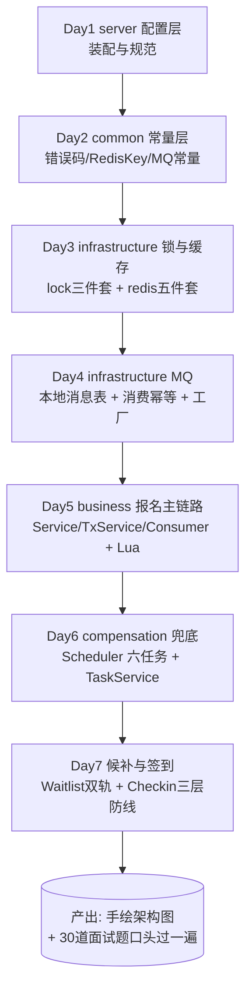

# 15 · 项目源码阅读路线（7 天施工图）

> 目标：不是"看过"，而是**每读完一个阶段，能回答对应问题、能动手验证**。
> 阅读顺序 = 依赖顺序：配置层（怎么装配）→ 基础设施（有哪些武器）→ 业务主链路（怎么打）
> → 补偿兜底（怎么收尾）。每天 2-4 小时，读完写"理解清单 + 验证记录"。
>
> 代码根目录：`backend/`，包名前缀 `com.campusflow`。
> 建议配合 IDE 的"调用层次（Call Hierarchy）"从 Controller 入口向下钻。

---

## 阅读总图（先建立地图）

---

## Day 1 · server 配置层：一个请求是怎么进来的

**读什么文件**（按此顺序）：
1. `backend/campusflow-server/src/main/resources/application.yml`（全局参数：限流/预留 TTL/MQ/缓存）
2. `application-local.yml`（环境差异如何注入；文末 JVM 参数建议）
3. `backend/campusflow-server/src/main/java/com/campusflow/server/config/`
   - `TraceIdFilter.java` → `WebMvcConfig.java`（拦截器注册与放行路径）→
     `JwtAuthInterceptor.java` → `GlobalExceptionHandler.java` → `JacksonConfig.java`
4. `backend/campusflow-server/src/main/resources/logback-spring.xml`
5. `backend/campusflow-server/src/main/java/com/campusflow/server/CampusflowApplication.java`

**理解什么问题**：
- Filter 与 Interceptor 各自解决什么（协议层 vs MVC 层）？为什么 TraceId 用 Filter？
- MDC / AuthContext 都是 ThreadLocal，谁负责清理？不清理会怎样？
- JacksonConfig 为什么要 Long→String？（雪花 ID 与 JS Number 2^53）
- 500 响应为什么不返回堆栈？错误码分段（0/2xxxx/3xxxx/4xxxx）怎么划分？

**动手验证什么**：
- 启动应用，登录拿 token，`curl -i` 观察 `X-Trace-Id` 响应头；
- 故意传错参数，确认返回 40001 + 字段明细；把 traceId 在 `logs/campusflow.log` 里 grep 出来；
- 临时注释 JacksonConfig 重启，浏览器控制台看报名记录 id 的精度变化（做完恢复）。

---

## Day 2 · common 常量层：项目的"宪法"

**读什么文件**（全部在 `backend/campusflow-common/src/main/java/com/campusflow/common/`）：
1. `error/ErrorCode.java`（全文过一遍，记住分段规则和关键码：23002 满员/23003 限流/42901 并发防护）
2. `exception/BizException.java`、`result/ApiResult.java`、`result/PageResult.java`
3. `constant/RedisKeyConstants.java`（**重点**：每个 Key 的数据结构 + TTL 策略注释）
4. `constant/MqConstants.java`（Topic/Tag/Group 命名 + 广播 Topic 单独列出）
5. `enums/RegistrationStatus.java`（状态机 + occupiesStock/canCancel 语义方法）
6. `util/SnowflakeIdWorker.java`（时钟回拨 MAX_BACKWARD_MS=5 的处理）+ `util/TraceUtils.java`

**理解什么问题**：
- 为什么 Redis Key 必须集中在常量类？"TTL 策略统一在注释中标注"防什么？
- RegistrationStatus.occupiesStock() 为什么是 RESERVED/CONFIRMED/CHECKED_IN 三个？
- 雪花算法回拨为什么"小幅等待、大幅拒绝"？

**动手验证什么**：
- `redis-cli KEYS 'campusflow:*'` 对照 RedisKeyConstants 逐个说出用途和 TTL；
- 写一个 3 行 main 调 `SnowflakeIdWorker.nextId()` 连打 5000 个，观察同毫秒序列递增；
- 手绘 RegistrationStatus 状态机图（后面 Day5 会用上）。

---

## Day 3 · infrastructure（上）：锁、缓存、限流、布隆

**读什么文件**（`backend/campusflow-infrastructure/src/main/java/com/campusflow/infra/`）：
1. `lock/DistributedLock.java` → `lock/DistributedLockAspect.java` → `lock/RedissonLockService.java`
   （注解式 + 编程式两种形态；SpEL key；isHeldByCurrentThread 校验）
2. `config/RedissonConfig.java`（为什么手动装配不用 starter；两参 tryLock = 看门狗）
3. `config/ThreadPoolConfig.java`（三个池七参数 + 拒绝策略选型注释）
4. `redis/StockRedisService.java`（预热内容设计：stock/meta/members 三 Key + TTL=活动结束+7天）
5. `redis/MultiLevelCacheService.java`（L1 Caffeine/L2 Redis/回源/空值占位/广播失效入口）
6. `redis/BloomFilterService.java`、`redis/RateLimiterService.java`
7. `config/RedisConfig.java`（序列化策略）

**理解什么问题**：
- 看门狗的两参 tryLock 触发条件？显式 leaseTime 的代价？
- 预热为什么分 stock/meta/members 三个 Key？哪些内容"不适合缓存"（类注释有答案：大文本）？
- 空值占位为什么 TTL 只有 60s？广播 evictLocal 为什么只失效本地？

**动手验证什么**：
- 写一个测试方法打 `@DistributedLock(key = "'demo:' + #id")`，两线程并发跑看互斥日志；
- `redis-cli TTL campusflow:activity:1:stock` 看剩余 TTL，倒推活动结束时间+7 天规则；
- 布隆：`mightContainActivity` 对一个不存在的 id 调用，观察 false 概率（多试几个）。

---

## Day 4 · infrastructure（下）：MQ 可靠投递体系

**读什么文件**（`.../infra/mq/`）：
1. `MessageDeliverService.java`（**本日核心**：事务内建记录 → 同步发送 → 指数退避 → confirmConsumed 闭环）
2. `MessageConsumeLogService.java`（tryBeginConsume 三层幂等，逐行读注释）
3. `MqConsumerFactory.java`（消费组后缀隔离 groupSuffix、广播模式、线程数、consumeTimeout）
4. `MqProducerConfig.java`（producer 装配与 send-retry-times）
5. `CacheEvictConsumer.java`（BROADCASTING 广播失效本地缓存；失败不重投的取舍）
6. `MessageDeliverDO.java` / `MessageConsumeLogDO.java`（状态字段与唯一键）

**理解什么问题**：
- 本地消息表 vs RocketMQ 事务消息的取舍（类注释原文就是答案）；
- 消费确认返回什么才算成功？RECONSUME_LATER 之后发生什么？上限之后发生什么？
- "投递-消费闭环"是怎么把 message_deliver.status 推到 CONFIRMED 的？

**动手验证什么**：
- 打开 MySQL `SELECT msg_key,status,retry_count FROM message_deliver ORDER BY id DESC LIMIT 10;`
  观察一次报名后记录的状态流转 NEW→SENT→CONFIRMED；
- 临时停掉 RocketMQ（或改错 name-server）再报名，观察 FAILED + next_retry_time 退避，
  恢复 MQ 后由 messageRetry 任务自动重投（等 15s 扫描周期）。

---

## Day 5 · business 报名主链路（最重要的 200 行）

**读什么文件**（`backend/campusflow-business/src/main/java/com/campusflow/biz/`）：
1. `registration/controller/RegistrationController.java`（入口：POST /activities/{id}/registrations）
2. `registration/service/RegistrationService.java`（**编排层，非事务**：signup/cancel/doPersistReservation）
3. `registration/service/RegistrationTxService.java`（**事务层**：persistReservation / confirmRegistration / cancelRegistration / releaseReservation，类注释逐行读）
4. `backend/campusflow-infrastructure/src/main/resources/lua/reserve.lua`（返回码 1/0/-1..-5 每个分支）
5. `registration/listener/RegistrationConfirmConsumer.java`（消费入口 + handleFailure 转补偿）
6. `activity/service/ActivityService.java` 的 `approvePublish/warmupStockIfNeeded/adjustCapacityInternal`（预热三场景）
7. 对照测试：`campusflow-server/src/test/java/com/campusflow/server/it/LuaOversellIT.java`

**理解什么问题**：
- 为什么编排层（Service）与事务层（TxService）要拆开？（自调用代理失效 + 边界清晰）
- META_MISSING 的自愈路径怎么走？（懒预热重试一次，再失败转 500 业务提示）
- confirmRegistration 幂等的三层：唯一约束 / 状态 CAS / 消费幂等表，各自拦截什么场景？
- 活动取消时消费端为什么"走释放补偿 + 业务性拒绝"？（RegistrationConfirmConsumer 的 BizException 分支）

**动手验证什么**：
- 跑 `mvn -pl backend/campusflow-server test -Dtest=LuaOversellIT`，
  结合断言（30 抢 10 恰好 10 条）复述每条断言对应哪层防线；
- 把 reserve.lua 的 `DECR` 改成先 `DECR` 后判负数（人为引入竞态），跑 IT 看是否仍不超卖
  （思考：为什么仍不超卖？SISMEMBER/库存判负在哪里兜住？），改回来。

---

## Day 6 · compensation 兜底体系（面试"如果 Redis/Redisson 挂了"的底气）

**读什么文件**（`backend/campusflow-business/src/main/java/com/campusflow/biz/compensation/`）：
1. `scheduler/CompensationScheduler.java`（**六任务全读**：频率、锁 Key、幂等依据逐个标注）
2. `service/CompensationTaskService.java`（bizKey 幂等创建 + processDueTasks）
3. `entity/CompensationTaskDO.java`（状态与 maxRetry）
4. `registration/listener/CancelReleaseConsumer.java`（取消释放消息的消费兜底）
5. `audit/StockAuditService.java`（bizKey 幂等记账）

**理解什么问题**：
- 六个任务各自兜什么故障？（消息发送失败/消费失败/预留超时/候补超时/库存漂移/活动状态滞留）
- 预留恢复任务的三分支（已确认→修复预留状态 / 重发消息 / 超上限→幂等释放+通知）；
- 为什么所有任务都要 lockService.tryRun？锁抢不到为什么不重试？

**动手验证什么**：
- 手工把一条 message_deliver 置回 FAILED、next_retry_time 置为过去，等 messageRetry 扫描重投；
- `SELECT * FROM compensation_task;` 了解 payload 与 bizKey 格式；
- 写一段笔记：**"三个兜底时间线"**——15s（消息重投）/20s（预留恢复）/5min（库存对账）。

---

## Day 7 · 候补与签到 + 全项目收束

**读什么文件**：
1. `waitlist/service/WaitlistService.java`（join 的 ZADD NX + DB 兜底；confirm 复用报名链路）
2. `waitlist/service/WaitlistPromoteService.java`（锁内 promoteLoop；DB 失败回滚 Redis 继续下一位）
3. `waitlist/listener/WaitlistPromoteConsumer.java`、`config/WaitlistWiringConfig.java`（循环依赖解法）
4. `checkin/service/CheckinService.java`（issueToken/scan 三层防线；SHA-256 摘要存证）
5. `checkin/listener/CheckinConsumer.java`
6. 对照测试：`CheckinConcurrencyIT.java`、`CancelConcurrencyIT.java`、`IdempotencyIT.java`、`CompensationRecoveryIT.java`

**理解什么问题**：
- 候补为什么"Redis ZSet 权威 + DB 持久化"双轨？各自负责什么？
- 晋级出队后 DB 写失败怎么办？（回滚 Redis 服务，继续下一位；预留 TTL 兜底）
- 候补 confirm 为什么复用 doPersistReservation 而不是另写一条链路？
- 签到三层防线分别在什么条件下生效？

**动手验证什么**：
- 跑全部 6 个 IT：`mvn -pl backend/campusflow-server test`，记录通过结果；
- 全链路串讲测试：对着 `scripts/e2e_api_test.py` 的用例清单，口头复述每一步走过了 Day1-Day7 的哪些类；
- 产出最终交付物：**一张手绘总架构图**（请求→Lua→本地消息表→MQ→消费→DB→对账→候补→签到）
  + 把 `docs/learning/14_项目面试题与参考回答.md` 的 36 题口头过一遍。

---

## 各阶段自检清单（读完全部打勾才算完成）

| 阶段 | 自检问题（能脱口而出即通过） |
|---|---|
| Day1 | 一个请求从进入 Tomcat 到返回 ApiResult 经过哪些组件？ |
| Day2 | 23002 和 42901 分别是谁返回的？Redis 里有哪些 Key？ |
| Day3 | @DistributedLock 的看门狗怎么触发？SpEL key 解析失败会怎样？ |
| Day4 | 一条消息从产生到 CONFIRMED 经过几个状态？ |
| Day5 | 报名成功到 DB 确认之间，系统崩溃会在哪几个点？各由谁兜底？ |
| Day6 | 六个补偿任务的频率和幂等依据？ |
| Day7 | 候补晋级同时有两个实例触发，最多有几个用户被"双重服务"？为什么？ |

## 阅读技巧（适用于任何项目）

1. **入口驱动**：从 Controller 注解的 URL 找入口，Call Hierarchy 一路向下，不要按文件名字母序读；
2. **注释优先**：本项目注释密度极高（设计动机/取舍都在注释里），先读类注释再读方法体；
3. **跑测试即读文档**：`campusflow-server/src/test/java/com/campusflow/server/it/` 的 6 个 IT
   是"可执行的需求文档"，断言就是设计目标；
4. **改动验证**：每阶段做一次"小改动 + 跑测试"，比纯读快 3 倍。

---

## 附录 A · 文件 → 知识点对照表（按面试考点反查源码）

| 面试考点 | 核心文件 | 必读行/段落 |
|---|---|---|
| 超卖防线 | `lua/reserve.lua` | 头注释"为什么不用 GET+DECR" + 第 5 步库存扣减 |
| 一人一单三层防线 | `RegistrationTxService.confirmRegistration` | DuplicateKeyException 幂等分支 |
| 本地消息表 | `infra/mq/MessageDeliverService.java` | 类注释 + trySendDeliver/handleSendFail |
| 消费幂等三层 | `infra/mq/MessageConsumeLogService.java` | tryBeginConsume 全文 + 三层注释 |
| 死信转补偿 | `biz/registration/listener/RegistrationConfirmConsumer.java` | handleFailure 静态方法 |
| 看门狗 | `infra/lock/DistributedLockAspect.java` | leaseTimeMillis<=0 分支 + 类注释三防护 |
| 定时任务防重 | `biz/compensation/scheduler/CompensationScheduler.java` | 每个任务的 lockService.tryRun |
| 库存对账 | `CompensationScheduler.doStockReconcile` | DB 权威口径 + 审计 bizKey |
| 候补出队原子性 | `lua/waitlist_serve.lua` | ZPOPMIN + DECR + SADD + SET |
| 候补回滚跳过 | `WaitlistPromoteService.promoteLoop` | waitlistOpt.isEmpty 与 affected==0 两分支 |
| 签到三层防线 | `CheckinService.scan` | 类注释 + SETNX/CAS/唯一约束代码 |
| 凭证防伪 | `CheckinService.issueToken/buildTokenVO` | SHA-256 摘要 + 明文一次性 |
| TraceId 链路 | `server/config/TraceIdFilter.java` | finally MDC.remove 注释 |
| 多级缓存 | `infra/redis/MultiLevelCacheService.java` | get 回源 + evictLocal 广播入口 |
| 缓存广播 | `infra/mq/CacheEvictConsumer.java` | BROADCASTING + 失败不重投取舍 |
| 布隆过滤器 | `infra/redis/BloomFilterService.java` | 类注释三特点 + rebuild |
| 雪花时钟回拨 | `common/util/SnowflakeIdWorker.java` | MAX_BACKWARD_MS=5 分支 |
| Long 精度 | `server/config/JacksonConfig.java` | 注释（...593 -> ...600 案例） |
| 事务边界 | `RegistrationTxService` 类注释 | "均带 @Transactional 且被外部类调用" |
| 线程池治理 | `infra/config/ThreadPoolConfig.java` | 三池选型注释 + CallerRuns/Abort |
| 分片路由 | `it/ShardingSphereShardingIT.java` | 五个测试方法 + 内嵌 YAML |
| 分片启动隔离 | `application-sharding.yml` | ShardingSphereDriver + flyway=false |
| 压测证据 | `docs/performance/LOAD_TEST_REPORT.md` | 第一节表格 + 第二节四断言 |
| 环境隔离 | `application-docker.yml` / `application-local.yml` | 服务名互访 + 环境变量兜底 |

## 附录 B · 阅读时的"三个提问模板"

读任何一段代码前，先带着这三个问题，读完必须能回答：

1. **这段代码防的是什么故障？**
   （每段防御性代码都对应一个故障场景：并发重复、消息丢失、中间件宕机、状态滞留……
   说不清防什么，就等于没读懂。例：tryBeginConsume 防"Broker 对同键消息不去重"。）
2. **如果这一行失败，系统会怎样？**
   （顺着失败往下想：谁兜底？用户看到什么？数据会不会错？
   例：trySendDeliver 失败 → markFailed + 退避 → 15s 扫描重投，用户无感。）
3. **这段代码的"反面写法"是什么？**
   （想象删掉这段防御会发生什么真实事故：删掉 SISMEMBER → DB 唯一约束仍兜底但洪峰
   全打 DB；删掉对账 → Redis/DB 漂移永不收敛。反面写法 = 面试官最爱问的"为什么"。）

## 附录 C · 一周极简版（时间紧张时的最小路线）

只有 3 天时间时，按此顺序保命（覆盖约 80% 面试考点）：

- **Day A**：`reserve.lua` + `StockRedisService` + `RegistrationService/RegistrationTxService`
  + `LuaOversellIT` → 吃透超卖/幂等/状态机；
- **Day B**：`MessageDeliverService` + `MessageConsumeLogService` + `RegistrationConfirmConsumer`
  + `CompensationScheduler` → 吃透消息可靠性/补偿/对账；
- **Day C**：`DistributedLockAspect` + `WaitlistPromoteService` + `CheckinService`
  + 压测报告 → 吃透锁/候补/签到/数字。

---

## 附录 D · 与 30 天学习计划（daily/）的映射

| 源码路线 | 对应每日任务 | 差异说明 |
|---|---|---|
| Day1 server 配置层 | daily day04-05 | daily 版多了装配与请求生命周期实验 |
| Day2 common 常量层 | daily day03（表）+ day01 | 状态机在 day03 优先于常量 |
| Day3 infrastructure 上 | daily day10-11（缓存）+ day20（锁） | 拆成两天，配实验更多 |
| Day4 infrastructure 下（MQ） | daily day14-15 | 消费幂等单独一天 |
| Day5 报名主链路 | daily day12-13 | Lua 单独一天逐行精读 |
| Day6 compensation | daily day16 | 补偿+阶段四收网 |
| Day7 候补与签到 | daily day17-19 | 拆三天，含 IT 全绿验证 |
| 锁一致性 | daily day20-22 | 看门狗/Redis HA/对账专题 |
| JUC | daily day23-24 | 10 个 lab 全跑通 |
| JVM | daily day25-26 | 10 个实验 + 脚本实操 |

**使用关系**：本文件是"7 天快速路线"（时间紧用）；daily/ 是"30 天完整计划"
（校招复习主用）。两者读的是同一批文件，daily 版在每个阶段加了实验与自测。

## 附录 E · 读源码的姿势自查（10 条纪律）

1. 每个类先读类头注释再读方法——本项目设计动机全在注释；
2. 从 Controller/消费者入口进入，用 Call Hierarchy 钻取，不按文件名字母序；
3. 遇到"防御性代码"必问"防什么故障"（附录 B 提问模板）；
4. 遇到常量/枚举先全读一遍（RedisKeyConstants/ErrorCode/RegistrationStatus）；
5. 每读完一个域，画一张时序图（报名/取消/晋级/签到四张）；
6. 测试类是"可执行的需求文档"，读实现前先读对应 IT 的断言；
7. 改一行跑一次测试，验证理解（day13 的 Lua 竞态实验是范例）；
8. 不懂的 JDK API 立即查（HexFormat/records/switch 表达式），不留模糊区；
9. 把"我以前会这么写"与"项目这么写"的差异记下来——这就是进步清单；
10. 读完产出三样：架构图、四张时序图、36 题口头过关——不以输出为终点的阅读是无效阅读。

---
> 下一篇：16_项目进阶改造练习.md —— 读完源码后，用 12 个改造题把项目变成自己的。
